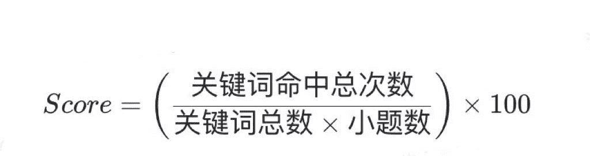

# 【已结束】金融行业 · 大模型挑战赛（20万）

> 来源：[https://ai.feishu.cn/docx/LeljdJ009oSJ75x3FEmcBJKcngd](https://ai.feishu.cn/docx/LeljdJ009oSJ75x3FEmcBJKcngd)

比赛平台：`https://competitions.zhipuai.cn/match`

欢迎参加「2024金融行业·大模型挑战赛」。

随着近年大模型应用的突破和发展，大语言模型（LLM）已经在金融领域展现出显著成效。为了进一步促进大模型在金融领域的广泛应用，赛方使用市面上所有公开的金融相关数据，构建了一个贴合金融实际场景的多轮问答测评赛题【金融多轮问答数据集】。比赛将提供所有相关的基础数据表。选手可以使用包括但不限于代理方法（agentic）、文本到API（text2api）、文本到SQL（text2sql）、信息检索等技术手段来完成题目。

赛题包含中文测试集及英文测试集，选手可任选一版提升优化。

> 主办单位：清华大学基础模型研究中心

> 支持单位：智谱、博时基金、安硕信息、恒生聚源

> 社区支持：魔搭社区，WaytoAGI，ZLead硅谷委员会，Huggingface

> 模型支持：Bigmodel.cn

> 数据支持：恒生聚源、安硕信息、博时基金

> 奖金支持：20万

# 赛程赛制

以下所有时间点为北京时间（GMT+8）

请注意，报名时间以外的其他时间点可能会有变动，请参赛者密切关注本网站和邮件通知。

## 一、报名组队与实名认证：2024年12月3日至2025年2月6日

1. 报名：在清竞比赛平台完成注册。未在平台报名者将视为无效参赛。

2. 参赛形式：可单人或组队参赛，每队最多三人。每位选手仅限加入一支队伍。

3. 报名信息：确保信息准确有效，否则组委会可取消参赛资格及奖励。

4. 报名截止：2月6日24:00前完成报名、组队变更等操作。

5. 实名认证：比赛复赛结束之前，需在清竞比赛平台完成实名认证，否则将无法参与领奖。

大赛官方交流群：


## 二、初赛阶段（2024年12月3日至2025年2月10日）

1. 报名成功的参赛队伍将通过指定平台使用大模型API，在本地调试算法后在线提交结果。初赛分为 A 榜（2024年12月2日至2025年2月6日）和B 榜（2025年2月7日至2025年2月10日）。初赛成绩由 A 榜（30%）和B 榜（70%）成绩加权得出。

+ A 榜期间，系统每天提供3次提交机会，实时评测并返回成绩。排行榜每小时更新，按评测指标排序，展示历史最优成绩。A 榜最后一次评测截止时间为2025年2月6日18:00。

+ B 榜期间，评测标准与 A 榜相同，但赛题难度有所变化。B 榜最后一次评测截止时间为2025年2月10日18:00。

2. 初赛淘汰与复赛晋级代码审核：2025年2月11日-2025年2月16日

+ 未产出成绩的队伍复赛资格。

+ 前50名的参赛队伍将晋级复赛，最终将结合选手具体方案决定，复赛名单于2025年2月16日公布。

3. 参赛队伍可以使用除承办方提供的训练数据外的其他标注数据。若对数据使用有疑问，请邮件联系组委会：wei.jia@zhipuai.cn。

## 三、复赛阶段（2025年2月17日至2025年3月9日）

1. 晋级参赛队伍将通过指定平台使用大模型API，在本地调试算法后在线提交结果。复赛同样分为 A 榜（2025年2月17日至2025年3月6日）和B 榜（2025年3月7日至2025年3月9日）。复赛成绩由 A 榜（30%）和B 榜（70%）成绩加权得出。

+ A 榜期间，系统每天提供3次提交机会，实时评测并返回成绩。排行榜每小时更新，按评测指标排序，并显示队伍所在赛区。A 榜最后一次评测截止时间为2025年3月6日18:00。

+ B 榜期间，评测标准与 A 榜相同，但赛题将进行调整。B榜最后一次评测截止时间为2025年3月9日18:00。

2. 复赛淘汰与决赛晋级审核：2025年3月10日

+ 复赛阶段排名前 15 的队伍将晋级决赛答辩环节。组委会将对代码进行审核，审核不通过的队伍将被取消答辩资格，晋级名额将依据排行榜顺延。

3. 参赛队伍可以使用除承办方提供的训练数据外的其他标注数据。若对数据使用有疑问，请邮件联系组委会：wei.jia@zhipuai.cn。

## 四、决赛答辩（暂定2025年3月，具体时间待通知）

1. 决赛将以线下或线上答辩形式进行。晋级队伍需准备答辩材料，包括答辩PPT、参赛总结和核心代码。

2. 晋级团队需提交答辩PPT初稿，提交时间将另行通知。组委会将审核并提供修改建议，随后团队需提交终稿。答辩的具体时间和地点将另行通知。

3. 答辩流程包括15分钟的队伍陈述和10分钟的评委问答。评委将根据技术思路、理论深度和答辩表现进行评分。

4. 决赛分数由复赛成绩（占60%）和答辩成绩（占40%）加权得出。主办方将根据决赛分数颁发奖项。

# 奖项及奖励

## 比赛奖金

本次大赛奖金总额为20万元人民币。具体奖金分布如下（所有奖金均为税前）：

+ 冠军（1名）：60000元人民币现金奖金，颁发获奖证书。

+ 亚军（2名）：30000元人民币现金奖金，颁发获奖证书。

+ 季军（5名）：10000元人民币现金奖金，颁发获奖证书。

+ baseline奖励（15名）：2000元人民币现金奖金。

+ 分享奖励：我们鼓励参赛选手分享比赛心得到社交媒体和专业论坛，如知乎、📕、即刻、🛰️推文等。针对每份有效分享（需包含至少100字的使用体验描述，并带上 #2024金融大模型挑战赛 #清竞比赛平台 等话题）将赢得1000万智谱开放平台通用模型API（有效期为1个月）。

+ 内推机会：优秀选手将获得智谱等赛事组织方的内推机会。

+ 周边奖励：赛方还准备了一系列丰富的周边奖品，包括机械键盘、双肩包、鼠标垫、马克杯、雨伞、文化衫等，随机抽奖赠送。

# 数据介绍

## 基础数据准备

本次赛题使用的数据均由恒生聚源提供，使用该数据进行学术引用时，请注明数据来源为恒生聚源。数据主要分为两大类：结构化数据和非结构化数据。

考虑到赛题的难度，赛方使用了恒生聚源处理的非结构化数据转半结构化数据供选手使用。

## 注意事项

1. 本次数据仅限比赛期间使用，比赛结束后请妥善删除相关数据。

2. 禁止对数据进行二次开源、传播或任何形式的商业化使用（包括但不限于转发、盈利等行为）。如需进一步使用或获取数据授权，请联系恒生聚源基财营销中心王晓培（邮箱：wangxp22189@hundsun.com）。

3. 若需进行学术引用，需事先取得恒生聚源的书面同意，并在引用中明确标明数据来源为恒生聚源。

结构化数据包括以下几部分：

+ A股上市公司数据：涵盖500家A股公司（2019-2021年），包括公司基本资料（如`LC_StockArchives`），公司名称变更（`LC_NameChange`），以及公司业务信息（`LC_Business`）。

+ 股东及股权信息：包括股东类型分类（`LC_SHTypeClassifi`）、股东名单（`LC_MainSHListNew`）、公司实际控制人（`LC_ActualController`）等信息，涉及股东持股统计、股权变动、股权冻结与质押等内容。

+ 公司财务与经营状况：包括资产负债表（`LC_BalanceSheetAll`）、利润表（`LC_IncomeStatementAll`）、现金流量表（`LC_CashFlowStatementAll`）、主营业务构成（`LC_MainOperIncome`）以及审计意见（`LC_AuditOpinion`）。

+ 行业及概念板块：包含行业分类（`LC_ExgIndustry`）、行业估值指标（`LC_IndustryValuation`）、行业财务指标（`LC_IndFinIndicators`）及概念板块信息（`LC_COConcept`）。

+ 股票市场数据：如A股交易数据（日行情表`QT_DailyQuote`）、股票技术指标（`CS_TurnoverVolTecIndex`）及停牌复牌信息（`LC_SuspendResumption`）。

+ 基金数据：涉及管理人前10家，每家50只基金（2019-2021年），包括基金概况（`MF_FundArchives`）、基金管理人信息（`MF_InvestAdvisorOutline`）及基金分红（`MF_Dividend`）。

+ 港股和美股数据：涵盖20家港股公司及20家美股公司（2019-2021年），包括公司概况、员工数量变动、日行情等信息。

+ 指数数据：包含沪深三百、中证500、中证1000、创业板指数、上证指数的基本情况（`LC_IndexBasicInfo`）及其成份（`LC_IndexComponent`）。

+ 舆情数据：针对500家A股公司（2019-2021年）的舆情信息（`PS_NewsSecurity`），以及相关事件体系指引（`PS_EventStru`）。

非结构化数据主要涉及：

+ 报告：年度报告、季度报告等公司财务报告。

+ 公告：董事会公告、监事会公告、股东大会公告等。

+ 上市资料：如招股说明书等公司上市相关文件。

# 赛题内容

## 1. 评测任务概述

本次比赛要求参赛选手以大模型API制作一个问答系统，回答用户的金融相关的问题。

本赛题为多轮问答，包含中英双语。

参赛者需要利用API和赛题提供的金融数据，并以此为基础创建信息问答系统。本次比赛评估模型能力的赛题按照涉及模型的能力和复杂程度大体分为初级、中级、高级三种类型，每种类型的题目拥有不同的分值：

初级：数据基本查询（30分）

通过SQL或API等方式可查询结果，如：某公司（或某股票代码）2022年11月2日的涨跌幅为？等问题。

中级：数据统计分析查询（40分）

在初级阶段的基础上，使用基础数据完成金融数据的统计分析、关联指标查询、公式计算等，如：MACD 即将金叉，中小板，近半年涨停次数超过10次的股票有多少家？分别是？等问题。

高级：复杂问题（30分）

股价回测、财务分析等，如：每年的4月叠加上市公司年报和一季报。理论上，新闻频次会达到了一年最高。你帮我验证下，2021年在A股有多少比例的上市公司符合这个假设?

## 2. 评测方式

### 2.1 初赛阶段

选手报名成功后，参赛队伍通过平台下载数据，并在本地调试算法。然后，参赛队伍在线提交结果。在初赛期间，赛事主办方会提供金融数据查询的API供选手使用和测试数据集供选手评估模型效果。参赛选手可以手动提交评估结果文件，系统会实时评估并返回成绩。排行榜每小时更新一次，按照评估指标从高到低进行排序。每个队伍每天的提交次数限制为3次。排行榜将展示参赛队伍在初赛阶段的历史最佳成绩进行排名。为了确保比赛的公平和公正，参赛选手需要在初赛截止日期之前提交结果文件。赛事主办方将核实问答结果的可复现性，并对通过验证的选手进入复赛。如果有队伍未在初赛期间进行提交或未提交结果文件，则他们的复赛提交将被视为无效。

### 提交物

初赛阶段，参赛队伍本地调试算法，在清竞比赛平台在线提交结果，结果文件命名为`参赛队名称_result`，以utf-8编码格式保存。文件格式见`submit_example.jsonl`。

### 2.2 复赛阶段

在复赛阶段，比赛组织方将使用测试集评估参赛选手提供的镜像文件中的算法模型的性能，以确定算法的优劣并进行排名。复赛阶段的测试数据集文件规范与初赛阶段保持一致。

复赛结束后，参赛队伍需要提交相关代码，模型的镜像文件和说明文档（具体要求请参见规则章节）。赛题组织方将审核优胜参赛队伍的代码，要求代码符合比赛主题和相关规范。对于未提交或审核不通过的队伍，将取消其决赛资格和比赛奖励，并通知递补选手。最终的队伍排名将根据复赛成绩计算，并在官方完成代码审核后公布榜单。

### 提交物

复赛阶段，参赛队伍本地调试算法，在清竞比赛平台在线提交结果，结果文件为`docker`镜像文件和说明文档，命名为`参赛队伍名称_result`。文件包含模型权重文件，模型配置文件，模型预测脚本，如果需要向量引擎，知识文件等，需要一并打包提交。

## 3. 数据说明

评测任务的任务形式为：给定一组参考文档和问题，要求模型按照指定格式生成答案。问题包含多种类型。

问题及答案示例：

```
[
    {
        "question_id": "1111111-1111111",
        "question": "安硕信息的股票代码是？",
        "answer": "300380"
    },
    {
        "question_id": "1111111-2222222",
        "question": "该公司9月是否涨停？涨停次数为多少次？分别是哪几天？",
        "answer": "涨停次数为2次，分别是2024年9月27日及2024年9月30日"
    },
    {
        "question_id": "1111111-3333333",
        "question": "涨停原因分别是？",
        "answer": "2次涨停原因均为【金融科技+银行+华为+国产软件】"
    },
    {
        "question_id": "1111111-4444444",
        "question": "前十大股东中是否有投资基金参与？如果有的话，是哪家？",
        "answer": "中国工商银行股份有限公司－大成中证360互联网+大数据100指数型证券投资基金"
    }
]
```

## 4. 评测指标

赛事主办方会根据选手提供的回答与参考答案（answer）进行对比，并根据关键字段命中情况进行评分。

评分公式截图👇



评分公式如下：

参数说明：

+ 关键词命中总次数（Number of keylist hits）：表示在题目中命中 `keylist` 中元素的总次数（包括多小题）。

+ 关键词总数（Number of keylist items）表示 `keylist` 中定义的关键字段总数。

+ 小题数（Subquestions per question）：每个题目包含的小题数量（例如，每题包含 3 小题）。

+ 得分（Score）：表示最终得分。结果完全正确的回答得满分 1 分，部分正确则根据命中比例计算得分。

示例问题（1道题目，含4个小题）

以下是一组包含多个小题的多轮对话题目：

组委会提供-参考答案

```
[
    {
        "question_id": "1111111-1111111",
        "question": "安硕信息的股票代码是？",
        "answer": "300380"
    },
    {
        "question_id": "1111111-2222222",
        "question": "该公司9月是否涨停？涨停次数为多少次？分别是哪几天？",
        "answer": "涨停次数为2次，分别是2024年9月27日及2024年9月30日"
    },
    {
        "question_id": "1111111-3333333",
        "question": "涨停原因分别是？",
        "answer": "2次涨停原因均为【金融科技+银行+华为+国产软件】"
    },
    {
        "question_id": "1111111-4444444",
        "question": "前十大股东中是否有投资基金参与？如果有的话，是哪家？",
        "answer": "中国工商银行股份有限公司－大成中证360互联网+大数据100指数型证券投资基金"
    }
]
```

选手提交答案-评测示例<答案正确>


```
[
    {
        &quot;question_id&quot;: &quot;1111111-1111111&quot;,
        &quot;answer&quot;: &quot;300380&quot;
    },
    {
        &quot;question_id&quot;: &quot;1111111-2222222&quot;,
        &quot;answer&quot;: &quot;涨停次数为2次，分别是2024年9月27日及2024年9月30日&quot;
    },
    {
        &quot;question_id&quot;: &quot;1111111-3333333&quot;,
        &quot;answer&quot;: &quot;2次涨停原因均为【金融科技+银行+华为+国产软件】&quot;
    },
    {
        &quot;question_id&quot;: &quot;1111111-4444444&quot;,
        &quot;answer&quot;: &quot;大成中证360互联网+大数据100指数型证券投资基金&quot;
    }
]
```

## 评测计算

1. 第一题：300380 完全正确，得分 1 分。

1. 第二题：2，2024年9月27日，2024年9月30日 完全正确，得分 1 分。

1. 第三题：【金融科技+银行+华为+国产软件】 完全正确，得分 1 分。

1. 第四题：大成中证360互联网，大数据100指数型证券投资基金，得分 1 分。

## 总得分计算

+ 小题数：4。

+ 得分：4 / 4 = 1.0（满分）

## 5.注意事项

+ `baseline`开源需要提供`jupyter-notebook`文件及详细的`readme`作为目录。
