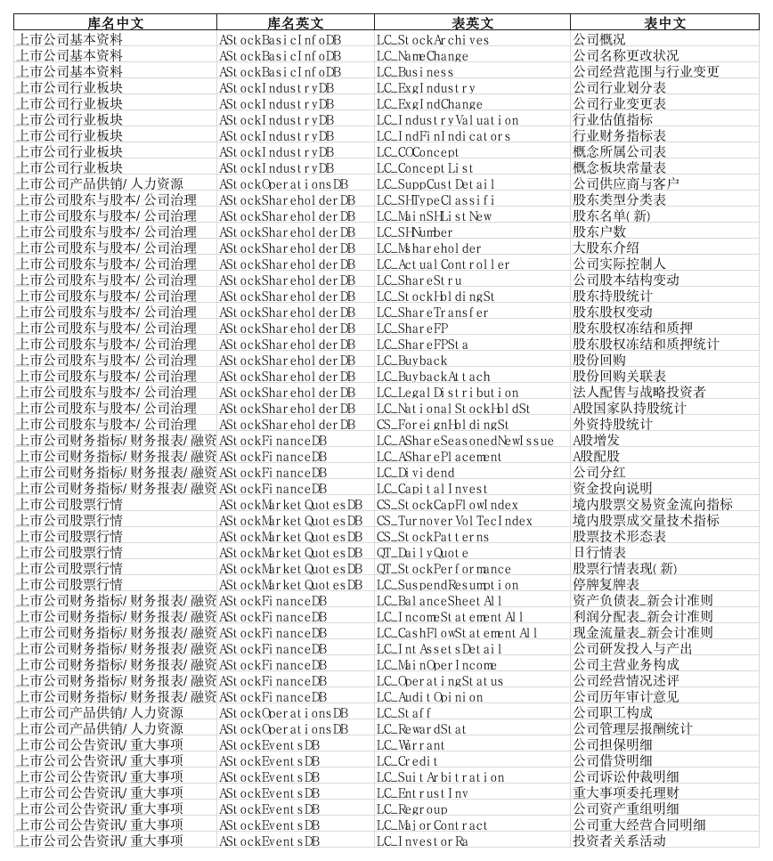
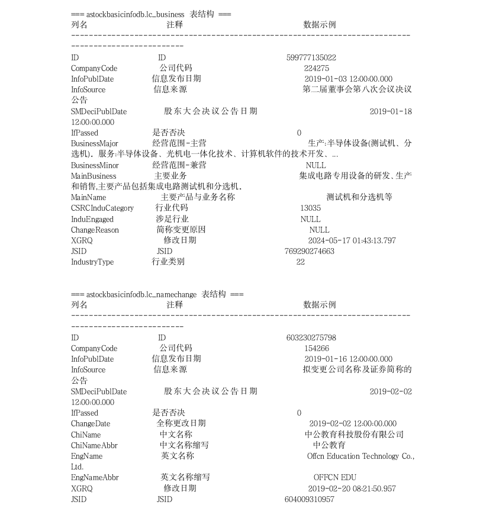
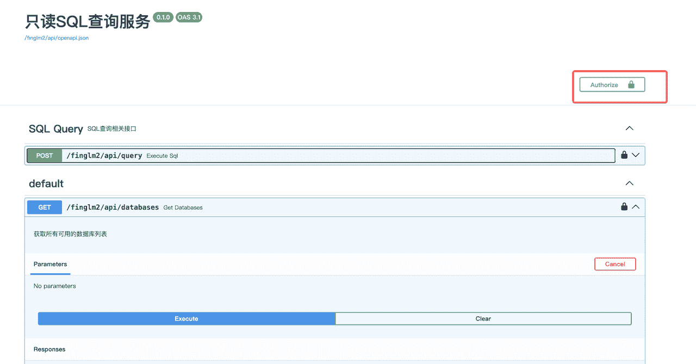
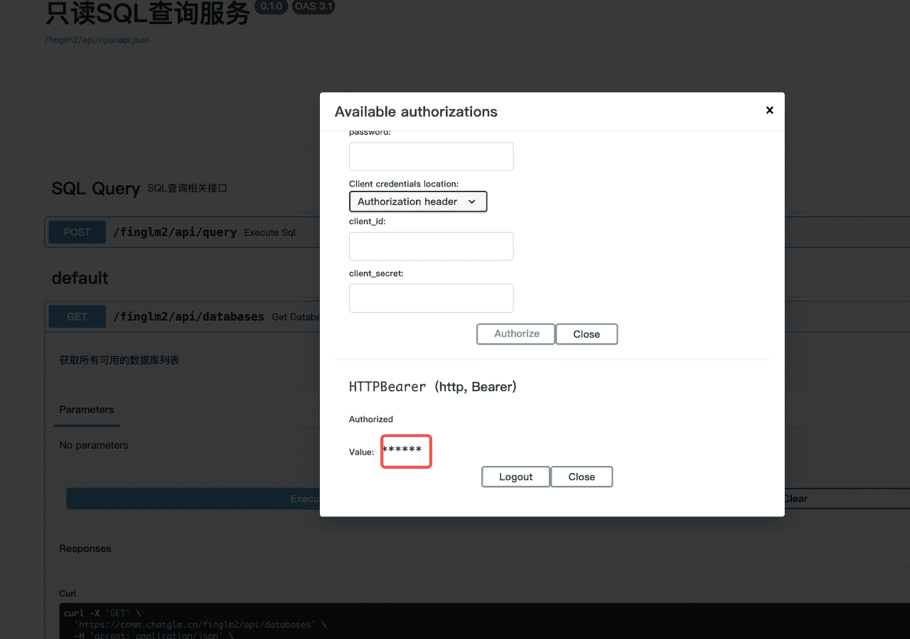
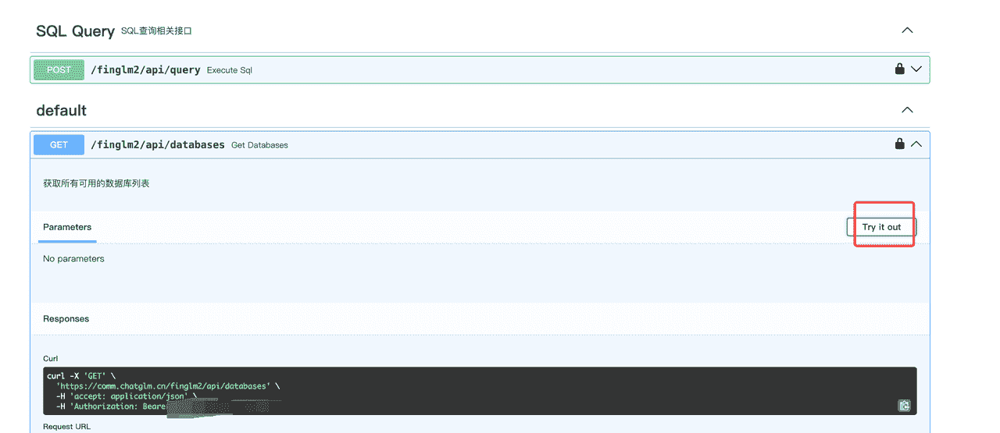
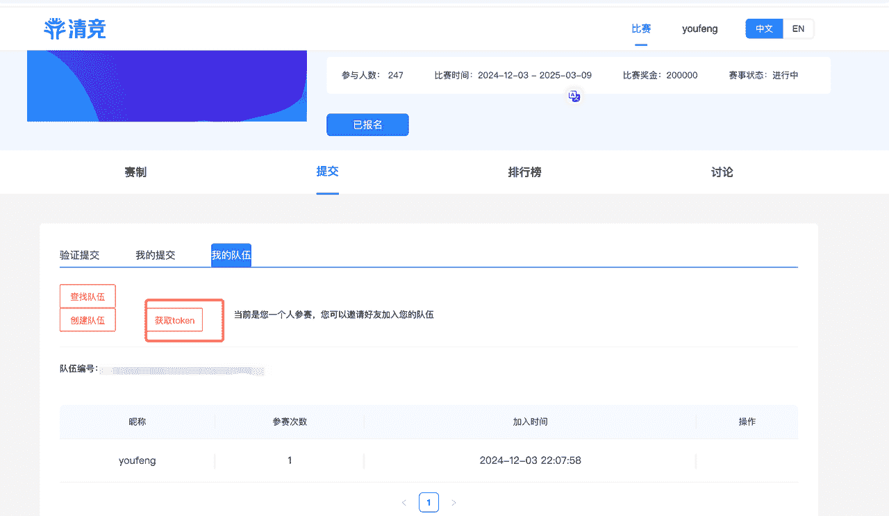

# API说明 | 金融行业 · 大模型挑战赛

> 来源：[https://ai.feishu.cn/docx/MjNZdlAhxoFQDuxoS5kcyN6tnCi](https://ai.feishu.cn/docx/MjNZdlAhxoFQDuxoS5kcyN6tnCi)

# 赛事简介

[赛事简介](https://zhipu-ai.feishu.cn/wiki/FtGMw1RVFiVyEPkr2S1c0KFUncc)

官方比赛平台：[清竞](https://competitions.zhipuai.cn/match)

# 数据说明

本次数据提供总计14个数据库，77个数据表的金融行业数据，是真实的金融行业数据大全，包括A股、港股、美股、基金等丰富数据。

基础数据准备：

本次赛题使用的数据均由**恒生聚源****提供，使**用该数据进行学术引用时，请注明数据来源为恒生聚源。数据主要分为两大类：结构化数据和非结构化数据。

考虑到赛题的难度，赛方使用了恒生聚源处理的非结构化数据转半结构化数据供选手使用。

**注意事项：**

1.  本次数据仅限比赛期间使用，比赛结束后请妥善删除相关数据。

1.  禁**止对数据进行二次开源、传播**或任何形式的商业化使用（包括但不限于转发、盈利等行为）。如需进一步使用或获取数据授权，请联系恒生聚源基财营销中心王晓培（邮箱：wangxp22189@hundsun.com）。

1.  若需进行学术引用，需事先取得恒生聚源的书面同意，并在引用中明确标明数据来源为恒生聚源。

结构化数据包括以下几部分：

+   **A股上市公司数据**：涵盖500家A股公司（2019-2021年），包括公司基本资料（如LC_StockArchives），公司名称变更（LC_NameChange），以及公司业务信息（LC_Business）。

+   **股东及股权信息**：包括股东类型分类（LC_SHTypeClassifi）、股东名单（LC_MainSHListNew）、公司实际控制人（LC_ActualController）等信息，涉及股东持股统计、股权变动、股权冻结与质押等内容。

+   **公司财务与经营状况**：包括资产负债表（LC_BalanceSheetAll）、利润表（LC_IncomeStatementAll）、现金流量表（LC_CashFlowStatementAll）、主营业务构成（LC_MainOperIncome）以及审计意见（LC_AuditOpinion）。

+   **行业及概念板块**：包含行业分类（LC_ExgIndustry）、行业估值指标（LC_IndustryValuation）、行业财务指标（LC_IndFinIndicators）及概念板块信息（LC_COConcept）。

+   **股票市场数据**：如A股交易数据（日行情表QT_DailyQuote）、股票技术指标（CS_TurnoverVolTecIndex）及停牌复牌信息（LC_SuspendResumption）。

+   **基金数据**：涉及管理人前10家，每家50只基金（2019-2021年），包括基金概况（MF_FundArchives）、基金管理人信息（MF_InvestAdvisorOutline）及基金分红（MF_Dividend）。

+   **港股和美股数据**：涵盖20家港股公司及20家美股公司（2019-2021年），包括公司概况、员工数量变动、日行情等信息。

+   **指数数据**：包含沪深三百、中证500、中证1000、创业板指数、上证指数的基本情况（LC_IndexBasicInfo）及其成份（LC_IndexComponent）。

+   **舆情数据**：针对500家A股公司（2019-2021年）的舆情信息（PS_NewsSecurity），以及相关事件体系指引（PS_EventStru）。

# 数据字典及样例数据

## 数据字典



[数据字典.xlsx](https://internal-api-drive-stream.feishu.cn/space/api/box/stream/download/all/Sy8rbhPucoNkc4xBDdycnfBEncL)

## 数据表schema及样例数据



[all_tables_schema.txt](https://internal-api-drive-stream.feishu.cn/space/api/box/stream/download/all/DsnAbhg1IoK2hAxlWjQcqs1hn9b)

# API使用说明

## API文档 - swagger UI

[你可](https://comm.chatglm.cn/finglm2/api/docs#/default/get_databases_finglm2_api_databases_get)以直接使用swagger ui快速调试API。地址

### 如何使用swagger UI

1.  点击Authorize



1.  在打开的栏目里拖到最下面，填写你的team token，点击login



1.  愉快的进行调试吧！



# API调用示例

## 如何获得Access token

https://competitions.zhipuai.cn/matchDetail?id=120241202000000003



## 获得所有数据库

### CURL

```
curl -L -X GET &quot;https://comm.chatglm.cn/finglm2/api/databases&quot; \
-H &quot;Authorization: Bearer {{your access token}}&quot; \
-H &quot;Accept: application/json&quot;
```

### PYTHON

```
import requests

# 设置请求URL和headers
url = &quot;https://comm.chatglm.cn/finglm2/api/databases&quot;
headers = {
    &quot;Authorization&quot;: &quot;Bearer {{your access token}}&quot;,
    &quot;Accept&quot;: &quot;application/json&quot;
}

try:
    # 发送GET请求
    response = requests.get(url, headers=headers)
    
    # 打印详细信息
    print(&quot;状态码:&quot;, response.status_code)
    print(&quot;响应头:&quot;, response.headers)
    print(&quot;\n响应内容:&quot;)
    print(response.json())

except requests.exceptions.RequestException as e:
    print(&quot;请求发生错误:&quot;, e)
```

## 执行SQL

### CURL

```
curl -X POST &quot;https://comm.chatglm.cn/finglm2/api/query&quot; 
-H &quot;Content-Type: application/json&quot; 
-H &quot;Authorization: Bearer {{your access token}}&quot; 
-d &#x27;{
  &quot;sql&quot;: &quot;SELECT * FROM constantdb.secumain LIMIT 10&quot;,
  &quot;limit&quot;: 10
}&#x27;
```

### PYTHON

```
import requests
import json

url = &quot;https://comm.chatglm.cn/finglm2/api/query&quot;
headers = {
    &quot;Content-Type&quot;: &quot;application/json&quot;,
    &quot;Authorization&quot;: &quot;Bearer {{your access token}}&quot;
}
data = {
    &quot;sql&quot;: &quot;SELECT * FROM constantdb.secumain LIMIT 10&quot;,
    &quot;limit&quot;: 10
}

response = requests.post(url, headers=headers, json=data)
print(json.dumps(response.json(), indent=2, ensure_ascii=False))
```