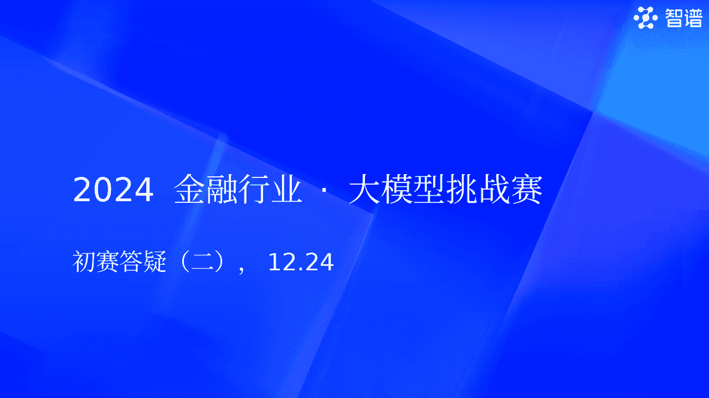

# 【初赛答疑】金融行业·大模型挑战赛

> 来源：[https://ai.feishu.cn/docx/ZLVfdyEQcoRZ21xfsVYcSc6MnHS](https://ai.feishu.cn/docx/ZLVfdyEQcoRZ21xfsVYcSc6MnHS)

> 比赛官网：https://competitions.zhipuai.cn/match

# 2024.12.10 答疑

本次答疑包括赛题解答、第一个 baseline 分享（躺躺老师） 和其他选手问题解答

+   **第一次答疑回放：**金融行业·大模型挑战赛初赛答疑（一）_哔哩哔哩_bilibil

+   **第一次答疑 PPT：**

[2024金融行业·大模型挑战赛初赛答疑.pptx](https://internal-api-drive-stream.feishu.cn/space/api/box/stream/download/all/LBhqbdApKoB2Z8x11xGc5Zdjnge)

+   **第一期****比赛方案参考：**[**Baseline开源仓库**](https://github.com/MetaGLM/FinGLM2/blob/main/baseline/bus_baseline/run.ipynb)

# 2024.12.24答疑

本次答疑包括赛题数据介绍、第二个baseline分享（公交车老师）

+   **第二期答疑回放**：金融行业·大模型挑战赛初赛答疑（二）_哔哩哔哩_bilibili

+   **第二期答疑PPT**：

[12.24金融大模型挑战赛直播分享ppt（终版11点30分）.pptx](https://internal-api-drive-stream.feishu.cn/space/api/box/stream/download/all/TdAhb1ZdYo38xmxVDBBck07rnQg)

+   **第二期比赛方案参考**：[**Baseline开源仓库**](https://github.com/MetaGLM/FinGLM2/blob/main/baseline/bus_baseline/run.ipynb)