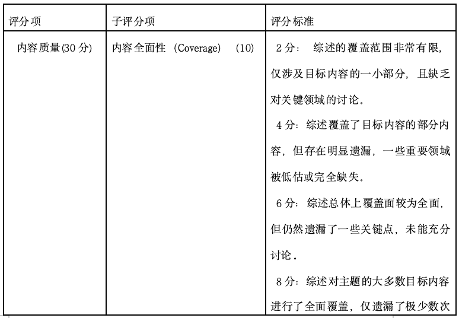
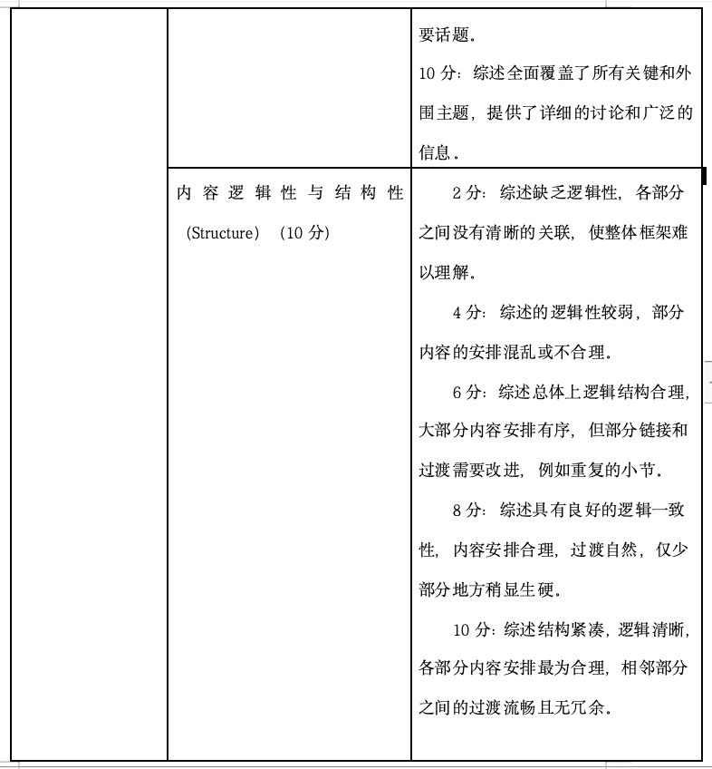
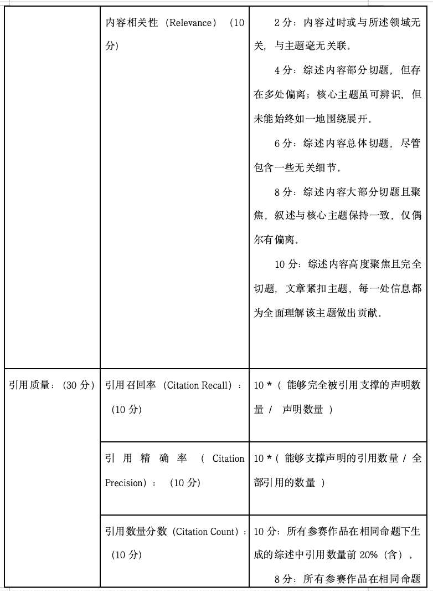
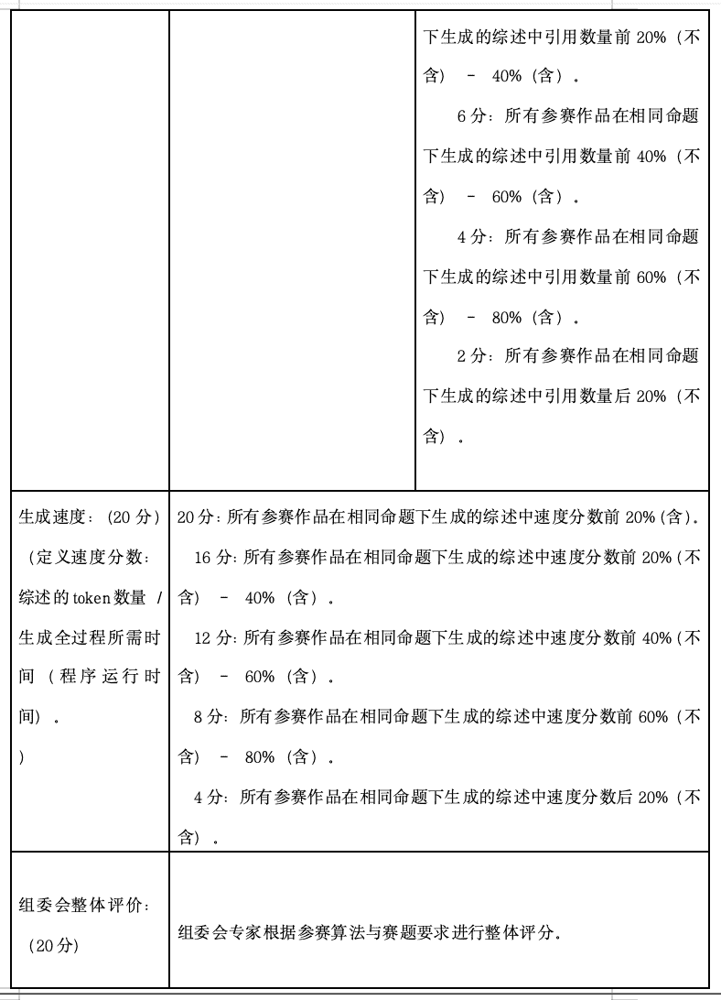

# 【已结束】科研工具 挑战赛（30 万）

> 来源：[https://ai.feishu.cn/docx/HIdydM9dVo8ObnxP2yKcAYrVnpd](https://ai.feishu.cn/docx/HIdydM9dVo8ObnxP2yKcAYrVnpd)

+   **比赛平台：****https://competiti**ons.zhipuai.cn/match

+   **比赛平台: **https://competition.atomgit.com（以在开放原子大赛官网报名为准）

对于学生、科研工作者和科技从业者而言，在知识研究型工作中，要花超过60%的时间来进行文献资料的调研整理等繁杂且重复的工作，如何从海量文献中快速、准确地获取所需信息，一直是产学研人员面临的一大挑战，大模型强大的长文本能力、指令理解能力和跨学科推理分析能力为这些挑战带来切实可行的解决方案，它可以帮助产学研人员快速的、系统地梳理某一领域的研究现状、技术发展方向以及问题解决方法，为后续研究提供有力支持。

> **组织架构**

> 主办单位：开放原子开源基金会

> 联合主办单位：重庆市经济和信息化委员会、中国石油勘探开发研究院、华为技术有限公司

> 协办单位：北京智谱华章科技有限公司

大赛官方交流群：

# 赛题介绍

### 1 赛题描述

#### 1.1 基于检索增强的多智能协作的结构化长文献综述生成：

（1）响应不同类型的综述指令，本次比赛重点考虑以下4类：

a.对一个技术概念的调研综述；

b.对一个方向研究现状的综述；

c.对多个方法的对比分析综述；

d.对一个技术方法研究脉络的综述。

（2）从指定的文献知识库中检索相关文献内容，来生成回答，最好不低于50篇文献；

（3）通过多智能体协作+模型微调的形式完成结构化长文献综述的生成，并提供句子或段落级别的索引溯源。

#### 1.2 结构化长文献综述的参考定义：

（1）主题结构清晰，章节标题契合；

（2）前后逻辑关系或脉络关系通顺；

（3）通过融合综述方法实现详细阐述技术或方法，而非简单的笼统总结；

（4）内容长度不低于2000字。

#### 1.3 数据描述：

（1）文献知识库：近3年计算机顶会顶刊和arXiv文献PDF全文，大概2万篇左右，同时给出PDF原文和建设好的知识库，可以使用建好的知识库，也可以自行设计解析方法重新构建；

（2）参考样例问题，4个不同类型的综述问题：

a.损失函数（对一个技术概念的调研综述）；

b.Text2SQL研究现状如何，面临哪些挑战？ （对一个方向研究现状的综述）；

c.有哪些方法可以提升大模型的规划能力，各自优劣是什么？（对多篇文献的对比分析综述）；

d.多模态大模型的技术发展路线是什么样的？ （对一个技术方法研究脉络的综述）。

### 2 作品提交

（1）资格评审阶段

完整的参赛proposal，应至少包含个人介绍、赛题背景理解、预期解决方案、时间规划等。经赛项专家组评审，proposal通过的前60支队伍（视比赛具体情况调整）将会邮件通知进入初赛，也可在技术交流群中实时获取赛项最新通知。

（2）初赛结果评审阶段

a.针对赛题的完整解决方案，须给出完整设计文档，格式不限；

b.需要提交能够满足赛题要求的仓库链接。评审方将使用仓库文件进行Docker镜像构建，并用于相关任务的评测；

c.该阶段得分为文档和程序的综合分数，详见评审机制。

###

### 3 算力支持说明

初赛阶段，每4个团队分为1组，每组共享1个月4卡算力，本赛项最多支持60支队伍。

视比赛具体情况调整，最终解释权归赛项共建单位。

# 竞赛机制

### 1 赛程

（1）2024-12-06 报名启动（个人名义/组织机构参赛等均可，每支队伍人数不超过5人）；

（2）2024-12-23 初赛开始 ；

（3）2025-01-12 报名截止 ；

（4）2025-01-17 初赛作品提交截止 ；

（5）2025-01-20 入围决赛名单公布；

（6）2025-02-13 决赛开始 ；

（7）2025-02-26 决赛作品提交截止 ；

（8）2025-02-28 线下决赛路演及颁奖（拟定） 。

### 2 参赛对象

参赛对象不受限制，青少年/成人，在校学生/在职工程师/个人开发者，国内/全球等，均可参赛。

### 3 组队报名

本赛项报名流程统一在开放原子大赛赛事官网报名，作品提交路径统一在赛事组提供的AtomGit组织库内提交。

组队成员一经报名确认，不做二次更改（特殊情况咨询赛事小助手处理）队伍人数上限为5人，包含5人，学生参赛时最终获奖时需提供相应学生证佐证参赛资格。

### 4 作品提交

#### 4.1 参赛作品提交方式

（1）参赛队伍提交作品前，需将队长在大赛官网上的注册邮箱、用户名、姓名、手机号码等信息邮件发送给本赛项工作人员（联系邮箱：yuanchun.wang@aminer.cn，邮件主题命名为：“参赛队伍名称”建仓申请），工作人员确认后为该参赛队伍在 AtomGit （AtomGit网址：https://atomgit.com/）上创建一个私有仓库，并将队长添加为该仓库管理员。参赛队伍完成作品后，将作品源代码及相关文档提交至该仓库即可。参赛队伍所提交作品（含初赛作品及决赛作品）命名方式为：参赛队伍名称+初赛/决赛作品+作品标题；

（2）在作品提交周期内，参赛队伍可在不改变作品名称和主要功能的基础上多次提交。参赛队伍在所参加赛程中多次提交作品的，以其最后一次提交的作品视为其在该赛程中参与评审的参赛作品。同时在竞赛期间，如赛项组织方有需要，参赛队伍需配合补充提交其它作品相关材料；

（3）所有已提交的参赛作品和相关材料原则上不予退还。

#### 4.2 参赛作品提交规范

（1）参赛作品须符合本赛项及所属赛道方向，作品名称应能体现其主要特征；

（2）参赛作品必须为原创作品，不得侵犯任何第三方的专利权、著作权、商标权及其他知识产权，且不得违反国家相关法律法规，否则将取消该作品的参赛资格；

（3）作品允许使用他人开源代码，但必须在符合该代码的开源许可基础上，注明出处，以及与作品其它代码的依赖关系，且不得使用GPL、LGPL、Mozilla协议等强约束性开源协议的其他开源代码；提交作品时，必须在分析设计文档中明确说明作品中其他开源代码的协议、作用及所占比例；

（4）作品应能正常运行并可达到预期结果。作品应与设计文档描述的功能一致，如未能实现设计文档中描述的所有功能，应注明未实现功能及其所占比例和重要程度；

（5）参赛作品的代码注释量应足够高，原则上不得低于代码量的5%。

### 5 信息变更

报名信息变更请在报名终止前，联系活动对接群工作人员进行修改。赛事作品提交截止日期前，如若作品变更可联系赛事对接群工作人员进行变更。

### 6 注意事项

（1）您授予主办方对您在本大赛所提交的包含参赛作品在内的参赛信息和个人信息进行展示、报道、宣传等用于市场宣传活动的权利，以及在全球范围内永久地、不可撤销地、免费地使用商标等相关的知识产权的权利；

（2）参赛作品必须为原创作品，并未侵犯任何他人的专利权、著作权、商标权及其他知识产权，且不得违反国家相关法律法规，否则将取消参赛资格；

（3）参赛团队均可在不改变作品名称和主要功能的基础上，持续推进作品迭代升级，对应赛程最后一次提交的作品为参赛作品；

（4）评审期间，参赛团队须按照组委会的要求补充提交参赛作品有关材料；

（5）作品必须可分离原开发环境，具备可演示的运行环境，能够在组委会提供的测试账户上编译/运行或自行提供编译/运行环境；

（6） 作品允许使用他人开源代码，但必须在保持原有版权的基础上，注明出处和其他开源代码的依赖关系。提交作品时,必须在分析设计文档中明确说明作品中其他开源代码的作用及所占比例；

（7）作品应能正确运行并可达到预期结果。作品应与设计文档描述的功能一致，如未能实现设计文档中描述的所有功能，应注明未实现功能及其所占比例和重要程度；

（8）所有已提交的参赛作品和相关材料原则上不予退还。

### 7 参赛团队须知

本赛题正式开始比赛的要求为：报名人员数量至少达到300人，且提交作品数量至少达到50个。若未达到报名人员或提交作品的数量要求，则本赛题可能被延期或暂停，届时将由本赛题共建方（华为技术有限公司）向您发出书面通知。

# 竞赛奖项

一等奖：1名，每名奖金10万元

二等奖：2名，每名奖金5万元

三等奖：5名，每名奖金1万元

优秀奖：10名，每名奖金0.5万元

特别说明：奖金币种为人民币，奖金为含税金额。

# 评审机制

### 1 评审标准

本赛项各赛程的评审邀请业内专家、项目维护者组成评审团，对参赛作品进行评审。

初赛评审：由评审团对提交到AtomGit内的作品打分，得到初赛晋级名单。

决赛路演评审：由决赛路演评审团，现场观看队伍路演打分，评选出一、二、三等奖和优秀奖。

### 2 评分规则

评分注意：

（1）上述评价标准中，【引用数量分数】以及 【生成速度分数】能够被直接计算；其他分数全部/部分需要主观判断；

（2）对于需要主观判断的分数，最终得分为: 初赛：完全由大模型评分；决赛：大模型评分*0.6 + 人工专家评分 * 0.4；

（3）其中涉及到大模型评分的环节中的大模型选择以及具体的提示词由组委会选择或设计。

###

### 3 晋级规则

初赛阶段：依据评分标准进行评分，根据评分公布晋级决赛的选手。

决赛阶段：现场评委最终评分评选出一、二、三等奖和优秀奖。

总分相同，优先按照内容质量评分排序；

总分和内容质量分数相同，优先按照引用质量分数排序；

总分、内容质量分数、引用质量分数均相同，按照生成速度分数排序；

以上分数均相同，按照组委会整体评价分数排序。