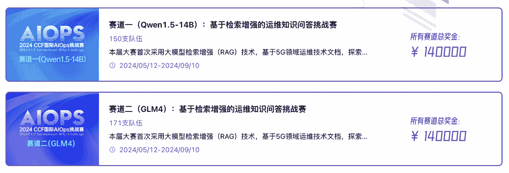
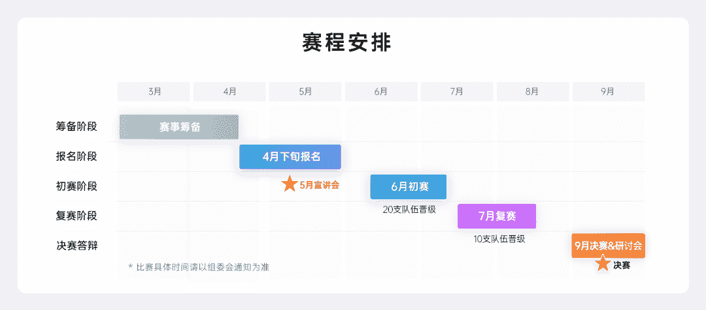
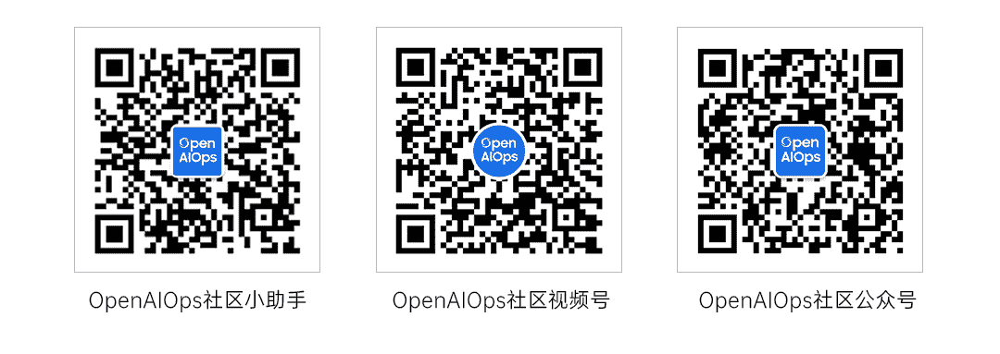

# 【已结束】AIOps 挑战赛（14万）

> 来源：[https://ai.feishu.cn/docx/FrgOdrGGnoG97Ixkf73c4iLSnCc](https://ai.feishu.cn/docx/FrgOdrGGnoG97Ixkf73c4iLSnCc)

# **赛题背景**

> CCF国际AIOps挑战赛（China Computer Federation International AIOps Challenge）由清华大学联合中国计算机学会（CCF）自2018年共同发起。旨在借助社区力量，运用人工智能算法解决各类运维难题。迄今为止已经成功举办六届，吸引了大量AIOps从业者和关注者，随着赛事规模和影响力的不断扩大，形成了运维行业著名的专业赛事品牌，并逐渐发展为智能运维领域最具影响力的专业赛事。

>

> 2024 (第七届）CCF国际AIOps挑战赛由中国计算机学会（CCF）、清华大学、中国科学院计算机网络信息中心、中兴通讯、中国建行银行主办，中国计算机学会互联网专委会、OpenAIOps社区、清华大学计算机科学与技术系、中南大学、北京必示科技有限公司、北京智谱华章科技有限公司承办，ModelScope社区、南开大学软件学院协办。同时，本届AIOps挑战赛也是OpenAIOps社区成立之后第一届重要年度赛事。

# **赛题方向**

「基于检索增强的运维知识问答挑战赛」

2024第七届CCF国际AIOps挑战赛首次采用大模型检索增强（RAG）技术，基于5G领域运维技术文档，探索如何结合领域私有技术文档进行高效私域知识问答。揭示在通用大语言模型基座下，垂直领域知识问答面临的领域知识缺失，公私域知识冲突，多模态图表并存等一系列挑战。

参赛队伍需要通过私域文本处理、数据库构建、基座模型微调、Prompt工程等其中部分技术，搭建运维领域的检索增强问答系统，或基于大赛主办方搭建的基础RAG系统之上，修改部分模块，提升私域知识问答精度。大赛主办方会使用和公开的私域文档相关的问题和专家标准答案对选手的答案进行评测，实时更新榜单。

# 赛程安排

本次挑战赛整体预计跨越5个月，4月下旬开启赛事报名；5月中旬举行线下宣讲会；6月启动初赛，选拔20支队伍晋级复赛；7月开启复赛，最终决胜出10支队伍晋级决赛；9月中旬将进行最终决赛答辩和研讨会。

# 相关链接

+   比赛官网：https://competition.aiops-challenge.com/home/competition

+   GLM-4 API 申请：……

+   魔搭算力资源申请：

注：更多赛事相关信息将在社区“智能运维前沿”公众号发布，同时OpenAIOps社区群将提供赛事通知、赛事答疑，作为学习交流的平台已吸引近4000+参与，有意者可扫码添加官方微信号（OpenAIOps社区小助手）入群。