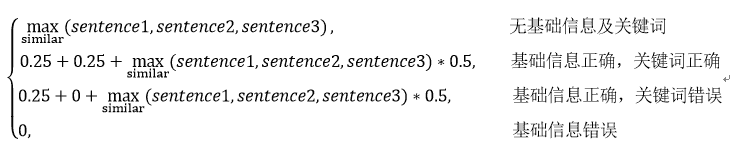

# 赛题描述

> 来源：[https://ai.feishu.cn/docx/UYzodAJM9ofPoDx38WhcQkJonQb](https://ai.feishu.cn/docx/UYzodAJM9ofPoDx38WhcQkJonQb)

# **赛题内容**

## **1. 评测任务概述**

本次比赛要求参赛选手以ChatGLM2-6B模型为中心制作一个问答系统，回答用户的金融相关的问题，不允许使用其他的大语言模型。参赛选手可以使用其他公开访问的外部数据来微调模型，也可以使用向量数据库等技术。

本次比赛评估模型能力的赛题按照涉及模型的能力和复杂程度大体分为初级、中级、高级三种类型，每种类型的题目拥有不同的分值：

初级：数据基本查询（40分）

参赛者需要利用提供的ChatGLM2-6B开源模型和上市公司年报原始数据，并以此为基础创建信息问答系统。系统需能够解决基本查询，如：某公司2021年的研发费用是多少？等问题。

中级：数据统计分析查询（30分）

在初级阶段的基础上，参赛者需要进行金融数据的统计分析和关联指标查询。系统需基于各类指标，提供问题和答案，如：某公司2021年研发费用增长率为多少？等问题。

高级：开放性问题（30分）

如：某公司2021年主要研发项目是否涉及国家创新领域，如新能源技术、人工智能等？

## **2. 评测方式**

### **2.1 初赛阶段**

选手报名成功后，参赛队伍通过天池平台下载数据，并在本地调试算法。然后，参赛队伍在线提交结果。在初赛期间，赛事主办方会提供部分金融数据供选手使用（选手也可自行准备需要的数据）和测试数据集供选手评估模型效果。参赛选手可以手动提交评估结果文件，系统会实时评估并返回成绩。排行榜每小时更新一次，按照评估指标从高到低进行排序。每个队伍每天的提交次数限制为3次。排行榜将展示参赛队伍在初赛阶段的历史最佳成绩进行排名。为了确保比赛的公平和公正，参赛选手需要在初赛截止日期之前提交结果文件（详细要求请参见附录）。赛事主办方将核实问答结果的可复现性，并对通过验证的选手进入复赛。如果有队伍未在初赛期间进行提交或未提交结果文件，则他们的复赛提交将被视为无效。

提交物：初赛阶段，参赛队伍本地调试算法，在天池平台在线提交结果，结果文件命名为"参赛队名称_result"，以utf-8编码格式保存。文件每行是一个json串，包含"ID"，"question"，"answer"。

### **2.2 复赛阶段**

在复赛阶段，比赛组织方将使用测试集评估参赛选手提供的镜像文件中的算法模型的性能，以确定算法的优劣并进行排名。复赛阶段的测试数据集文件规范与初赛阶段保持一致。

复赛结束后，参赛队伍需要提交相关代码，模型的镜像文件和说明文档（具体要求请参见规则章节）。赛题组织方将审核优胜参赛队伍的代码，要求代码符合比赛主题和相关规范。对于未提交或审核不通过的队伍，将取消其决赛资格和比赛奖励，并通知递补选手。最终的队伍排名将根据复赛成绩计算，并在官方完成代码审核后公布榜单。

备注：由于开放性题目不易量化，为确保比赛的公平和公正，自动测评阶段的开放性题目暂不计分，赛事主办方将在复赛成绩排名后，组织复赛答辩，开放性题目的成绩由评测委员会的领域专家参与打分。

## **3.数据说明**

机器阅读理解(Machine Reading Comprehension)和问答（Questing Answering）是自然语言处理领域的重要方向，可以让人工智能模型阅读文本，并回答与文本相关的问题。评测任务的任务形式为：给定一组参考文档和问题，要求模型按照指定格式生成答案。问题包含多种类型。

问题示例：

{"ID": 1, "question": "2019年中国工商银行财务费用是多少元?"}

{"ID": 2, "question": "工商银行2019年营业外支出和营业外收入分别是多少元?" }

{"ID": 3, "question": "中国工商银行2021年净利润增长率是多少?保留2位小数。"}

答案示例：

{"ID": 1,

"question": "2019年中国工商银行财务费用是多少元?",

"answer":"2019年中国工商银行财务费用是12345678.9元。"}

{"ID": 2,

"question": "工商银行2019年营业外支出和营业外收入分别是多少元?",

"answer": "工商银行2019年营业外支出为12345678.9元，营业外收入为2345678.9元。"}

{"ID":3",

"question": "中国工商银行2021年净利润增长率是多少?保留2位小数。",

"answer": "中国工商银行2020年净利润为12345678.90元，2021年净利润为22345678.90元，根据公式，净利润增长率=(净利润-上年净利润)/上年净利润，得出结果中国工商银行2021年净利润增长率81.00%。" }

## **4.评测指标**

我们依据：

评测示例：

{"question": "2019年中国工商银行财务费用是多少元?",

"prompt": {"财务费用": "12345678.9元", "key_word":"财务费用、2019", "prom_answer": "12345678.9元"},

"answer": [

"2019年中国工商银行财务费用是12345678.9元。",

"2019年工商银行财务费用是12345678.9元。",

"中国工商银行2019年的财务费用是12345678.9元。" ]

}

评测计算示例：

答案一：工商银行2019年财务费用是12345678.9元。

most similar sentences:

2019年工商银行财务费用是12345678.9元。 (Score: 0.9915)

中国工商银行2019年的财务费用是12345678.9元。 (Score: 0.9820)

2019年中国工商银行财务费用是12345678.9元。 (Score: 0.9720)

评分：0.25+0.25+0.9915*0.5=0.9958分。

评分解释：prom_answer正确、包含所有key_word、相似度最高0.9915。

答案二：2019年中国工商银行财务费用是335768.91元。

评分：0分。

评分解释：prom_answer错误不得分。

答案三：12345678.9元。

most similar sentences:

2019年工商银行财务费用是12345678.9元。 (Score: 0.6488)

2019年中国工商银行财务费用是12345678.9元。 (Score: 0.6409)

中国工商银行2019年的财务费用是12345678.9元。 (Score: 0.6191)

评分：0.25+0+0.6488*0.5=0.5744分。

评分解释：prom_answer正确、未包含所有key_word、相似度最高0.6488。

复赛阶段，参赛队伍本地调试算法，在天池平台在线提交结果，结果文件为docker镜像文件和说明文档，命名为"参赛队伍名称_result"。 文件包含模型权重文件，模型配置文件，模型预测脚本，如果需要向量引擎，知识文件等，需要一并打包提交。

## **5.注意事项**

● 参赛选手只能使用ChatGLM2-6B模型，需要在最终提交测试集时，对其模型训练/微调方法进行介绍。

● 参赛选手可以使用其他数据，包括自有的金融领域(有标注/无标注)数据，需要在最终提交文件中注明其训练数据来源及处理方法。比赛中使用的公开的数据集建议在ModelScope（魔搭社区）进行开源。

● 赛事期间，魔搭社区将为参赛选手提供微调ChatGLM2-6B以及推理ChatGLM2-6B的算力，该算力仅限本赛事使用，如果需要更多算力，可以书面申请。

● 最终获奖的参赛选手的技术方案的知识产权属于对应的参赛选手，建议参赛选手在魔搭社区开源参赛的模型和系统。

● **参赛方案中的模型下载和数据加载须通**过ModelS[c](https://modelscope.cn/models/ZhipuAI/chatglm2-6b/summary)ope（魔搭社区[）进行。

模型下载地址：https://modelscope.cn/models/](https://modelscope.cn/datasets/modelscope/chatglm_llm_fintech_raw_dataset/summary)ZhipuAI/chatglm2-6b/summary

数据集下载地址：https://modelscope.cn/datasets/modelscope/chatglm_llm_fintech_raw_dataset/summary