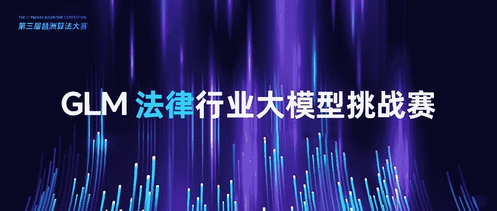
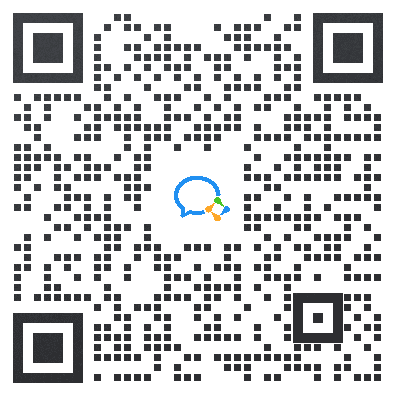

# 赛事介绍

> 来源：[https://ai.feishu.cn/docx/P1FxdL25Ko0V6Ux27srcZQbGndg](https://ai.feishu.cn/docx/P1FxdL25Ko0V6Ux27srcZQbGndg)

# **赛事简介**

欢迎参加「GLM 法律行业大模型挑战赛」。

随着技术的进步，大语言模型（LLM）已经在多个领域展现出显著成效，法律行业也不例外。LLM 在法律服务、案件分析和合同审核等方面已显示出其强大潜力。

为探索 LLM 在法律行业的应用潜力，我们在琶洲算法大赛主办方的指导下，推出了 GLM 法律行业大模型挑战赛。

赛题由智谱AI、深圳数据交易所、安硕信息和魔搭社区、天池平台联合承办，比赛旨在推动大模型在法律领域的发展，并邀请广大开发者和技术团队参与创新。

参赛者需基于 GLM-4 模型，制定技术方案。方案应利用大语言模型的语义理解和函数调用功能，准确解析用户查询，并通过访问相关法律数据库或 API，提供服务，包括解答法律问题、查询案件信息、检索历史案件和分析司法数据。

> 本次[挑战赛隶属](http://www.aicompetition-pz.com)于 2024 年第三届琶洲算法大赛 AI 大模型挑战赛赛道之一。2024 年第三届琶洲算法大赛（赛题总网站）由广州市人民政府、 中国人工智能学会联合主办， 中国信息通信研究院、 广州市海珠区人民政府、 广州市科学技术局、 广州市工业和信息化局、 广州市政务服务和数据管理局、 人工智能与数字经济广东省实验室（广州）共同承办， 聚焦 AI 大模型、 AIGC 行业热点， 广泛邀请行业龙头企业、 科研机构、 投资机构、 生态合作企业、 行业协会参与出题、发动征集、评审、技术合作及商业落地机会， 预计将吸引超 5000 支队伍参赛。

大赛官网

# **赛程赛制**

以下所有时间点为北京时间（GMT+8）

请注意，报名时间以外的其他时间点可能会有变动，请参赛者密切关注本网站和邮件通知。

一、报名组队与实名认证：2024年5月30日至6月30日

1.  报名：在天池平台和琶洲算法大赛官网（http://www.aicompetition-pz.com）完成双重注册，在琶洲算法大赛官网报名时，务必填写天池参赛队伍ID号码。未在官网报名者将视为无效参赛。

1.  参赛形式：可单人或组队参赛，每队最多三人。每位选手仅限加入一支队伍，并根据队长单位所在地选择赛区。赛区划分以琶洲算法大赛官网为准。

1.  报名信息：确保信息准确有效，否则组委会可取消参赛资格及奖励。

1.  报名截止：6月30日上午10:00前完成报名、组队变更等操作。

1.  实名认证：6月30日上午10:00前，各队伍成员（包括队长）需在天池官网完成实名认证，否则将无法继续参赛。

大赛官方交流群：

二、初赛阶段（2024年5月30日至7月14日）

1.  报名成功的参赛队伍将通过指定平台使用 GLM-4 API 或 GLM-4 开源模型，在本地调试算法后在线提交结果。

+   **初赛分为 A 榜（5月30日至6月3**0日）和B 榜（7月1日至7月14日）。

+   A 榜期间，系统每天提供3次提交机会，实时评测并返回成绩。排行榜每小时更新，按评测指标排序，展示历史最优成绩。A 榜最后一次评测截止时间为6月30日18:00。

+   B 榜期间，评测标准与 A 榜相同，但赛题难度有所变化。B 榜最后一次评测截止时间为7月14日18:00。

+   初赛成绩由 A 榜（30%）和B 榜（70%）成绩加权得出。

1.  初赛淘汰与复赛晋级：2024年7月17日

+   未产出成绩的队伍将被取消复赛资格。

+   原则上各赛区前10名的参赛队伍将晋级复赛，最终将结合选手具体方案决定，复赛名单于7月17日公布。

1.  参赛队伍可以使用除承办方提供的训练数据外的其他标注数据。若对数据使用有疑问，请邮件联系组委会：wei.jia@zhipuai.cn。

GLM-4 API 调用链接：https://open.bigmodel.cn/dev/howuse/glm-4

三、复赛阶段（2024年7月21日至8月4日）

1.  晋级参赛队伍将通过指定平台使用 GLM-4 API 或 GLM-4 开源模型，在本地调试算法后在线提交结果。

+   **复赛同样分为 A 榜（7月21日至8**月1日）和B 榜（8月2日至8月4日）。

+   A 榜期间，系统每天提供5次提交机会，实时评测并返回成绩。排行榜每小时更新，按评测指标排序，并显示队伍所在赛区。A 榜最后一次评测截止时间为8月1日18:00。

+   B 榜期间，评测标准与 A 榜相同，但赛题将进行调整。B榜最后一次评测截止时间为8月4日18:00。

+   复赛成绩由 A 榜（30%）和B 榜（70%）成绩加权得出。

1.  复赛淘汰与决赛晋级：2024年8月8日

+   复赛阶段排名前 8 的队伍将晋级决赛答辩环节。组委会将对代码进行审核，审核不通过的队伍将被取消答辩资格，晋级名额将依据排行榜顺延。

1.  参赛队伍可以使用除承办方提供的训练数据外的其他标注数据。若对数据使用有疑问，请邮件联系组委会：wei.jia@zhipuai.cn。

四、决赛答辩（暂定2024年9月，具体时间待通知）

1.  决赛将以线下或线上答辩形式进行。晋级队伍需准备答辩材料，包括答辩PPT、参赛总结和核心代码。

1.  晋级团队需提交答辩PPT初稿，提交时间将另行通知。组委会将审核并提供修改建议，随后团队需提交终稿。答辩的具体时间和地点将另行通知。

1.  答辩流程包括15分钟的队伍陈述和10分钟的评委问答。评委将根据技术思路、理论深度和答辩表现进行评分。

1.  决赛分数由复赛成绩（占60%）和答辩成绩（占40%）加权得出。主办方将根据决赛分数颁发奖项。

五、总决赛（暂定2024年9月，具体时间待通知）

决赛答辩的冠军队伍将参加次日举行的琶洲算法大赛总决赛答辩，与其他13个赛道的冠军队伍竞争，争夺总冠军。

# **奖项及奖励**

本次大赛奖金总额为25万元人民币，由琶洲算法大赛组织方提供。具体奖金分布如下（所有奖金均为税前）：

+   冠军（1名）：10万元人民币现金奖金，10万元算力券，颁发获奖证书。

+   亚军（1名）：5万元人民币现金奖金，3万元算力券，颁发获奖证书。

+   季军（1名）：2万元人民币现金奖金，2万元算力券，颁发获奖证书。

此外，赛事组织方还提供以下额外激励：

+   复赛期间各赛区成绩第一名将获得琶洲算法大赛赛事方提供的 2 万元人民币（税前）现金奖励。

+   决赛冠军将有机会参加琶洲算法大赛总决赛，14个赛道的冠军同台竞技，争夺额外40万元人民币现金奖励和10万元算力券。总冠军团队还将获得500万元专项扶持、广州市人才绿卡、琶洲CBD户口。

+   所有获奖团队将有机会获得最高1000万元的创业（项目）落地扶持和不少于300万元的创投机构资金优先投资。获奖团队成员还将享受人才落地绿色服务通道。