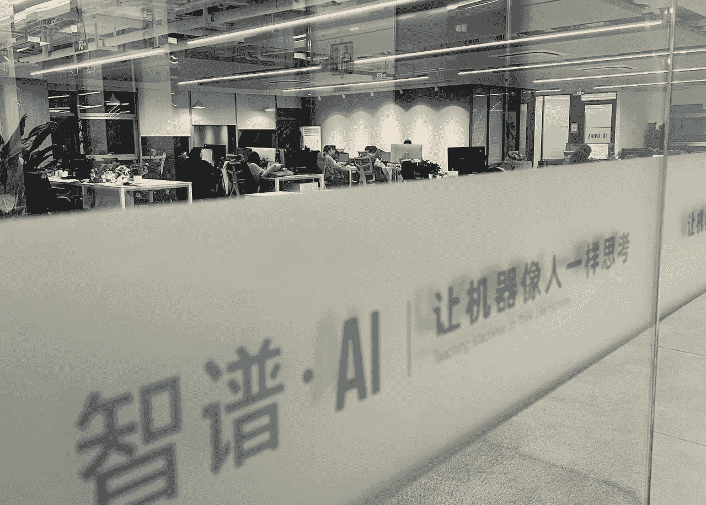

# 3.4 生态 · 走进智谱

> 来源：[https://ai.feishu.cn/docx/RIETdC2QToIJ0Ax9mG4crVZZn0V](https://ai.feishu.cn/docx/RIETdC2QToIJ0Ax9mG4crVZZn0V)

欢迎走进智谱AI交流活动，在这里,我们为大家提供与全球顶尖AI专家、研究人员和行业领袖面对面交流的宝贵机会。通过丰富多彩的讲座、研讨会和圆桌讨论，大家将深入了解最新的人工智能技术动态和应用趋势。智谱AI致力于构建一个开放、包容的学术与产业交流平台，促进知识共享与合作创新。我们期待大家的积极参与，与我们共同探讨前沿科技，推动人工智能的持续发展。携手智谱AI，共同开创智能化的美好未来！

这里详细记录了目前我们举办的活动：

<https://zhipu-ai.feishu.cn/sync/I447dldoQsFFP6bcGUYcAaOVnQc>