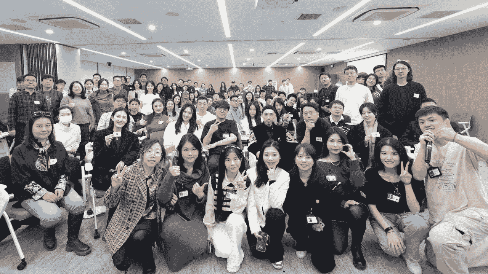
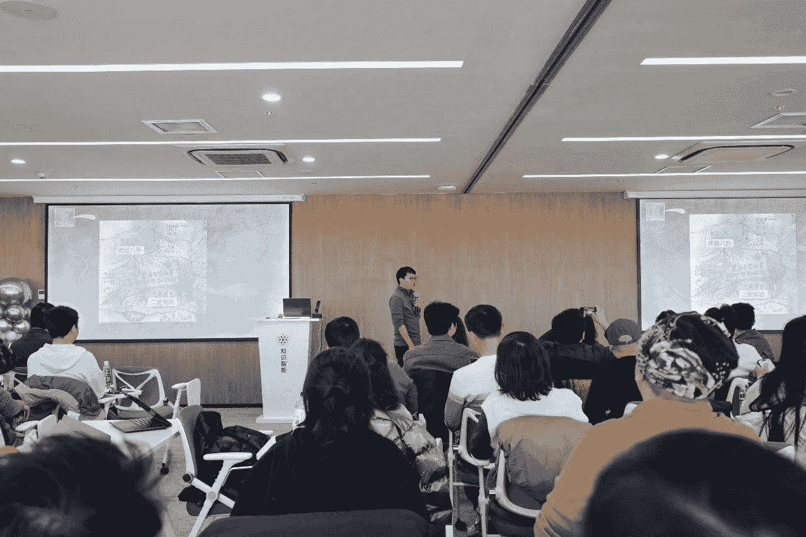
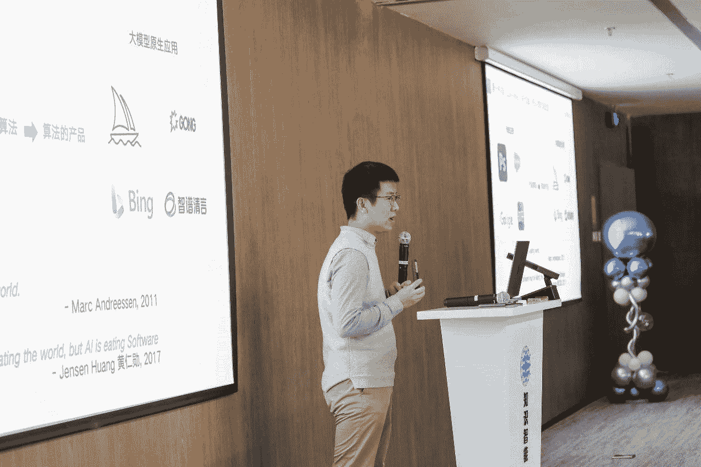
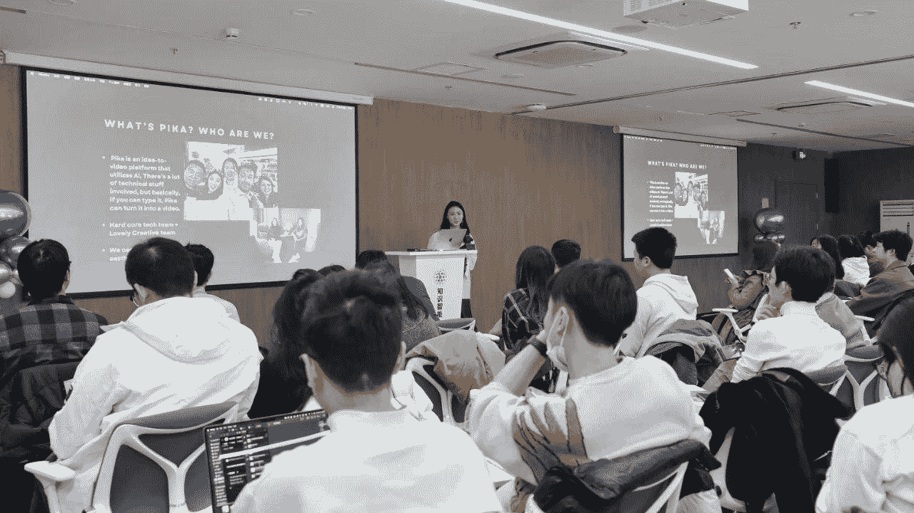
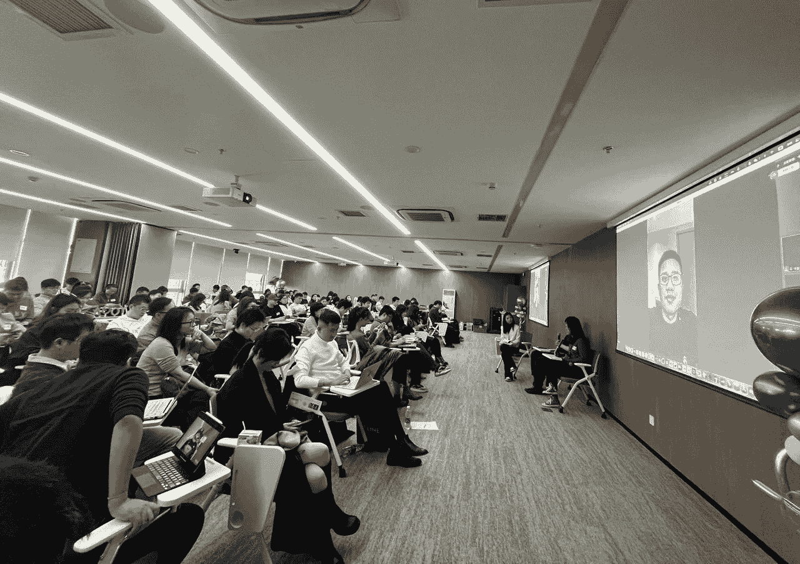
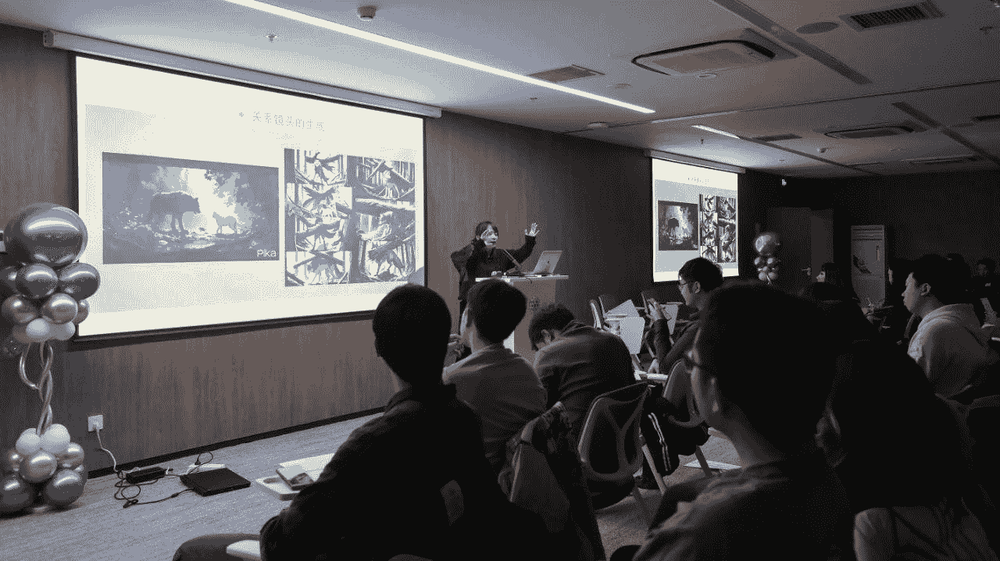
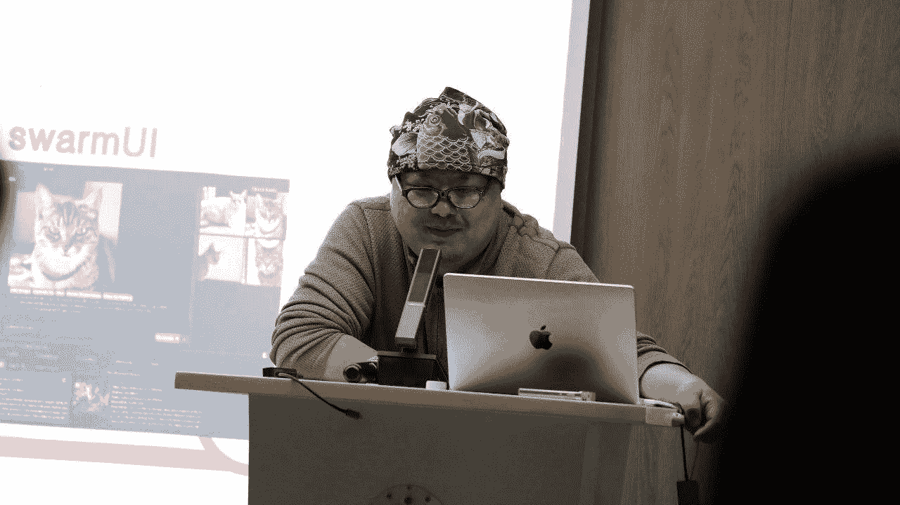

# 用AI交个朋友

> 来源：[https://ai.feishu.cn/docx/LhmBdEDh9oyGj1xm1SccKOaNntf](https://ai.feishu.cn/docx/LhmBdEDh9oyGj1xm1SccKOaNntf)

> 活动组织者：数字生命卡兹克

相关文章：2024，我们真的用AI交了个朋友

## 分享内容

**一.《我们需要数字人吗》**

来分享的好基友：商汤科技数字人项目总监 - 廖虎。

**二. 《畅聊金融中的大模型》**

来分享的好基友：智谱AI解决方案专家大山。

**三. 《PIKA》**

来分享的好朋友：Jessie，PIKA Director Of Artists Relationship。

四. 小小的讨论《2024 AI会冲击哪些场景？》

主持人：Jessy - 出门问问人类助理

分享的基友们：张泓- 嘉实基金DataLab副总监、韩愉畅 - 同花顺智能投研产品负责人、卡兹克 - 摸鱼的

五. 《从剧本到拍摄:AIGC介入影视创作的可能性》

来分享的好朋友：Vicky，北京电影学院博士。

六. 《完蛋！我被AI包围了！》

**来**分享的好朋友：吉川明静，游戏制作人、AIGC工作室发起人。

