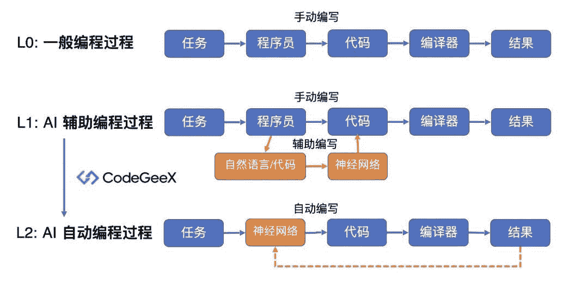
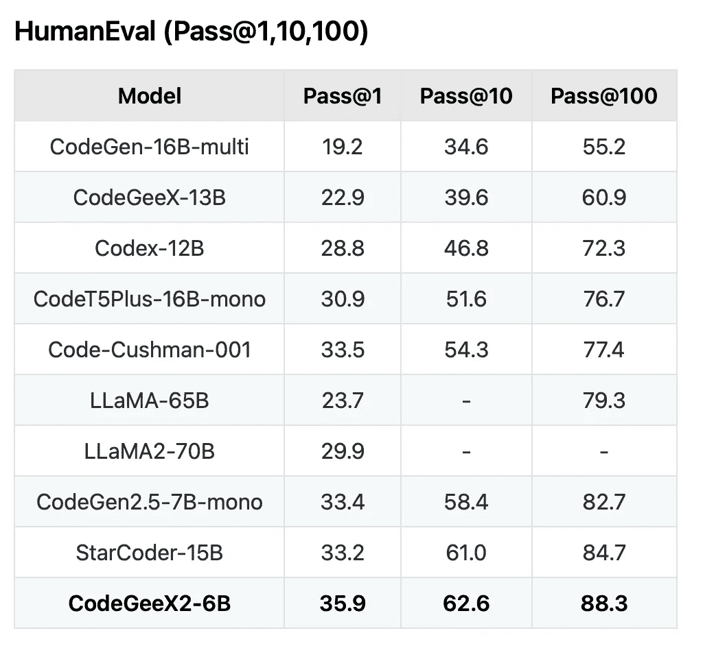
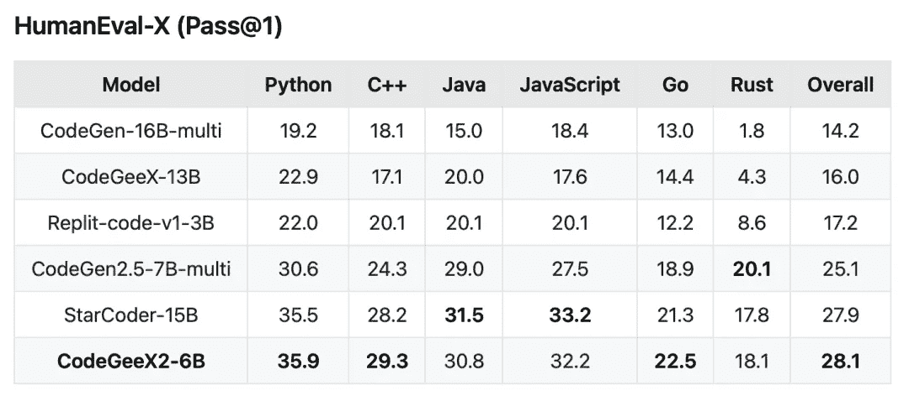
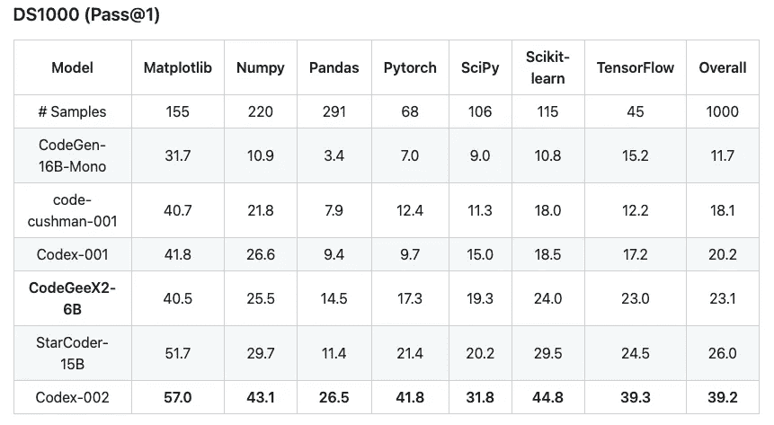
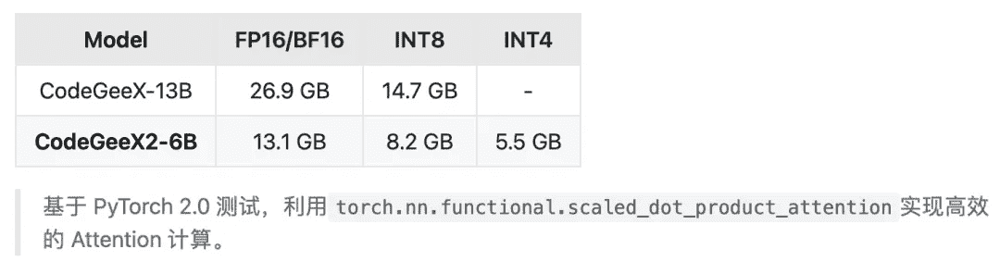
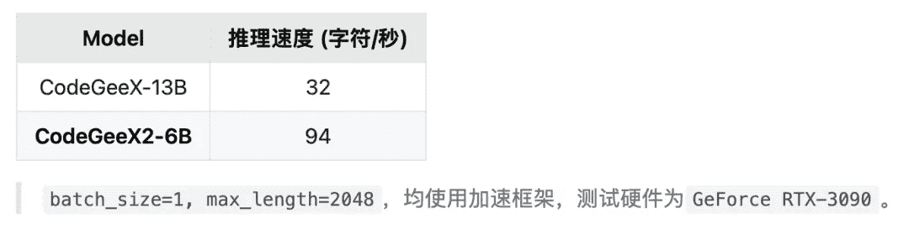

# 开源 · CodeGeeX2 开源，最低6GB显存，性能优于StarCoder

> 来源：[https://ai.feishu.cn/docx/MTvhdfFn2odw54xXC7Fc3Sl4nLb](https://ai.feishu.cn/docx/MTvhdfFn2odw54xXC7Fc3Sl4nLb)

我们希望每一位程序员，都能在自己机器上跑上一个自己的编程助手。

为实现这一目标，我们现将「代码生成模型 CodeGeeX2-6B」开源。同时我们也将对该模型持续进行迭代升级，以提供更加强大的代码辅助能力。

CodeGeeX2 是多语言代码生成模型 CodeGeeX 的第二代模型，基于 ChatGLM2 架构注入代码实现。

得益于 ChatGLM2 的更优性能，CodeGeeX2-6B 在多项指标上取得了较大的性能提升。与 150 亿参数的 StarCoder-15B 相比，CodeGeeX2-6B 凭借 60 亿参数便具备了近 10% 的优势。

更多特性包括：

**更强大的代码能力：**基于 ChatGLM2-6B 基座语言模型，CodeGeeX2-6B 进一步经过了 600B 代码数据预训练，相比一代模型，在代码能力上全面提升，HumanEval-X 评测集的六种编程语言均大幅提升 (Python +57%, C++ +71%, Java +54%, JavaScript +83%, Go +56%, Rust +321%)，在Python上达到 35.9% 的 Pass@1 一次通过率，超越规模更大的 StarCoder-15B。

**更优秀的模型特性：**继承 ChatGLM2-6B 模型特性，CodeGeeX2-6B 更好支持中英文输入，支持最大 8192 序列长度，推理速度较一代 CodeGeeX-13B 大幅提升，量化后仅需6GB显存即可运行，支持轻量级本地化部署。

**更全面的AI编程助手：**CodeGeeX插件（VS Code, Jetbrains）后端升级，支持超过100种编程语言，新增上下文补全、跨文件补全等实用功能。结合 Ask CodeGeeX 交互式AI编程助手，支持中英文对话解决各种编程问题，包括且不限于代码解释、代码翻译、代码纠错、文档生成等，帮助程序员更高效开发。

**更开放的协议：**CodeGeeX2-6B 权重对学术研究完全开放。

## 代码能力评测

CodeGeeX2 作为一个多语言代码生成基座模型，代码能力较上一代大幅提升，以下是在 HumanEval，HumanEval-X, DS1000 基准上的评测结果（评价指标 Pass@k 定义与论文中一致）：

## 量化推理性能

CodeGeeX2 与上一代相比，对部署更加友好。得益于使用 Multi-Query Attention 和 Flash Attention，推理速度更快，且量化后仅需6GB显存即可运行：

### **量化**

### **推理**

CodeGeeX2-6B的安装请参考官方：

https://github.com/THUDM/CodeGeeX2