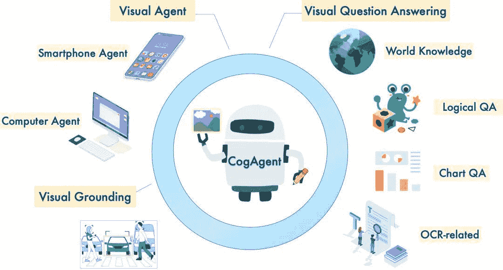
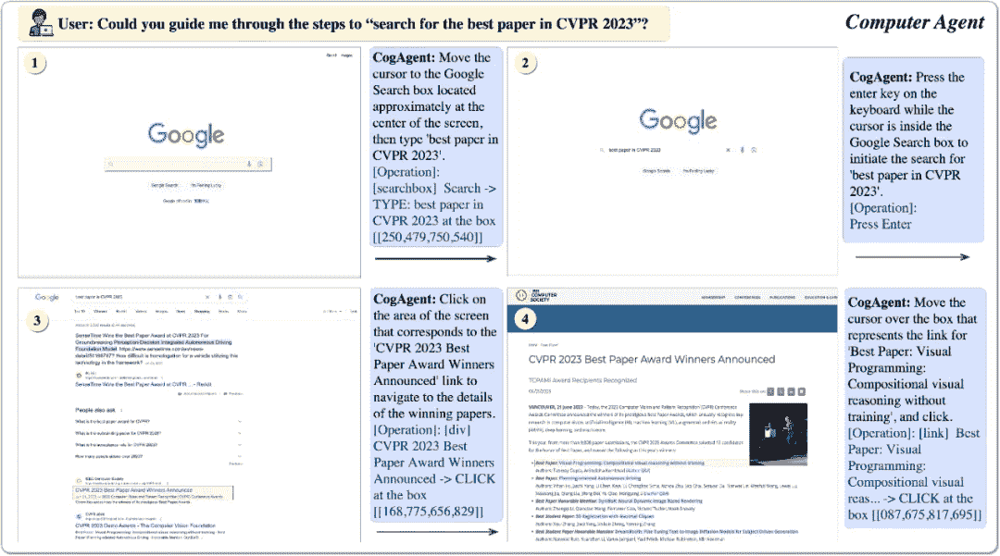
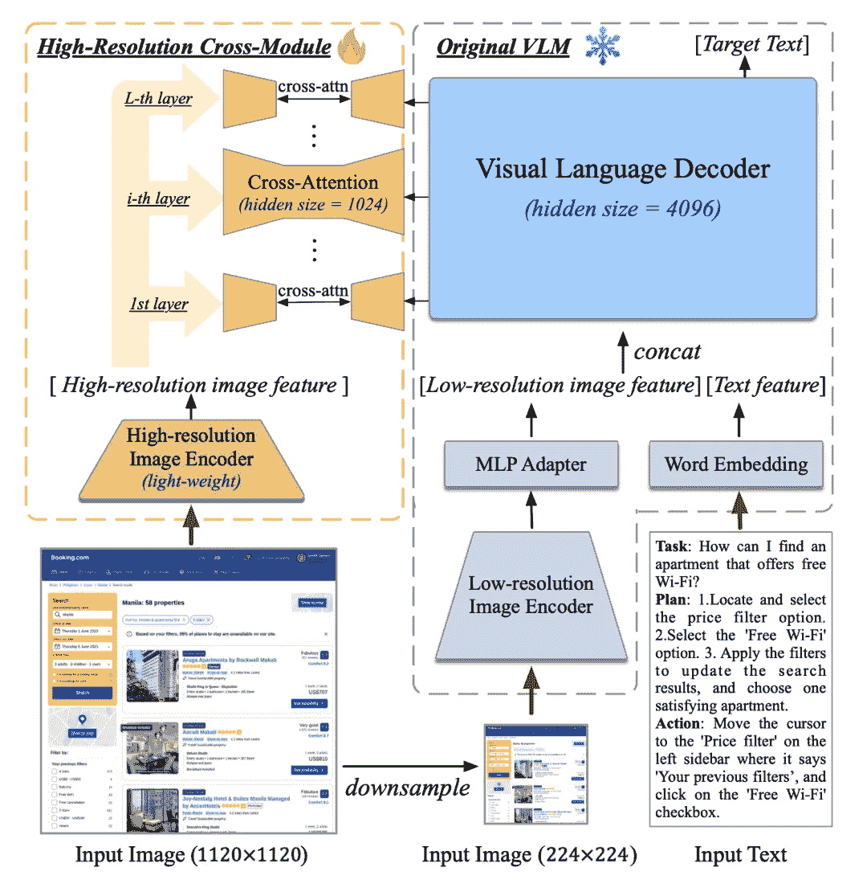
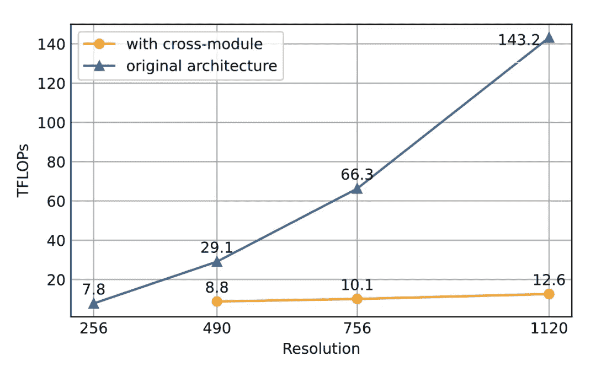
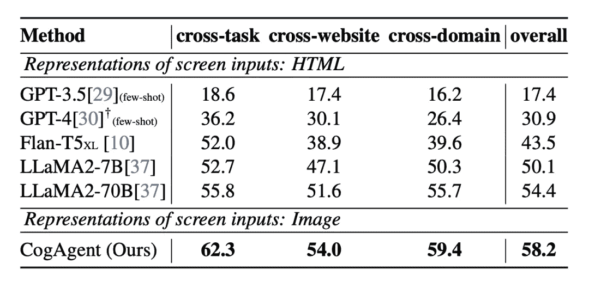
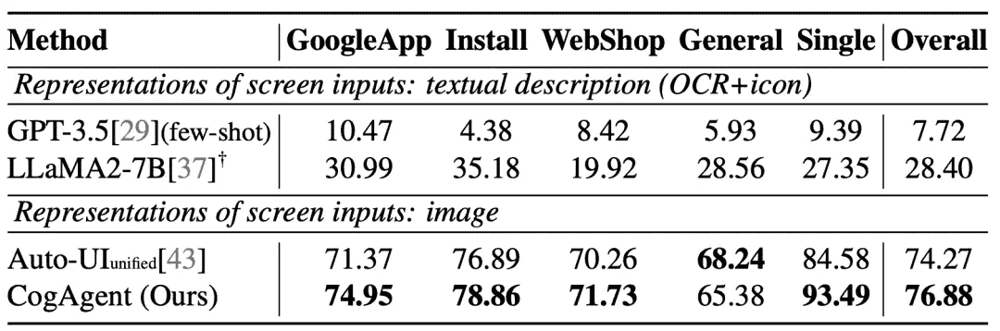
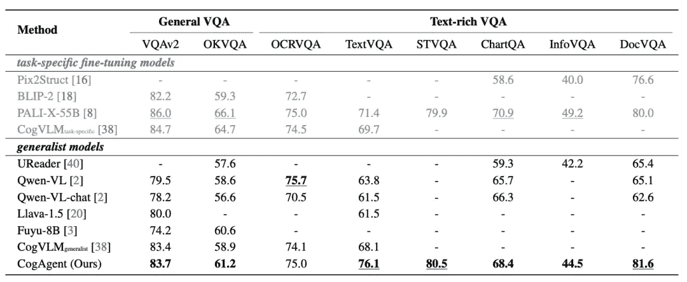
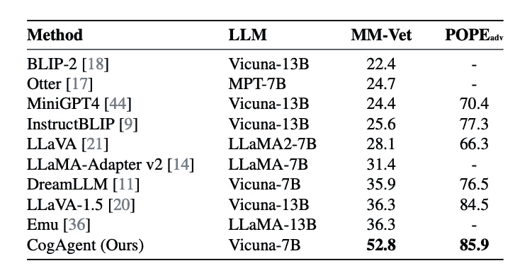
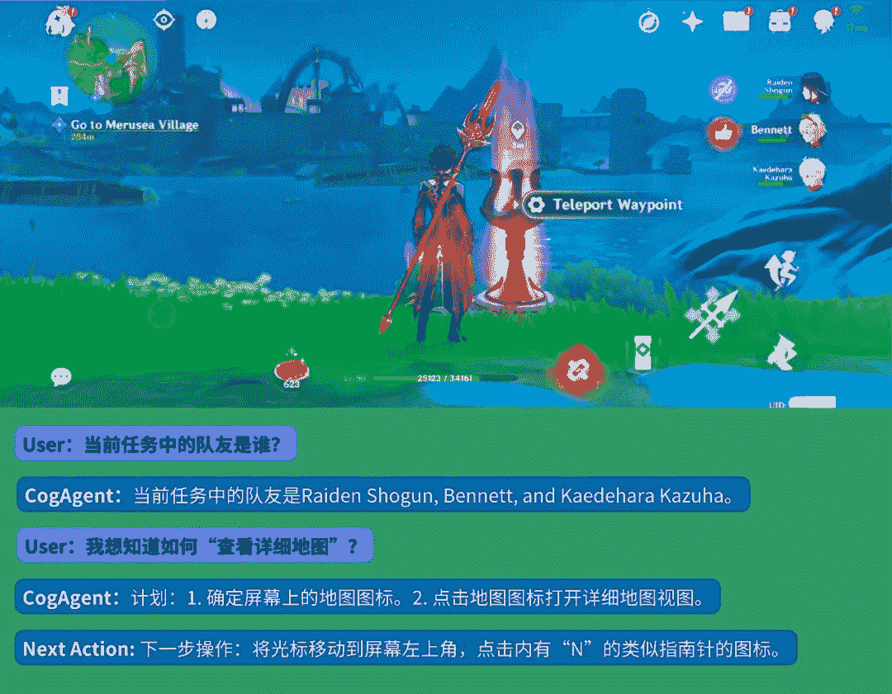

# 开源 · CogAgent：带 Agent 能力的视觉模型，免费商用

> 来源：[https://ai.feishu.cn/docx/HeyTdvRYAo8wO4xwRBWczjRNncf](https://ai.feishu.cn/docx/HeyTdvRYAo8wO4xwRBWczjRNncf)

10月11日，我们发布了智谱AI新一代多模态大模型 CogVLM，该模型在不牺牲任何 NLP 任务性能的情况下，实现视觉语言特征的深度融合，其中 CogVLM-17B 在 14 个多模态数据集上取得最好或者第二名的成绩。

12月15日，我们再次升级。基于 CogVLM，提出了视觉 GUI Agent，并研发了多模态大模型CogAgent。

其中，视觉 GUI Agent 能够使用视觉模态（而非文本）对 GUI 界面进行更全面直接的感知， 从而做出规划和决策。

而多模态模型 CogAgent，可接受1120×1120的高分辨率图像输入，具备视觉问答、视觉定位（Grounding）、GUI Agent等多种能力，在9个经典的图像理解榜单上（含VQAv2，STVQA, DocVQA，TextVQA，MM-VET，POPE等）取得了通用能力第一的成绩，并在涵盖电脑、手机的GUI Agent数据集上（含Mind2Web，AITW等），大幅超过基于LLM的Agent，取得第一。

为了更好地促进多模态大模型、Agent社区的发展，我们已将CogAgent-18B开源至GitHub仓库（申请可免费商用），并提供了网页版Demo。

+   论文：https://arxiv.org/abs/2312.08914Demo：http://36.103.203.44:7861/

+   代码：https://github.com/THUDM/CogVLM

模型

+   Huggingface：https://huggingface.co/THUDM/cogagent-chat-hf

+   魔搭社区：https://modelscope.cn/models/ZhipuAI/cogagent-chat

**

一、视觉 GUI Agen**t

基于语言预训练模型（LLM）的Agent是当下热门的研究话题，具备良好的应用前景。但是，一个严重的问题是，受限于LLM的模态，它只能接受语言形式的输入。

以网页agent为例，WebAgent [3] 等工作将网页HTML连同用户目标（例如“Can you search for CogAgent on google”）作为LLM的输入，从而获得LLM对下一步动作的预测（例如点击按钮，输入文本）。

然而，一个有趣的观察是，人类是通过视觉与GUI交互的。

比如，面对一个网页，当给定一个操作目标时，人类会先观察他的GUI界面，然后决定下一步做什么；与此同时，GUI天然是为了人机交互设计的，相比于HTML等文本模态的表征，GUI更为直接简洁，易于获取有效信息。

也就是说，在GUI场景下，视觉是一种更为直接、本质的交互模态，能更高效完整提供环境信息；更进一步地，很多GUI界面并没有对应的源码，也难以用语言表示。因此，若能将大模型改进为视觉Agent，将GUI界面以视觉的形式直接输入大模型中用于理解、规划和决策，将是一个更为直接有效、具备极大提升空间的方法。

对此，我们提出了多模态大模型CogAgent，可以实现基于视觉的GUI Agent。下图展现了其工作路径与能力。

CogAgent模型同时接受当前GUI截图（图像形式）和用户操作目标（文本形式，例如“search for the best paper in CVPR 2023”）作为输入，就能预测详细的动作，和对应操作元素的位置坐标。

**二、模型结构**

CogAgent的模型结构基于CogVLM [2]。

为了使模型具备对高分辨率图片的理解能力，可以看清~720p的GUI屏幕输入，我们将图像输入的分辨率大幅提升至1120×1120（以往的模型通常小于500*500）。

然而，分辨率的提升会导致图像序列急剧增长，带来难以承受的计算和显存开销——这也是现有多模态预训练模型通常采用较小分辨率图像输入的原因之一。

对此，我们设计了轻量级的“高分辨率交叉注意力模块”，在原有低分辨率大图像编码器（4.4 B）的基础上，增加了高分辨率的小图像编码器(0.3 B），并使用交叉注意力机制与原有的VLM交互。在交叉注意力中，我们也使用了较小的hidden size，从而进一步降低显存与计算开销。

结果表明，该方法可以使模型成功理解高分辨率的图片，并有效降低了显存与计算开销。

在消融实验中，我们比较了该结构与CogVLM原始方法的计算量。结果表明，当分辨率提升时，使用文中提出的方案（with cross-module，橙色）将会带来极少量的计算量增加，并与图像序列的增长成线性关系。

特别的，1120×1120分辨率的CogAgent的计算开销（FLOPs），甚至比490×490分辨率的CogVLM的1/2还要**小。在INT4单卡推理测试中，**1120×1120分辨率的CogAgent模型占用约12.6GB的显存，相较于224×224分辨率的CogVLM仅高出不到2GB。

三、实验GUI Agent能力

在电脑、手机等GUI Agent的数据集上，CogAgent具有较大的优势，大幅超过所有基于LLM的Agent。

1、在网页Agent数据集Mind2Web上的性能

2、在手机Agent数据集AITW上的性能

**图像理解综合能力**

CogAgent在图像理解的综合能力也有相当的提升，在9个经典的图像理解榜单上（含VQAv2，STVQA, DocVQA，TextVQA，MM-VET，POPE等）取得了通用能力第一的成绩。

3、在VQA数据集上的通用性能，涵盖常识、OCR、图表、文档等方面：

4、在多模态大模型通用榜单MM-VET，POPE上的结果：

下面我们展示一个《原神》场景的实例：

