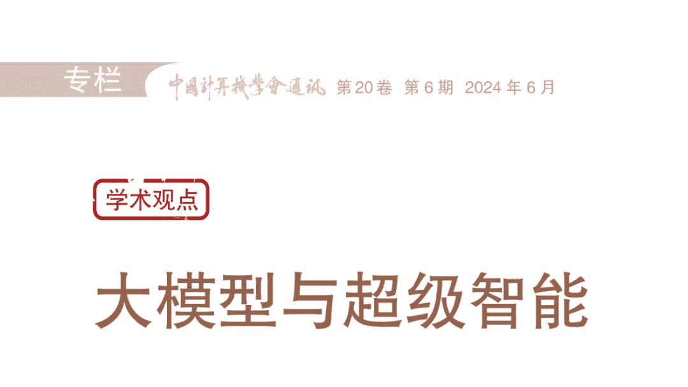
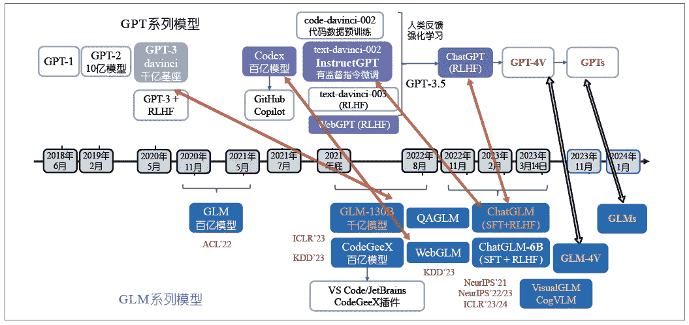
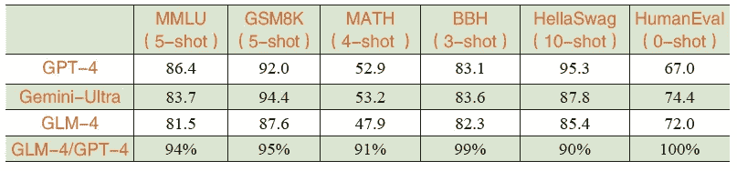
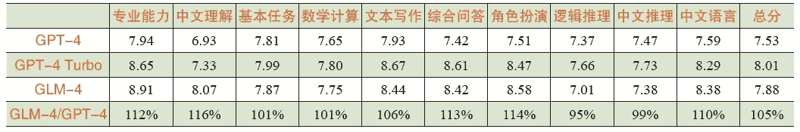
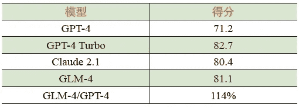
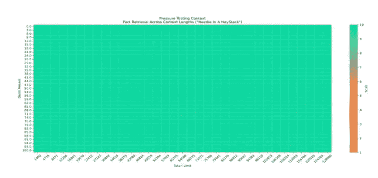
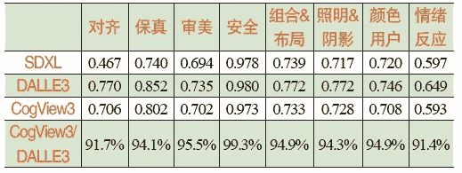
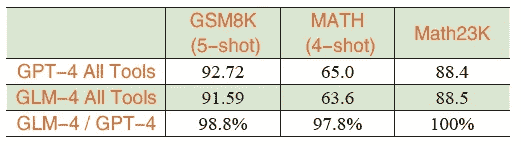
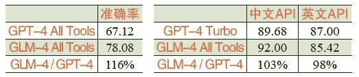
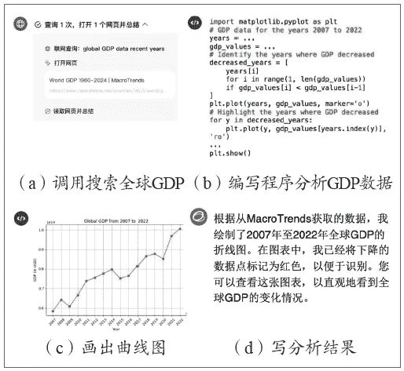

# 观点 · 大模型与超级智能

> 来源：[https://ai.feishu.cn/docx/BikCdMB7foWJUrxiv6Gcycr0nAc](https://ai.feishu.cn/docx/BikCdMB7foWJUrxiv6Gcycr0nAc)

> 本文探讨了大模型的发展历程，介绍了作者团队研发的GLM-4大模型，并针对AGI研究面临的挑战对AGI未来发展提出了一些思考。

超大规模预训练模型（也称基础模型、大模型，英文为Foundation Model、Big Model等）快速发展，成为国际人工智能领域研究和应用的前沿焦点。OpenAI ChatGPT和Sora的推出引发了社会和公众的广泛关注，并引起了大模型是否会引发新一轮行业变革甚至新一次工业革命的讨论。大模型作为ChatGPT和Sora等生成式人工智能技术产品的核心技术基座，正在快速改变产业格局，孕育出全新的用户交互模式，形成舆论引导、社会治理、信息服务等方面的不对称优势。大模型也被认为是通向通用人工智能(Artificial General Intelligence，AGI)的重要途径之一，成为各国人工智能发展的新方向，正在成为新一代人工智能的基础设施。人工智能大模型已成为国际科技“必争之地”，实现国产全自研、自主可控的人工智能基础模型迫在眉睫。

当前，我国人工智能基础模型研究、应用与产业化发展正处于从模仿追赶迈向创新引领的关键时期。大模型的快速发展给全球科技创新带来全新挑战：超大算力需求、超大规模数据需求、全新模型训练算法与框架、安全可信的软硬件系统，同时大模型的应用需求也更加动态多样，要求对大模型的不同层次进行深入研究。这是个全新的人工智能科学难题，也是我们赶超国际的机会。发展可媲美人类智能的人工智能系统已经成为人工智能领域研究的国际共识。

# 一、**大模型发展回顾**

从技术层面而言，ChatGPT的优异表现主要依托超大规模预训练基座模型GPT-3/3.5/4、有监督指令微调以及基于人类反馈的强化学习。回顾大模型的发展史，大致可分为四个阶段。

## 1.1 **算法之战（2018—2020）**

2017年谷歌提出了具有自注意力机制的Transformer机器学习模型架构，该架构迅速席卷了整个人工智能研究领域，成为自然语言处理等相关研究的主要方法。2018~2020年先后出现了基于Transformer的BERT、GPT/GPT-2/GPT-3、T5等基于大规模无标注数据自监督学习的大规模预训练算法。这些算法模型均在大数据支持下拥有较大规模模型参数，具备较强的通用能力，可完成多场景任务，显著降低学习成本、提高学习效率。尤其是BERT在十多个自然语言理解任务上的精度大大超过传统算法，掀起了BERTology的研究范式；2019年GPT-2实现了自然流畅的文本内容生成，彼时基于GPT-2的应用Talk2Transformer让人惊艳（当然现在和ChatGPT比起来算是粗糙的了），同时也使笔者坚定了投身生成式人工智能的决心；2020年谷歌的T5将自然语言的翻译、分类、回归、摘要生成等任务都统一转成文本到文本(text-to-text)任务。可以说2018~2020年是大模型的算法创新年，这段时间笔者团队研发了属于我们自己的算法GLM(General Language Model)。

## 1.2 **模型之战（2020—2022）**

这个时期基于各种预训练模型框架和算法，多种模型如雨后春笋般诞生。2020年的GPT-3（拥有1750亿参数）可以看作这一战的起点，它开启了基座模型的新时代，在语言生成、上下文学习和知识（常识）理解等方面展现出惊人的能力。很多人喜欢把这一年叫做大模型元年。随后全球范围内掀起了一股大模型研究的热潮，谷歌、Meta等公司开始不断发布百亿到千亿的大型语言模型，例如Gopher（2021年）、Chinchilla（2022年）、PaLM（2022年）、Claude（2022年）。但是这些模型都不开源，因此开源大语言模型也开始受到关注，比如Meta的OPT（2022年）、LLaMA（2023年）和HuggingFace的BLOOM（2022年）。国内一直缺少原创的开源千亿基座模型，更重要的是产学研各界对大模型的发展和产业化还没有形成共识，对于应该发展大模型还是转而发展小模型，大家还没有达成统一认识。2022年，清华大学和智谱AI开源了基于GLM算法训练的千亿基座模型GLM-130B，这一工作引起了全世界的关注，包括斯坦福大学、谷歌、OpenAI、Apple、Meta都对该模型进行了深入分析和对比。2022年11月斯坦福大学发布的大模型评测报告，对全球30余个开源模型进行了深入评测，GLM-130B是亚洲唯一入选的模型，在准确性和公平性指标上与GPT-3接近或持平，鲁棒性、校准误差和无偏性优于GPT-3。这一时期，国内外在大模型的研发上可以说是百花齐放。国内如清华大学、北京智源人工智能研究院、百度、华为、阿里、智谱AI等，都竞相追赶。

## 1.3 **产业落地之战（2023）**

2022年11月30日ChatGPT发布，唤醒了所有人对大模型的认知，大模型开始广为人知。一夜之间，似乎所有人对必须发展大模型达成了共识。大模型的发展不再仅限于模型技术的发展和模型训练本身，更重要的是如何实现模型的产业化应用。大模型开始在各个领域开花结果，在金融、互联网和教育等众多行业落地。得益于GLM-130B基座模型的能力，笔者团队仅用了2个多月，在2023年2月初就研发出了第一代ChatGLM，是国内最早可以线上测试使用的千亿级对话模型；同年8月基于ChatGLM开发的智谱清言通过国家第一批《生成式人工智能服务管理暂行办法》备案认证，正式面向公众上线使用。随后，全国多个产业纷纷投身大模型：短期的做AI升级，原来用分类算法、小模型实现的开始用大模型替代；中期的开始研究自己的定制化大模型。于是各种领域大模型（例如数学大模型、化学大模型、医疗大模型等）以及基于已有算法框架训练注入不同数据训练出的各种模型纷纷推出，一时间形成了“百模大战”的情形。仅此一年，据不完全统计，全国实现大模型初步应用的企业和部门有数千个。2023年是大模型产业落地元年。

一个插曲是2023年3月14日这天（大模型里程碑日），就像事先约好了一样，OpenAI发布了效果再次遥遥领先的GPT-4模型，Anthropic发布了对标ChatGPT的Claude，谷歌推出对抗OpenAI和微软组合的PaLM API服务(Bard)，我们开源了ChatGLM-6B，斯坦福大学发布Alpaca，Midjourney发布V5。其中，ChatGLM-6B三个版本的全球下载量超过1300万，在GitHub上总计星标数达到6万，超过Meta的LLaMA两个版本总和；团队也是GitHub公布的星标数超过500、大模型开源项目数最多的五个科研机构之一（前四分别是：Open AI、微软、HuggingFace、谷歌）。2023年笔者团队也有幸获HuggingFace全球最受欢迎的开源机构第五名，超过OpenAI、谷歌、微软，也是国内唯一上榜的机构。更加值得高兴和欣慰的是，我们发现开发者在这些开源模型上，开发出了700多项优秀的大模型开源项目，这也坚定了我们要围绕开发者继续研发新一代大模型、建立大模型生态的决心。2023年3月14日这一天，所有大模型的研究者、产业工程师们都在社交媒体（Twitter等）上欢呼，大模型里程碑日来了。时至今日，那天发布出来的模型都是经典中的经典。

## 1.4 **AGI元年（2024）**

OpenAI在2024年初推出了文本到视频生成模型Sora，这应该是目前最好的视频生成模型。Sora能够生成一分钟的高精度视频。更重要的是，这让大家看到也许这是构建物理世界通用模型的可能路径。Sora的主要技术思路是用视觉块编码(Visual Patch)的方式，把不同格式的视频进行统一编码，然后用Transformer架构进行训练，并引入类似Diffusion的Unet方式在降维和升维的过程中做加噪和去噪。Sora技术报告提到是一个Diffusion Transformer架构，但笔者团队曾经测试发现该架构与Unet相比有一定差距，因此OpenAI可能在这方面做了较大的改进。此外，OpenAI极有可能在2024年推出下一代模型GPT-5，也许会有全新的代号，无论如何比较肯定的是其认知能力将带来通用人工智能的再一次变革。其下一代模型在技术上可能解决目前ChatGPT中存在的事实性以及推理能力的缺陷，实现更精细的语义理解、多模态（文本、图像、语音、视频等）输入和输出，具备更强的个性化能力。此外人工智能的发展会更多瞄向通用人工智能，实现AI的自我解释、自我评测和自我监督，构建超过人类水平的超级认知智能(super intelligence)，并且确保模型的表现符合人类的价值观和安全标准。2023年7月，OpenAI公布了由其首席科学家伊利亚·苏茨克维(Ilya Sutskever)和首席强化学习专家詹·雷克(Jan Leike)发起的超级对齐计划(Superalignment)，目标就是实现机器自动对齐人类智能和人类价值观，实现模型的自我反思和自我监控。相信在2024年会有更多研究者加入到通用人工智能和超级认知智能的研究中。

# 二、**GLM-4**

大模型经过预训练后可以获得语言生成、世界知识、上下文学习(in-context learning)、代码理解/生成、复杂推理/思维链等能力。OpenAI的GPT系列模型历经三个主要阶段，形成了目前ChatGPT的对话能力。第一个阶段是2018~2020年，OpenAI每年发布一个基座模型版本，直到2020年的千亿基座模型GPT-3，其基础的语言生成能力和零样本泛化能力大大增强。第二个阶段是指令微调，旨在提升模型在各项任务上的泛化能力，要求指令种类足够多，每种指令的例子也要足够多。指令的指数级增长会带来跨域迁移能力的线性增长。单个指令下实例数的指数级增长也会带来该指令能力的线性增长，但也可能使其他指令的能力弱化，因此组合泛化能力尤为重要。例如，给定的指令同时包含摘要、问答、生成代码的指令，模型可以自动将这三项能力混合在一起，同时完成问答、摘要生成、代码生成的任务。可以将指令视为线性代数中的一组基，将不同能力混合在一起实际上就是对线性空间中的基做线性组合或凸组合。模型在没有见过指令时，只能在学到的空间内做插值，而很难外推到没有学习到的基上。第三个阶段是人类反馈的强化学习，这是根据用户反馈通过强化学习优化模型输出。在ChatGPT之后，OpenAI又增强了GPT-4的多模态能力，并通过增强智能体(agent)能力实现了应用商店GPTs。

笔者团队在2020年提出GLM算法框架，从那时起，我们就希望GLM能成为与OpenAI的GPT对标的技术体系。2022年我们发布了GLM-130B千亿基座模型，2023年连续发布了三个对话模型ChatGLM、ChatGLM2、ChatGLM3。2024年1月16日，我们公布了最新的GLM-4，将基座模型和对话模型统一了起来。相比ChatGLM3，GLM-4的性能大大提升，接近GPT-4；支持更长上下文（128 K）；支持更强的多模态能力；支持更快的推理速度、更多的并发，大大降低推理成本；同时GLM-4增强了智能体能力。图1展示了GPT系列模型和GLM系列模型的演进历史。

图1 GPT系列模型与GLM系列模型对比

## 2.1 **GLM基础能力**

我们对GPT-4和GLM-4在若干数据集上进行了全面的测试分析。表1列出了在国际通用英文数据集上的评测结果。第一个数据集MMLU是大规模多任务语言理解的基准，主要评估模型的零样本(zero-shot)和少样本(few-shot)学习能力。该基准涵盖STEM（科学、技术、工程、数学）、人文科学、社会科学等57个科目。它的难度从初级到高级专业水平不等，考验模型掌握世界知识和解决问题的能力。科目范围涵盖从传统领域（如数学和历史）到更专业的领域（如法律和道德）。GSM8K是一个由8500个高质量的语言多样化的小学数学问题组成的数据集，这些问题都是由人类写手创造的。MATH数据集则包含初等代数、代数、数论、计数和概率、几何、中等代数和微积分等领域的多种数学问题，是用LaTeX写的，也就是说并不全是自然语言，而有点像代码阅读。BBH是谷歌推出的一个面向推理的基准测试套件，涵盖了各种AI复杂任务，可以评估语言模型在各种复杂任务上的性能。HellaSwag是一个用于评估自然语言处理模型在常识推理方面表现的基准测试集，由OpenAI团队开发，旨在测试模型解决具有误导性的场景推理问题的能力。它包含70000个多项选择问题，每个问题都涉及两个具体领域的场景。这些问题伪装成可能令人产生错觉的正确答案，目的是测试模型的常识推理能力。在这些数据集上，总体来说GLM-4接近GPT-4。

表1 基础能力评测（英文）

## 2.2 **GLM中文对齐能力**

在模型实际应用过程中，我们更注重中文的对齐能力。表2列出了GLM和GPT在中文对齐能力方面的评测对比。数据集使用的是AlignBench。在AlignBench上，GLM-4甚至超过了在2023年6月13日发布的GPT-4，逼近GPT-4 Turbo（GPT-4最新版本，2023年11月6日发布）的效果，尤其是在专业能力、中文理解、角色扮演方面甚至超过GPT-4 Turbo的精度，但在中文推理方面的能力还有待进一步提升。

表2 对齐能力（中文，数据集：AlignBench）

## 2.3 **GLM长文本能力**

GLM-4支持更长上下文窗口能力（128 K），表3对比了GLM-4和国际上效果最好的几个模型，包括OpenAI的GPT-4和Anthropic的Claude2.1。可以看出GLM-4的效果超过了GPT-4和Claude 2.1，接近GPT-4 Turbo。在大海捞针(Needle Test)测试中，在128 K文本长度内，GLM-4模型均可做到几乎百分之百的召回精度（见图2），基本解决了长上下文全局信息因为失焦而导致的精度下降问题。也就是说，单次提示词可以处理的文本可以达到300页，开发者再也不用担心文档太长而无法一次性处理完了。最重要的是，这个技术可以比较容易地扩展到1 M甚至无限长上下文，例如谷歌最近推出的无限长上下文Transformer。

表3 长上下文能力评测（中文，数据集：LongBench、Needle Test）

图2 Needle Test (128 K)，全绿表示100%召回精度

## 2.4 **GLM多模态能力**

GLM-4内嵌了CogView3。CogView是我们从2021年开始研发的文生图系列模型，目前已经推出CogView、CogView2和CogView3三个版本，几乎是和DALL·E的系列模型同期推出。表4列出了CogView3和SDXL、DALL·E3的对比情况。可以看出，在各项指标上，CogView3都明显超过开源最佳的SDXL，与OpenAI最新发布的DALL·E3相当，在对齐、保真、安全、组合&布局等各个评测维度上，CogView3的效果能达到DALL·E3的90%以上。

表4 文生图性能评测（SDXL是开源最佳模型）

## 2.5 **GLM智能体能力**

GLM-4还有一个全新的功能——All Tools。传统的大模型系统只能用大模型的某一个功能，或者使用提示词激活某个方面的能力。All Tools基于GLM模型的智能体能力，实现根据用户意图，自动理解、规划复杂指令，自由调用网页浏览器、代码解释器(code interpreter)和多模态文生图大模型，以完成复杂任务。类似于OpenAI近期推出的GPTs的基础能力，只需一个指令，GLM-4就会自动分析指令，结合上下文选择要调用的合适工具。表5给出了GLM-4和GPT-4的All Tools性能对比：通过自动调用Python解释器进行复杂计算（复杂方程、微积分等），在GSM8K、MATH、Math23K三个数据集上，GLM-4均能取得与GPT-4相当的效果。其中Math23K是一个用于研究机器自动解数学应用题的数据集，包含23162道小学数学应用题及其解题公式，可被用来检验大模型对数字的理解能力。

表5 GLM-4和GPT-4的All Tools对比：代码解释器

表6给出了GLM-4和GPT-4在网页自动浏览以及函数自动调用方面的性能对比。网页自动浏览是指模型自行规划检索任务、自行选择信息源并自动与信息源进行交互。函数调用是根据用户提供的函数描述，模型自动选择所需函数并生成参数，以及根据函数的返回值生成回复。GLM-4支持针对一次输入进行多次函数调用，并支持包含中文及特殊符号的函数名字。

表6 GLM-4和GPT-4的All Tools对比：网页浏览（左）和函数调用（右）

图3展示了一个例子，问题是“查询一下全球近年的GDP。分析这些数据中哪些年份GDP下降了，画折线图并将下降的年份标红”。可以看到GLM-4首先自行决定调用搜索，从网页中找到全球GDP数据，然后选择编写程序实现GDP数据的曲线统计，通过解读“对下降年份标红”，在程序中设置了两种不同的标记方式并画出曲线图，最后给出了对曲线图的解读。可以看出GLM-4已经实现了自动将多个工具无缝整合使用。

图3 GLM-4 All Tools案例：“查询一下全球近年的GDP。分析这些数据中哪些年份GDP下降了，画折线图并将下降的年份标红”

在智能体能力和All Tools工具的支持下，GLM-4实现了GLMs模型应用商店。截至2024年4月20日，已经有20多万应用在GLMs登陆。访问量最高的智能体应用每天支持数万用户访问。GLM-4智能体使任何人都能够运用GLM-4模型并挖掘它的潜力，没有任何编程基础也能够实现大模型应用的开发。

# 三、**关于AGI的一点思考**

当前AGI的研究还面临很多挑战，很多基础理论问题尚未得到根本解决，包括：

1.  未来AGI之路在哪里？是多模态预训练模型还是用大模型实现智能的操作系统？

1.  如何实现超级对齐？从更理论的角度，也许AGI也需要参考人脑智能的实现机理。

1.  如何实现更高效的训练，摆脱现在依赖英伟达的GPU路线？能否统一芯片和模型算法，实现更加高效的模型训练？

笔者团队针对以上三个挑战，围绕超级智能和超级对齐，融合软件和硬件展开相关AGI研究。

## 3.1 **未来AGI之路在哪里？**

这可能是所有做大模型研究的学者不断思考的事情。笔者有幸在大模型“热”起来之前和学术界、产业界的研究者一起组织了多次CCF启智会，现在回顾，确实在过去几年诞生了若干精妙的思想和技术。同时也要看到，在美国，OpenAI、Google DeepMind、Anthropic、Meta、xAI、斯坦福等公司和科研机构基本上形成了国际顶尖的大模型团队，这源于它们对创新型顶尖人才的汇聚，以及对基于大模型的AGI之路的执着和技术积累。OpenAI曾经在看不到前景和没有明显效果的阶段(2018~2021年)，仍然坚定地投入大量人力和算力，这种长期的坚持和纯粹的创新精神是成功的必要条件。

AGI是否能够通过大模型的缩放定律(Scaling Laws)来实现？缩放定律描述了大模型性能与其参数量、数据规模、计算量之间的关系。虽然备受质疑，但直到今天，可能高质量的缩放仍然是提高大模型性能的重要方法。一方面，这几个因素相互关联，参数量更大的语言模型需要更多的高质量数据和训练量，以兼顾文本理解和生成任务上的规模扩展效果。另一方面，多模态超大规模预训练模型的兴起，要求模型算法具备在多模态数据（如图片、视频）输入输出条件下的规模扩展。这就要求在模型架构、训练算法、人类意图对齐等方法上不断创新。

此外，从理论的角度，AGI也需要参考人脑智能的实现机理。基于大模型的AGI或者说机器智能不一定要和人脑认知的机理一样，但剖析人脑的工作机理也许可以更好地启发AGI的实现。人脑是一个复杂系统，枕叶中视觉脑区负责视觉理解、韦尼克区负责听觉语言理解、顶下小叶角回负责视觉语言理解；海马区、蛋白质磷酸修饰、长时程增强、新蛋白产生分别负责学习和短期/中期/长期记忆的形成；前额叶则负责工作记忆、规划、规则学习和推理等复杂任务。各脑区相互配合完成人的复杂认知功能。这些分析将有助于AGI的研究。

## 3.2 **新型原生多模态基座模型**

在大模型基座方面，目前的大模型主要基于Transformer架构，有三种主流架构：编码器(encoder-only，例如BERT)、编码器-解码器(encoder-decoder，例如T5)，以及解码器(decoder-only，例如GPT)。这几个架构都是国外设计并流行起来的，OpenAI把解码器发挥到了极致，Meta则将其开源引发全球技术跟随。国内在原始创新和自主研发方面严重欠缺。清华大学和智谱AI结合了BERT和GPT的优势，设计了GLM架构。但如何从本质上改进预训练模型的基座能力，实现Transformer架构上的颠覆式创新还存在巨大挑战。

另外，以GPT-4为代表的一系列语言模型基于互联网上海量的文本语料进行预训练，在语义理解、指令遵循等方面展现出了惊人的能力。然而，这些语言模型只能以文本形式处理内容，并无法处理图片等其他模态的信息。形如GPT-4V等视觉文本多模态模型通过一个视觉编码器(Vision Encoder)和语言模型建立连接，使得模型初步具备一定的图片理解能力，但这种文本视觉的交互仍然处于浅层。如何利用好互联网上海量的多模态语料（图片、音频、视频）进行大规模训练仍然具有挑战。原生多模态基座模型(Multimodal Foundation Models)通过在同一预训练过程中整合来自不同模态的数据，能从多个维度建模世界知识，不同模态的信息相互帮助，从而大大提升模型的理解能力，为下游应用打开了更广泛的想象空间。

## 3.3 **超级对齐**

OpenAI的研究者声称已经掌握实现通用人工智能的关键技术。GPT-5.0很可能会解决目前ChatGPT中存在的事实性以及复杂推理方面的缺陷；也可能会采用更高效的算法和更先进的计算架构，实现更大的模型容量和更强的泛化能力（如自动实现对低资源语言的支持，以更好地满足非英语用户的需求），具有更快的计算速度和更大的模型容量。未来实现超级智能的大模型将在人类面对的考试、工作、生活等若干方面超越人类智能，甚至在未来的知识创新方面达到或超过人类水平，实现超级智能。

超级智能将是人类发明的最具影响力的技术，并可能帮助我们解决世界上许多重要的问题。但是超级智能的巨大力量也可能产生一些危害。因此，模型学习的时候需要过滤掉包含极端观点、误导性信息和令人反感的内容的文本，让模型纠正不合适的输出，更好地了解人类的价值观、期望、意识形态和政治立场。虽然超级智能现在看似还很遥远，但OpenAI于2023年7月发布了超级对齐计划，认为超级智能可能在未来十年到来。为了管理可能的风险，我们将需要新形式的治理机构，并解决超级智能对齐问题。比如：我们如何确保比人类聪明得多的AI系统遵循人类意图？目前，对于可能具有超级智能的AI，我们尚无解决方案来指导或控制它，以防止它变得不可控。目前用于对齐AI的技术，依赖于人类监督AI的能力，但当前的AI对齐技术无法扩展到超级智能，需要全新的、颠覆式的科学和技术突破。一个可能的方法是建立一个与人类水平相当的自动对齐系统，让AI能够自己判断自己的行为和输出。这不仅需要设计全新的算法实现可扩展训练、自动模型结果验证、自动对超级对齐结果进行评估，同时还需要超大规模的算力迭代实现超级智能对齐。

## 3.4 **大模型操作系统**

随着大规模语言模型的兴起，基于语言模型的智能体系统逐渐崭露头角。形如AutoGPT、BabyAGI等系统能够以语言模型为中枢，对任务进行规划(Planning)，管理任务求解过程中的上下文(Memory)，并配备相应的工具插件(Tool use)，从而完成复杂的任务。然而，一方面受限于语言模型的基础能力，另一方面对复杂任务的规划和记忆管理还处在初级阶段，这类系统往往只能解决一些简单任务。如何构建一个通用的，针对复杂任务的Agent框架，使其具备规划、记忆、工具使用等能力，同时能像人类一样与真实环境动态交互，从行动中“反思”(Reflection)和进步，是进一步提升当前人工智能水平的必经之路。基于基础大模型在数字与物理世界中探索和积累的经验，我们可以设计和开发出真正意义的通用大模型智能体系统(General Agent OS)。

## 3.5 **芯算一体大模型机**

传统的大模型研究思维一直是围绕芯片进行算法设计，导致当前所有大模型的基础算法都只能在H100/A100类似体系架构上进行设计与实现。芯算一体大模型机是一种将芯片（核心硬件）与算法（软件）深度融合的下一代计算设备，目标是实现超高算力、超大存储以及优化的数据处理能力，为人工智能、大数据分析、科学计算等高性能计算提供基础支撑。大模型规模不断扩大，其对计算资源的需求也在急剧增加。传统的CPU架构在处理大规模并行计算任务时存在效率瓶颈，而GPU架构并行处理能力很强，但在制程方面被美国“卡脖子”。以华为、海光DCU为代表的国产芯片虽然在这方面取得了很大进展，但距离英伟达GPU还有一定距离，急需跨越式的软硬架构设计新思路。谷歌的张量处理单元(Tensor Processing Unit，TPU)以及其他类脑芯片在这方面也有一定创新，但仅面向谷歌内部使用。

因此，有必要从底层开始，围绕大模型/AGI算法设计研发新型芯算一体大模型机。当前国产芯片被“卡脖子”的最关键技术是单GPU芯片的计算能力和芯片间的高速通信，尤其是后者。芯算一体大模型机的核心思想是首先设计全新的大模型算法，然后针对新算法优化内存使用，提升芯片计算效率和芯片间的通信效率，设计全新的芯算一体大模型机有望在多种模型研究上得到广泛应用，用于开发和训练更复杂的AI大模型，如多模态、智能体、自反思大模型。通过设计全新的大模型算法和整合专用硬件构建全新大模型训练体系结构，实现全新的软硬体系架构也许是一条解决芯片被“卡脖子”的方法，实现我们自己的大模型之路。

开放数据与公平评测。基础模型研究需要大量的算力和数据作为支撑，目前国内对基础模型的研究投入来自分散的数个科研团队和企业，重复建设现象比较严重。国外有The Pile、Common Crawl等大规模开放数据，但国内还缺少专门的组织进行大规模开放数据收集与共享。此外，在大模型评测方面我们也需要认真反思。ChatGPT是一个全世界范围的现象级产品，同时也得到全世界用户的“测试”，没有这种开放测试也不可能真正达到如今的效果。需要针对大模型的能力、安全、伦理等多方面问题，建立大模型的评测标准、评测方法和评测数据集，研究安全可控、符合道德伦理规范的大模型训练方法和生成方法。为帮助学术界、产业界更好地评判模型能力，需要各研究机构更加广泛地参与测评，创建更加公平的评测。笔者在IEEE成立了一个国际大模型能力与评测标准工作组，也欢迎产学研界研究者一起参与其中。

# 四、**结束语**

2024年是AGI元年，这一年注定将是不平凡的一年，我们需要在三个方面快速发展：短期推广大模型应用场景，给予大模型更大的落地发展空间；中期自研颠覆式大模型算法与技术，催生大模型与其他学科、产业的交叉发展新范式；长期布局基于大模型的通用人工智能AGI，瞄向世界领先行列。

大模型之路不再是简单的单个高校或者企业行为，更是国家战略。《人民日报》指出：大模型是新型AI基础设施的关键底座，大模型的竞争也是国家科技战略的竞争，中国一定要布局全栈自主创新的大模型产品。我们要专注自己原创的大模型理论、算法、产品，加速大模型以及基于大模型的通用人工智能的研发，帮助推动国家经济发展和产业升级。

> **唐 杰**

> CCF会士，CCF大模型论坛主席，CCCF前编委。清华大学计算机系讲席教授、人工智能研究院基础模型研究中心主任，ACM/AAAI/IEEE Fellow。主要研究方向为人工智能、认知图谱、数据挖掘、社交网络和机器学习。

> jietang@tsinghua.edu.cn