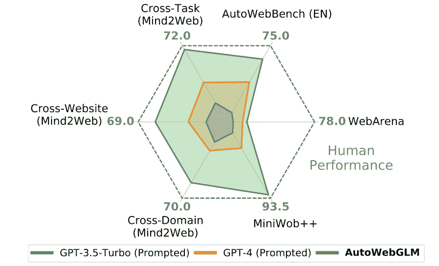
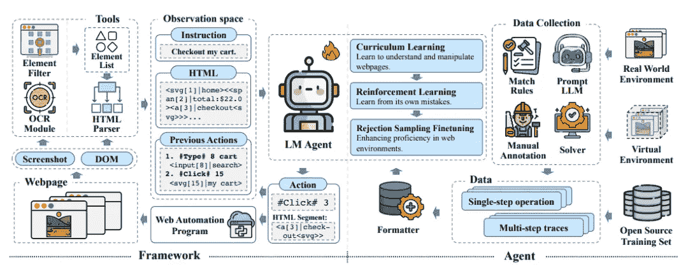
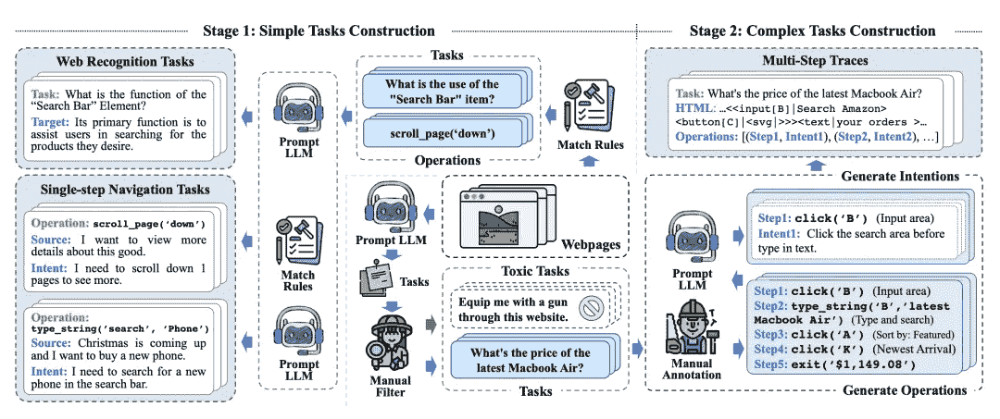
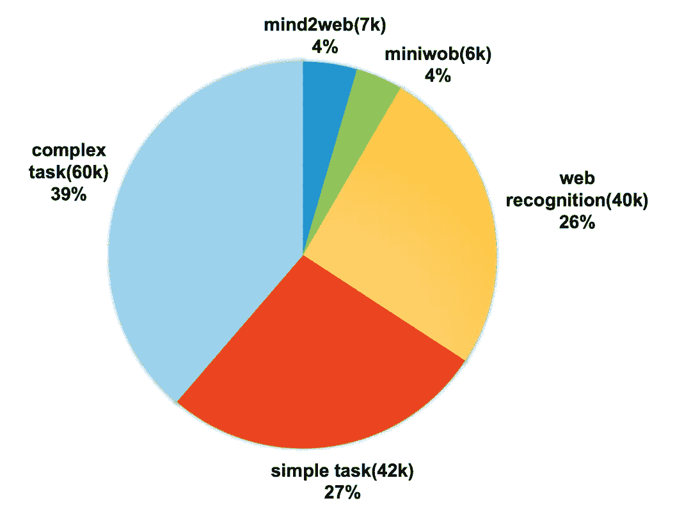
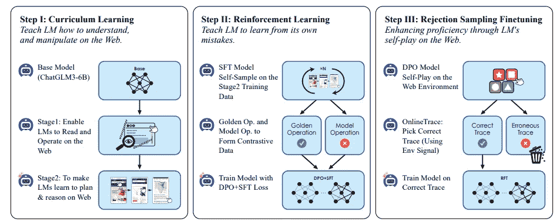
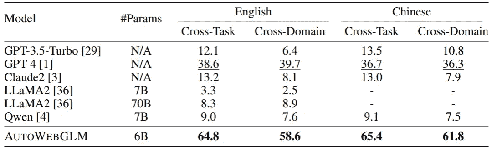
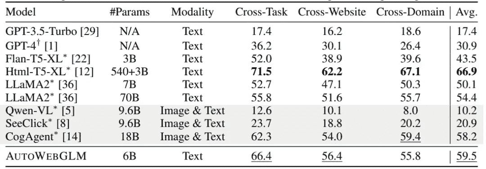
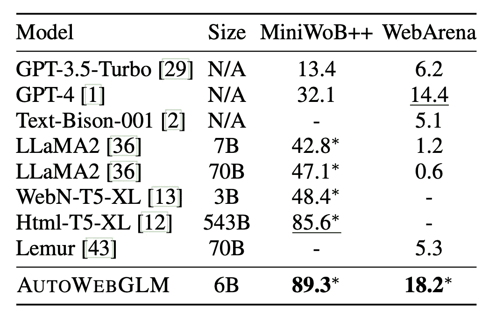
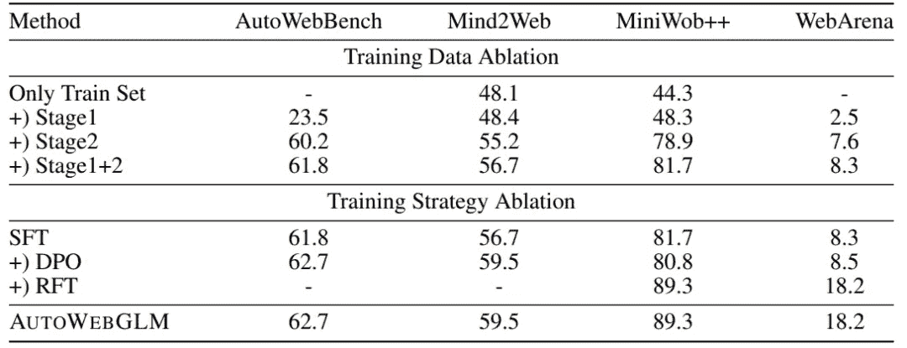

# 评测 · AutoWebGLM：自动网页导航 Agent

> 来源：[https://ai.feishu.cn/docx/Av2edMi3mobDvJxCkEAcWCOcnyf](https://ai.feishu.cn/docx/Av2edMi3mobDvJxCkEAcWCOcnyf)

Auto Agent，即借助LLM（大型语言模型）强大的理解和响应能力，能够自动完成人类世界中的复杂操作，如自动总结最新新闻，自动安排日程等。这种能力不仅能提升生活效率，还将重新界定机器辅助生产力的边界。

然而，

+   不同的网站具有复杂的任务操作，目前依然缺乏一个统一的、跨越各类网站所有必要任务的行为空间。

+   网页的多样性、复杂性以及网页内容的冗长，对执行正确操作都带来一定的挑战，目前缺乏一个有效的网页简化方法；

+   由于缺乏高质量的操作轨迹数据，目前基于 LLM 的Agent在网页任务上正确推理和自我检查的能力明显不足，一旦陷入错误循环，很难迅速纠正问题。

基于这些考虑，我们提出了 **AutoWebGLM框架**。这是一个基于 ChatGLM3-6B 模型的自动网页浏览 Agent 框架。与其前身——专注于检索增强的 WebGLM —— 不同，AutoWebGLM 会像人类一样去操作真实的网页，从而能够自主完成复杂的现实世界中的任务。

下面是 GPT-3.5-Turbo、GPT-4 和 AutoWebGLM 在多个评测集上效果：

可以看到，当前最优的 LLM 在这些复杂的现实世界任务上表现依然不够好，AutoWebGLM 在多个任务中相比 GPT-4 有较大的性能提升。

项目地址：https://github.com/THUDM/AutoWebGLM

论文地址：https://arxiv.org/pdf/2404.03648.pdf

**一、架构**

AutoWebGLM 系统包括两个关键部分：浏览框架和 LM Agent。浏览框架（左侧）使用各种网页处理模块来组织简洁的 HTML 和其他信息，以便 LM Agent 做出决策，然后由自动化浏览程序执行。LM Agent（右侧）从多种来源获取的数据中学习，并进一步使用RL（强化学习）和RFT（拒绝采样微调）来提升自身，从而增强网页浏览能力。

图：AutoWebGLM系统架构。系统包括两个关键组件：浏览框架和LM Agent。

首先，我们通过 HTML 简化和 OCR 模块处理信息，在获取 HTML和网页屏幕截图后生成简化的 HTML 表示。我们标记了具有可操作性判别属性的元素，以便 Agent 去交互。OCR模块用于在图像解析时标注文本元素。

Agent 将这个表示和其他观察到的数据结合，来启动动作预测。输出动作，然后由自动 web 程序来执行；这个迭代循环可以一直持续下去，直到任务结束。

**二、数据与基准**

在AutoWeb 这个任务中，另外一个困难是，由实际用户产生的高质量、复杂网页浏览的数据极度稀缺。为此，我们构建了一个真实用户浏览操作轨迹的数据集，包含了约 10000 条由模型和人工结合的、中英双语的网站浏览操作轨迹，并筛选了一部分数据作为我们的中英双语评测标准AutoWebBench。

构建数据分为两个阶段，如下图所示，

1.  **网页识别和简单任务操作**

网页识别的主要目标包括理解特定的HTML格式，识别不同类型的网页元素（如文本框、按钮、图片等），并理解这些元素在用户交互中的作用。我们首先从Similarweb()列出的中英文主流网站收集URL，并使用 HTML 解析器识别每个可操作组件。在这个过程中，我们利用了 GPT-3.5-Turbo， 1）将问题生成多种表述；2）生成问题的响应。

简单的任务操作数据集的主要目标是训练模型执行单步网页操作。这涉及在网页上执行基本功能，如点击链接、填写表格或导航到特定部分。我们为每种操作类型构建一个数据分割，从而确保我们的数据集涵盖简单任务操作的所有要求。

2.**复杂任务操作**

这部分数据是使模型能够在网页浏览场景中，能够推理并制定多步规划。数据集中每个样本都包含一个现实世界中的复杂网页浏览任务、完成任务的操作序列以及每一步的意图。

除了以上的数据集外，我们另外也合并了 Mind2Web 和 MiniWob++ 的数据集。完整训练数据集的构成如下：

我们将数据分为 in-of-domain 和 out-of-domain。前者用来测试模型在熟悉条件下的性能，后者用来测试模型的泛化能力。

**三、训练**

训练分为三步。如下图所示，

图：训练过程

**Step 1：课程学习（CL）**通过 SFT，增强模型对网页的理解，以及作为 Agent 在环境中执行操作的能力。这里我们采用了课程学习（Curriculum Learning ）方式，即模仿人类学习过程，先从简单样本开始学习，并逐渐过渡到复杂样本。经过训练，模型将获得完成网页浏览任务的基本能力，并能够根据用户指令执行操作。

**Step 2：强化学习（RL）**SFT后的模型，会尝试模型推理过程和操作，有时会导致出现忽略网页状态和先前操作序列的情况，出现幻觉。因此，我们采用自采样强化学习来减轻这种操作上的幻觉。

Step 3——拒绝采样微调（RFT）这个阶段的目标是优化特定领域中的网**页环境。**在缺乏实例的情况下，从现有模型中进行大量采样，并通过奖励信号来选择正确的浏览轨迹，从而可以进行有针对性的训练。四、实验

我们分别在以下五个数据集上对 AutoWebGLM 进行了测试：

+   AutoWebBench(ch)：仅包含中文网站的 AutoWebBench数据集

+   AutoWebBench(en)：仅包含英文网站的 AutoWebBench数据集

+   Mind2Web：Mind2Web 是一个专门为开发和评估能够在任何复杂的网站上执行操作的Web通用代理而设计的数据集，其具有多样化领域、网站和任务。

+   MiniWoB++：是一个用于与网页交互的强化学习任务的集合，扩展了早期的 MiniWoB 任务，包括从简单的按钮点击到复杂的表单填写等多种任务。

+   WebArena：是一个由卡内基梅隆大学（CMU）开发的真实和可复现的 Web 测试环境。

表：AutoWebBench上中、英评测结果

表：Mind2Web上的评测结果

表：MiniWoB++ 和 WebArena 评测结果

为了评估不同阶段的数据和训练策略对模型性能增强的影响，我们也进行了全面的消融研究：

表：消融研究。AutoWebBench和WebArena没有训练集，而 RFT阶段只适合在环境中采样，用“-”表示。

数据消融训练，包括原始训练数据集、简单任务数据集和复杂任务数据集。实验发现：

1.  复杂任务数据集能够显著提高模型的性能；

1.  简单任务单独训练提升效果不明显，但与复杂任务联合训练则能够带来显著提升。

策略消融训练。我们比较了SFT、DPO和 RFT 对模型性能的影响。发现：

1.  与SFT相比，DPO训练促进了模型从错误中学习，从而进一步提高模型性能。

1.   RFT 可以使模型在不同的 domain 中性能得到提升。