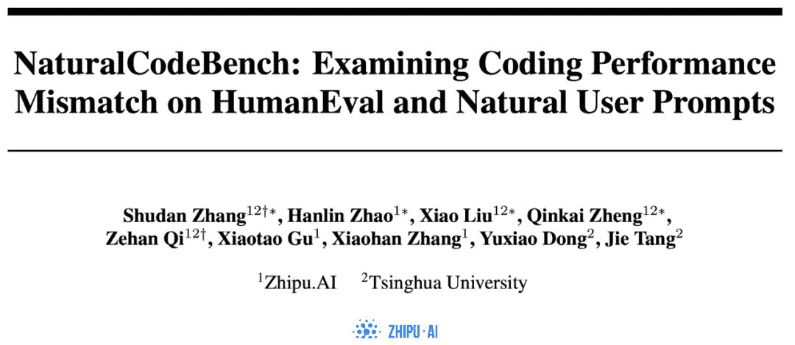
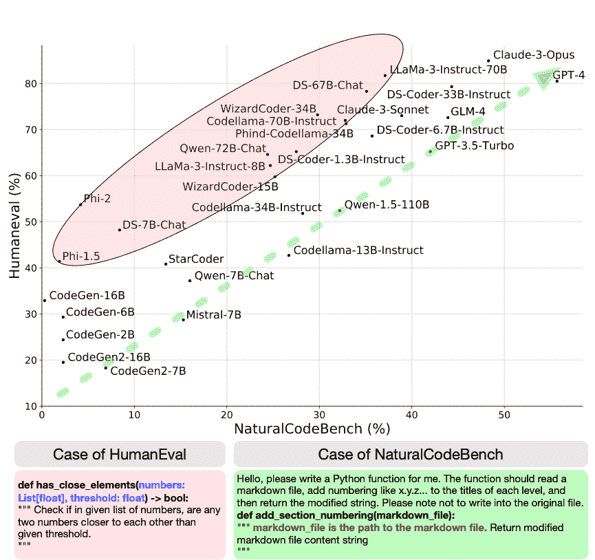
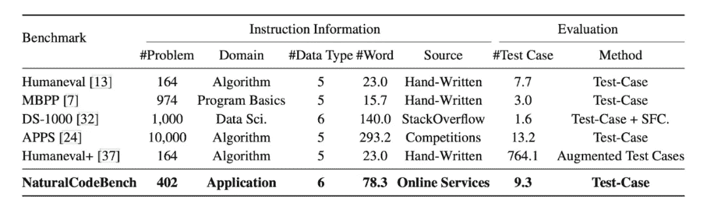
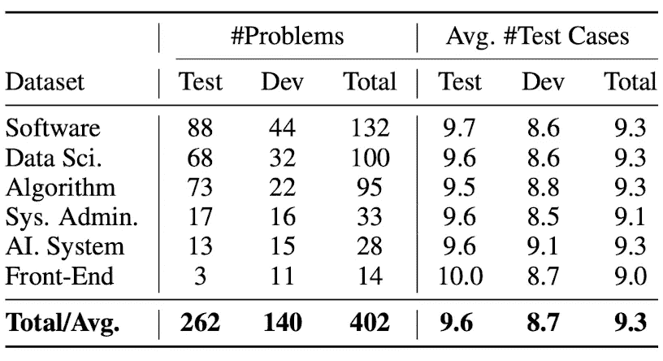
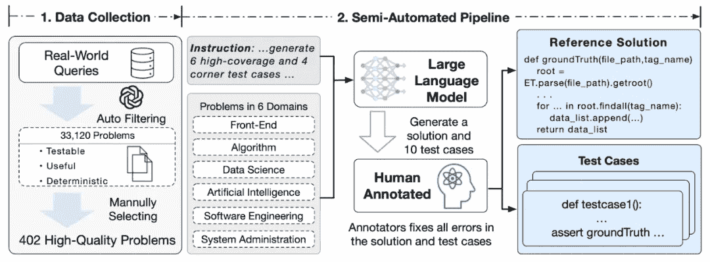
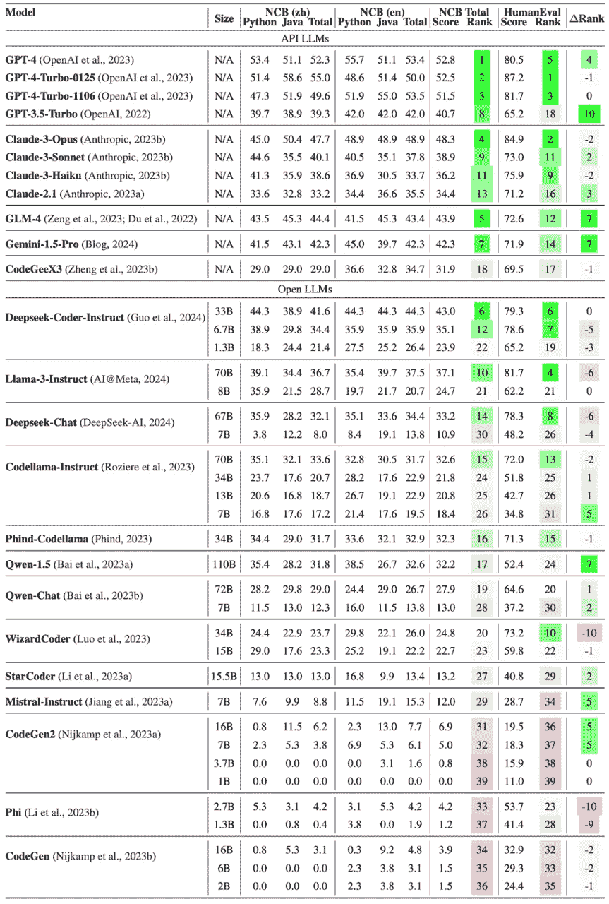
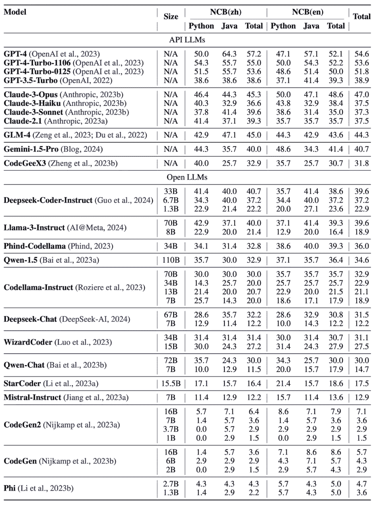

# 测评 · NCB：代码新榜，GPT-4 通过率仅 53%

> 来源：[https://ai.feishu.cn/docx/BjnodJmKooHV1Wxg8cOcF5bSnTb](https://ai.feishu.cn/docx/BjnodJmKooHV1Wxg8cOcF5bSnTb)

近年来，大型语言模型（LLMs）在代码生成领域取得了显著进展，甚至在一些编程比赛中达到了与人类平均水平相当的表现。

然而，当前的代码测试基准，如 HumanEval、MBPP 和 DS-1000，主要面向算法和数据科学的入门任务，不能充分满足现实世界中普遍存在的编码挑战要求。

为了填补这一空白，我们提出了NaturalCodeBench(NCB)，这是一个具有挑战性的代码基准评测集，旨在反映真实编程任务的复杂性和场景的多样性，即使表现最好的 GPT-4，在 NCB 上的通过率也只有 53%，说明 LLMs 的代码生成能力仍有很大的提升空间。

项目地址：https://github.com/THUDM/NaturalCodeBench

论文地址：https://arxiv.org/pdf/2405.04520

同时，我们在 39 个 LLM 上进行的系统性实验中发现，在HumanEval上分数接近的模型在 NCB 上的性能差距可能仍然很大，这表明我们缺乏对实际代码合成场景的关注，或者在 HumanEval 上进行了过度的优化。

HumanEval 与 NaturalCodeBench 的比较。(上图）测试的 LLM 在两个基准上的性能图。红圈中的 LLM 在两个基准上的表现相对不匹配。(下图）HumanEval 和 NCB 中编码任务的案例研究。NCB 基于真实世界用户的代码提问，并在可执行的 docker 环境中进行了评估。

我们将 NaturalCodeBench 在评测数据和评测方法上和其他基准的对比情况总结如下：

## 数据集

NCB 由 402 个 Python 和 Java 的高质量问题组成，这些问题都是从在线编码服务(CodeGeeX)的用户提问中精心挑选的，涵盖软件、前端、系统管理、人工智能等 6 个领域。

## NCB构建流程

考虑到为真实代码问题创建测试用例异常困难，我们还引入了一个半自动化流程，以提高测试用例构建的效率。与人工解决方案相比，它的效率提高了 4 倍之多。

1.  **数据收集：**从在线代码服务中(CodeGeeX)收集真实世界的提问，并通过 GPT-3.5 和人工注释从提问中筛选出高质量的问题并分类。

1.  **半自动化流程：**通过 LLM 生成解决方案和测试用例，然后由人工标注者进行修正，从而提高构建评估框架的效率。

## 详细评测结果

### 测试集结果

与 HumanEval相比，一些 LLMs 的位次出现了明显的变化：

+   在NCB测试集上评估 LLM，greedy decoding的所有结果均为pass@1

+   由于我们从在线编程()服务中收集到的大部分问题都是中文的，这对于基于英文的LLM模型来说并不公平。因此，我们对所有问题进行了翻译，形成了中英两个版本。

### 开发集结果

在NCB开发集上评估 LLM，greedy decoding的所有结果均为pass@1

**

结**果

1、GPT-4系列模型在代码领域仍处于较强水平（3款模型均分均超过51%)，但最高分也仅达到52.8，还远不能令人满意。

2、即使 HumanEval 分数相近的模型，在 NCB 上的表现也可能存在显著差距，表明现有**模型对代码真实应用场景的解决能力**不足，LLMs 的代码生成能力仍有很大的提升空间（LLMs的代码能力还远没有HumanEval评测集中表现的那样乐观）。

**NCB**

**NCB 的特点：**

**真实应用场景：** 从在线编程服务中收集自然用户查询，涵盖软件工程、前端开发、系统管理、人工智能等 6 个领域，更贴近真实应用场景。

**复杂数据类型：** 测试输入包括多种文件类型和其他复杂结构，如列表、数字、字符串、字典、张量、DataFrame、多格式文件，更具挑战性。

**高效构建： **采用半自动化流程构建基准测试，包括 GPT-4 生成参考解决方案和测试用例，人工专家进行校验和修正，效率提升超过 4 倍。

**中英双语：** 包含中英文版本的问题和指令，更公平地评估 LLMs 的代码生成能力。

**NCB 的意义：**

**评估真实应用能力： **帮助评估 LLMs 在真实代码生成任务中的表现，促进模型在实用性方面的提升。

**促进研究发展：** 为研究人员提供公平的评估环境和高效构建工具，推动代码生成领域的进一步发展。

**NCB 的结果：**

**模型性能差异：** 即使 HumanEval 分数相近的模型，在 NCB 上的表现也可能存在显著差距，表明现有模型对真实应用场景的优化不足。

**GPT-4 仍有提升空间：** 即使表现最好的 GPT-4，在 NCB 上的通过率也只有 53%，说明 LLMs 的代码生成能力仍有很大的提升空间。