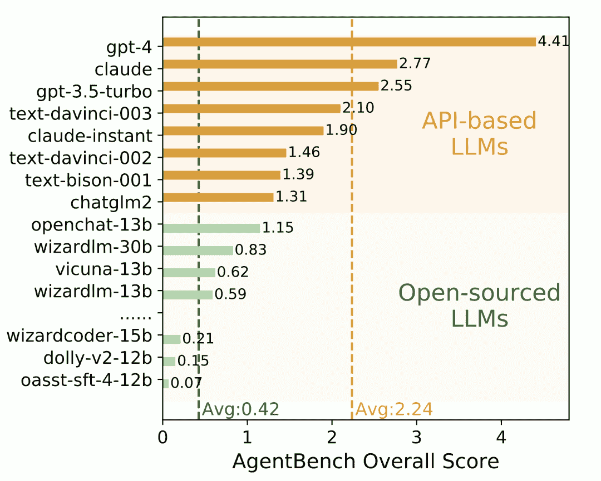
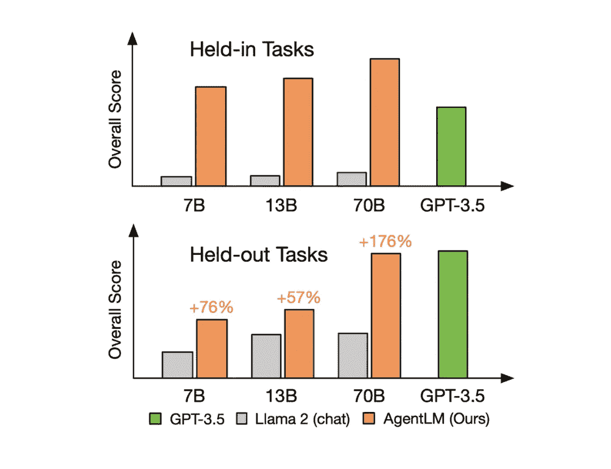
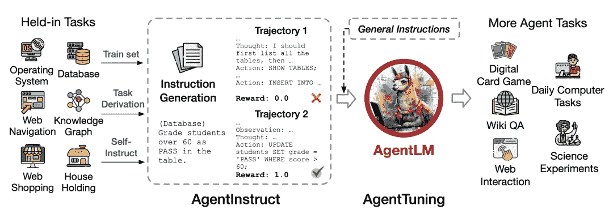
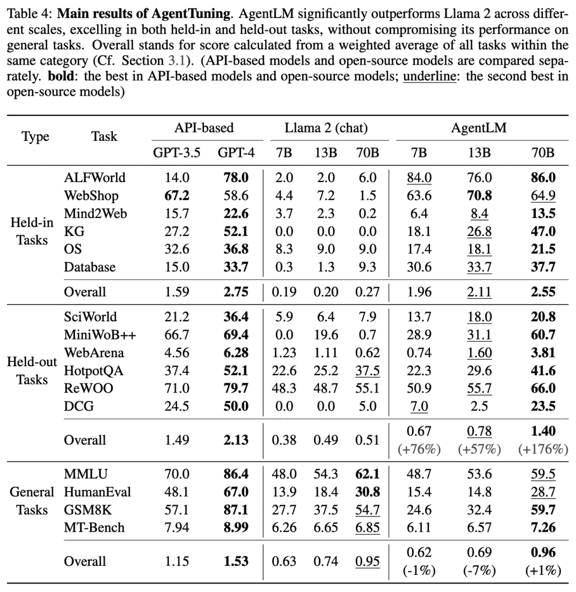
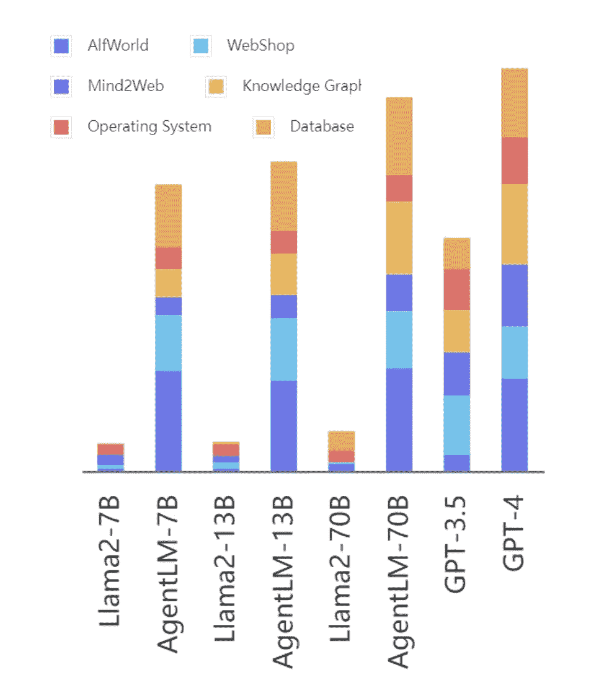
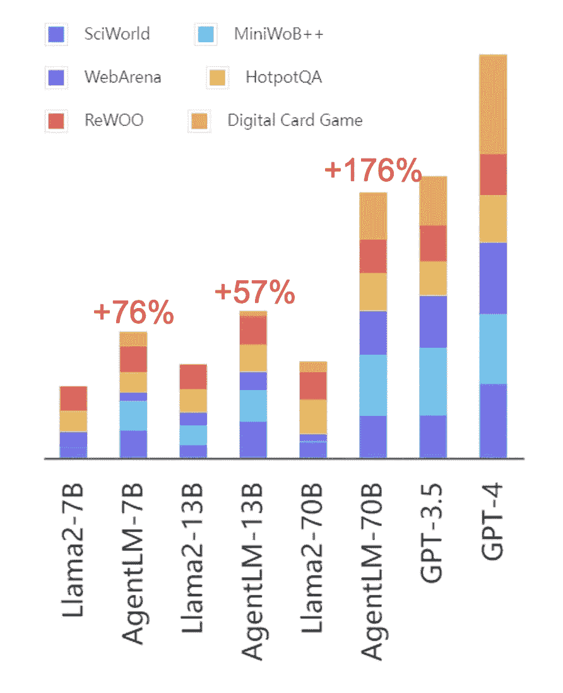
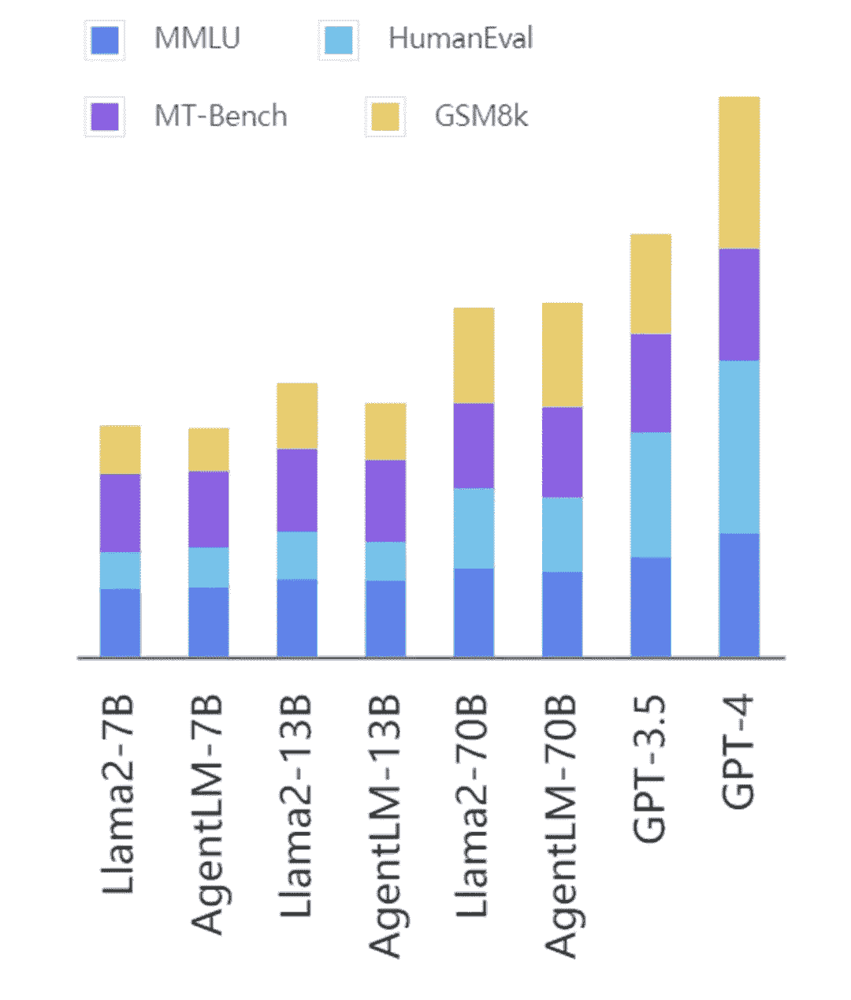
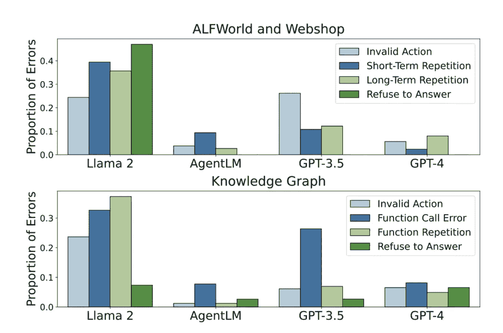
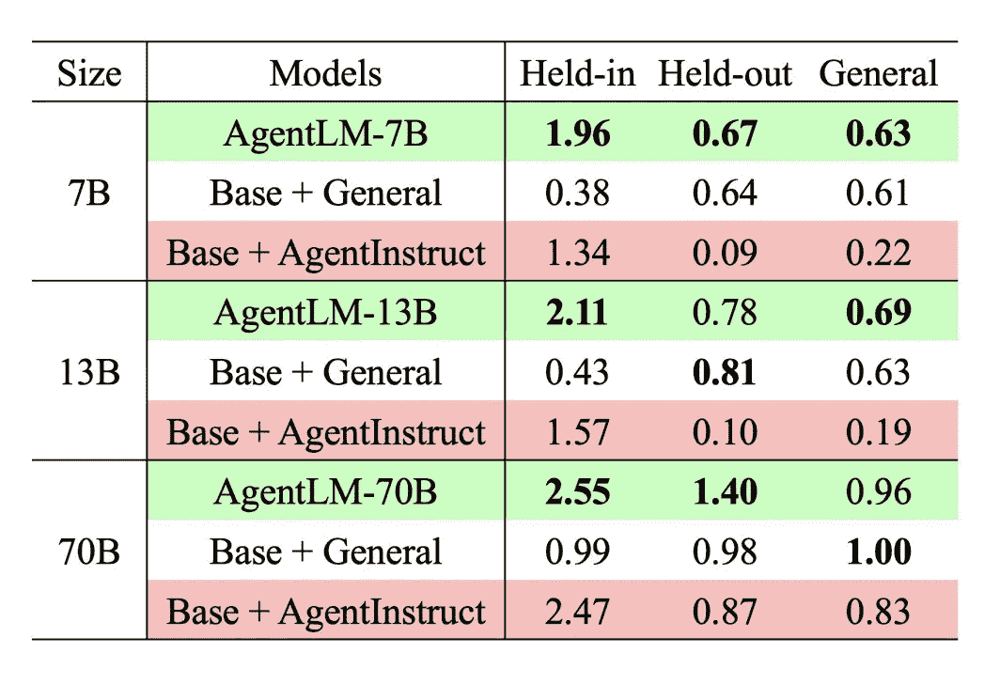

# 评测 · AgentLM：能打的 Agent 模型来了！7B，13B，70B 全开源

> 来源：[https://ai.feishu.cn/docx/I5o2dzzP9oUsA7xbmtNciLCOnhg](https://ai.feishu.cn/docx/I5o2dzzP9oUsA7xbmtNciLCOnhg)

还记得在 8月份，我们公开的 AgentBench 测试榜单吗？在当时的榜单中，各类开源模型的智能体能力普遍表现不佳。

对于 Agent 能力提升的策略，现有许多工作多使用 Prompt / 微调方法优化模型，在单项智能体任务上取得了卓越的表现，但智能体任务之间的促进及泛化效果有待进一步探索。

其实，开源模型并非没有完成智能体任务的能力，可能只是在智能体任务上缺乏对齐。

智谱AI&清华KEG提出了一种对齐 Agent 能力的微调方法 AgentTuning，该方法使用少量数据微调已有模型，显著激发了模型的 Agent能力，同时可以保持模型原有的通用能力。我们也开源了经过 Agent 对齐的语言模型，包括 AgentLM-7B，AgentLM-13B，AgentLM-70B，并开源了相应的数据集 AgentInstruct。

从上图中可以看到，经过微调的模型，内分布任务（Held-in Tasks）中 AgentLM-7B 的综合分数便可达到 GPT-3.5-turbo 的水平；外分布任务（Held-out Tasks，训练过程中未见过的任务）中 AgentLM-70B 模型可以取得与 GPT-3.5-turbo 相当的水平。

希望我们的开源工作，能够帮助大模型社区，促进行业发展。

+   Github：https://github.com/THUDM/AgentTuning

+   Huggingface：https://huggingface.co/THUDM

+   魔搭社区：https://modelscope.cn/models/ZhipuAI

+   Paper：https://arxiv.org/abs/2310.12823

**

方法：AgentTunin**g

AgentTuning 主要包括 2 个阶段。首先，我们收集并过滤得到一个多任务指令微调数据集 AgentInstrcut；然后，我们将 AgentInstruct 数据集与通用数据对模型进行混合微调。

评估结果表明，AgentTuning 能让 LLM 的 Agent 能力在未见过的 Agent 任务中展现出强大的泛化，同时保持良好的通用语言能力。

数据集：AgentInstruct

AgentInstruct 是一个经过筛选的智能体任务数据集。其包含 6 项智能体任务，从 Shell 交互到数据库操作，平均回合数从 5 到 35 不等，每条轨迹都有 ReAct 形式的 CoT 标注，帮助模型深入理解决策过程。为保证数据有效性，数据集在构造时进行了严格的筛选，仅保留了 1866 条高质量交互轨迹。最后，我们与测试集进行了数据重合度检测，防止数据泄露导致的评测误差。

**实验结果**

我们使用 AgentTuning 方法对 Llama-2-chat 系列模型进行了微调。微调过程中，我们将 20% 的 AgentInstruct 数据集和 80% 的通用数据进行混合训练，得到了 AgentLM-7B，AgentLM-13B，AgentLM-70B。

1、**智能体能力可泛化**

我们在同分布任务、外分布任务和通用能力任务上对模型进行评测。

从下表中可以看出，利用 AgentTuning 方法微调后的模型 AgentLM，Agent 能力显著增强。

在同分布任务中，AgentLM 能取得与 GPT-4 媲美的分数：

同分布任务：显著提升, 比肩 GPT-4

在外分布任务上，模型泛化性良好。AgnetLM-70B 的性能也接近 GPT-3.5。

外分布任务：泛化性良好, 接近 GPT-3.5

与此同时，模型的通用能力与微调之前基本相当，没有出现较大的变化。

通用能力：与微调前表现相当

2、**初等错误显著减少**

Llama-2-chat-70B在任务中大量出现如非法操作 / 重复 / 拒绝回答等初等错误。经过 AgentTuning 后，模型的简单错误比例大幅降低。

这说明，模型自身具有完成智能体任务所需的能力，经过少量对齐微调即可激发这些能力。

3、**通用能力对泛化至关重要**

在实验中，我们还观察到，仅使用 Agent 数据微调（图中红色），外分布任务泛化性并不好。而如果我们将 Agent 数据与通用数据混合微调（图中绿色），外分布任务的泛化则会显著提高，而且能更好保持模型原有的通用能力。在更大的模型（例如70B模型）上，AgentTuning 泛化到未见过任务的效果尤为显著。

更多详细信息，可以参考我们论文和 Github 内容。

**研究者说**

问：为何开源大模型解决智能体任务和闭源模型差距这么大呢？

**答：**的确，在 AgentBench 的榜单中我们可以清晰地看到开源模型和闭源模型之间的巨大鸿沟。我们在实验中仔细分析了两者的差异，开源模型在与环境多轮交互对话的过程中，很容易犯各种初等错误，例如重复输出、拒绝回答、回答无关等等，而闭源模型则少了许多。

同时，我们发现经过适当的 SFT 微调后，模型的低等错误有显著下降，这也从侧面体现模型“举一反三”、泛化到其余数据集上的能力。

问：AgentLM 相较基座模型有什么不同？

**答：**AgentLM 是基于 Llama2-chat 在高质量交互数据监督微调得到，训练过程采用 AgentInstruct 数据与通用训练数据混合训练。与原始模型相比，AgentLM 在原始同分布评测数据集（也就是微调所选用的任务）上表现接近 GPT-4，在从未见过的 6 个数据集上也有大幅提升，泛化性良好，表现接近 GPT-3.5-Turbo，而在通用能力方面，AgentLM 作为通用语言模型与微调前的模型表现相当。

问：为什么在训练过程中想到混入通用数据？

**答：**现有大模型 Agent 能力大多来源于 Prompt 策略的调整或者大量 Agent 数据的训练，这样的确能在相应数据集上达到不错的 Agent 性能，但模型对于其余 Agent 任务的泛化能力以及其原有的通用能力则无法保证。

Agent 任务的输入输出分布与通用任务的分布差距很大，如果只使用 Agent 任务进行训练，模型很快就 “忘记” 了如何理解和完成通用任务。而结合通用数据后，模型在训练过程中在仍能较好地保持原先的语言理解和输出能力，因此不仅可以继续完成各项通用任务，还可以在没有见过的 Agent 任务上，结合语言模型的原有的指令跟随能力和微调中学到的 Agent 能力，得到良好的泛化效果。