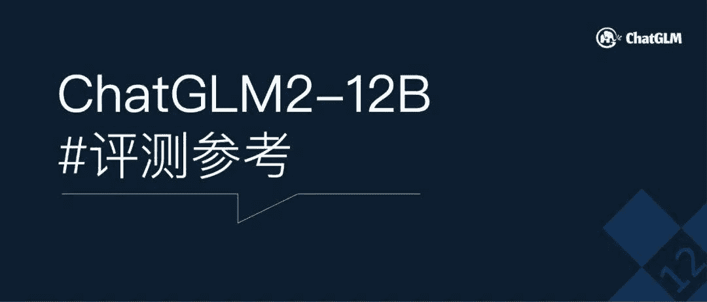
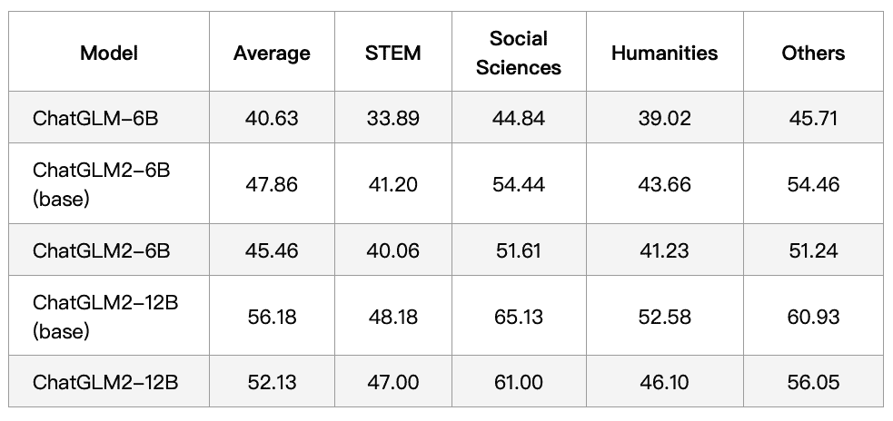
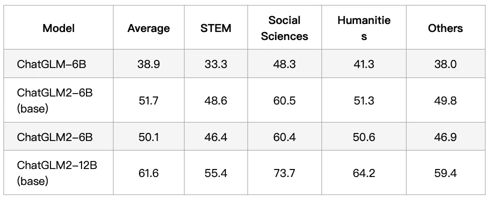
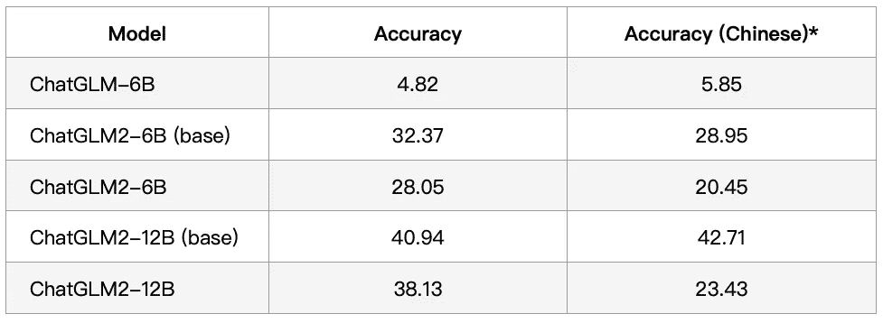
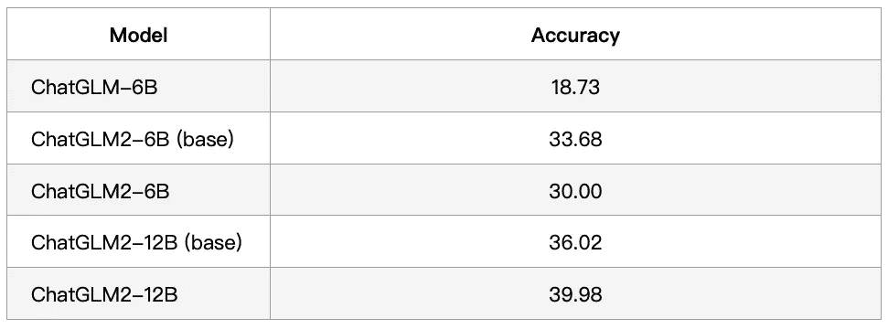

# 评测 · ChatGLM2-12B 效果怎么样？官方公布

> 来源：[https://ai.feishu.cn/docx/QEVgdaYaWoAII9xtY81c1a7VnoB](https://ai.feishu.cn/docx/QEVgdaYaWoAII9xtY81c1a7VnoB)

ChatGLM2 系列模型发布月余，大家对 ChatGLM2-6B 的效果已经有较多认知。我们现在公布 ChatGLM2-12B 在部分中英文典型数据集上的评测效果，供大家参考。这些数据集包括 MMLU(英文)、C-Eval(中文)、GSM8K(数学) 和 BBH(英文) 等。

ChatGLM2-12B 模型在这些数据集上取得了不错的成绩。我们将继续不断改进和优化模型，以提供更优质的模型效果。

具体信息请参考：https://github.com/THUDM/ChatGLM2-6B

**为感谢大家对 GLM **技术团队的关注和支持，我们计划于近期举办「ChatGLM开发者日」，为大家分享大模型研究相关的前沿进展，包括且不限于模型训练、微调、检索、prompt 等，敬请关注。

**MMLU**

Chat 模型使用 zero-shot CoT (Chain-of-Thought) 的方法测试，Base 模型使用 few-shot answer-only 的方法测试。

**C-Eval**

Chat 模型使用 zero-shot CoT 的方法测试，Base 模型使用 few-shot answer only 的方法测试。

**GSM8K**

所有模型均使用 few-shot CoT 的方法测试，CoT prompt 来自  http://arxiv.org/abs/2201.11903

+   我们使用翻译 API 翻译了 GSM8K 中的 500 道题目和 CoT prompt 并进行了人工校对。

**BBH**

所有模型均使用 few-shot CoT 的方法测试，CoT prompt 来自 :

https://github.com/suzgunmirac/BIG-Bench-Hard/tree/main/cot-prompts