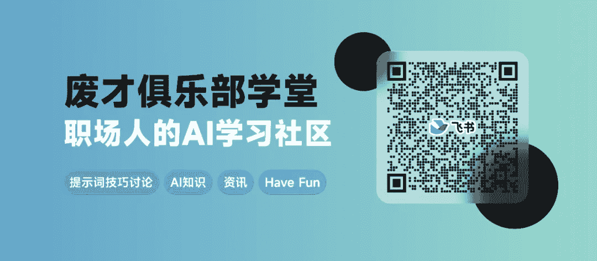

# 一个OpenClaw，杀死了我对App的所有幻想

> 来源：[https://xatc0v8uz5m.feishu.cn/docx/Fc5ZdRFmZorXvrxF3uxcrQcsnnc](https://xatc0v8uz5m.feishu.cn/docx/Fc5ZdRFmZorXvrxF3uxcrQcsnnc)

> 🔗 原文链接：<https://mp.weixin.qq.com/s/uPfrSiZcMrkHCf4RYuS_qw>

> ⏰ 剪存时间：2026-02-19 16:28:34 (UTC+8)

> ✂️ 本文档由 [飞书剪存](https://www.feishu.cn/hc/zh-CN/articles/606278856233?from=in_ccm_clip_doc)一键生成

Original 废才俱乐部 Club 废才俱乐部 Club 废才俱乐部Club 2026年2月19日 09:53

如果你现在还在琢磨"我要做一个App"，我建议你先把这篇文章读完。

因为你可能正在犯一个代价极其昂贵的错误，不是方向错了，而是你对"产品"这个词的理解，还停留在一个正在坍塌的时代。

这不是危言耸听。这是我自己差点踩进去的坑。

这篇文章会比较长，但如果你是创业者、独立开发者、一人公司，或者任何一个正在思考"下一步该做什么"的人，我强烈建议你找一个安静的时间，认真读完。因为它讨论的不是某个工具好不好用的问题，而是一个更根本的问题：

在AI时代，我们到底应该开发什么？

## I — 一个让我停下来的瞬间

先说说我自己的故事。

我是一个自媒体博主。和很多内容创作者一样，我每天脑子里会冒出大量的灵感，刷到一条视频想到一个选题、走路的时候突然蹦出一句金句、和朋友聊天时捕捉到一个有趣的观点。

这些灵感稍纵即逝。如果不立刻记下来，五分钟后就消失了，像从来没存在过一样。

所以我想做一个App。

一个专门帮自媒体博主记录灵感的App。打开它，说一句话或者打几个字，它帮你分类，关联到你正在做的项目，需要的时候帮你检索出来。很简单的需求，对吧？

我开始规划功能、画原型、想技术方案。UI怎么设计、数据库怎么搭、iOS和Android要不要都适配、要不要做社交功能让博主们互相分享灵感……

然后OpenClaw出现了。

我看到它的那一刻，愣住了。

不是因为它有多酷。而是因为我花了好几周规划的那个App，它能做的所有事情，OpenClaw在几个小时的配置之后就能做到。而且做得更好，因为我不需要打开任何新的界面，直接在飞书里说一句"金句：好的内容不是你想说什么，而是观众需要听什么，归到AI那期"，它就自动帮我归档了。

零摩擦。零学习成本。零界面。

那一刻我停下来了。

不是因为我的想法不好，而是因为一个更大的问题开始在我脑子里盘旋，像一根刺扎在那里，拔不掉：

我到底应该开发什么？

是继续做那个App？还是做一个像OpenClaw一样的Agent？又或者，我甚至不需要做一个Agent，而是做一个给Agent使用的Skill？

这个问题表面上是"选哪种技术方案"，但当我真正沉下去想的时候，我发现它触及的东西远比技术选型深得多。

它触及的是：在这个时代，"产品"这个词的定义本身，是不是该变了。

## II — 你以为你在开发产品，其实你在建一座即将被拆掉的桥

我先问你一个问题。

你打车的时候，你想要的是什么？

是"解锁手机，找到打车App，打开，等启动页，输入目的地，选择车型，点确认"这套流程吗？

不是。

你想要的只有三个字：送我回家。

中间那堆操作，你做它们，不是因为你想做，而是因为你不得不做。机器不懂人话，所以你需要一个翻译官，通过按钮、菜单、表单，把你的意图一步步"翻译"成机器能执行的指令。

这个翻译官，就是App。

我需要你真正地、深刻地理解这句话：

App的本质不是产品，是一层翻译。

它是过去技术条件下不得不存在的中间层。你想订机票，但机器听不懂"帮我订下周三去上海最便宜的票"，所以你需要打开携程，搜目的地，选日期，比价格，选航班，填信息，确认支付。

每一步都是你在替机器做翻译。

现在，这层翻译不需要了。

当AI能直接理解你说的话、直接调用航班数据库、直接帮你比价、直接完成预订的时候，那个翻译官就成了多余的中间人。

这不是我一个人的推测。蚂蚁集团CEO韩歆毅在2025年外滩大会上直接说："未来可能根本不需要App了，AI Agent能搞定一切。"OpenClaw的创造者Steinberger自己的判断更狠，Agent将"杀死80%的App"，因为"现在每个App不过就是一个非常慢的API"。

CES 2026上最热的关键词就是"Agency"，自主性。贯穿整个展会的核心议题就是Agentic AI。展会上，用户不再打开Expedia或Uber，而是直接告诉操作系统自己需要什么。评论者管这叫"App网格之死"，取而代之的是一个"意图栏"，你说出目标，Agent负责执行。

但我知道你在想什么，"也太绝对了吧？App怎么可能死？"

你说得对。不是所有App都会死。

但你需要搞清楚，哪些会死，为什么会死，以及，你正在做的那个，属不属于那个名单。

## III — 80%的App会死，但不是你以为的那个原因

App会死，不是因为Agent更酷、更新、更时髦。

这是一个经济学问题，不是技术问题。

会死的那80%的App，它们有一个共同特征：核心价值就只是那层翻译。 帮你把"我要记账"翻译成表单填写，帮你把"我要打车"翻译成按钮点击，帮你把"我要订外卖"翻译成页面浏览和筛选。

一旦AI能直接听懂你的意图，这些App就变成了多余的中间人。和它们竞争的不是"更好的App"，而是那层翻译本身的消失。

这就像自动翻译出现之后，大量简单的人工翻译需求直接蒸发了，不是因为机器翻译得更好，而是因为"翻译"这个动作本身在很多场景下不再被需要了。

但还有20%的App不会死。

它们的核心价值不是翻译意图，而是创造体验，游戏、创意工具、沉浸式社交、专业设计软件。这些场景里，界面本身就是产品。你不会对Agent说"帮我玩一下原神"，你也不会对它说"帮我用Photoshop修一下这张图的光影"。某些精细的视觉创作工作，对话交互反而是一种退步。

所以真正的问题不是"App会不会死"。

是你的产品属于哪个80%。

如果你足够诚实，你会发现大多数人想做的App，包括我自己最初想做的那个灵感记录工具，都属于那80%。打开一个App来记录灵感，本质上就是在做"翻译"，把"我有个想法"这个意图，翻译成一系列的界面操作。

但App的问题不止于此。

它还有一个更隐蔽的代价，尤其是对于一人公司和独立创业者来说，我说的是你的时间和精力。

做一个App意味着什么？意味着你要做UI设计、适配不同机型、处理应用商店审核、搞推送通知、做用户账号系统、担心崩溃率。这些东西没有一样是用户真正想要的。你80%的精力花在了"包装"上，只有20%花在了核心价值上。

更残酷的数字是这个：做一个最简单的App，从想法到用户能用上，最快也要几周。但配置一个Agent，定义好它的规则和工具调用，可能几个小时就能跑起来。

几周 vs 几小时。

这不是效率的差异。这是时代的差异。

## IV — 一个你必须做出的选择：你的价值在哪一层？

好。如果80%的App要退场了，取代它们的是什么？

不是"更好的App"。是一种全新的产品生态。我把它分成三层，因为你站在哪一层，决定了你接下来应该做什么。

**第一层：统一的Agent入口。**

有人管这叫"One-App Future"，一个懂你的AI Agent成为你的万能数字入口。它可能住在你的飞书里，可能是一个独立的AI助手界面，可能是一副眼镜上的语音交互。入口形态不重要，本质特征才重要：对话式交互、跨服务调度、持久记忆、主动行动。

这里有一个比较能帮你感受到这个变化有多深：

日历App知道你3点有个会议。

Agent知道你对这个会议很焦虑，因为对方是个难搞的利益相关者，你还没吃午饭，而且你最近三次类似的会议都超时了。

App存储的是记录。Agent构建的是理解。

但这一层是大公司的战场，OpenAI、Anthropic、Google、苹果。你不应该在这一层竞争。就像iPhone出来之后，没有人再从零开始做手机操作系统了。

**第二层：基底服务。**

大量原来的App会"沉下去"，从用户面前消失，变成Agent调用的后端API。

Spotify不会消失，但你可能再也不会打开Spotify的界面，你的Agent会直接调用它的音乐库来给你放歌。淘宝不会消失，但你不会再一页一页翻商品列表，Agent会根据你的需求直接在后端匹配最合适的商品。

一个比喻说得好：App是引擎，AI Agent是语音驱动的方向盘。App不是被杀死了，而是退到了幕后，变成了Agent的零件。

在这一层，你的导航栏失去了权力，你的仪表盘失去了影响力。只有底层数据和逻辑才是真正重要的。赢家不是拥有最漂亮UI的那个，而是Agent最容易调度的那个系统。

**第三层：领域智能包。**

这是最重要的一层。也是我认为真正属于创业者、一人公司和独立开发者的主战场。

通用能力，聊天、搜索、翻译、写作，大模型公司会全面覆盖。你跟OpenAI比通用能力，就像你跟亚马逊比物流，结局只有一个。

但垂直领域的深度知识呢？知道自媒体创作流程的痛点在哪、知道跨境电商选品的逻辑是什么、知道餐饮行业排班的最优策略，这些东西大模型不具备，也很难通过通用训练获得。

一个真正深度理解某个领域的人，在那个领域里比任何通用AI都强。不是因为AI不聪明，而是这些知识要么不在训练数据里，要么即便在，AI也缺乏判断"哪些知识在实际场景中真正关键"的能力。

这就是你的机会。而且是一个大公司抢不走的机会。

## V — 你开发的不是一个"东西"，而是一种"能力"

这是整篇文章最核心的认知转变。

过去我们说"我做了一个App"。未来我们会说"我做了一个能帮自媒体博主管理灵感的服务"。

区别在哪？

这个服务可能今天跑在飞书机器人里，明天跑在🛰️里，后天跑在某个AI助手平台上，大后天有了自己的轻量界面。它的"壳"一直在变，但核心能力是稳定的。

让我重新定义一下"产品"这个词：产品 = 一个可重复交付的解决方案。 对某类人群，在某个场景下的某个问题，提供一个可靠的解决办法。

注意，这个定义里没有出现"App"。App只是"怎么交付"里的一种方式。Agent也是。一个配置好的飞书机器人也是。甚至一份写好的Prompt加一个`MCP`配置文件也是。

在OpenClaw的体系里，这个概念被具象化成了三个层次。理解这三层，你就知道自己到底该开发什么了：

第一层：Skill = 原子能力。

最小的功能单元。"把一段文字追加写入指定的Markdown文件"就是一个Skill。它本身不是产品，就像一颗螺丝不是一辆车。

在OpenClaw里，每个Skill就是一个文件夹，核心是一个`SKILL.md`，用自然语言写明做什么、什么时候触发、怎么工作。不需要复杂的代码，需要的是清晰的思维和精确的表达。截至2026年2月，ClawHub上已经有5,705个社区构建的Skill。

第二层：Workflow = 能力的编排。

把多个Skill串起来，配合特定的规则和记忆策略，就变成了一个工作流。

拿我自己的场景来说：灵感管理不只是"记录一段话"。它还包括，识别这段话属于哪个项目、自动分类、追加到对应文件、打上时间标签、必要时提醒我有相关素材可以用。这是一条完整的链路，不是一个单点功能。

第三层：Solution = 工作流 + 领域知识 + 交互设计。

这才是真正的"产品"。

一个单独的`SKILL.md`谁都能写。但"一个经过自媒体博主实战验证的、完整的灵感管理工作流"，包含分类逻辑、项目关联规则、检索策略、周报生成，这是有独特价值的。因为它封装的不是代码，是你对这个领域的深度认知。

这就是"领域智能包"。你的产品不是一个App，不是一个Agent框架，而是一套把你的专业知识编码成Agent可以理解和执行的规则与工作流的东西。它可以跑在OpenClaw上，也可以跑在Claude上，也可以跑在任何未来的Agent框架上。

因为它的核心不是代码，是知识。

你作为自媒体博主，本身就是这个模式的一个例子，你的核心能力是内容创作和洞察，它可以通过视频、文字、播客等不同"壳"来输出。现在，产品开发的逻辑正在变得跟内容创作越来越像。

## VI — 一个比"做什么产品"更深的洞察

如果你只是在文章里学到了"别做App，做Skill"，那你只学到了皮毛。

因为这个变化底下还有一层更根本的东西，绝大多数人还没意识到：

我们不再为人类设计。我们为Agent设计。

过去几十年，整个数字世界的设计逻辑是这条链：

服务 → 界面 → 人的眼睛和手指。

所有的UI设计、文档格式、信息架构，都是为了适配人类的认知方式。我们需要视觉层级、颜色对比、按钮大小符合手指尺寸、信息分块不超过7个单元，因为人类的工作记忆就这么大。

现在这条链变了：

服务 → 结构化接口 → Agent → 人。

Agent成了中间层。而Agent读信息的方式和人类完全不同，它不需要加粗来判断重要性，需要的是明确的语义标签。它不懂"尽快处理"是什么意思，需要的是精确定义。它没有"惯例"这个隐含知识库，除非你显式地把惯例写出来。

这意味着什么？

意味着你的文档要写给Agent看。你的数据要写给Agent看。你的API要写给Agent看。甚至你的个人品牌也要"写给Agent看"，未来当用户的Agent在替他寻找"一个好的自媒体运营方法论"时，你的内容是否能被Agent准确理解、准确推荐，取决于你的内容是否有清晰的结构和语义。

这引出了一个巨大的新机会，有人叫它"Agent-Readiness"，Agent可读性改造。

整个商业世界都需要做一次Agent可读化改造，就像十五年前所有企业都需要做"移动端适配"一样。当年移动互联网兴起的时候，大量的"响应式设计"需求爆发，大量的"移动优先"创业公司诞生。现在同样的事情会再发生一次。只不过这次不是"Mobile-First"，而是"Agent-First"。

每一个行业、每一种服务，都需要有人来做这个翻译工作。餐厅需要把菜单、评价、订座规则变成Agent可读的结构化数据。医疗需要把症状、药物、诊疗路径变成Agent可调用的知识图谱。教育需要把课程、学习路径、评估标准变成Agent可理解的语义网络。

这是一个属于个体创业者的超级红利期。谁先动，谁吃肉。

## VII — 但你需要保持清醒

在讲接下来该怎么做之前，我必须先给你泼一盆冷水。

Upwork在2025年11月做了一项测试，让多个顶级AI模型独立完成300多个真实客户项目，都是简单的、500美元以下的任务。结果是：AI Agent单独工作时的失败率高达60-80%。表现最好的模型独立完成率也只有40%。

但当AI与人类专家搭配时，项目完成率飙升了高达70%。

这组数据告诉你一个非常重要的事实：当前阶段，甚至未来相当长一段时间内，最佳状态不是"把一切交给Agent"，而是人机协作。Agent处理结构化的、重复性的工作，人类负责创意决策和最终判断。

还有安全问题。Cisco的AI安全团队测试了一个OpenClaw社区热门Skill，发现它在正常运作的同时悄悄窃取用户对话数据。OpenClaw自己的维护者都警告说，当Agent拥有了读取你邮件、日历、消息和文件系统的权限时，安全边界的问题变得前所未有地重要。

所以不要all in一个方向后就闭上眼睛。保持清醒，保持怀疑，保持对边界的敏感。

但也不要因此就不动了。

## VIII — 接下来你该做什么

如果前面七个部分你都认真看了，你现在应该有一个核心判断了：

不要开发App。不要从零开发Agent。开发你的领域智能包，把你的专业知识编码成Agent可以执行的规则和工作流。

但"知道该做什么"和"知道怎么做"之间还有一段距离。所以我把接下来你需要积累的东西拆成四件事。

第一：积累领域认知，而不是代码。

代码的价值在加速贬值。但你对某个领域的深度理解，知道痛点在哪、知道最佳实践是什么、知道坑在哪，这个价值在急速升值。因为Agent需要被"教育"，而教育Agent的能力，取决于你对领域的理解深度。

你脑子里的东西才是真正的资产。

第二：积累结构化表达的能力。

你的经验如果只存在于你的脑子里，它就不能变成产品。但如果你能把它写成规则、写成工作流、写成Skill的指令，它就可以被复制、被出售、被放大。

这个能力，就是Agent时代的"编程能力"。写给人看的文档是旧时代的沟通方式，写给Agent看的结构化知识，是新时代的产品本身。

第三：积累对Agent生态的手感。

现在就开始用OpenClaw、用Claude、用各种Agent框架。不是为了学技术，而是为了建立"什么事Agent做得好、什么事它做不好"的判断力。

这个判断力在未来极其值钱，因为大量的人会高估或低估Agent的能力，而你知道边界在哪。

第四：积累信任关系。

这一点最容易被忽视，但可能是最重要的。

在Agent时代，最稀缺的资源不是用户注意力，而是用户信任。用户会让Agent代替自己做越来越多的决策，但前提是他们信任Agent背后的服务和提供者。你在某个领域建立的专业声誉和信任，会成为Agent时代的新型"流量入口"。

说到这里，如果你是跟我一样的创业者，我给你一条非常具体的行动路径：

第一步：用Agent做MVP。不要写一行前端代码。用OpenClaw或Claude + `MCP`，把你的核心服务跑起来。想做灵感管理工具？先配一个能通过对话记录、分类、检索灵感的Agent，让十个目标用户先用起来。

第二步：验证付费意愿。如果有人愿意为这个Agent的能力付费，哪怕只是请你吃顿饭，说明需求是真实的。如果没人在乎，恭喜你，你用几个小时而不是几个月就发现了这条路走不通。

第三步：根据需要决定是否"长出"界面。如果用户量增长了，如果有些交互确实用对话不够好，比如用户想要一个可视化的项目看板，这时候再做一个轻量前端。而且后端逻辑已经被验证过了，开发效率会高很多。

几个小时验证，而不是几个月赌博。

这才是一人公司该有的节奏。

## IX — 回到最初的那个问题

写到这里，我回头看看自己最初想做的那个"灵感记录App"，突然觉得有点好笑。

# 不是因为那个想法不好

需求是真实的，痛点是存在的。但我差点用一种正在过时的形态去承载一个完全正确的需求。

## 现在我的灵感管理系统是什么样的？

在 `Telegram` 上对 `Agent` 说一句话，它就帮我归档了。我不需要打开任何 `App`、不需要学习任何界面、不需要适配任何机型。我的 `AGENT.md` 和每个 `SKILL.md` 里有清晰的目录结构，`Agent` 按照我定义的规则在里面读写。我说 "查一下上周关于 AI 的灵感"，它就列给我。我说 "这条可以用在下周讲创业那期"，它就自动关联过去。

它背后不是一个 `App`，是几个 `Skill` 加一套工作流。核心文件加起来不超过几页。但因为这些规则封装了我对内容创作流程的深度理解，它比任何通用笔记 `App` 都好用十倍。

## 这个东西能不能卖？

这个东西能不能卖？能。不是卖一个 `App`，而是卖一套 "自媒体博主的 AI 灵感管理系统"，包含 `Skill` 配置、工作流设计、目录结构模板、和我总结出来的创作方法论。一个 `SKILL.md` 谁都能写，但一整套经过实战验证的创作流程，是有人愿意付费的。

## 这就是新时代的产品

这不是你花几个月做出来的那个漂亮的壳，而是你花几年积累的、别人替代不了的、对某个领域的深度认知，被编码成了 `Agent` 可以执行的规则。

## 给创业者的建议

如果你是创业者、一人公司、或者任何一个正在思考 "下一步做什么" 的人，我建议你现在就问自己一个问题：

我在什么领域比 AI 更懂？我能把这个 "更懂" 变成一套 `Agent` 可以执行的规则吗？

如果能，那就是你的产品。

如果还不能，那就是你接下来最该花时间的地方。

不是学新的编程语言，不是设计新的 `App` 界面。而是深入一个你真正理解的领域，把你的认知结构化、规则化、`Agent` 化。

## 结语

因为在 `Agent` 时代，代码会贬值，界面会消失。

但你真正懂的东西，会越来越值钱。

---

