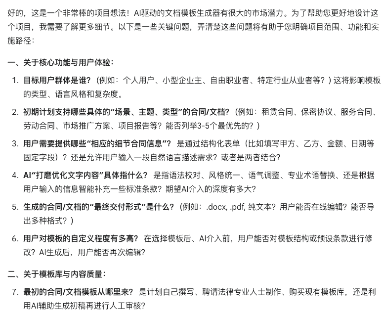
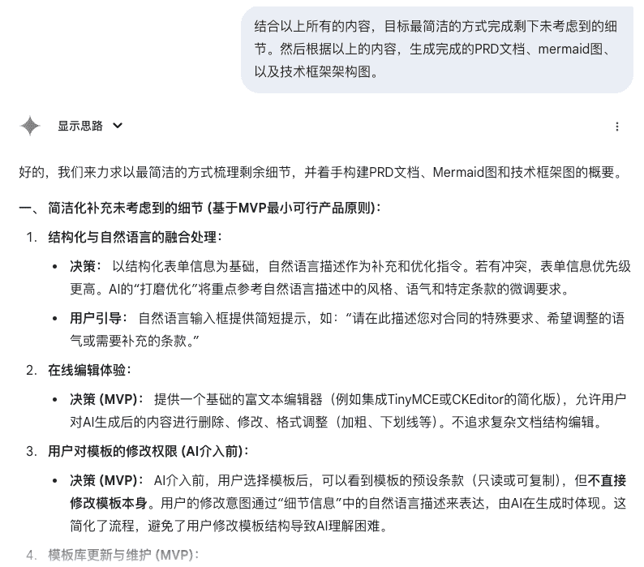
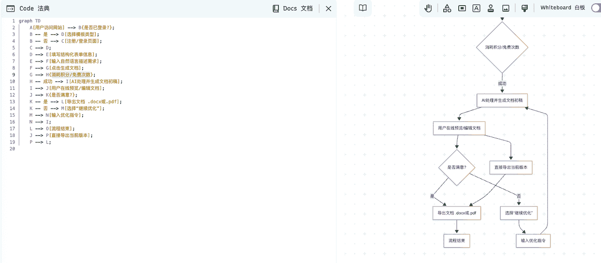
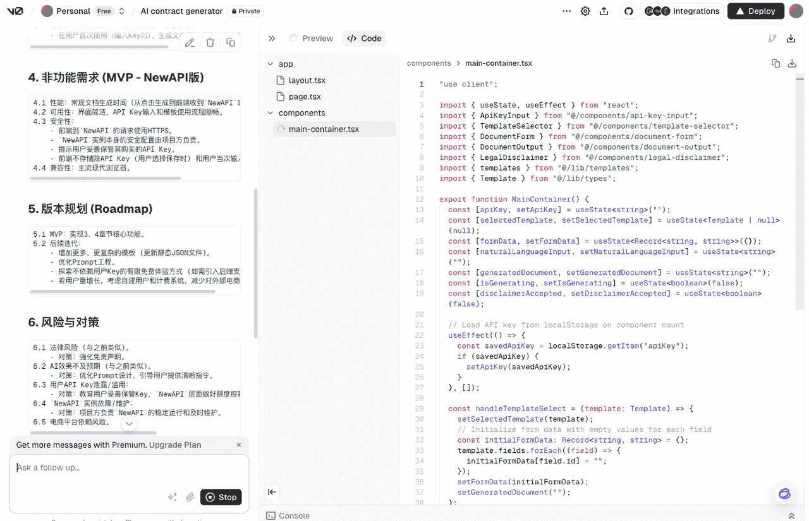
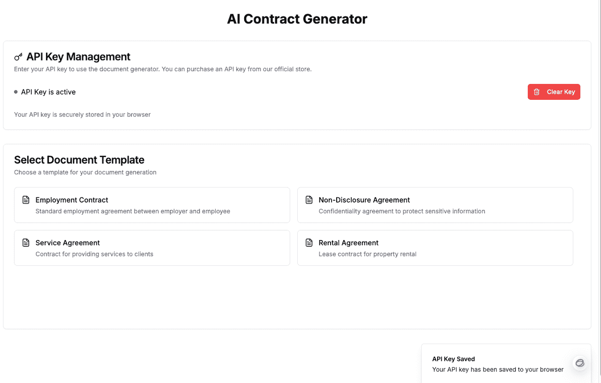
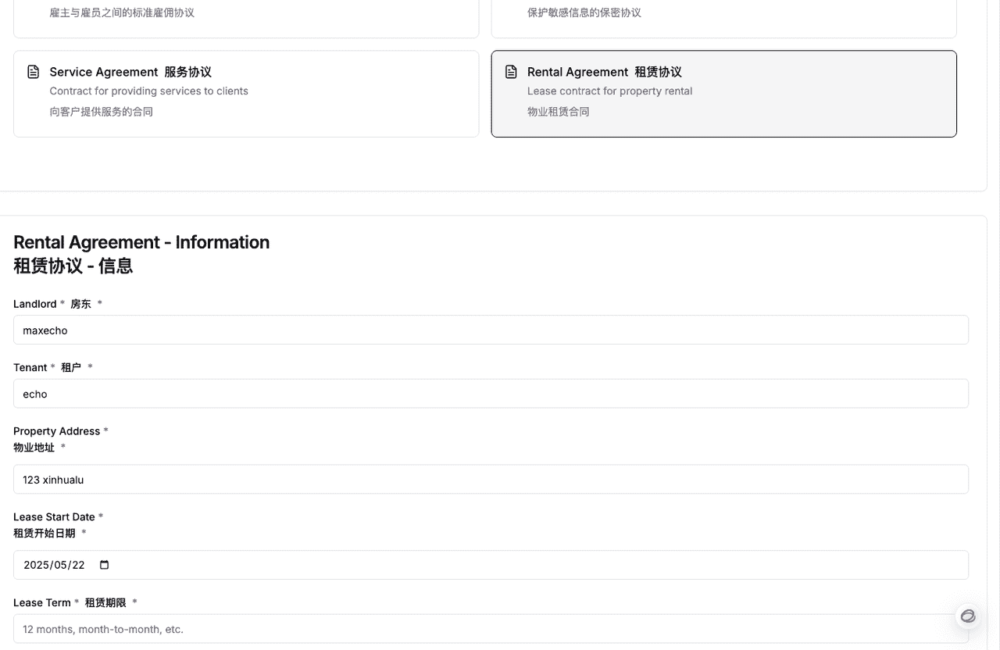
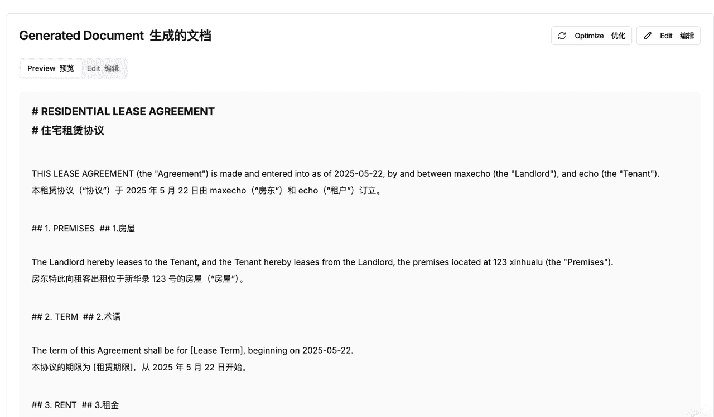

# 应用开发工作流程

> 来源：[https://xatc0v8uz5m.feishu.cn/docx/XoqjdaGICoXuPDxa5WBcuApYnZf](https://xatc0v8uz5m.feishu.cn/docx/XoqjdaGICoXuPDxa5WBcuApYnZf)

web+newAPI+

产品需求规划

生成bug文档，每次进行记录

进度文档

技术文档

# 系统设计

## 想法

想法：AI驱动的简单合同/文档模板生成器

想法写出来，竭尽全力完善出来。这一步做好能够很好的减少后续的不必要bug。

先把大概的想法告诉 AI，然后让 AI 给我们画个草图，然后再一遍一遍地来优化它。

eg：

```
我想写一个项目，AI驱动的简单合同/文档模板生成器。用户只需要选择对应场景、主题、类型的模板，然后将相应的细节合同信息给到生成器，最后生成器将通过大模型打磨优化文字内容，生成相应的合同或者文档。并且需要用户付费使用。想要设计这个项目,还缺少哪些关键信息,向我提问。
```

通过大模型反向向我们提问帮助我们一步步完善项目所需要的内容。【想要设计这个项目,还缺少哪些关键信息,向我提问。】

这么做的目的是因为我们在想一个项目的时候呢，其实往往都是这个设计的不够完善，而且本身我们对于这个项目是不够全面的，我们没有办法说能够覆盖到所有的内容。就比如说在一个软件开发里面，它需要涉及到的这种技术点啊，全站全站的一些嗯要求啊，我们是很难考虑到的，包括说我们需要呈现的效果。我们前期只是有个概念，我们需要通过让AI大模型的问答交互的一个过程来去完善我们整个项目的一个需求，这是很重要很重要的。



## 项目完善

然后这个时候大模型会根据我们提出的想法，提出很多实质性的问题。我们只需要将对应的问题进行补充。这个过程是有一点痛苦和反人性的（我们往往需要一个快速、及时性，而不喜欢被反问和思考更多）但是请相信，这样的动作能为你整个项目进度提速很多。正所谓磨刀不误砍柴工

项目应该如何设计，用mermaid图来表示交互过程

ps:在大多数情况使用大模型的过程中，会设定大模型要顺应用户的思路去走。往往大模型为了用户的使用体验而牺牲掉一些准确性，所以我们想要更好的使用大模型工具，就需要我们在问问题的时候加上（整个问答过程需要用一定的批判性的思考回答∑，不需要顺应我的观点，从客观事实的角度出发）

核心思路是让大模型辅助我们设计整个项目

## 生成mermaid图

让大模型生成架构图mermaid图、PRD





## 技术架构选定

纯前端+newAPI+网点

使用NEW

我有一个思路,可以利用网店自动发货和开源项目newapi简化设计。

NewAPl是一个可以转发大模型请求的项目,能把发给它的请求转发给大模型官方,通常

用来分发和管理APl接口。用户的使用凭证就是NewAPI生成的API Key。NewAPl可以管理

这个Key的使用次数或额度。用户在网店购买apikey,网店自动发货。然后用户给newapi

发送大模型请求,这样,就可以利用NewAPl省去我自己开发后端来管理用户凭证的麻

甚至可能完全不需要后端,用纯前端就能满足需求。

## 使用V0或lovable生成第一版的网页

通过超强工具完成第一版的项目生成

将PRD的内容提供给V0，



用 V0 工具生成第一版的网页代码,生成的 PRD 文档直接粘贴，V0 就会开始地帮你开始写代码.





然后我们就要去开始去简单的测试整个页面以及功能看有没有出现一些bug，对bug进行一些修复，然后呢去嗯，测试他。



你会看到他真的能够实现我们想要生成一个合同文档的这样一个功能。那么现在的话我们在生产过程中它的一个质量以及可以优化的细节，然后呢再把整个啊，网页的一个UI界面设计的更加好看，以及符合我们这个啊，这个网页的一个风格，那么我们这样就已经完成了。一大半，剩下的话就是要对整个项目呢进行去做更进一步的优化，那么在遇到一些新的问题的时候，嗯，可能我们通过V0或者是lovable的工具呢可能没有办法满足我们在细节上的优化，这个时候就需要我们用到cursor、windsurf\或者是trae对这个项目的一些细节进行更进一步的优化。因为通过这些工具呢可能没有办法啊，准确的。很细致化的去做一些优化，所以需要我们更进一步的用编程软件呢。去完成他。那么好以上的内容就是

用 cursor 或者 win surf 进行进一步的调试和功能完善。命令生成的项目，功能上可能还有不少的 bug，甚至有些交互也还没实现，所以我建议用 cursor 或者 win serve 这样的专业的 AI 编程工具来做进一步的优化。我这次呢用 win surf 来做演示，步骤也非常简单，第一步就是下载代码，第二步打开项目，就是用 win serve 打开刚刚下载的那个项目文件夹，第三步就是安装依赖，什么意思呢？就是运行这个命令来安装一些项目需要用到的一些第三方的插件，第四步运行项目运运行 npm run def 来启动项目。项目跑起来之后，在浏览器里面访问对应的地址，你就可以看到你的网页了。

第五步，测试和修复。在浏览器里面，你可以实际使用你的网页，遇到任何的错误、功能不正常的地方，可以把错误信息截图或者描述一下，比如说我点了这个按钮没反应，直接发给 win serve，让它帮你修改。如果一次不行，那就多试几次，很多问题呢 AI 都可以帮你直接搞定。这里说一个非常非常非常重要的小技巧，可以说是 AI 编程的这个救命稻草，每次来帮你修好一个 bug，或者你对某个时刻的网站状态基本满意了，我强烈建议你用 get 保存一次代码。简单来说，这个 get 就像游戏时的这个存档，AI 写的代码呢有个比较大的毛病，就是他可能会过于热情，一下子修改一大片他认为相关的代码，结果呢可能把好的地方也给改坏了，但有了 get 之后，如果 AI 代码改崩了，或者你不喜欢它的修改，你可以随时读档，轻松地回到之前某个你喜欢的那个状态。

第五步，部署上线。终于要上线了，第一就是打包项目，按你的 win serve 里面呢运行 npm run build，不会的话，你也可以完全让 WINSF 里面的 AI 帮你来做这件事情，这一步会把你的代码优化压缩，生成一个完整的项目包。然后第二步呢就是上传到服务器，把你刚刚生成的这个项目包上传到服务器或者其他的一些网站托管平台，这样别人就可以看到你的网站了。大功告成，当然如果你完全不知道怎么操作、怎么上线，别忘了你还可以随时问你的 AI 助手，win serve 里面的 AI 助手呢可以说是这方面的专家中的专家