# 用AI辅助做产品功能设计 1.0

> 来源：[https://xatc0v8uz5m.feishu.cn/docx/Jz6HdrdzKouJmqxM4rDcuiXDnqc](https://xatc0v8uz5m.feishu.cn/docx/Jz6HdrdzKouJmqxM4rDcuiXDnqc)

> 🔗 原文链接： h[ttps://mp.weixin.q](https://mp.weixin.qq.com/s/Ri8koAa3eCPIqx6aAGr3vw)q.com/s/Ri8koAa3...

> ⏰ 剪存时间：2025-05-20 16:36:00 (UTC+8)

> ✂️ 本文档由 [飞书剪存 ](https://www.feishu.cn/hc/zh-CN/articles/606278856233?from=in_ccm_clip_doc)一键生成

原创 银海inhai AI产品银海2025年05月17日 00:40  浙江

Hi，我是银海。

你身边的AI产品经理，陪你解决每一个真实问题。

今天，咱们手把手用 AI 来做一个产品。

附工具推荐和10个完整的产品设计1.0版本提示词。

咱们今天做出来的产品效果它可以是长这样的📕运营工具箱：


也可以是长这样的短视频爆款预测分析：


还可以是这样的产品介绍界面：

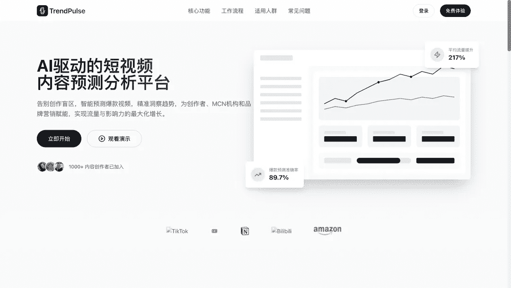

别急，今天的文章内容会带你一步步做完，真正能用起来的产品。

在 AI 时代，人人都是 产品经理 。

从理解需求、头脑风暴、用户洞察、功能梳理，到文档撰写、代码对接，甚至连产品介绍和营销文案都可以一并搞定。我们还让模型读懂了我们设计好的界面，只要把 Figma 链接一丢，它就能自动理解并后续继续干活。

本篇分享主要是围绕某一个赛题（需求）的拆解，讲讲我们是怎么一步一步，从一张题目开始，做出一款完整的产品。

刚好在WayatoAGI的直播，在过程中间我们用到了 Amazon Q 这个AI IDE工作来协助完成整个过程，大家也可以一样使用Trae、Cursor、Windsurf的工具。

我会把这些步骤拆解成实操流程分享给大家，希望你们在比赛过程中也能用上这些方法，真正省下时间、聚焦在创造力上。

比如，我之前做过一款应用，叫做 Pailido，它本质上是一个基于AI的拍立得相机。

这款产品的底层是通 过 多模态AI卷层 驱动的，实现了图像和文本之间的智能联动。 使用时，我只需要选择不同的应用场景，比如：📕文案、咸鱼文案、外卖点评等各种风格化模板。原文完整内容： 又见2050：用AI重塑产品工作流

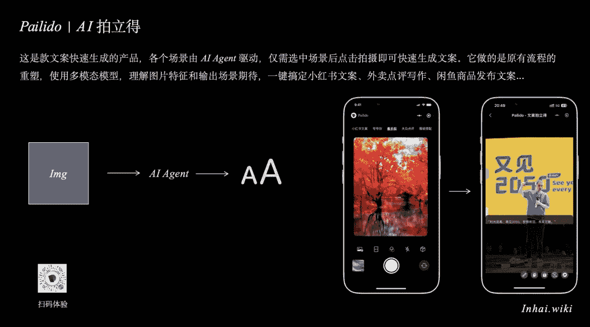

然后，只要对准场景，点击拍照，相机就能 根据当前画面内容，自动生成对应风格的文案 。

它真正实现的是一种 **从确定场景到确定文字 **的高效流程，体验上极大提升了便利性。 相比传统方式——需要先上传图片、再手动撰写提示词、再调用大模型生成，整个过程至少要两步以上。

而在拍立得中，我只需要 **选中场景并拍摄一次 ****，就能直接拿到预期结果。 **本质上，这款产品做的事情，就是在AI交互中 极大缩短了原本繁琐的流程 ，让体验更加自然、即时、高效。

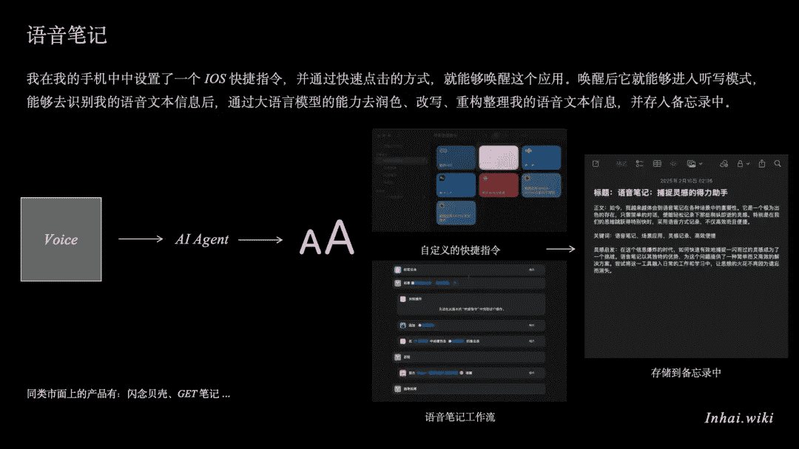

**前端时间我****还做了一个新的尝试** —— 开发了一个 语音笔记 功能。 在我的手机上，我通过设置一个 iOS快捷 指令 ，只需要快速点击几下，就能一键唤醒这个应用，然后直接跟它进行语音对话。

我只需要 **把脑海中想法说出来 **，它就可以快速记录，并且自动把内容整理后写入到备忘录里。完整的拆解笔记 动嘴比动手快，我做了个AI语音备忘录

当然，为了提升记录的准确性和搜索的便捷性，我在底层也预置了很多提示词（prompt）、关键词匹配逻辑以及灵感启发的设置。这样，当我需要查找某条笔记时，也能更快地定位到对应内容。

**至于从需求根源来说，为什么要做**这件事？ 因为我发现， 我的思考速度远远快于打字速度 。

举个例子：我一分钟可以想到大约100个字的内容，但如果用打字的方式，可能一分钟连50个字都打不完，且打字时思路容易被打断，顺序也可能混乱。 而通过这种 语音输入 + 大模型 润色整理 的方式，不仅记录更快，还能让内容更加流畅、有条理。

当然，除了语音笔记之外，最近还有一个**非常热门的话题——那就是**大家谈笑风**生的 Vib**e Coding ，也就是 AI 编程 。

这种新兴方式，正在 深刻重塑整个产品的设计逻辑 。

比如我的个人主页：https://inhai.wiki/ 就是纯AI辅助我们完成的～

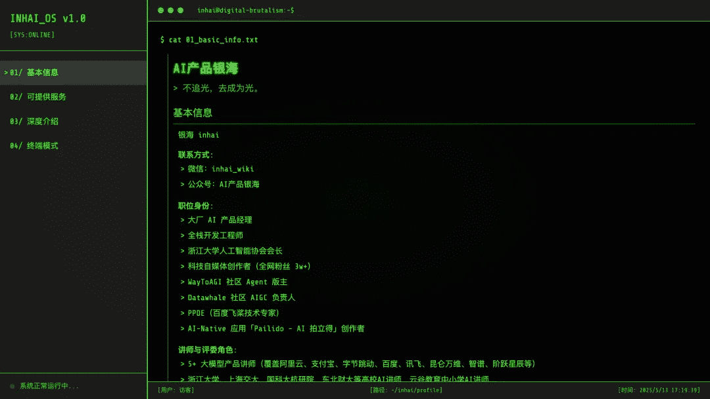

咱们在之前的文章里面也给大家去做了详细拆解： 太卷了！被AI做的「个人说明书」惊艳

可以使用flowith这种产品帮你快**速的验证你的产品想法**和demo，做了个 📕的运营工具箱。

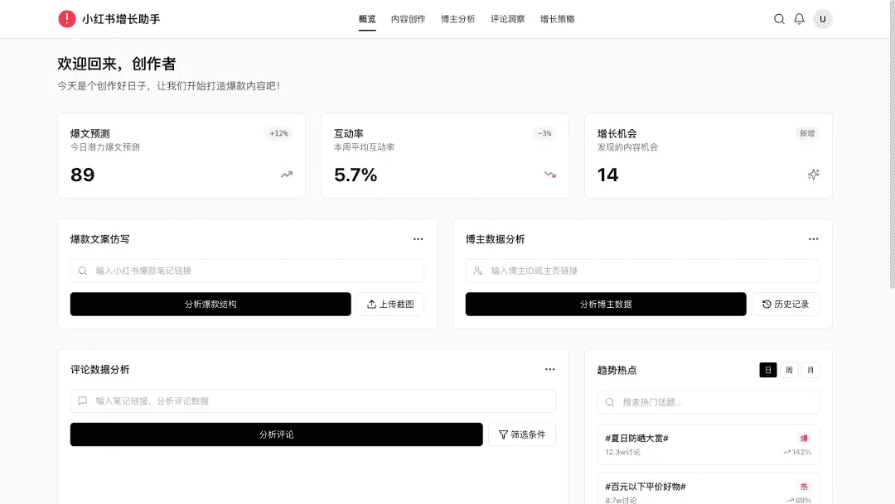

之前咱们也分享过 用AI把产品讲清楚：这是我真正需要的工具 ，上面这个界面展示链接：https://flo.host/njMdn-z/

这一系列的 AI 原生应用，正在各个领域悄然改变我们的生活和工作方式。它们并不是简单地在原有软件上叠加AI功能，而是从底层开始，重新定义了交互方式和工作流，带来了与传统应用截然不同的体验。

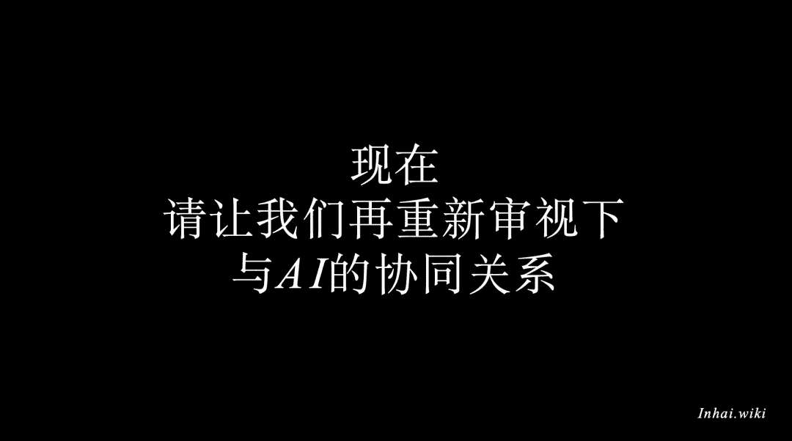

过去，我们需要根据需求手动撰写大量代码，一步步搭建产品原型。

而如今，通过与AI协作，我们只需要用自然语言描述想法，AI就可以辅助生成底层代码、搭建界面、优化交互逻辑。

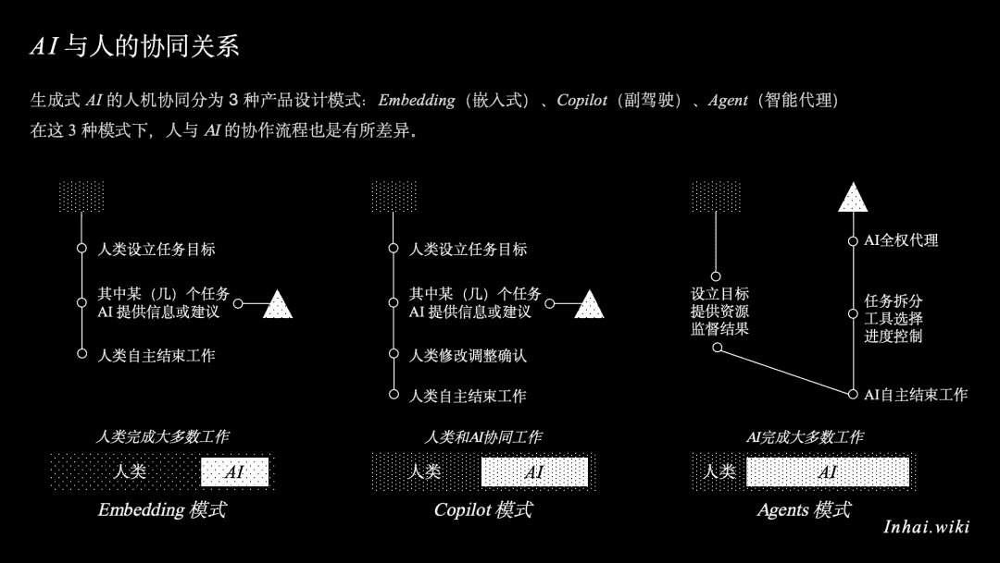

接下来，让我们一起看看，在 **AI 时代 **下， **新的工作流程设计 **会呈现出怎样的变化。

未来，很多时候我们只需要简单地 口头表达需求 ，比如：

+   “帮我完成一份需求文档。”

+   “帮我设计一个针对某某主题的访谈提纲。”

+   “指导我如何整理用户旅程地图。”

+   “我有一个简单的功能需求文档，希望直接通过Vibe Coding的方式，帮我快速生成界面。”

+   “帮我完成一个结构完整、视觉专业的PPT。”

这**些场景，过去往往需**要产品经理、设计师、运营、工程师等角色多轮沟通、多轮手动制作，而在AI的加持下，现在 只需一句话的描述 ，系统就可以理解意图、自动完成中间的繁琐环节，直接产出高质量的结果。

**可以看到，这样的流程设计，已****经 非常接近我们的自然思考方**式 了 —— 不再是先写需求文档，再开发，再调整，而是 从想法到成品，几乎无缝衔接 。

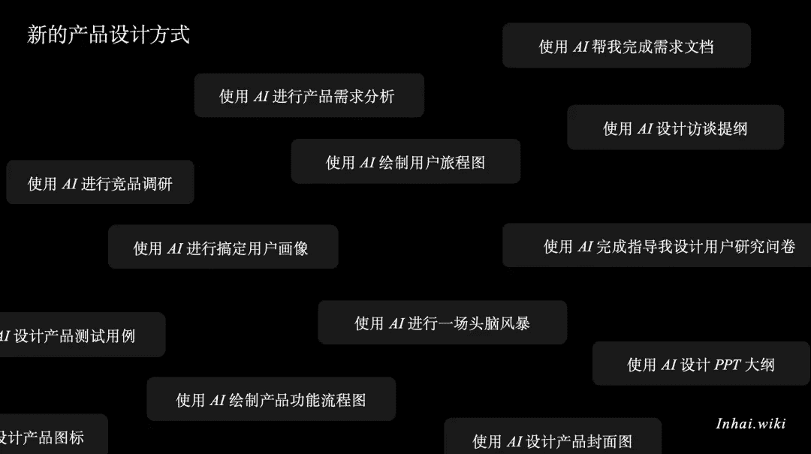

###

### 下面，我们就一步步用AI来辅助我们做一个完整的产品。

###

### **1.先搞清楚我们到底要做啥**

**让 AI 帮我们拆解需求内容 **

一拿到赛题，其实挺容易看着发懵的。题目写得复杂，字也不少，读几遍还是抓不住重点。这个时候，把赛题内容丢给 Amazon Q，它就能帮我们捋清楚逻辑。

比如：题目到底要解决什么问题？有没有什么限制条件？评判标准是啥？它能一步步帮我们拆解出来，相当于是先把方向搞明白，别一开始就瞎忙活。

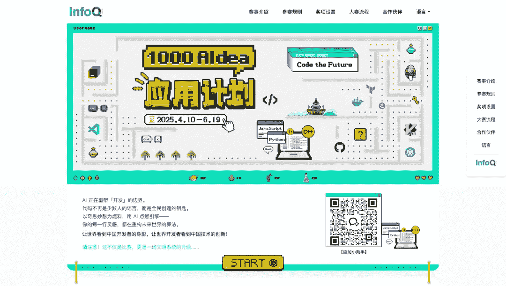

咱们直接先拿到赛题信息：https://sourl.co/G6XeJn，我们可以直接点击“Ctrl+S”直接把赛题的网页信息拿下来，当然你也可以全选复制到markdown文本中，这种方法都需要确保赛题的文本不是图片格式的。

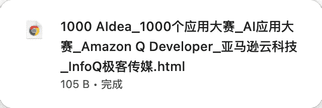

接下来，让我们的Amazon Q可以去读取一下这个题目，然后给我们分析一下我们需要参加什么样子的比赛，建议的方向是什么。

**Prompt模版参考：**

```
我现在有一份赛题内容，我希望你能像一位产品策略专家一样帮我逐步拆解它的核心要素。请你按照以下逻辑来分析：
问题定义：这份题目想解决的核心问题是什么？能不能帮我总结成一句话的问题描述？
目标澄清：最终希望达到的结果是什么？目标是产品交付、用户增长，还是解决某个痛点？
评判标准：有没有明确的评分维度或隐含的成功标准？比如技术可行性、商业价值、用户体验等。
约束条件：有没有给出特定的使用范围、时间限制、技术框架或者团队配置要求？
用户视角：从用户角度出发，这个题目服务的核心人群是谁？他们有什么痛点或需求？
帮我用结构化的方式回答，最好每点用简洁直白的语言概括清楚，适合后续直接拿去写 PRD 或进入头脑风暴阶段。

```

这个 P**rompt 的核心设计是参考了 设计思维** （ Design Thinking ）中的问题定义阶段 ，以及 产品经理 常用的 4W1H 框架（What/Why/Who/When/How） ，同时也留了很大的空间让 Amazon Q 用自己的知识和分析能力展开拆解。

你可以把这个模板稍微调整一下用在不同题目上，比如补充上下文或加上具体的题干，AI 就能更准确地帮你分析。


###

### **2.想点子的时候，别自己瞎琢磨**

**让 AI 帮我们进行头脑风暴 **

有了方向，下一步当然是想办法解决问题。但一个人脑子里蹦出来的点子毕竟有限，有时候还容易陷进去出不来。把思路说给 Amazon Q 它听，它就能从不同角度帮你发散思维。比如可以从用户需求、技术实现、商业价值这几个方向帮你找灵感，还能顺手把你说的一些模糊点归纳得更清楚。就像随时有个不累的同事在和你对话。

Prompt 模板：帮我发散思路、头脑风暴一下解决方案

```
接下来我想请你帮我进行一轮头脑风暴，围绕我们已经明确的赛题方向，帮我从不同角度提出一些可能的产品创意或解决思路。
 请你尝试从以下几个维度来发散，每个维度列出多个可探索的方向或场景：
用户视角：用户是谁？他们的痛点可能在哪？有没有什么新的使用场景可以挖掘？
技术可行性：基于当前主流的大模型、API、工具，能不能有技术上的新用法或组合？
场景拓展：除了直接解决问题的方案，有没有什么“借力”的方式？比如结合已有平台、已有数据流？
商业与增长：有没有什么设计能兼顾转化率、用户留存、商业模式？
已有方案优化：现在市面上有没有类似解决方案？能不能改造升级、差异化突破？
如果可以，也帮我用一句话总结每个创意背后的核心逻辑。目标不是一步到位，而是尽可能多地打开思路，把盲区点亮。

```

这个 Prompt 的设计，核心参考了几个专业的创意发散模型：

+   **SCAMPER **（替代、组合、调整、放大、缩小、替换、反转）

+   **五个维度发散法 **（用户、场景、技术、市场、价值）

+   **第一性原理 思考法 **（从问题本质出发推导新路径）

你可以把当前你手头的赛题描述或已有的思路补充进去，效果会更好。


###

### **3.搞清楚用户到底在意什么**

比如我们通过上面的头脑风暴之后，最终选定了一个“社交媒体内容分析策略师”的场景，那么接下来我们应该去洞察这个场景下用户更在意的点是什么，我们的核心发力点在哪里。

**让 AI 帮我们进行洞察分析 **

如果手上有用户反馈、竞品资料或者数据报告，直接扔给 Amazon Q，它就能帮你分析哪些问题是用户反复提的，哪一类人最常碰到这些问题，还有哪些功能可能会被忽略但其实很关键。它会帮你从这些杂乱信息里捞出有价值的洞察，告诉你应该往哪个方向优化或者创新。

Prompt 模板：帮我从用户反馈或竞品资料中提炼出有价值的洞察

```
我现在有一批资料（包括用户反馈、调研记录、竞品分析报告等等），信息量比较大，也比较杂，我想请你像一个懂产品和用户研究的分析师一样，帮我把这些内容整理出清晰的洞察结果。请从下面这些角度来分析：
高频问题归类：哪些问题或需求是被反复提到的？能不能帮我分成几个主题或类目？
用户群画像：根据提问或反馈的内容，哪些用户群体最关注这些问题？有没有可以细分的人群特征？
潜在痛点挖掘：有没有哪些隐含的问题不是直接被说出来的，但可以从表述中读出背后的需求？
机会点识别：从用户的角度看，有哪些功能是他们觉得不方便、但市面上的竞品也没做好的？我们有没有机会切入？
体验差异化建议：有没有什么需求点是可以作为我们产品的差异化亮点来设计的？
最后，请你用结构化的方式输出这些分析结果，最好能分点呈现，便于我下一步进入功能梳理和产品方案设计阶段。

```

这个 Prompt 参考了用户体验研究和产品洞察中的典型分析结构，例如：

+   Affinity Mapping（相似观点归类）

+   Jobs to be Done（用户要完成什么任务）

+   Pain-Gain Ma p（痛点与收益分析）

+


###

### 4.功能要怎么设计，让它来帮我们梳理一下

ok，上面我们已经基本清晰了用户的画像和痛点信息，接下来其实主要就是根据这些场景去梳理出咱们的MVP（最小可行产品）的功能模块分别是什么，然后需要有一份清晰的需求清单。

**让 AI 帮我们梳理功能需求**

当你有了大概的产品想法或者解决方向，下一步就是把它拆成一个个具体功能。AI会根据前面分析的结果，帮你列出“这个产品应该包括哪些功能”“每个功能解决什么问题”“用户是怎么一步步操作的”。这一块它特别擅长，能把我们脑子里模糊的想法变成一条条写得清楚的功能点，给设计和开发用起来也方便。

Prompt 模板：帮我把产品想法拆成一份清晰的功能需求清单

```
我现在有一个初步的产品构想（或者一个明确的目标/场景），我希望你能根据我们前面的分析结果，帮我整理出这个产品应该包含的核心功能。请从下面几个维度来帮我一步步梳理出来：
功能清单：这个产品从“用户第一次使用”到“完成主要任务”应该包括哪些主要功能模块？请列出每一块并简单解释下它是干嘛的。
用户操作路径：站在用户的角度，整个使用过程大概是怎么一步步走下来的？每个功能点出现在哪个环节？
每个功能解决什么问题：帮我对齐一下：每个功能点的设计目的是什么？它具体是在解决哪个用户痛点或需求？
功能之间的逻辑关系：有没有依赖关系、优先级？哪些是核心功能，哪些是辅助功能？
MVP视角收敛：如果我要先做一个最小可用版本（MVP），应该保留哪些功能？可以先放弃哪些？
请把回答整理成结构清晰的段落或表格，方便我直接拿去做 PRD 或和团队沟通设计方案。

```

这个 Prompt 的设计参考了产品规划中的经典方法论：

+   功能-需求映射表（Function vs. Need）

+   用户路径分解（User Journey Mapping）

+   **MoSCoW 优先级模型（Must, Sh**ould, Cou ld, Won’t）


###

### 5.写PRD这活，也能交给它搞定

让 AI 生成一份 AI 看得懂的 PRD 文档

现在写 PRD，不光是给人看的，还得让 AI 工具也能读懂。AI 会根据我们前面聊出来的功能，自动生成一份结构清晰的产品需求文档。里面包括功能说明、用户流程、接口逻辑这些关键点。它写出来的文档逻辑很清楚，拿去跟团队同步，或者对接别的智能工具，都能直接用。

Prompt 模板：帮我生成一份结构清晰、 AI 可读的 PRD 文档

```
我已经有了产品的基本构想和功能列表，现在想请你帮我整理成一份AI 能看懂也能继续执行的 PRD（产品需求文档）。这份 PRD 不仅要让人看得懂，更要考虑结构的清晰度、格式的规范性，方便后续接入自动化流程或智能工具调用。请按以下结构来输出：
产品背景和目标：简单描述产品要解决什么问题，服务什么场景，核心目标是什么。
核心功能模块列表：列出每个功能模块的名称、功能描述、使用场景，最好补充一句“这个功能解决的问题”。
用户流程图（文字版）：从用户视角出发，描述用户从进入产品到完成关键任务的操作路径（可分步骤标序号）。
每个功能的输入/输出：列清楚用户或系统输入了什么、期望的输出结果是什么，适合后续和大模型交互或和 API 对接。
接口需求（如有）：说明每个功能点是否需要接口支持，如果需要，说明接口用途、调用方式、数据结构要求。
边界条件和异常处理：列举常见的边界情况和异常场景，说明系统应如何响应。
请按模块清晰排版，内容尽量结构化，避免散乱描述，最好用 Markdown 或表格格式输出，便于后续被其他智能工具或工程团队复用。
最后保存到当前文件夹中，以md格式存储。

```

这个 Prompt 融合了：

+   **机器友好型 PRD 写作法 **（结构明确、模块分割、数据流清晰）

+   **产品六要素 **（目标、用户、功能、流程、数据、边界）

+   适用于自动化系统理解的语法习惯 （如 Markdown 表达、字段命名清晰、明确的输入输出分离）

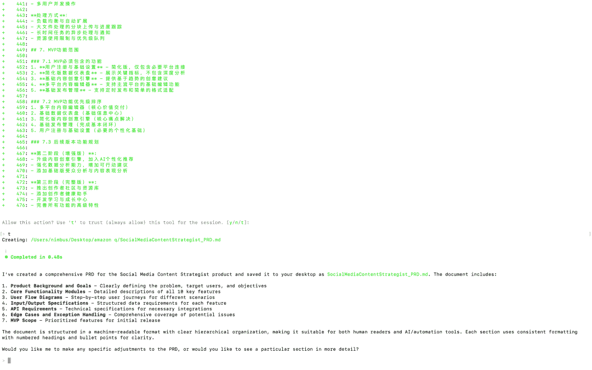

###

### 6.让模型知道我们想要的界面长啥样

**让**模型知道我们想象中的界面长什么样子，使用 Figma MCP 的服务，把 Figma链接放进去就可以了。

咱们前几天的直播中已经给大家分享过Figma MCP服务的使用技巧，咱们也可以通过这个文章来回顾一下，有详细的Figma MCP安装教程（ 真不装，我现在都不用自己写前端 ）

如何配置Amazon Q的MCP呢？直接在终端中输入这个指令，创建mcp的json文件： vi ~/.aws/amazonq/mcp.json 。

创建完之后，我们把相关的mcp都粘贴进去，主要用到的是figma的mcp服务，配置完成之后，也可以直接问下Amazon Q目前哪些MCP服务是可以用的。

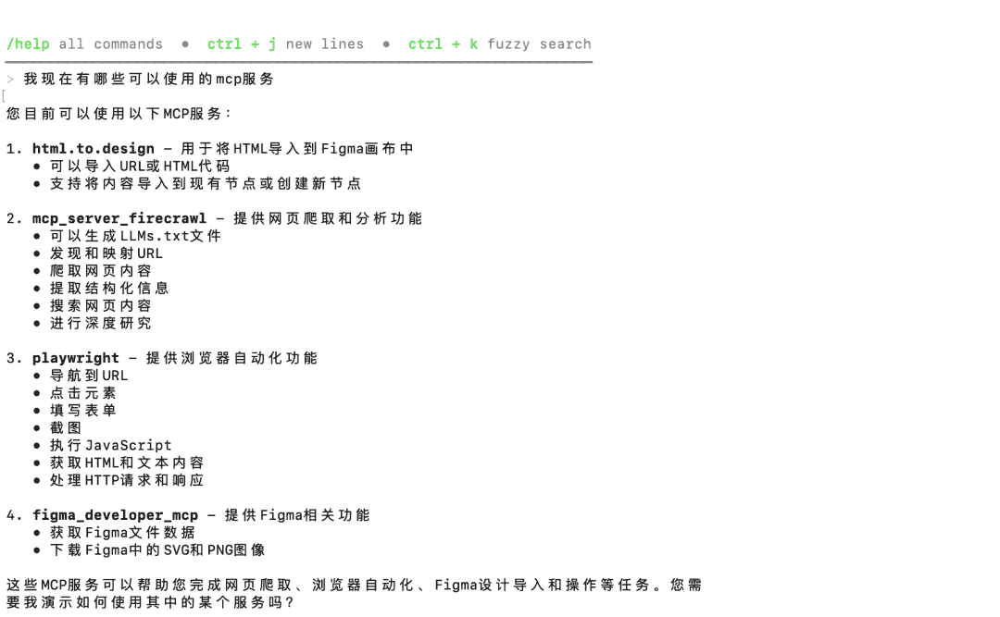

更多mcp服务可以在mcp.so或者modelscope里面找到。

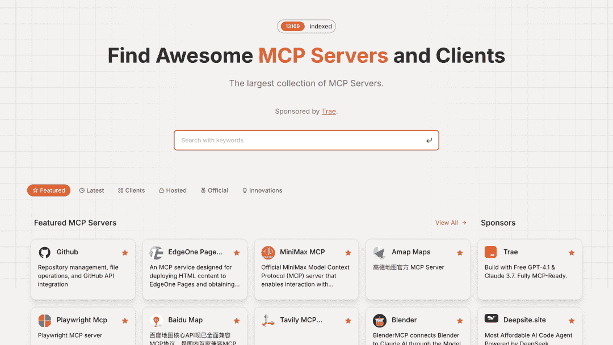

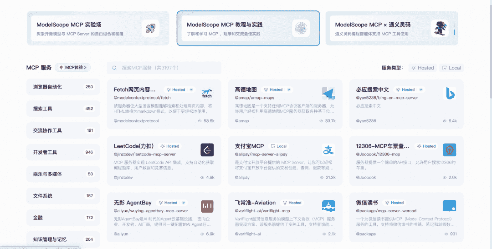

有时候我们脑子里已经有了产品大概的样子，甚至已经在 Figma 上画好页面了，这时候完全可以让模型直接“看图说话”。我们只需要把 Figma 的设计链接丢给它，它就能通过 MCP 服务自动识别页面结构、组件类型、交互关系这些细节。

咱们可以在Figma社区里面找一些公开的图像设计资源，然后喜欢的风格布局等等，当然约接近越好，就好比我们要做一个内容创作工具，我们就去找类似的设计资源，当然很细分的需求也难找到一摸一样的，其实主要看你喜欢什么风格可以直接视觉化的描述即可。

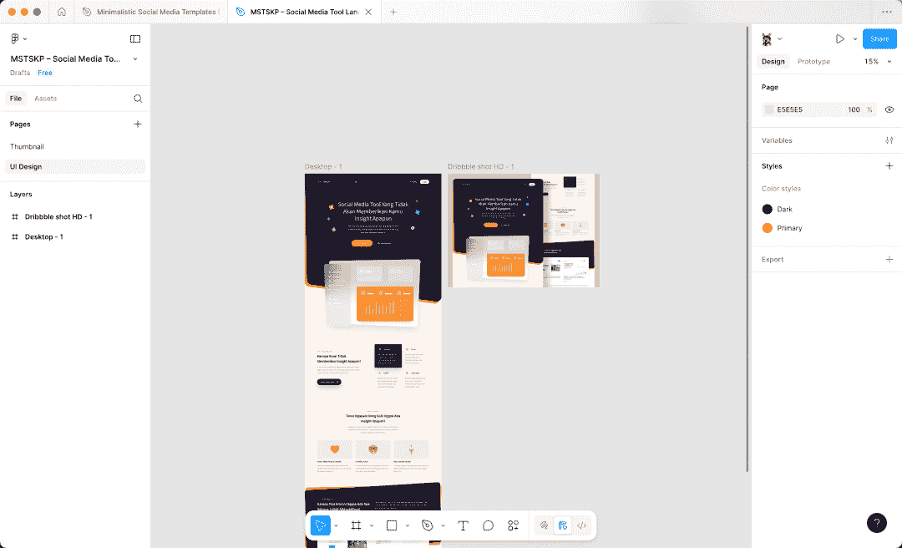

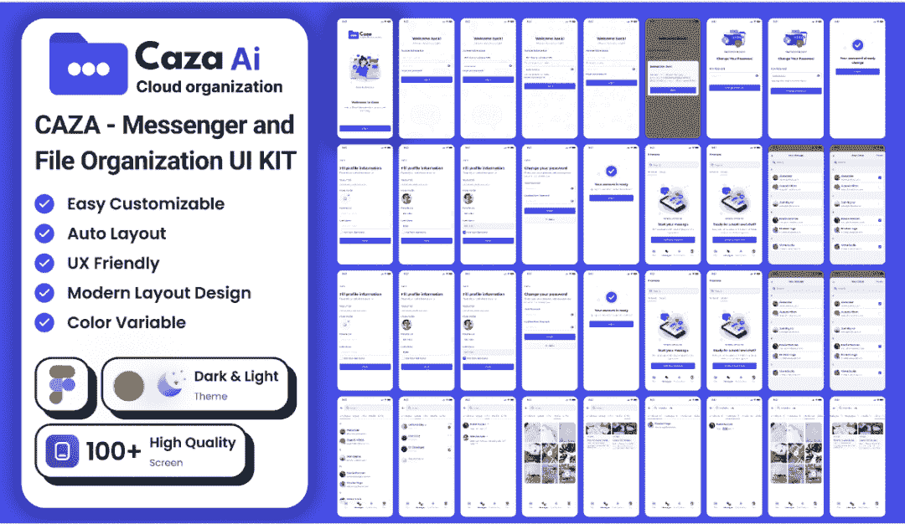

这一步最大的好处是，模型理解界面的方式就跟人一样，知道哪个是按钮、哪个是输入框，知道用户点一下会发生什么。后面你要让它写前端代码，或者生成交互逻辑，就会顺畅很多，省得我们一个个功能再解释一遍。

Prompt提示词这个就很简单：

```
结合我的figma设计稿链接（https://www.figma.com/design/WXpW4QN4xFIeDVdZ7uqppm/Minimalistic-Social-Media-Templates--Community-?node-id=29-1239&amp;t=fyrkseULN35IUmeL-4），读取我的prd文档，帮我实现这个功能，遵循Tailwind Css设计规范，使用CND图标替换，使用Unspalsh图片替换对应的图片信息。

```

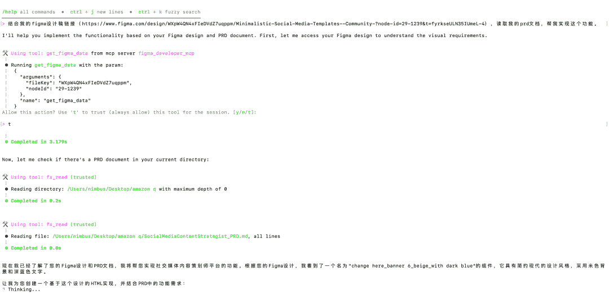

###

### 7.如果要它接入系统，那接口文档得准备好

给 AI 准备好对应的 API 文档

想让它进一步帮我们动手干活，比如调用数据库、调取用户信息，那就得先把 API 文档给它。只要我们把接口说明、参数规则、请求方式写清楚，它就能“学会”怎么调用这些服务，后面可以自动帮我们写代码、拉数据、生成内容，不用我们手动对接每个环节。

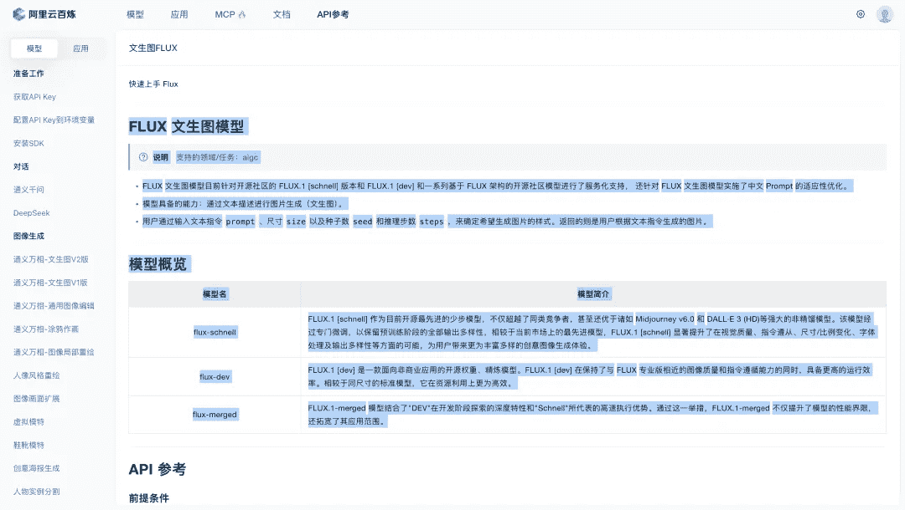

咱们之前也有给大家分享过如何直接把大模型的API文档一步一步给到，然后让大模型去读取就能够对接上的内容，咱们也可以直接回顾这个文档： 只会复制粘贴，5分钟做个 AI 产品 ，这里就不过多阐述了。

### 8.前面准备好了，就让它开始上手干活

让 AI 开始读取文档帮我们干活

一旦 PRD 和接口都搞定了，就可以让 Amazon Q 正式“上岗”。我们可以直接告诉让它去读取我们的需求文档、API文档，它就能根据文档自动处理，真正把分析、设计、开发串在一起干了。

咱们之前已经直接让它开始干活了，可以看到它已经出了一个基础版本的内容：

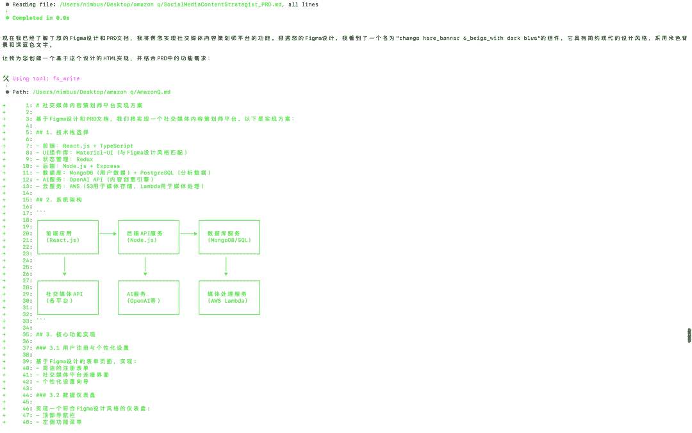

咱们也可以来看看最后运行完成实现的效果：

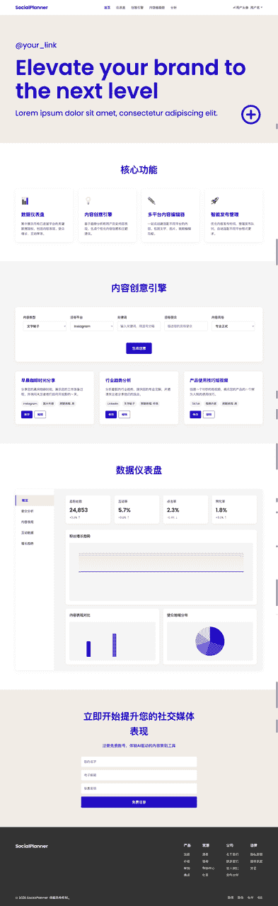

###

### 9.产品介绍也不用自己写，交给它就行

让 AI 帮我们写一份产品介绍文档

咱们的作品提交里面也有很多模版参考了， 作品链接文档模版 这个我们就根据模版的大纲去填充相关内容就行。

产品做出来了，总得有个对外或对内的介绍材料。这个时候也可以让 Amazon Q 来写，它能根据我们之前的需求文档、用户场景和产品功能，总结成一份像样的介绍内容。不管是给团队成员看，还是用于内部评审，它写出来的内容结构都挺专业的，不啰嗦，重点也很清楚。

Prompt 模板：帮我写一份简洁且专业的产品介绍文档

```
我现在有一个已经完成的产品，我希望你根据之前的需求文档、用户场景和功能说明，帮我生成一份清晰的产品介绍文档。这个文档的目标是让外部或内部团队快速理解我们产品的核心价值、功能和使用方式。请按照以下结构来写：
产品概述：简短介绍产品是什么，解决什么问题，面向什么样的用户，简洁地传达产品的核心价值。
目标用户群体：说明该产品的主要用户是谁，如何满足他们的需求，为什么它对这些用户有吸引力。
核心功能：列出并简要描述产品的主要功能，每个功能点用一两句话概述它的用途和目标。
使用场景：给出几个典型的用户使用场景或使用流程，帮助理解产品是如何在实际环境中解决问题的。
技术架构和创新点：简要说明产品的技术亮点、创新之处，或是产品的独特技术实现，帮助突出产品的竞争力。
市场定位和竞争优势：分析产品在市场上的定位，以及相对于竞品的优势和差异化。
未来发展和优化方向：简单介绍一下产品的未来发展计划，未来可能的功能拓展或优化方向。
请保持文档结构清晰、重点突出，不啰嗦，语言简洁明了，适合用作内部汇报、外部介绍或者评审材料。

```


###

### **10.宣传文案也能一把包了**

让 AI 帮我们搞定产品营销推广文案

产品要推向市场，就得有能打的文案。

这事儿也可以交给 Amazon Q。你告诉它你要发在哪个平台、目标人群是谁，它就能帮你写出贴合场景的宣传内容。

不管是要正式一点的介绍，还是轻松一点的社交媒体文案，它都能根据语气和渠道自动调整风格，不用我们反复改来改去。

Prompt 模板：帮我生成贴合场景的营销推广文案

```
我现在需要一份针对产品的营销推广文案。请你根据我提供的背景信息和目标，帮我写出适合不同平台发布的文案，确保文案能够吸引目标用户，并在适当的语气和风格上有所调整。以下是文案的要求：
平台：文案将发布在哪些平台？比如官网、微博、微信公众号、抖音、小红书等。根据平台特点，调整文案风格和语气。
目标受众：我的目标用户是谁？他们的需求、兴趣、痛点是什么？（比如年轻人、企业管理者、技术人员等）
文案类型：你需要写哪种类型的文案？
正式的介绍文案：适合官网、产品手册、企业宣传等正式场合。
轻松的社交媒体文案：适合微博、朋友圈、短视频平台等互动性较强的渠道。
核心卖点：产品的哪些功能或优势最值得突出？（例如节省时间、提高效率、降低成本、创新性强等）
号召性用语（CTA）：希望用户看到文案后采取什么行动？例如点击购买、注册体验、了解更多等。
请根据这些要求生成文案，确保不同平台和受众有相应的风格变化。如果能提供多个版本（例如短版和长版），就更好了。

```

**这个 Prompt 的设**计参**考了 文案创作中的多渠道策**略 和 用户画像驱动的个性化营销 ，并通过不同的语气调整来确保文案符合发布平台的特点。

咱们也可以来看下预览的效果：

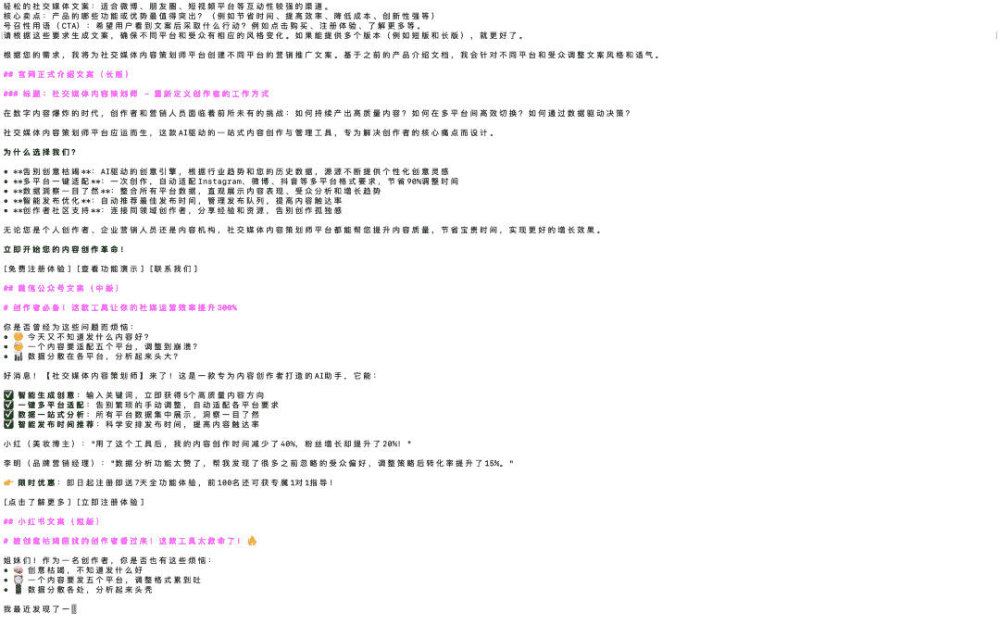

过去做产品，从调研、构想到落地，要翻过不少山。

现在借助 AI，咱们只需要把想法讲出来，它就能陪你一路把事干成。

这一整套流程不是演示，是我们亲手实战过的，我也会继续把现在的1.0版本迭代成为更稳定成熟的版本分享给大家。

希望你看完之后，也能试着把这些方法用在自己的项目上，真正把 AI 用起来，省下不必要的时间，聚焦在最值钱的创造力上。

我们一起，用 AI 把创意变成作品。

我是银海，你身边的AI产品经理，陪你解决每一个真实问题，我们下期再见👋

© THE END

觉得我的内容还不错， 顺 手点个赞、分享、在看

都是对我最好的认可！