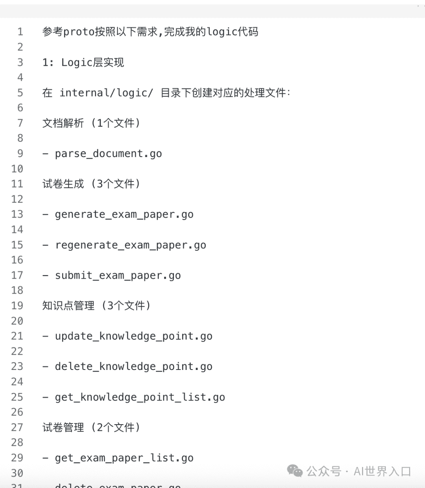
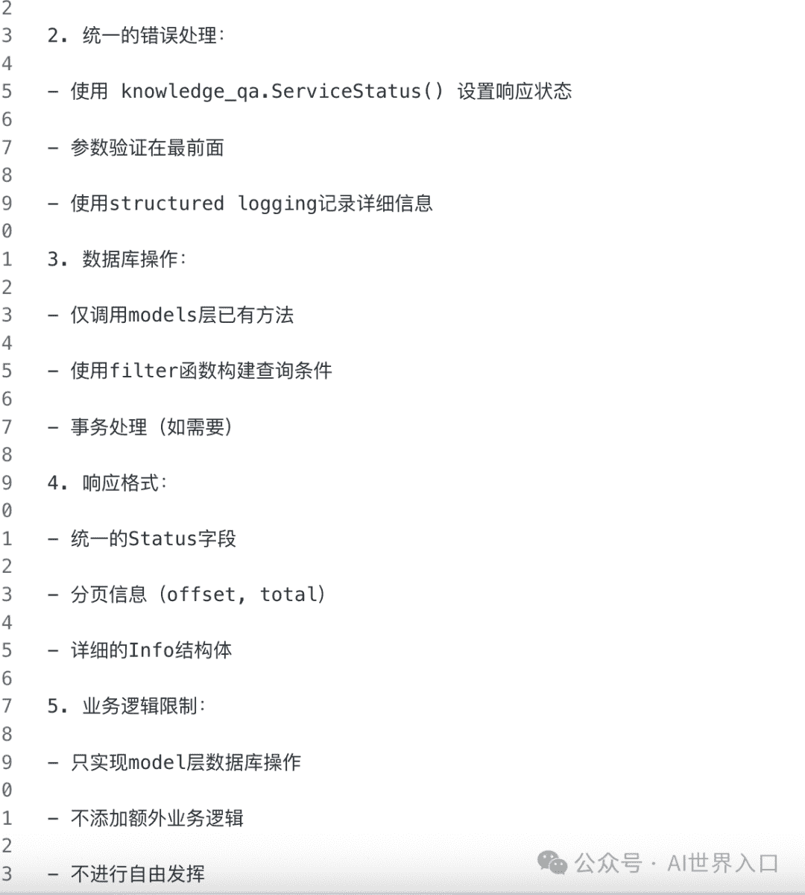
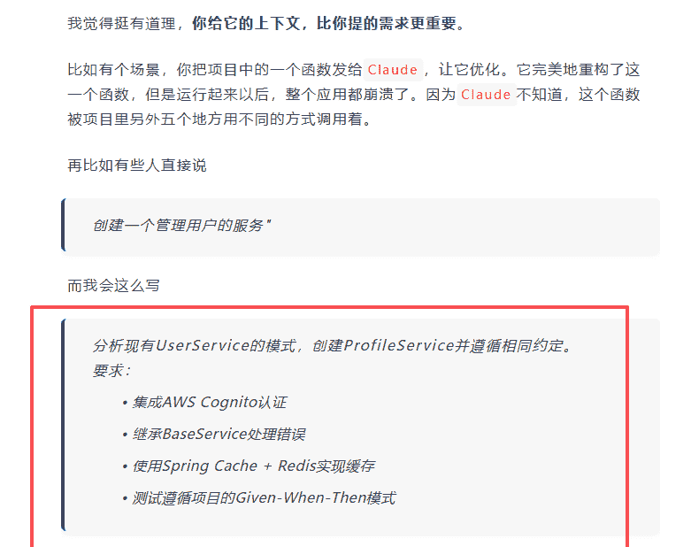

# AI编程一年，我把血泪教训拧成这篇干货，帮你少走半年弯路

> 来源：[https://xatc0v8uz5m.feishu.cn/docx/UWYRdizydoCHogxh2u9cV0WJn3e](https://xatc0v8uz5m.feishu.cn/docx/UWYRdizydoCHogxh2u9cV0WJn3e)

> 🔗 原文链接： h[ttps://mp.weixin.q](https://mp.weixin.qq.com/s/y6y5sf-OtaTrHshRG6VlXg?click_id=10)q.com/s/y6y5sf-O...

> ⏰ 剪存时间：2025-09-23 16:29:36 (UTC+8)

> ✂️ 本文档由 [飞书剪存 ](https://www.feishu.cn/hc/zh-CN/articles/606278856233?from=in_ccm_clip_doc)一键生成

原创 AI吴同学 AI世界入口2025年09月23日 14:31  浙江

> 哈喽，大家好，我是吴同学，一个陪你一起摸索AI的好同学。

介绍一下我自己的情况，我使用了一年左右的AI编程了，一年前，我还在为了一个bug大骂AI不靠谱，现在可以说目前90%的代码都是用AI来帮我完成的，不论工作上**还是日常开发，AI基本都能**出色地完成我布置的任务，这中间的转变，一方面是因为模型能力的增强，另一方面也是我踩了无数的坑。现在我将我的经验和教训给大家分享一下， 我拧干水分，保证全是干货 。

如果你是正在使用AI编程，相信我，这篇文章或多或少会让你有所收获！

# **工具选择**

AI编程现在的工具选择非常的多，那么我们要如何来选择一个合适的呢？请看下表

| 名字 | 上手难度 | 费用 | 编码能力 | 可用模型 | 适用人群 |
| --- | --- | --- | --- | --- | --- |
| claudeCode | 高，主要是是靠命令行 | 毕竟贵，官方的要200美刀一个月，国内中转镜像也要300左右 | 强，有所降智但是我认为还是目前的No.1 | 以claude系列为主，也可以外接其他的模型 | 适合有一定编程基础的，对编码要求较高的人群 |
| cursor | 中等，有UI界面，大部分为英文，需要中文插件 | 略贵，20美刀一个月只能用五百次左右请求，基本要开60美刀的套餐 | 比较强，比cc差一点 | 选择性比较多，出来claude系列还有gpt，gemini | 适合零基础，有一定经济基础的 |
| trae | 简单，字节开发的，对国内用户友好 | 首月3美刀，然后10美刀一个月，无限制使用 | 比cursor略差一点 | 和cursor基本一致 | 新人我建议无脑冲，经济实惠，前期做简单项目完全够了 |
| codeX | 高，主要是是靠命令行 | 20美刀的GPT套餐够日常需求 | 我觉得不必CC差多少 | GPT5 | 最佳用法是和claude code一起搭配使用，比如用来做代码审查和文档评审 |

我一直用的就是 Claude Code 也推荐大家，如果经济条件允许还是要第一梯队的产品，给到的体验是完全不一样的

但是如果你是纯小白，我建议还是先从trae开始，经济实惠，界面友好，非常适合用于学习

# **规则**

不管使用哪个编程工具，都会有一个类似于规则或者记忆的东西，这个非常的重要，如果你刚接触AI编程，一定要先了解规则。我就用我最熟悉的 Claude Code 为例，看看他的规则在哪里

1.  1. 用户记忆：~/.claude/CLAUDE.md

这里存放一些所有项目都希望遵守的规则，比如说我们默认的语言，在什么时候调用什么mcp

说实话，这个是有点玄学在身上的，不知道各位有没有和我一样，总感觉有时候遵守，有时候不遵从，我试了很多个规则，我推荐我当下的一个 :

https://yw62pbfftrl.feishu.cn/wiki/TpI8wIZ2viRMijkDpuRc5sCRntc?from=from_copylink

1.  2. 项目记忆：./CLAUDE.md

这里是存放当前项目的一些规范，比如项目架构，技术栈，API设计约定，能让AI在开始工作前就对项目有全局认知，减少后续的沟通成本。

这里我推荐大家按照 AGENTS.md的规范填写，现在很多AI编程工具都支持的，核心是构建以下内容

+   • Project overview 项目概述

+   • Build and test commands 构建和测试命令

+   • Code style guidelines 代码风格指南

+   • Testing instructions 测试说明

+   • Security considerations 安全注意事项

我一般会直接让 Claude Code 帮我生成

关于一些示例，大家可以在网站 https://agents.md/ #examples 里面去查看一下其他的

# **高质量Prompt编写**

前两天我听到了一个播客，里面说现在的AI已经很强大了，如果没有完成我们的任务，大概率是由于我们的上下文没有提供足够。

我觉得挺有道理， 你给它的上下文，比你提的需求更重要 。

比如有个场景，你把项目中的一个函数发给 Claude ，让它优化。它完美地重构了这一个函数，但是运行起来以后，整个应用都崩溃了。因为 Claude 不知道，这个函数被项目里另外五个地方用不同的方式调用着。

再比如有些人直接说

> 创建一个管理用户的服务"

而我会这么写

> 分析现有UserService的模式，创建ProfileService并遵循相同约定。

> 要求：

+   • 集成AWS Cognito认证

+   • 继承BaseService处理错误

+   • 使用Spring Cache + Redis实现缓存

+   • 测试遵循项目的Given-When-Then模式

然后要适当引用部分的文件，比如需要model的代码，我们就指定相关的model代码，而不要一股脑全部丢进去

记住你的提示词越精准，AI完成度就越高，比如以下的提示词

这**是一个很详细的**提示词，直接一轮就帮我完成了所有代码，你在让AI帮我们干活的时候，我是比较建议在一个文档上面，先把提示词写清楚， 确保没有歧义 ，然后逻辑说清楚了再给到AI帮我们实现。

如果你怕搞不清楚，你和AI说： 在开始写代码前，先问我一些澄清问题

确保没有歧义了，我们让它进行代码编写

# **spec工作模式**

写好单个Prompt只是基础，但想让AI完成复**杂项目，就需**要一套更宏观的工作流，比如 规范驱动开发

就是我们要先创建用户需求文档，然后技术文档，然后再是任务，这个我[不过多阐述，主要就是一种方法论，防止](https://mp.weixin.qq.com/s?__biz=MzE5ODkyMDkzMA==&mid=2247483695&idx=1&sn=b30975acaa8c1e66916e7a87174cc18d&scene=21#wechat_redirect)[AI乱飞的方式，大家可以看我往期的两篇文章 ](https://mp.weixin.qq.com/s?__biz=MzE5ODkyMDkzMA==&mid=2247484365&idx=1&sn=83fd057d0a76008ea40cd36e86f62cb4&scene=21#wechat_redirect)别再让AI写“野代码”了！我复刻了Kiro顶级工作流 (文末附完整提示词) 告别Vibe Coding！GitHub爆火的spec-kit，正在重塑AI编程范式

其实还有一种开发方式就是 **测试驱动开发（TDD）**

这种理念就是先写测试代码，然后再写实现，然后不断增加测试用例，来完善实现，这种方式可以很好的保证功能实现，我建议大家在一些复杂逻辑的功能，可以和AI说， 采用TDD的规范进行开发，现在先写测试代码

# **善用MCP**

有个场景：你让Claude使用一个的第三方库来处理数据，它自信满满地给了一段代码，你复制运行，满屏报错。经过半小时的排查，你才发现代码里那个关键的函数，是Claude自己发明的，那个库里根本没有。

我相信有很多人都会有共鸣，这时候我们就要用mcp来解决问题，比如我们如果安装了 context7 这个mcp会去拉取第三方库的官方文档，这样就能规避这个问题，当然还有很多其他的mcp，你可以参考我的这篇文章 CodeBuddy Cli你需要的5个MCP

# **学会禁止**

我觉得禁止让AI干什么比告诉它要干什么更重要,应该更多的说什么不能干

比如很多时候一些简单逻辑是不需要测试代码的，还有 README 文件，AI很喜欢突然写个 README 文件，说实话，我觉得它在故意浪费我的Token

# **架构设计**

在开始编码之前一定要和AI先沟通整体架构,尽可能的拆分的足够细致,比如复杂逻辑拆成多个子模块,遵循高内聚,低耦合,拆分的越细致,AI改崩的概率越低

记住 你对软件工程的理解,决定你对AI编程的上限

对于没有经验的小白来说这一点真的很难，所以我这里也是建议小白不要想着搞一个什么大项目，我们先从一些小的项目开始做起，做一个MVP产品，慢慢迭代

这里还需要说一下，我们架构一定要简单一点，特别是MVP产品，我们尽量全部用node.js开发，这样部署简单，能够快速的拿到结果

推荐架构:

+   • react 作为前端框架

+   • vercel serverless functions 完成后端实现

+   • supabase 作为数据库

+   • vercel 进行部署

这一套技术栈对AI编程非常友好，生态也很熟悉，特别适用于小而美的项目，最重要的是都可以白嫖，不花钱

# **UI设计**

我总结了以下方法

+   • 要设定组件库

+   • React UI组件库有Material-UI、Ant Design

+   • Vue.js UI组件库有Element UI

+   • 通用UI组件库有Bootstrap等

+   • 指定风格

+   • 苹果的Apple Design

+   • 谷歌的Material Design

+   • 适合企业应用的Ant Design

+   • 以及磨砂玻璃风的Glassmorphism

+   • 扁平风的Flat Remix

+   • 运用参考图

+   • 去 dribbble 找到设计图片

+   • 然后让AI生成包含设计规范的json

+   • 让AI参照规范进行制作

+   • Figma/Pixso将设计稿转成code

# **前端先行**

在UI设计以后，我是建议先完成前端开发，我们先让AI用开发出整体样式，不要考虑功能实现，等整个前端功能完成以后，我们再进行后端接入

# **版本管理，你的后悔药**

一定一定要用git进行版本管理,这是你的后悔药。

代码写崩了的时候 直接 git reset --hard 直接从头再来

比如我前段时间写了一个项目，就是接入supabase的时候搞错了第三方库，给我弄得乱七八糟的，不停地让改bug，反而越改越多。我选择直接回滚，将库指定好然后就很快搞好了。

我是建议你每完成一个重要的需求，你就让AI帮你Git提交一下

# **安全**

主要需要检查三点：

1.  1. **用户输入区域 **，只要是用户输入的都要进行校验，我记得有一个攻击方式就是在用户注册的时候，用户名没有限制，破坏者直接用脚本输入一个5M大小的用户名，直接给干崩了

1.  2. **第三方依赖 **，我们尽量不要去使用一些小的开源项目，还是要找一些star比较多的项目

1.  3. **敏感数据 **，主要就是一些apiKey，我们决定禁止放在前端，必须放到后端环境变量中。因为我们这些数据泄露了是很严重的，比如我们接入了 Deepseek的api，如果我们的发生了泄露，别人就可以用你的apikey进行调用API，你可能突然就没钱了

# **慢就是快**

这句话大家一定要记在心里，不要想着别人说一个小时就做出来个项目，然后你也直接一股脑让AI一次性生成代码，这样你大概率是直接崩溃的

一行一行地写，比一次性生成更高效。比如说让它先写函数A，测试通过后，再让它基于函数A写函数B，像搭积木一样前进。

# **写到最后**

**我一直以来对 AI 的定**义都是： 人人都配备的高潜实习生 。

对当下的 AI 实习生，应该安排合适的任务，给予合适的指导及信息输入，并随时做好帮它兜底，并随时接手，就像你带一个真人实习生一样没啥区别，要么没用好，要么没雇好。

现在不要只收藏，快去试一下，给你的实习生分配一下任务，做出一个自己的应用

---

> 每一份思考都值得被看见。

> 如果**这篇内容帮你**省了时间，带来了启发，请点个赞或分享给朋友吧。

> 我是 AI吴同学 ，一个与你并肩摸索AI的好同学。

> 关注我，不止是获取资讯，更是和我一起成长。下期见！

我想问一下，就是下面这个方式它是不是适用所有的应用在做开发的时候都能够使用的一套模板呢？比如说我在做网页方面的应用的话，可以用这句话作为用户开发的一套模板嘛，以及说我如果说是在做iOS应用的一个方式的时候呢?分析现有UserService的模式，创建ProfileService并遵循相同约定。

要求：

• 集成AWS Cognito认证

• 继承BaseService处理错误

• 使用Spring Cache + Redis实现缓存

• 测试遵循项目的Given-When-Then模式

你提出了一个非常好的问题！这个红框中的开发指令，它并不是一个适用于所有应用（包括网页和 iOS 应用）的通用模板。

我们来具体分析一下为什么，以及它更适合什么场景：

### 为什么它不是通用模板？

1.  **技术栈绑定性强：**

+   **AWS Cognito认证：** 这是一种特定的云服务认证方案，适用于使用 AWS 生态的应用。如果你在用其他云服务（如 Azure AD, Google Firebase Auth）或自建认证系统，这条就不适用。

+   继承BaseService处理错误： BaseService 这样的概念通常出现在面向对象编程（OOP）的后端服务架构中，特别是使用 Spring 框架的项目（结合 Spring Cache）。前端框架（如 React, Vue 的网页，或 Swift/Kotlin 的 iOS/Android）虽然也有错误处理机制，但通常不会以“继承 BaseService”这种方式来处理。

+   Spring Cache + Redis实现缓存： Spring Cache 是 Java Spring 框架的缓存抽象，而 Redis 则是常用的缓存数据库。这明确指向了使用 Java Spring 后端技术栈的场景。网页前端应用和 iOS/Android 应用虽然也有缓存机制（如浏览器缓存、本地存储、App 内存缓存），但不会使用 Spring Cache。

1.  **架构模式针对性强：**

+   **分析现有UserService的模式，创建Pr**ofileService并遵循相同约定： 这表明该指令是在一个已经存在的、具有特定服务架构（例如微服务或分层架构）的项目中进行的，并且要求新服务（ProfileService）与旧服务（UserService）保持一致性。这种约定和模式是项目内部特有的。

1.  **测试方法针对性强：**

+   测试遵循项目的Given-When-Then模式： Given-When-Then 是一种行为驱动开发（BDD）的测试风格，常用于集成测试、端到端测试或业务逻辑测试。虽然这种思想可以借鉴，但具体的测试框架和实现方式会因技术栈而异（例如，Java 项目可能用 Cucumber 或 Spock，JavaScript 项目有 Jest/Cypress，iOS 有 XCTest/XCUITest）。

### 那么，这个模板更适合什么场景？

这个指令是为**后端服务开发**量身定制的，特别是针对：

+   使用 Java Spring 框架的项目。

+   部署在 AWS 云环境中的项目。

+   已经建立了良好代码规范和架构模式的大型或中型项目。

+   注重测试覆盖率和行为驱动开发（BDD）的项目。

它是一个非常具体的、高质量的后端开发指令示例，因为它提供了足够的上下文和技术细节，让开发者（或 AI）能够精确理解并执行任务。

### 网页和 iOS 应用开发能否借鉴这种思路？

**当然可以！虽然不能直接照搬，但这种提供详细**上下文和具体要求的思路是非常值得借鉴的。

**对于网页（前端）应用：**

你可以提供这样的指令：

> **分析现有****UserDash****boardPage的组件模**式，创建UserProfileEditor组件并遵循相同约定。要求：

+   集成Auth0认证组件，处理用户登录状态。 （替代AWS Cognito）

+   遵循现有UI组件库的错误提示和校验机制。 （替代继承BaseService处理错误）

+   **使用React Query + LocalS**torage实现用户数据缓存和离线访问。 （替代Spring Cache + Redis）

+   测试遵循项目的Cypress端到端测试规范。 （替代Given-When-Then）

**对于 iOS 应用：**

你可以提供这样的指令：

> **分析现有****LoginViewModel****的架构模式，创建****ProfileView**Model并遵循相同约定。要求：

+   集成Firebase Authentication处理用户认证。 （替代AWS Cognito）

+   **遵循项目定义的****AppError****类型和错误展示逻辑。** （替代继承BaseService处理错误）

+   使用Core Data + NSCache实现用户配置文件和图片缓存。 （替代Spring Cache + Redis）

+   编写遵循XCTest的单元测试和XCUITest的UI自动化测试。 （替代Given-When-Then）

### 总结

**这个红框中的例子**展示了向 AI 或开发者提供高质量、高上下文开发需求的典范。它能够让接收方（无论是人类还是 AI）清晰地知道：

+   **做什么** (ProfileService)

+   **在什么基础上做** (UserService的模式，相同约定)

+   **如何做** (集成Cognito, 继承BaseService, 使用Spring Cache+Redis)

+   **如何验证** (Given-When-Then测试)

**所**以，核心的 takeaway 是：在给 AI 或团队下达开发指令时，越详细、越具体、越贴合项目当前的技术栈和规范，结果就会越精确、越符合预期。 但具体的技术细节和术语会根据你所使用的平台和技术栈而变化。

这个模板适合什么样的场景？安卓的应用吗？还是网页wed

显示思路

问得好！我们来深入分析一下。

这个模板**最适合后端服务开发**，不直接适用于安卓（Android）应用或网页（Web）前端的开发。

原因如下：

### 为什么不直接适用安卓和网页？

**这个模板指**令中提到的技术和概念，几乎都属于服务器后端的范畴：

1.  **UserService****, ****ProfileService**：这代表的是处理业务逻辑和数据的服务层，是典型的后端架构模式。

1.  **继承BaseService**：这种通过继承来统一处理错误的方式，在以 Java 为主的后端（特别是 Spring 框架）中非常常见。

1.  S**pring Ca**che + Redis：这是最关键的一点。Spring Cache 是 Java Spring 框架独有的技术，而 Redis 是一种运行在服务器上的数据库/缓存系统。安卓应用和网页前端都无法直接使用它们。它们有自己的缓存机制：

+   **安卓**：使用 Room 数据库, SharedPreferences, 或内存缓存。

+   **网页**：使用 localStorage, sessionStorage, IndexedDB, 或 Redux/React Query 等状态管理库。

1.  **AWS Cognito**：虽然安卓和网页都需要和 Cogni**to **交互来完成登录注册，但它们的角色是客户端，通过 SDK 调用 Cognito 的接口。而模板里提到的“集成”，更偏向于后端服务与 Cognito 的集成配置。

---

### 那么，安卓和网页的类似模板应该是什么样的？

虽然技术不同，但这个模板**“提供清晰、具体、可执行要求”的思路**是非常值得借鉴的。我们可以把这个模板的“灵魂”翻译成安卓和网页的版本：

#### 安卓 (Android) 应用的等效模板：

> **分析现有****LoginViewModel****的架构模式，创建****ProfileView**Model并遵循相同约定。要求：

+   **集成 AWS Cognito Mobi**le SDK 完成用户资料的获取与更新。

+   **使用项目中定义的 ****Result<T>** 封装类来处理网络请求的成功与失败状态。

+   使用 Room 数据库对用户配置信息进行本地缓存，减少网络请求。

+   **使用 JUnit 和 Mockito 编写单**元测试，遵循项目的 MVVM 测试模式。

**对比分析：**

+   ProfileService -> 变成了安卓架构中的 ProfileViewModel。

+   Spring Cache + Redis -> 变成了安卓本地数据库 Room。

+   错误处理 -> 变成了安卓中常见的 Result 封装类。

+   测试 -> 变成了安卓常用的 JUnit 和 Mockito。

#### 网页 (Web) 前端的等效模板：

> **分析现有****useAuth**** Hook 的模式，创建****useUserProfile** Hook 并遵循相同约定。要求：

+   **集成 AWS Amplify U**I 组件库处理用户个人资料的展示与编辑。

+   **使用 ****axios**** 拦截器（interceptor）统一处理 **API 请求的错误，并在界面上弹出提示。

+   **使用 React Query (或 SWR) 对用**户数据进行缓存和状态管理，实现自动刷新。

+   **使**用 Jest 和 React Testing Library 编写单元测试和组件测试，遵循项目的测试规范。

**对比分析：**

+   ProfileService -> 变成了 React 中的自定义 Hook useUserProfile。

+   Spring Cache + Redis -> 变成了前端数据请求和缓存库 React Query。

+   错误处理 -> 变成了网络请求库 axios 的拦截器。

+   测试 -> 变成了前端常用的 Jest 和 React Testing Library。

### 总结

+   **场景定位**：你提供的原始模板是一个非常专业的Java Spring 后端开发任务指令。

+   **通用性**：它的**具体技术栈不通用**，不能直接用于安卓或网页前端。

+   **思路可借鉴**：但它**“定义清晰、要求明确”的思路是通用且极具价值的**。在给前端或移动端开发者（或AI）分配任务时，也应该像这样，写清楚要遵循什么模式、使用什么库、如何处理缓存和错误、以及测试标准。