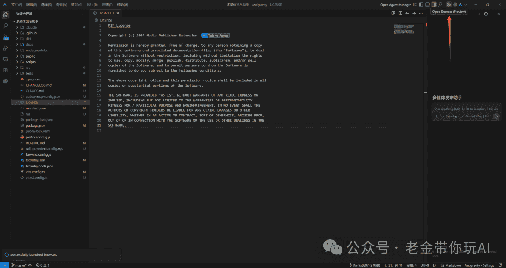
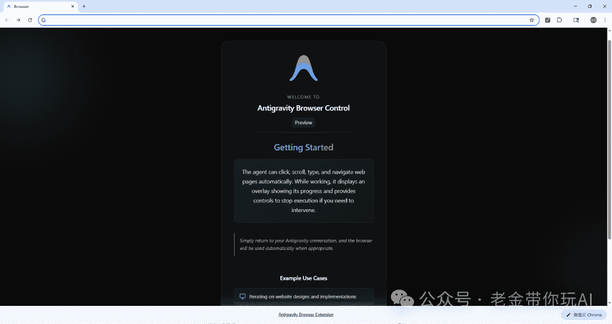
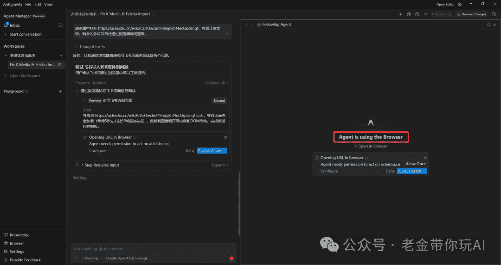
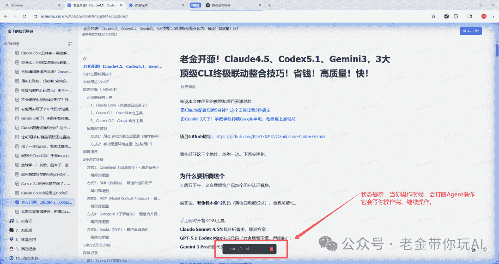
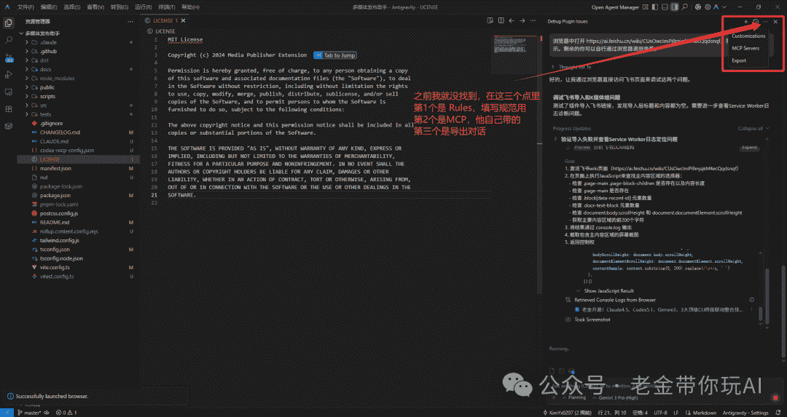
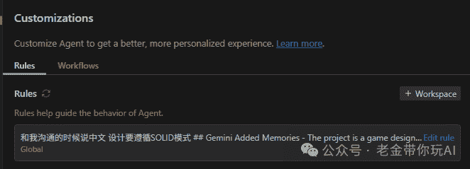
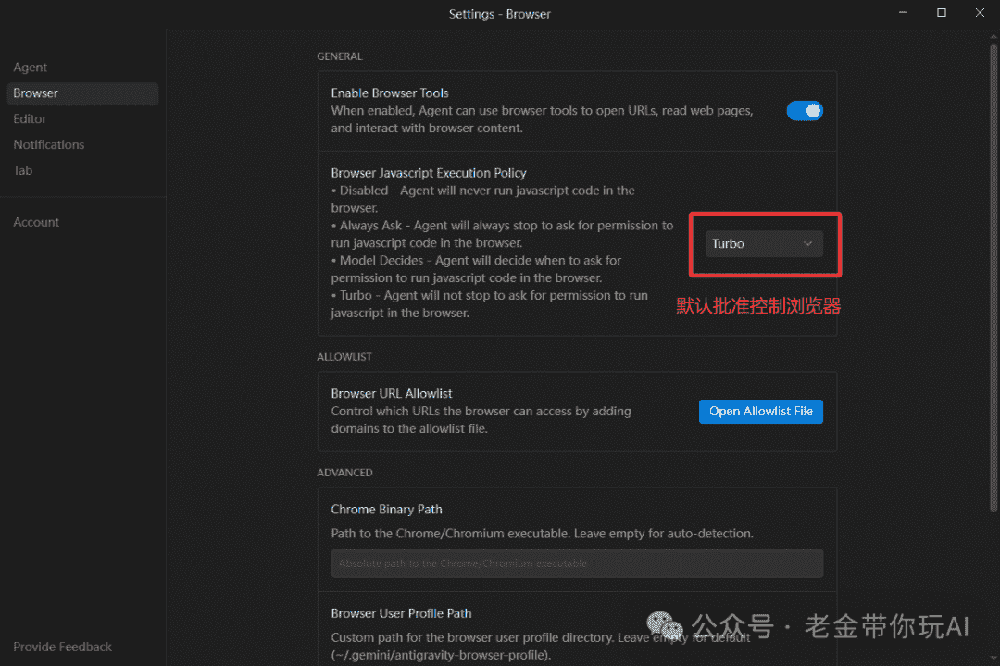
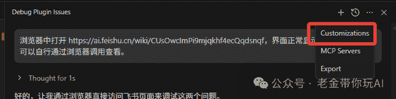
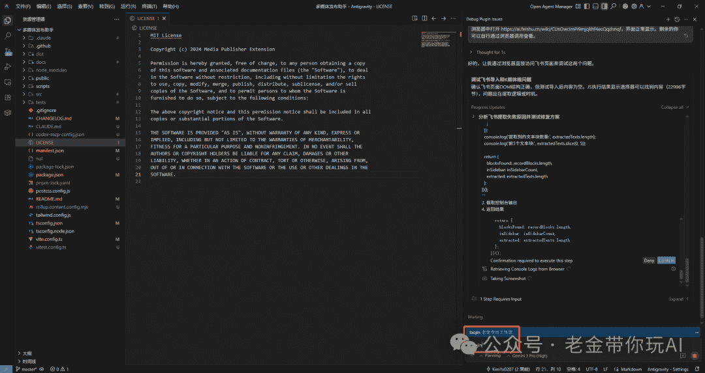
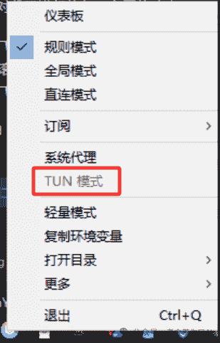

# `Antigravity`：谷歌这波赛博菩萨，新增`Claude Opus 4.5`免费用，`Gemini 3 Pro` 也免费，白嫖必须冲！

> 来源：[https://xatc0v8uz5m.feishu.cn/docx/J391dK3NBovItjxJW0Wcimb0nQd](https://xatc0v8uz5m.feishu.cn/docx/J391dK3NBovItjxJW0Wcimb0nQd)

> 🔗 原文链接：[https://mp.weixin.qq.com/s/pdzuXxk9nlpRdYLaLy6GpQ](https://mp.weixin.qq.com/s/pdzuXxk9nlpRdYLaLy6GpQ)

> ⏰ 剪存时间：2025-12-06 23:08:04 (UTC+8)

> ✂️ 本文档由 [飞书剪存](https://www.feishu.cn/hc/zh-CN/articles/606278856233?from=in_ccm_clip_doc)一键生成

原创 金先森是朝鲜族阿 老金带你玩AI2025年12月6日 15:18

加我进AI讨论学习群，👸号右下角“联系方式”

文末有老金的开源知识库地址·全免费

---

## 这事儿有点意思

昨晚刷论坛的时候，看到一条消息。

整个人都愣了。

不是因为又有什么新模型发布，而是谷歌的`Antigravity`，悄悄加了`Claude Opus 4.5`的支持。

关键是，免费的。

说实话，有点懵。

谷歌自家有`Gemini 3 Pro`，现在还让你免费用竞争对手的模型？

这操作，属实是赛博菩萨了。

### 先说说`Antigravity`是啥

前两天可能有家人们没跟上，简单说一下。

`Antigravity`是谷歌11月18号发布的AI编程IDE，和`Gemini 3`一起亮相的。

不是普通的代码编辑器，是Agent-First架构——你只需描述任务，AI代理自主完成从规划到测试的全流程。

和`Cursor`、`Claude Code`是同类竞品，但玩法完全不一样。

核心卖点？免费用`Gemini 3 Pro`、免费用`Claude Sonnet 4.5`、免费用`Claude Opus 4.5`、还有`GPT-OSS`。

这两天玩下来，发现它不只是个编辑器，更像是个AI任务调度中心。

### SWE-bench 80.9%，什么概念

说回正题。

为啥这次升级值得单独写一篇？

直接看数据。

SWE-bench成绩：`Claude Opus 4.5`拿了80.9%，`GPT-5.1 Codex-Max`是77.9%，`Claude Sonnet 4.5`是77.2%，`Gemini 3 Pro`是76.2%。

第一个突破80%大关的模型。

写代码这块，目前没对手。

`Terminal-Bench`上也是第一，59.3%，比`Gemini 3 Pro`的54.2%高出一截。

更骚的是效率——同样的任务，`Opus 4.5`用的`token`比`Sonnet 4.5`少76%。

省钱又省时间。

## `Antigravity`核心功能

这是之前没细讲的，补上。

### `Agent Manager`（任务控制中心）

`Antigravity`的亮点核心，你可以同时开多个工作区，每个工作区跑多个`Agent`。比如一个`Agent`写后端API，一个写前端`React`组件，一个写测试用例——并行处理。快捷键`` `Ctrl+` ``调出，能看到所有任务的状态。

### `Editor`（代码编辑器）

基于`VS Code`构建，界面熟悉，支持`Tab`补全、内联对话、语法高亮、`Git`集成。有个`tab to jump`功能挺骚，智能推荐光标下一个跳转位置。

### `Browser`（内嵌浏览器）

AI可以直接操控的浏览器，用于自动化测试、UI验证、截图。不用再装`Playwright`了，原生支持浏览器控制。

### `Artifacts`系统

这个功能太骚了，必须单独讲。

传统AI助手像黑盒——你让它干活，它干完了，但你不知道它中间怎么想的。

`Antigravity`用`Artifacts`（工件）解决这个问题。

每个`Agent`任务自动生成可验证的交付物。

`Task Plan`是任务规划书，`Agent`先列出要做什么让你审核批准。

`Implementation Plan`是实施计划，具体怎么实现用什么技术方案。

`Walkthrough`是工作记录，完整的执行过程包括截图和浏览器录屏。

最骚的是，你可以直接在`Artifacts`上留评论，类似`Google Docs`。

`Agent`会根据你的反馈调整，不用重新开始任务。

这设计太人性化了，终于不用盯着一堆日志找问题。

推荐使用`Planning`先做计划，查看处理方案是否正确。

### 浏览器控制

这功能让我惊了。

`Antigravity`会提示你安装`Antigravity Browser Control`扩展。

装完之后，AI代理可以：自动点击网页元素、滚动页面、输入表单、导航跳转、截图和录屏。

以前用`Playwright`、`Puppeteer`才能做的事，现在`Agent`原生支持。

实际用起来是这样的：

你让`Agent`"测试一下登录功能"。

它会自己打开浏览器，输入用户名密码，点登录按钮，等页面加载，验证跳转是否正确。

然后生成一个录屏`Artifact`，你直接看视频就知道测试通过没通过。

不用自己跑一遍。

安全方面也考虑到了——浏览器用独立的`Chrome`配置文件，和你个人浏览器完全隔离。

### 知识库功能

`Antigravity`把学习当作核心功能。

`Agent`在执行任务的过程中，会自动把有用的代码片段、执行模式、架构决策保存到知识库。

下次遇到类似任务，它会从知识库里调用之前的经验。

简单说，用得越多，`Agent`越聪明。

这和`Cursor`的记忆功能类似，但`Antigravity`是原生集成的。

项目结构里有个 `.context/` 目录，就是AI知识库的存放位置。

### MCP集成

`MCP`是`Model Context Protocol`，让`Agent`能连接外部工具。

`Antigravity`原生支持`MCP`，可以连接：`GitHub`（读代码、提PR）、`Linear`（创建任务、更新状态）、`Notion`（读取文档）、`MongoDB`/`Supabase`（读数据库schema）。

配置方法：点对话框侧边栏 → `MCP Servers` → 选择要装的`MCP`服务。

配置文件在：`~/.gemini/antigravity/mcp_config.json`

举个例子，你让`Agent`"修复这个bug并创建PR"。

它会用`GitHub MCP`读代码、修改、提交、创建PR，用`Linear MCP`自动更新任务状态。

全自动。

### Rules：直接配置规范

## 使用技巧

`Antigravity`有两种工作模式。

### `Plan Mode`（规划模式）

让`Agent`先思考，生成任务计划，等你确认后再执行。适合复杂架构设计、新项目启动这些需要协作的任务，你会看到更多内容——任务分解、实施方案、风险提示。

### `Fast Mode`（快速模式）

让`Agent`直接执行，不问问题。适合简单修复、快速编辑这些确定性高的任务，省时间但要小心误操作。

### `Deep Think`开关

`Gemini 3`专属。打开后模型会慢下来，模拟思维链，反复检查逻辑。适合复杂逻辑、数学计算、数据迁移，不适合简单改动——会浪费时间。

### 权限控制

`Agent`能执行终端命令，这有风险。`Antigravity`用`Allow List`/`Deny List`控制。

三种执行策略：`Off`是默认不执行任何命令除非在`Allow List`里。`Auto`是`Agent`自己判断，高风险命令会问你。`Turbo`是全部自动执行除非在`Deny List`里。

建议设置：日常用`Auto`，把 `rm` 、 `curl` 这些危险命令加到`Deny List`。有个用户分享经验："我只白名单了`jq`、`csvkit`、`ripgrep`，其他全部要手动批准。"这样既高效又安全。

### `Workflows`工作流

你可以把常用的提示词保存成工作流模板。

创建方法是点`Global`，输入工作流名称和提示词后保存，文件存在 `~/.gemini/antigravity/global_workflows` 目录。

使用的时候在对话窗口输入 `/` ，选择你创建的工作流就行。

比如你经常需要"代码审查"，就创建一个工作流，每次输入 `/review` 就能调用，省得每次重复打一堆字。

#### 操作流程

先从这里进入

创建一个你的工作流规则

然后用 `/工作流名字` 触发

如果对你有帮助，记得关注一波~

## 下载安装

先把工具装上，再说别的。

### 下载地址

`https://antigravity.google/download`

支持`Windows`、`Mac`、`Linux`。

下载完打开，第一个选项选`Start fresh`（之前没用过`Cursor`的话）。

后面的选项按默认就行，一路`Next`。

然后就到了登录环节。

这里卡了很多人。

### 登录问题详解

先说原理，再说解决方案。

为啥`CLI`能用环境变量，桌面版不行？

老金我之前给大家介绍过`CLI`怎么通过环境配置连接成功。

有小伙伴试了相同的办法，结果行不通。

让`Cursor`帮我调通的时候，顺便问了一下。

大致意思是：`CLI`可以读取系统环境变量走代理，桌面版不吃这套，必须用其他方式。

所以桌面版需要`Tun`模式或`Proxifier`。

#### 方案一：`Tun`模式

如果你的VPN软件支持`Tun`模式，直接开就行。

`Clash`、`V2rayN`、`Surge`这些都有。

#### 什么是`Tun`模式？

就是虚拟网卡模式，让所有软件的流量都走代理。

不像普通代理只代理浏览器。

#### 开`Tun`模式后

访问`ipaddress.my`，确认IP显示美国。

然后重新打开`Antigravity`登录，就能成功了。

老金我没订阅，所以不用这个，有的人直接用就行。

#### 方案二：`Proxifier`

#### 下载地址

`https://www.proxifier.com/`

可以免费用31天，够玩了。

#### 配置步骤

打开`Proxifier` → `Profile` → `Proxy Servers` → `Add`

填你代理的地址和端口（通常是`127.0.0.1:7890`之类的）

然后`Profile` → `Proxification Rules` → 确保`Default`走代理

#### Check一下

看软件列表里的流量是不是都通过代理了。

所有电脑上运行的软件都会被强制转到代理。

再试一次登录`Antigravity`，就成功了。

然后这里有中文版，那啥，免费激活码什么的仅供学习使用（保命狗头）

`https://github.com/1564307973/Proxifier-CN`

### 账号地区问题

除了网络问题，还有账号地区问题。

常见报错："Sorry, this account is ineligible to use `Antigravity`"

#### 原因

谷歌检测的是账号的地区设置，不是你的IP。

#### 解决方法

打开这个链接：`https://payments.google.com/gp/w/u/0/home/setting`

把国家/地区改成美国或日本。

#### 账号要求

用老账号，2020年前注册的成功率高。

学生账号不行，换个人账号。

新注册的`Google`账号大概率登不上。

### 中文界面设置

登录成功后，先把界面改成中文。

在`Extensions`扩展中搜"Chinese"，装第一个语言包。

重启后，快捷键 `Ctrl+Shift+P` 调出命令面板。

输入"display"，选`Configure Display Language`。

选中文，重启完成。

#### 中文回复设置

`Antigravity`的`Agent`默认用英文回复。

解决方法：`Settings` → `Customizations` → `Manage` → 点`+Global`

输入 总是使用简体中文回答 保存。

### 插件推荐

再装几个插件提升体验。

#### `Markdown`预览插件

搜"Markdown-preview-enhanced"装上，看`Markdown`文件更方便。

#### `Git`增强插件

搜`GitLens`，看代码历史更清晰。

#### 主题插件

搜你喜欢的主题，`Antigravity`兼容`VS Code`插件市场。

### 模型选择建议

现在支持的模型：`Gemini 3 Pro`（`High`/`Standard`/`Low`）、`Claude Sonnet 4.5`、`Claude Sonnet 4.5`（`Thinking`）、`Claude Opus 4.5`、`GPT-OSS 120B`。

点`IDE`右下角的模型选择器切换。

#### 使用建议

简单补全用`Gemini 3 Pro Low`，省配额。

日常编码用`Claude Sonnet 4.5`，性价比高。

复杂推理用`Claude Opus 4.5`，准确率最高。

数学/逻辑用`Gemini 3 Pro` + `Deep Think`。

限额了切到`GPT-OSS`继续干。

### 配额限制

免费不是无限。

说下实际体验：每5小时刷新一次配额，高档模型（`Pro High`、`Opus 4.5`）更容易触限。

#### 应对策略

分任务——别一次性扔太大的需求，拆成小块，`token`消耗少。

分模型——日常补全用`Low`档，复杂任务才用高档。

切模型——触限了切到`Sonnet 4.5`或`GPT-OSS`继续干。

有个`X`用户`@tonytonggg`说得好：

> "Nice of Google Antigravity to provide free credits to Claude for Sonnet 4.5 when their own API is too busy."

谷歌自家模型限流的时候，还能切`Claude`接着干活。

## 横向对比

| 功能 | `Antigravity` | `Cursor` | `Claude Code` |
| --- | --- | --- | --- |
| 价格 | 免费（预览期） | $20/月起 | $20/月（Pro） |
| 模型选择 | 多模型可切换 | Claude为主 | 仅Claude |
| `Agent`并行 | 支持多任务 | 单任务 | 单任务 |
| 浏览器控制 | 原生支持 | 需插件 | 需`MCP` |
| `Artifacts` | 有 | 无 | 无 |
| 知识库 | 原生支持 | 有 | 有 |
| `MCP`集成 | 原生支持 | 需配置 | 原生支持 |

老金我的体会：追求免费选`Antigravity`，追求稳定选`Cursor`，追求`Claude`体验选`Claude Code`。

三个我都在用，各有各的场景。

## 真实的坑

不是广告，坑也得说。

### 稳定性一般

第一个公开版本嘛，偶尔卡顿、掉线，能接受但确实存在。

### `Opus 4.5`响应慢

比`Sonnet 4.5`慢20-30%，模型大了没办法。

### 新账号可能被拒

刚注册的`Google`账号大概率登不上，用老账号。

### 浏览器控制有时候抽风

复杂页面可能识别不准，简单页面没问题。

### `Agent`有时候会"失忆"

长任务做到一半忘了前面的上下文，得重新描述。

## 值不值得折腾

说实话，值。

原因很简单。

免费用`Opus 4.5`这机会不多。

多模型可切换不被一家绑死。

`Agent`并行功能其他IDE没有。

浏览器控制原生支持太方便。

知识库让`Agent`越用越聪明。

学习成本低，`VS Code` fork界面熟悉。

现在是预览期，谷歌也在观察用户反馈。

趁免费赶紧玩，等正式版可能就要钱了。

有家人问我和`Claude Code`怎么选——

如果你已经订阅了`Claude Pro`，`Claude Code`体验更纯粹。

如果你想省钱多尝试，`Antigravity`是目前最划算的选择。

## 写在最后

谷歌这波操作，确实有点东西。

自家有`Gemini 3 Pro`，还让用户免费用`Claude`的模型。

这格局，不是一般公司能有的。

当然，谷歌也不傻——用免费吸引用户，培养习惯，等`Antigravity`成为主流IDE，再谈商业化。

但对咱们用户来说，现在就是白嫖期。

`Opus 4.5`免费用，`Gemini 3 Pro`免费用，`Agent`并行，浏览器控制，知识库——还要啥自行车？

赶紧下载试试，有问题留言，我尽量回复。

如果对你有帮助，记得关注一波~

### 引用来源（供验证）

+ `Anthropic`官方博客：`Claude Opus 4.5`发布公告 [`https://www.anthropic.com/news/claude-opus-4-5`](https://www.anthropic.com/news/claude-opus-4-5)

# 相关资源与参考链接

+ Google Developers Blog：Antigravity发布公告 `https://developers.googleblog.com/build-with-google-antigravity-our-new-agentic-development-platform/`

+ VentureBeat：Agent-first architecture解析 `https://venturebeat.com/ai/google-antigravity-introduces-agent-first-architecture-for-asynchronous`

+ The New Stack：Antigravity Is Google's New Agentic Development Platform `https://thenewstack.io/antigravity-is-googles-new-agentic-development-platform/`

+ LogRocket Blog：A developer's guide to Antigravity and Gemini 3 `https://blog.logrocket.com/antigravity-and-gemini-3`

+ InfoWorld：A first look at Google's new Antigravity IDE `https://www.infoworld.com/article/4096113/a-first-look-at-googles-new-antigravity-ide.html`

+ Google官方：Gemini 3介绍 `https://blog.google/products/gemini/gemini-3/`

+ 知乎/CSDN：多篇中文使用教程和登录问题解决方案

---

## 往期推荐

提示词工工程（Prompt Engineering）

LLMOPS(大语言模运维平台)

[WX机器人教程列表](https://mp.weixin.qq.com/mp/appmsgalbum?__biz=MzI0NzU2MDgyNA==&action=getalbum&album_id=3502843007181520907#wechat_redirect)

[AI绘画教程列表](https://mp.weixin.qq.com/mp/appmsgalbum?__biz=MzI0NzU2MDgyNA==&action=getalbum&album_id=3192433076551843848#wechat_redirect)

[AI编程教程列表](https://mp.weixin.qq.com/mp/appmsgalbum?__biz=MzI0NzU2MDgyNA==&action=getalbum&album_id=3704202865347362819#wechat_redirect)

---

## 结语

谢谢你读我的文章。

如果觉得不错，随手点个赞、在看、转发三连吧 🙂

如果想第一时间收到推送，也可以给我个星标⭐～谢谢你看我的文章。

开源知识库地址：

`https://tffyvtlai4.feishu.cn/wiki/OhQ8wqntFihcI1kWVDlcNdpznFf`

扫码 **添加下方🛰️（备注AI）**，拉你加入 **AI学习交流群**。

