# PageSpeed，使用AI自动优化网站PageSpeed性能

> 来源：[https://xatc0v8uz5m.feishu.cn/docx/OyzRdQGPtoFDYHxvvjacaQTAn3e](https://xatc0v8uz5m.feishu.cn/docx/OyzRdQGPtoFDYHxvvjacaQTAn3e)

> 🔗 原文链接： h[ttps://mp.weixin.q](https://mp.weixin.qq.com/s/6wGinqiS0pdwZqesg3poAg?click_id=26)q.com/s/6wGinqiS...

> ⏰ 剪存时间：2025-12-11 14:28:14 (UTC+8)

> ✂️ 本文档由 [飞书剪存 ](https://www.feishu.cn/hc/zh-CN/articles/606278856233?from=in_ccm_clip_doc)一键生成

https://pagespeed.web.dev/

原创 刘小排 刘小排r2025年12月11日 07:56  北京

哈喽，大家好，我是刘小排。

今天一位学生来找我报喜，他从零编程基础开始，借助AI编程来做产品，现在已经取得了相当不错的成绩，上个月挣了四万多美元。

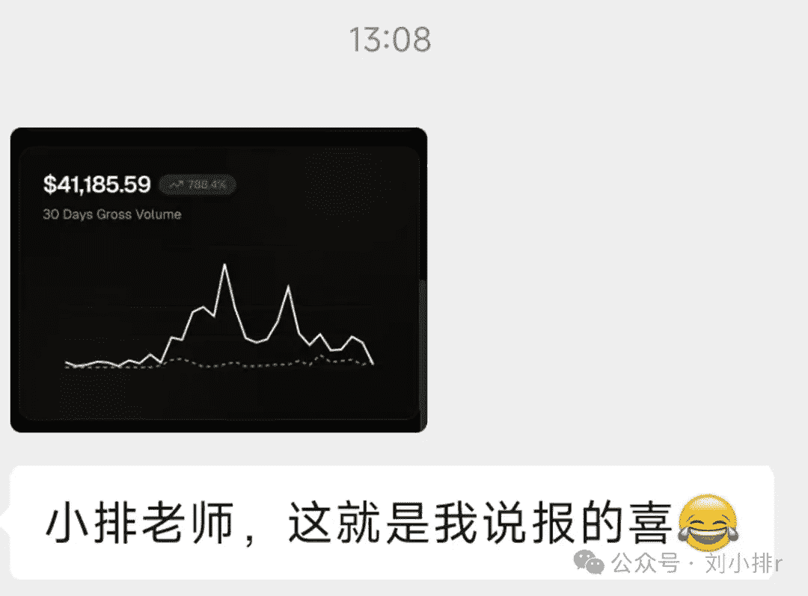

但是，当我和他一起排查他的网站产品后，我发现 —— 他挣少了！

因为，他主力网站的PageSpeed评分竟然只有60多分！

这意味着，无论是Google还是用户，都不会认为这是一个产品体验过关的网站。

既然如此，那我单独写一篇公众号文章吧。

一、为什么我们需要提升网页PageSpeed性能

## **因为，PageSpeed 是 Google SEO 的核**心指标（Core Web Vitals）

##

Google 2021 年之后已经把网页速度（CWV：LCP、FID、CLS）作为正式 ranking factor。

对于像 Raphael AI https://raphael.app 这样靠 Google 搜索流量 + 社交平台二次推荐 的工具类产品：

+   **速度越慢，排名越往后**

+   **速度好，可以越过竞争对手**

+   **用户体验越好，付费转化率越高。**

+

Google 官方明确表示：

> “网站速度与用户体验相关，直接影响排名。”

对于英文市场尤其重要。

二、如何分析自己网站的PageSpeed性能?

请你打开 https://pagespeed.web.dev/

输入你的网站地址。

如果你输入的是我的网站 https://raphael.app

你会发现，我的Raphael AI无论是手机版还是桌面版，所有评分都是90分以上。

90分算高吗？

No！

四个90分，只是及格 ，说明你的网站PageSpeed性能过关。

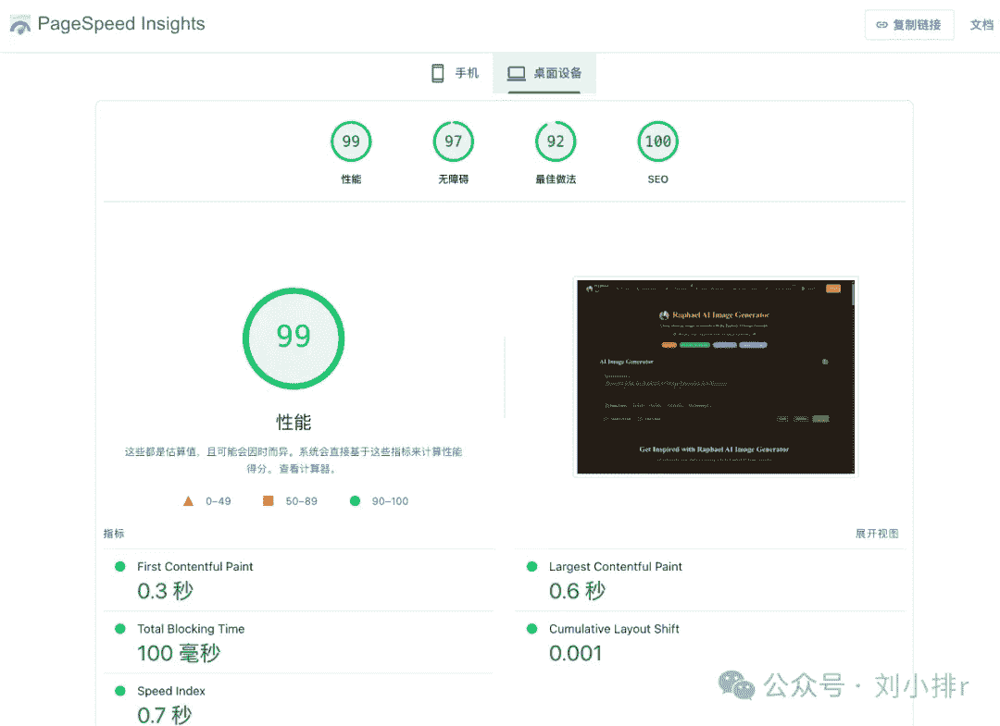

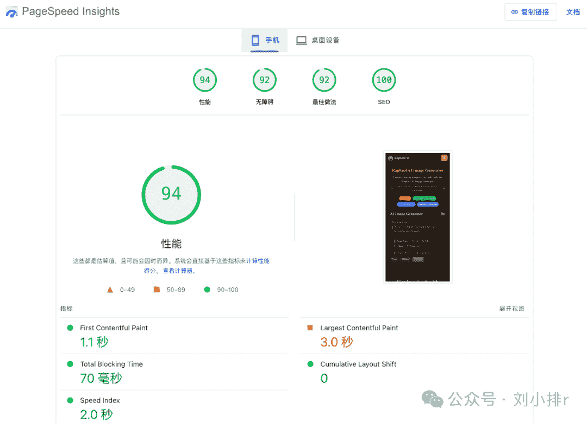

三、如何手动优化？

如 果 你采取古法炼钢： 你需要详细去了解PageSpeed里所有的关键指标分别是什么意思，例如，LCP、FCP、TBT、CLS、Speed Index等等。

再查看Google PageSpeed工具给你的建议，逐一优化。

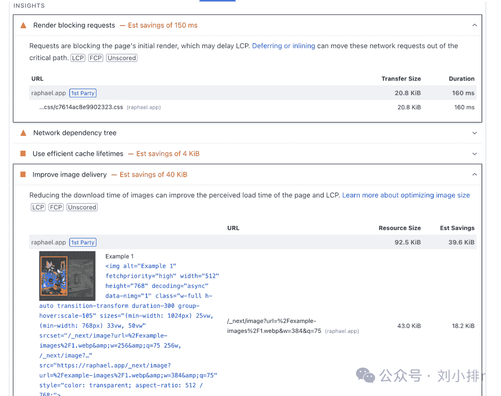

在AI出现以前，我就是这么优化的。

费时间，但是值得。

四、如何使用AI自动优化？

感谢这个时代。

今天的你，已经不再需要像我当年那样古法炼钢。

我们需要请出两个工具

1. 支持MCP协议的任何AI编程工具 ，包括并不限于：Cursor、Codex、Claude Code、Google Antigravity等等

**2. Devtools MCP**

接下来就可以自动完成

五、Devtools MCP和Playwright MCP等其他浏览器自动化工具相比，有什么好处？

我曾经推荐过很多款浏览器自动化工具，包括Playwright MCP、Claude for Chrome等等。

你可以参考我以前的文章

[别再花钱买RPA了！Claude Code 实](https://mp.weixin.qq.com/s?__biz=MzI1MTUxNzgxMA==&mid=2247498796&idx=1&sn=2e3070dfaa88d96497d46d71d61a0b56&scene=21#wechat_redirect)现邮件、社媒、内容创作、竞品跟踪全自动化

所有的RPA可以去死了！Claude Code可以只靠口喷完成一切！

[C](https://mp.weixin.qq.com/s?__biz=MzI1MTUxNzgxMA==&mid=2247498894&idx=1&sn=65bdd89973e4750f9edb33e529813be5&scene=21#wechat_redirect)laude for Chrome 一手体验！自动回复微信、发Twitter、做调研……做AI浏览器的创业者该慌了，比赛已经结束

在优化PageSpeed这件事情上，我只推荐一个： Devtools MCP

为什么呢？

因为

+   Devtools MCP是Google官方推出的，和Chrome浏览器结合得很好

+   **Devtool**s MCP 不仅可以完成网页自动化操作，还能够进行 原生浏览器调试

+   比起其他浏览器自动化工具，DevTools MCP更底层

+   更细粒度、更贴近 浏览器内核级的“观测 +调试”能力

由于它直接 基于 Ch **rome DevTools Protocol，下面这些事情，**只有Devtools MCP能做得最好。

+   监听 **Network **：请求/响应头、body、status、时序、重定向链路

+   监听 **Console **： console.log , error , warn ，甚至 stack

+   **DOM/JS 调试 **：执行任意 JS、取 window 变量、performance metrics

+   能看到更丰富的浏览器内部信息（network、console、runtime、性能）

+   排查线上某个页面偶发性 500 / CORS / CSP 问题

+   看某些国家/网络下页面到底请求了什么、哪个资源慢

+   更细粒度的控制

+   逆向分析

+   分析第三方页面的：

+   追踪脚本

+   AB 实验的触发逻辑

+   指标（首屏时间、资源体积）

> 比如：“用 Devtools MCP 打开 raphael.app，检查首页加载有哪些 404/500 请求，并给我优化建议。”

看到这里你应该明白了： 无论是在网站上线前的localhost、还是网站上线后的正式域名，我们都可以利用Devtools的 浏览器内核级的“观测 +调试”能力 ，对网站性能进行分析和优化。

六、使用Claude Code / Codex 自动优化网页性能的全流程

步骤

以Codex为例，其他AI编程工具(Cursor、Claude Code等）类似

1. 打开 https://pagespeed.web.dev/ 输入你的线上域名，进行分析。把分析结果截图，发送给 （如果你的网站还没上线，跳过这一步）

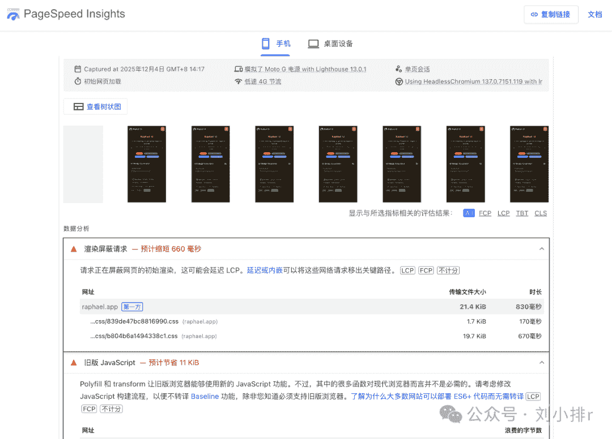

2. 在Codex安装Devtools MCP

+   手动安装方法：根据官方文档进行 https://github.com/ChromeDevTools/chrome-devtools-mcp

+   自动安装方法：给Codex授予Full Access权限，告诉Codex

+   "根据官方文档进行 https://github.com/ChromeDevTools/chrome-devtools-mcp 帮我安装devtools mcp ”

+

3. 本地运行网站，通知Codex，使用devtools MCP帮我们分析Lighthouse性能

> 使用devtools mcp验证pagespeed lighthouse性能，结合代码，找出优化点

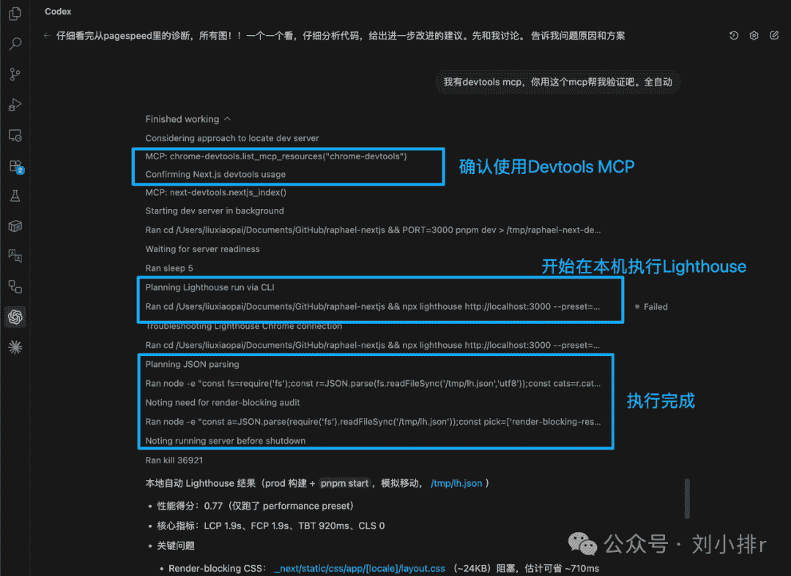

4. 确认优化点，通知Codex帮我们修复

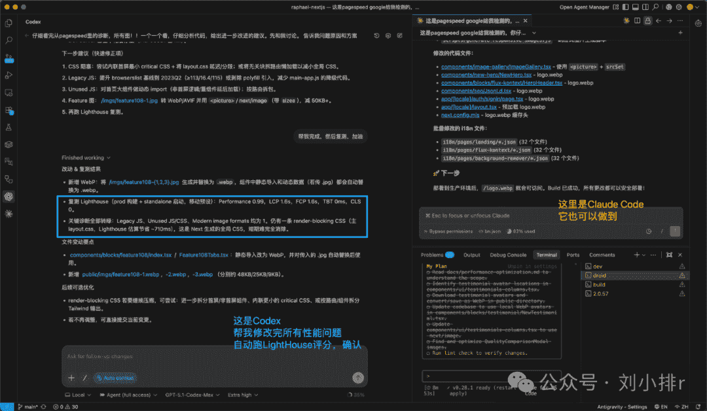

5. 修复后，重复执行3和4，直到本地分析的性能过关

6. 上线网站

7. 通知Codex，验证线上版本。如果和本地不符合，继续使用devtools mcp进行优化

一些小Tips

+   一次优化可能无法做完全部，尤其是当你的优化点很多的前提下。 没关系，多做几次。

+   本地Lighthouse评分可能和线上不同，因此我们一定需要同时结合本地Lighthouse评分、线上PageSpeed评分，两者同时优化。先本地、再线上。

+   实测： Codex (GPT-5.1-Codex-Max Extra High)的表现 ，比Claude Code (Claude Opus 4.5)和Gemini 3 Pro略好。

七、如果还想偷懒

就连这，你都还嫌麻烦？

好吧，这是一个懒人的世界，世界属于你。

还记得我那位卖快速建站工具ShipAny的朋友 @idoubi 吗？ 他连续肝了两天，把ShipAny V2版本的PageSpeed评分刷到了接近于4个满分。

也就是说， 如果你购买ShipAny V2版本来建站，不仅可以快速建站，还可以享受到原生满分级PageSpeed的体验！

先看看idoubi有多拼。 如果你想买ShipAny，往下面翻，有超大幅度优惠码

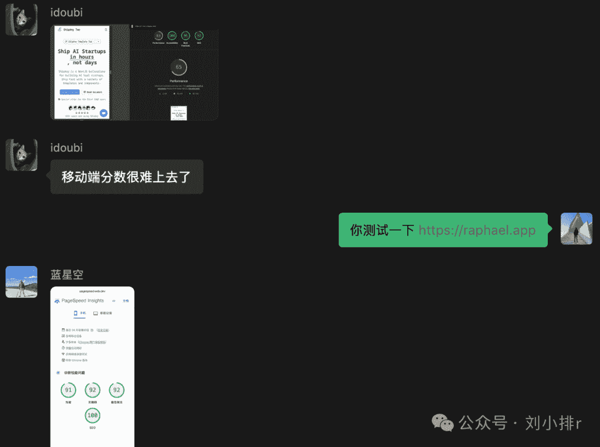

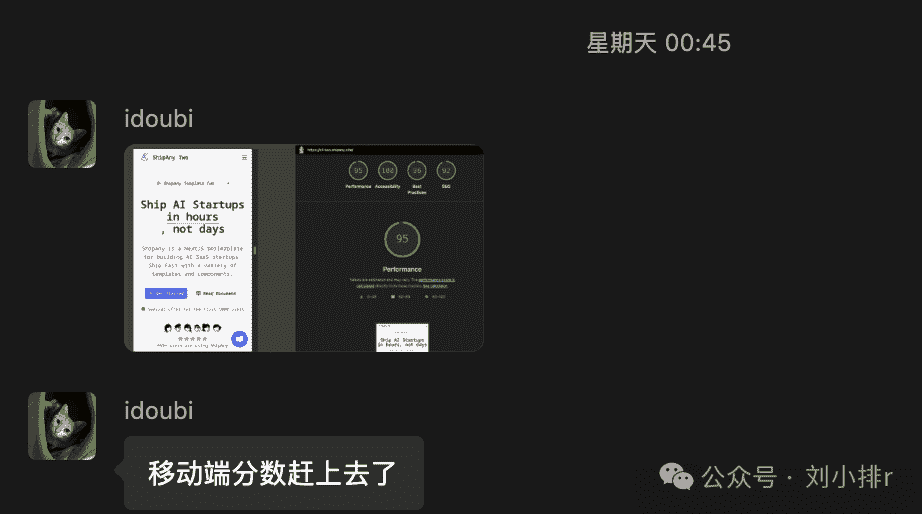

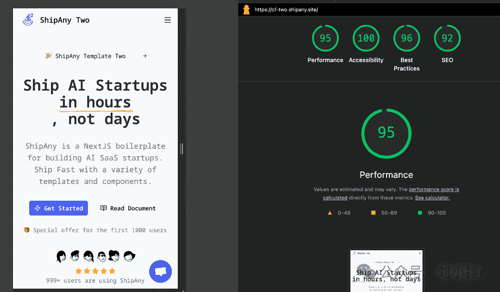

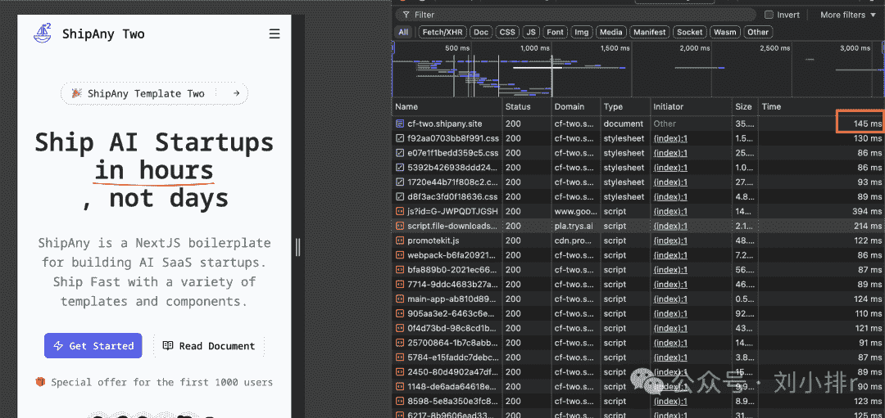

使用优惠码的方法：

1. 访问 https://shipany.ai/zh/?ivt=SCAI （带了我的邀请链接，不要去掉）

2. 打开“定价”页面，勾选“使用自定义优惠码”

3. 结账的时候，输入优惠码 SCAI-LIUXIAOPAI ， 价格立即变成打折后的1399.50元人民币。

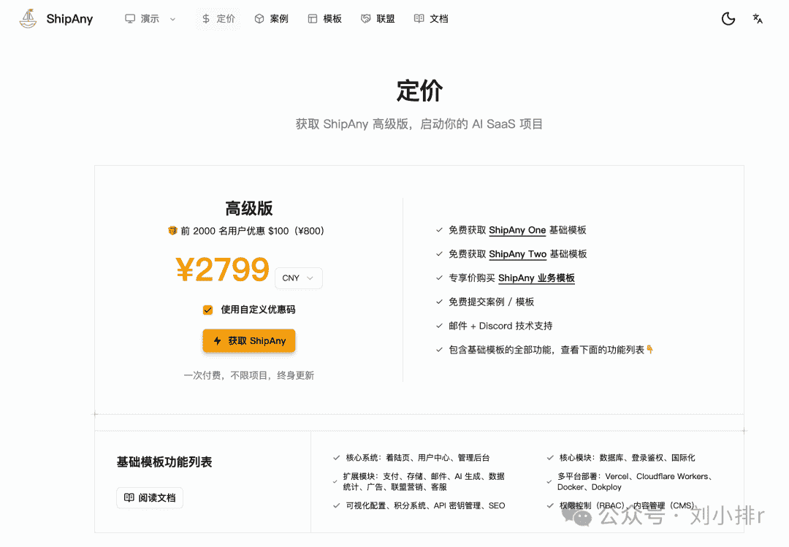

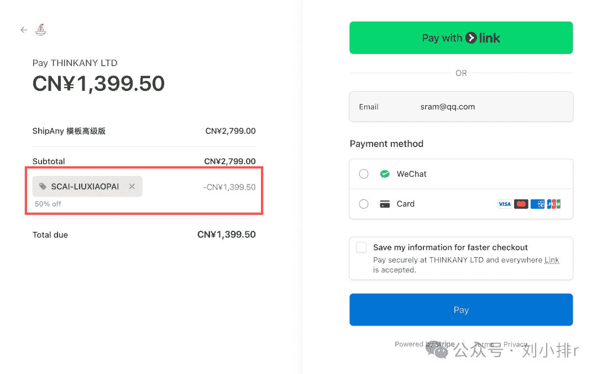

---

你学会了吗？

请在贴出你优化后的PageSpeed评分吧！