# 从100万月活跌下来之后，我让Raphael AI 再次起飞：没投广告，只做了4件小事

> 来源：[https://xatc0v8uz5m.feishu.cn/docx/M9NAdSUFXo07uFxlkQWcUfBFnNh](https://xatc0v8uz5m.feishu.cn/docx/M9NAdSUFXo07uFxlkQWcUfBFnNh)

> 🔗 原文链接： h[ttps://mp.weixin.q](https://mp.weixin.qq.com/s/Eyo9dZEN4l9k4SXmHCXbsg)q.com/s/Eyo9dZEN...

> ⏰ 剪存时间：2025-12-12 00:22:01 (UTC+8)

> ✂️ 本文档由 [飞书剪存 ](https://www.feishu.cn/hc/zh-CN/articles/606278856233?from=in_ccm_clip_doc)一键生成

原创 刘小排 刘小排r2025年12月12日 00:06

哈喽，大家好，我是刘小排。

Raphael AI 是我离职创业后做的第一个 AI 产品。

那时候没有团队、没有 Claude Code、也没有现在满世界的 AI 编程助手。

就只有我一个人 + Cursor，硬生生**在一周内把产品上**线，上线第一个月就突破 100 万月活 。

网站地址 https://raphael.app

感兴趣的朋友可以参考当时我的文章 我用Cursor做的产品，月活超过100万了

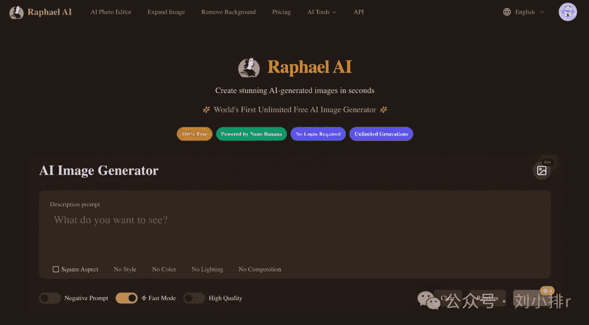

后来因为精力转向其他项目，Raphael AI 的流量一度回落。

但就在过去一个月，我突然把它的增长再次打爆了。

11月MAU **已经突破 67 万，并且每**天都在继续涨。

按这个趋势， 12月肯定会超过年初巅峰。

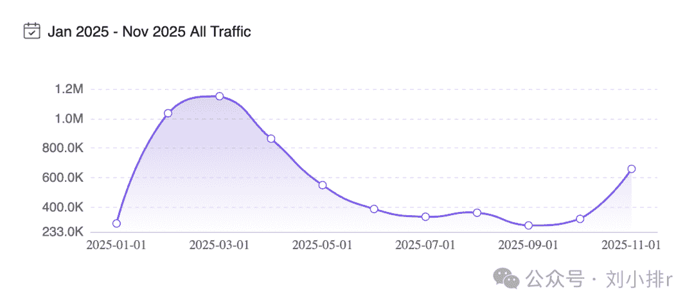

如果只看Google搜索流量的增长，更加刺激

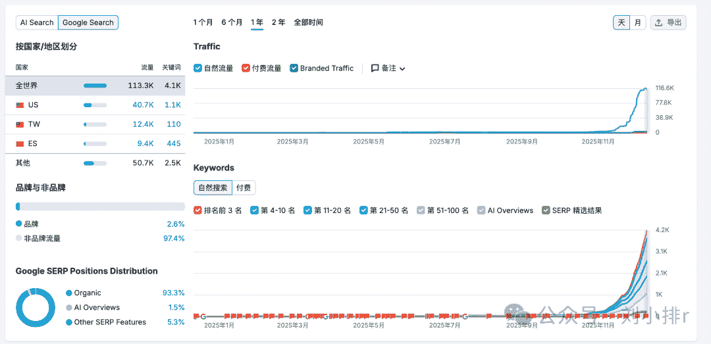

等着瞧吧！1月初，会出来12月的数据，我敢跟你打赌，一定超过100万月活！

这次的增长，不靠投广告，不靠买流量。

我只做了四件小事。

四件小事，都是围绕同一个内核： 我相信 好产品，会被自传播

到底哪四件事？

下面展开讲。

# 一、把 PageSpeed 分数全线拉到 90+，最好 100

最近花了一些时间，把Raphael AI的PageSpeed分数全线拉到90+，还有几个100分。

道理大家都明白，方法也有。如果你不会，可以参考这一篇，我写得很详细 使用AI自动优化网站PageSpeed性能

很多人以为这是优化强迫症。

**但**事实是：

当你的性能上到一个“变态级别”，搜索引擎会奖励你，用户也会奖励你 。

你可以打开Google PageSpeed进行验证

https://pagespeed.web.dev/analysis/https-raphael-app/wo1c55rnfu?form_factor=mobile

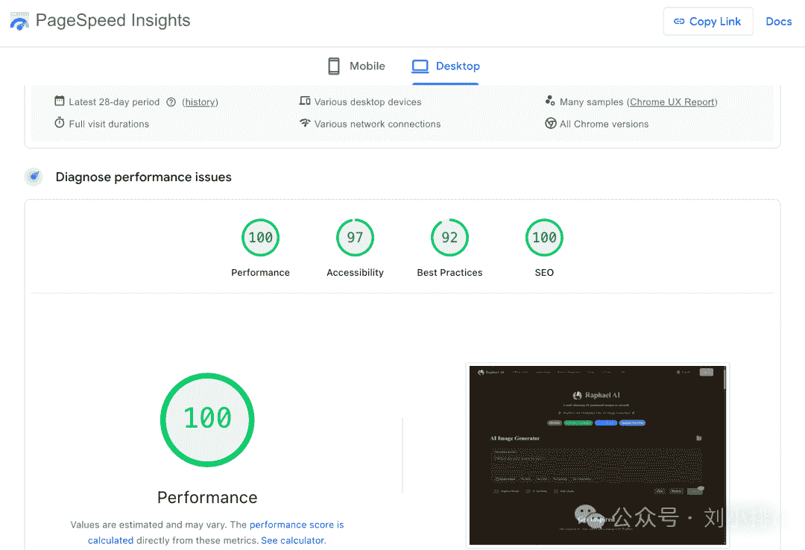

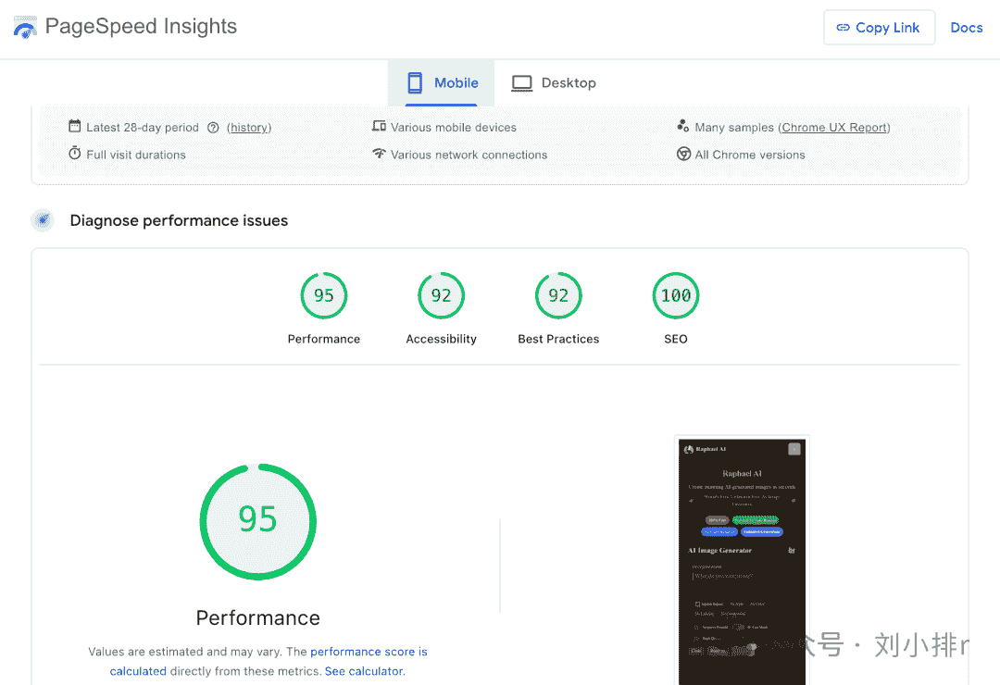

# 二、把 32 种语言的文案全都重新手工打磨

不是机器翻译，而是“像做本地化产品一样”的重写。

这件事让流量从“一个国家的产品”，变成了“32 个国家同时跑”的产品。

如果在从前，这件事非常不可思议。 在前东家打工时，这样的工作，我们会雇佣外国语学校学习小语种的实习生，来进行人工校对。

但是今天，我们有了AI，不再需要实习生了。我们可以把AI当成精通本地化语言、同时了解我产品功能的合伙人，逐一优化。

效果非常立竿见影。

从Google Search Console后台看，我有大量的Google搜索流量，来自我根本不认识的各种语言搜索词。

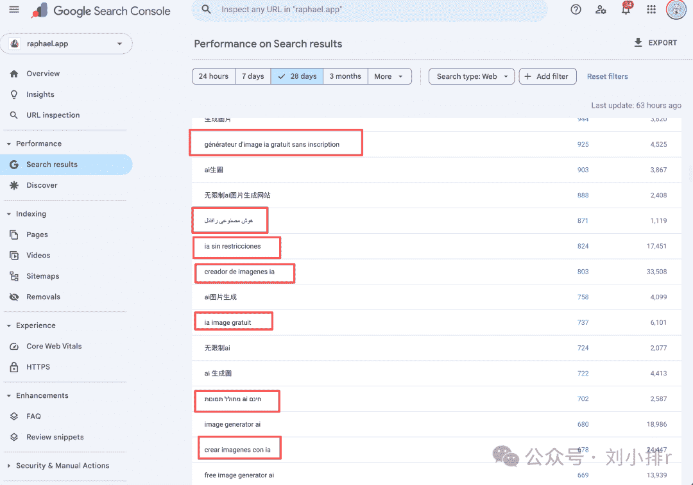

# 三、 持续提升生图品质，让图本身替我获客

**在社交时代：

图片，****就是增长引擎。

品**质，就是传播本身。

只要画得够好看，用户会自发帮你发到 Reddit / Twitter / 📕。

有人认为我SEO做得好，全靠发外链发得多。我还听到有人在传说，说我发明了自动发外链的AI ……

而真相是 —— 我完全不懂SEO。Raphael AI的外链，不是我发的，而是用户发的。

我所做的，只不过是持续在提升产品的生图质量而已。

最近一个月，我和团队的小伙伴集中发力，把生图质量又拉高了一个档次。

在Raphael AI，即便是免费用户，他也能不限制数量地得到如下品质的AI图片

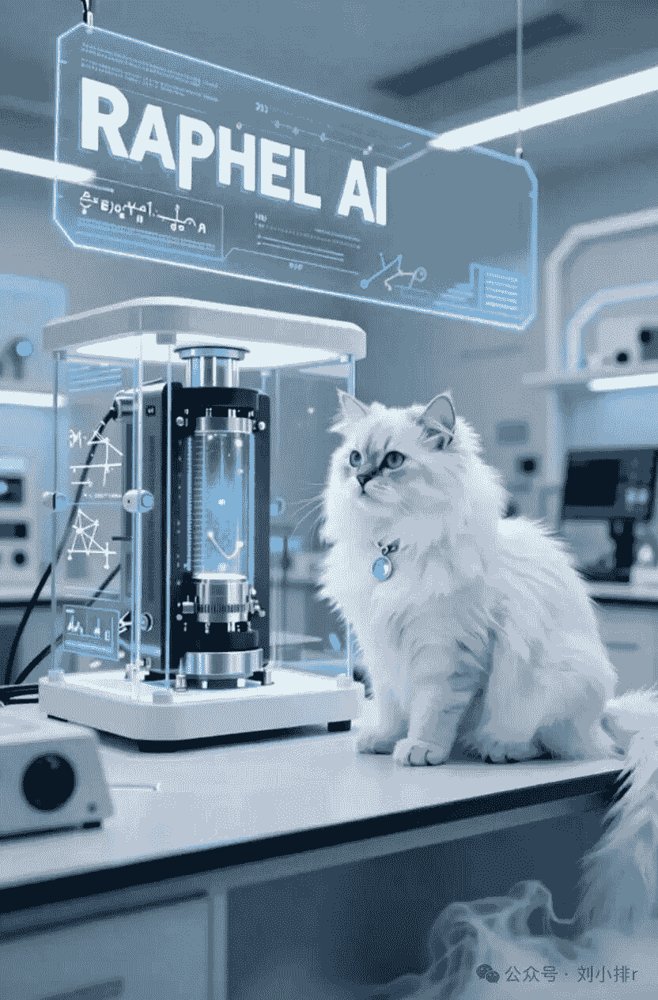

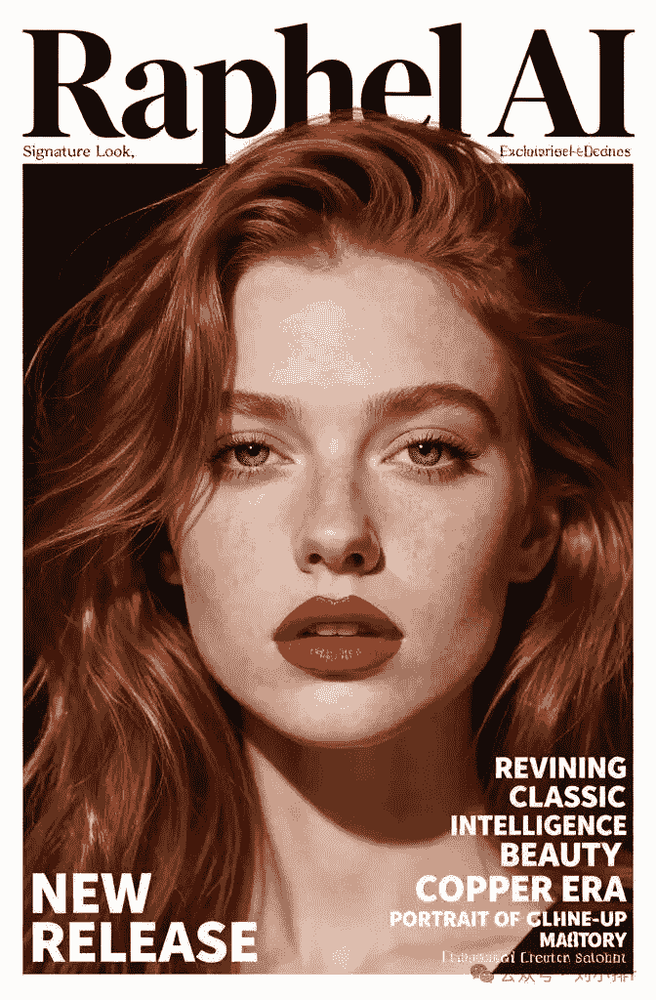

通过Semrush可以看到， Raphael AI每天、每时每刻，都有新的外链 ——它们都不来自我。

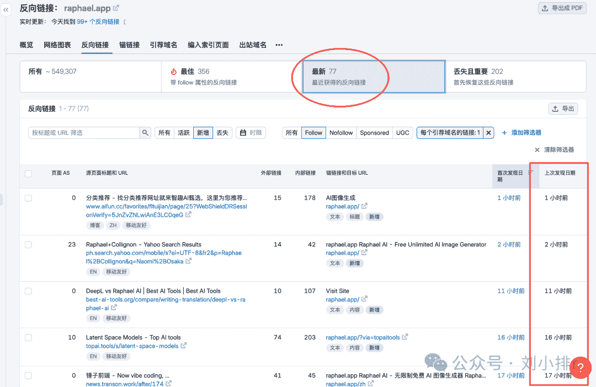

如果你对于SEO有特别执着的兴趣，那我告诉你一句真理： 服务好用户，让用户主动帮你发外链，比你自己发外链，效率高太多了。

从我访客的Top Sources可以看到， 基本上只有四类

**1. 搜索引擎 **（得益于产品好，从而用户帮我发的外链多，从而网站权重高）

**2. 自然访问 **（得益于产品好，用户加入了收藏夹）

**3. AI **（得益于网站权重高）

**4. 社交媒体流量 **（得益于用户在社交媒体分享，尤其是分享图片）

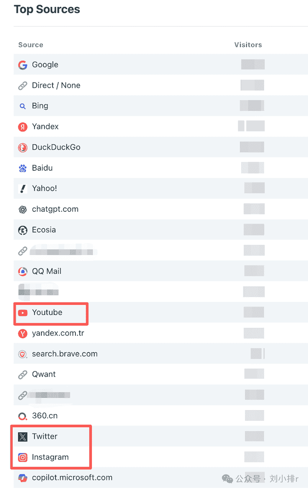

对了，Raphael AI 内部做了一个智能路由，每次会调用不同的模型。如果你想要使用我的生图API，我也尝试性的开放出来了其中一款模型的API，而且价格是全世界最低 Raphael AI开放文生图API，每张图仅需2分钱

# 四、最重要的用户体验升级：取消匿名用户的人机验证

Raphael AI 由于要提供无限数量的画图，我以前是靠人机验证，来进行防刷处理。 这虽然非常有效，但也带来了用户体验的降低。

前几天想到了一个技术方案，让我取消匿名用户的人机验证。 带来了非常好的结果。

其中的技术机制还挺复杂的，有很多细节。

做完后发现可以进行分享一些使用AI编程的经验，我就顺便写了[ 人生第一篇付费阅读的👸号 ，你如果喜欢，感谢支](https://mp.weixin.qq.com/s?__biz=MzI1MTUxNzgxMA==&mid=2247499915&idx=1&sn=3c27ef4939e22a9cf8ac1a8781a79ddf&scene=21#wechat_redirect)持我 → 复杂需求如何让AI一次写对？面对复杂需求，这是我实战沉淀的Vibe Coding终极SOP

说回来。这一招的结果非常离谱： 这是最立竿见影的增长加速器。

体验从“略繁琐”变成“顺滑如丝”，留存、转化、分享全部一起跳升。

你可以亲自试试。

请你用任何浏览器，打开Raphael AI https://raphael.app

随便输入点文字，点击‘生成’！

讨厌的人机验证没有了！过程非常丝滑！

看看下面的图：

就这一招，

跳出率： 53% → 15% (越低越好)

人均访问时长： 3分25秒 → 5分15秒

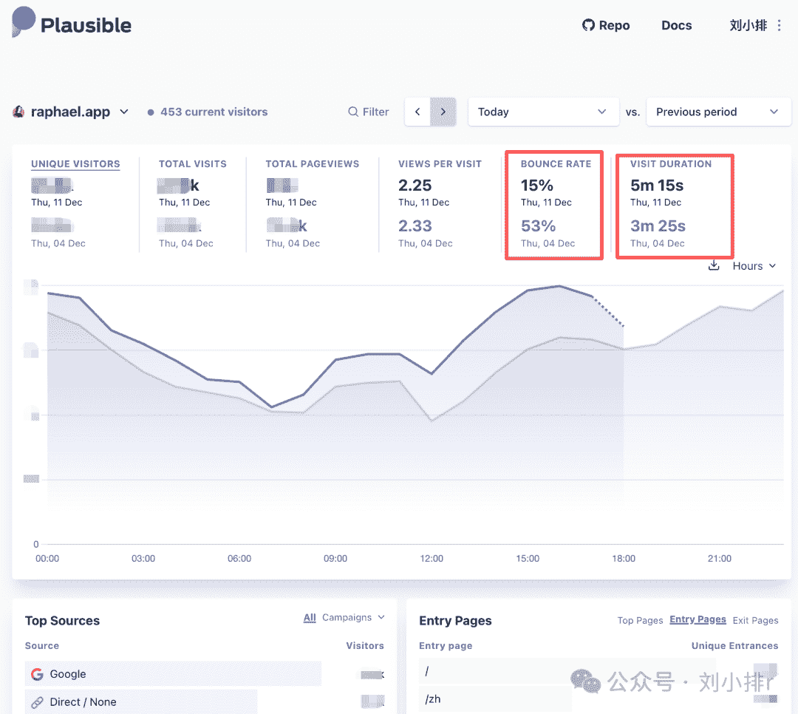

---

今天先分享到这里。期待和你交流。

还没关注我的朋友，请关注我，我们约好！下月初，和我一起看12月的统计数据哦！

那是我们正式重回巅峰的时候！💪