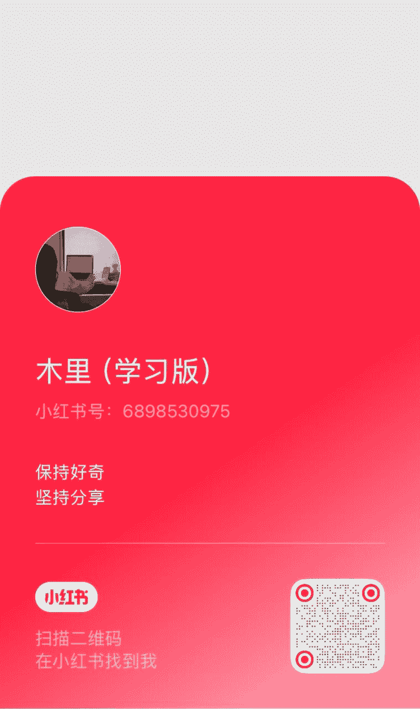
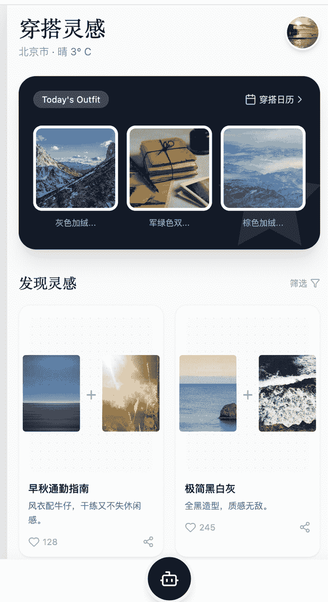
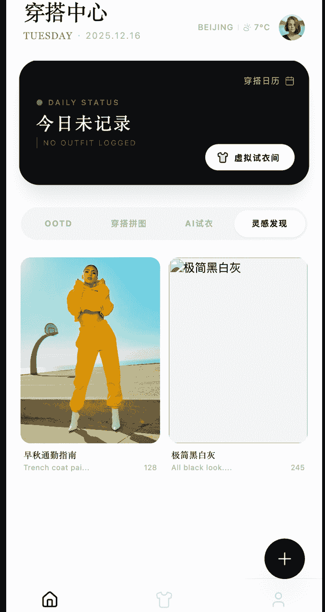
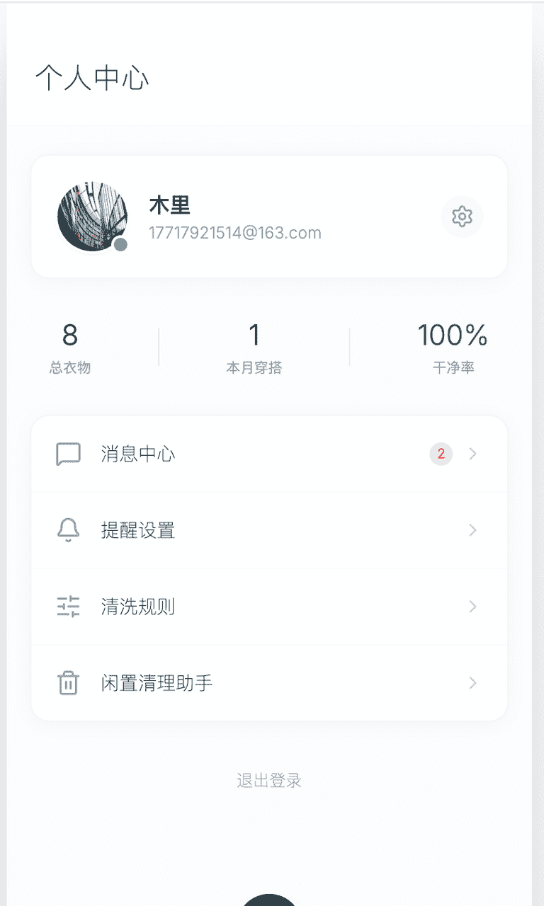
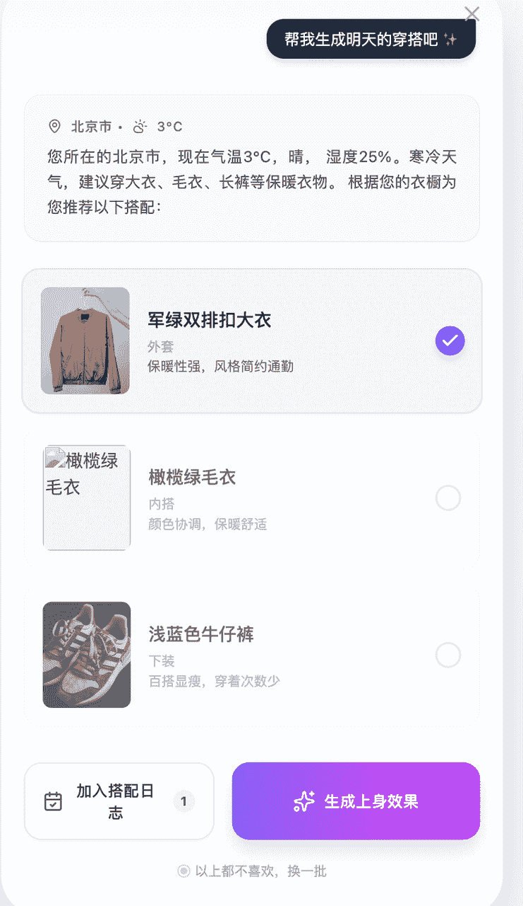
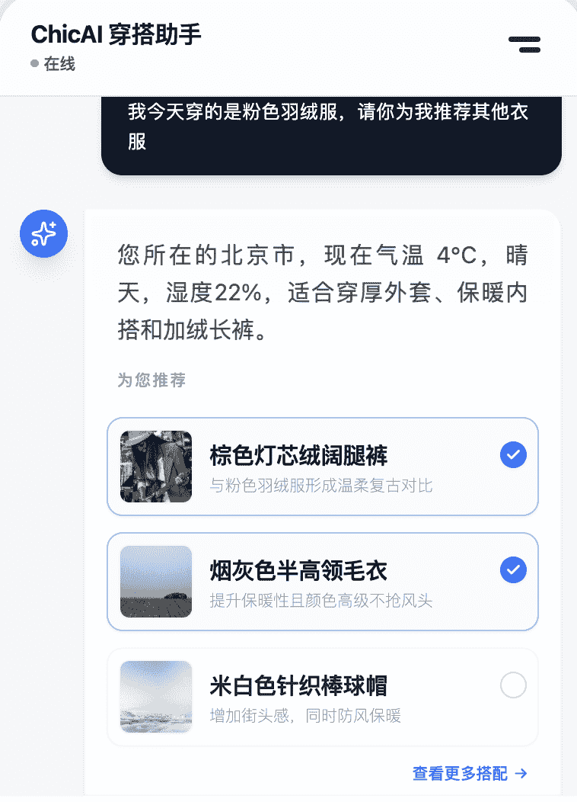
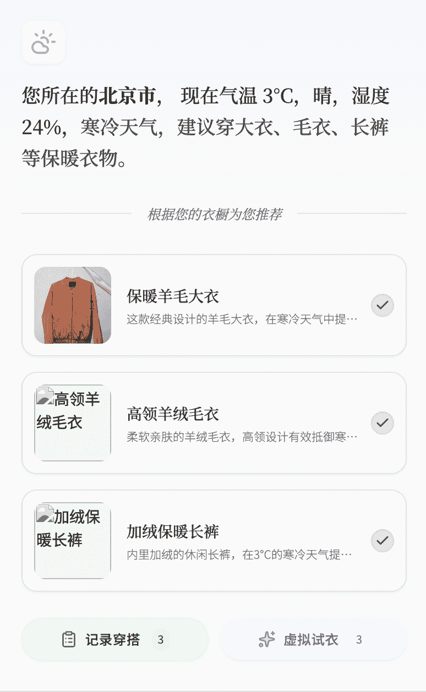
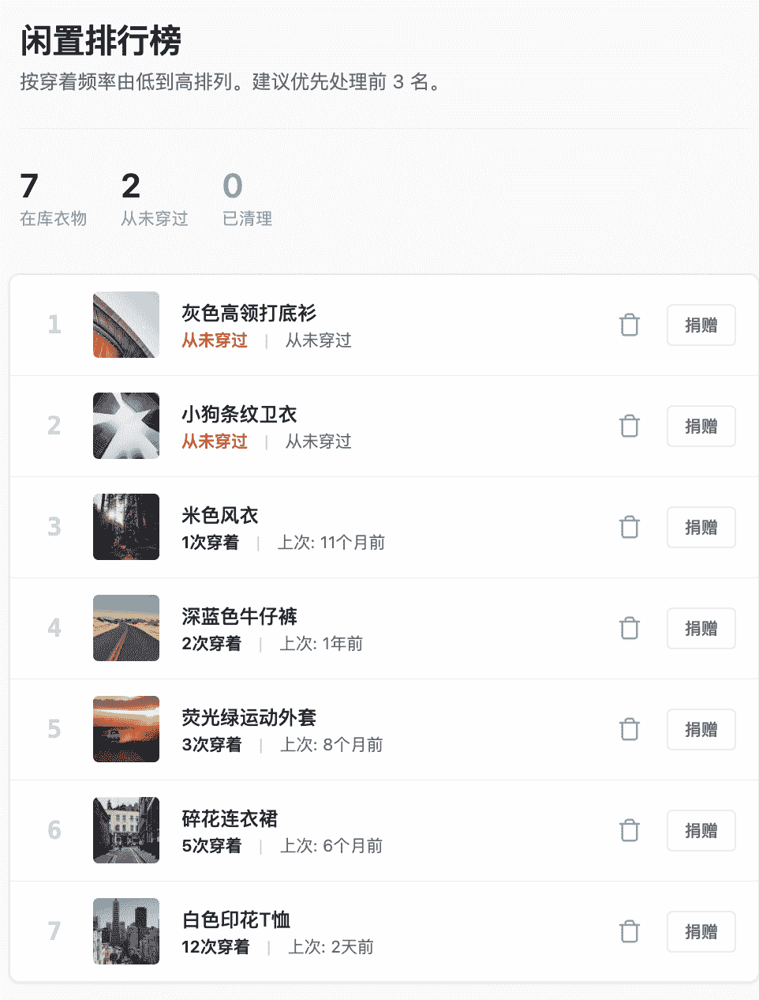

# 木里：知衣APP是如何vibe coding出来的

> 来源：[https://xatc0v8uz5m.feishu.cn/docx/VmGld1FVFo4gnCxDwSOcnPGKnuf](https://xatc0v8uz5m.feishu.cn/docx/VmGld1FVFo4gnCxDwSOcnPGKnuf)

> **关于我**

> 目前是中传在读研究生，互联网公司实习中，未来想转AI产品方向

> 从10月开始学习，先学习了n8n，后来接触vibe coding

# 前期尝试

gemini3出来之后，先尝试做了一个非常小的需求，跑通前后端部署

https://pm-assistant-one.vercel.app/

# 开始做知衣

### 和gemini3讨论前端框架和基础功能

https://gemini.google.com/app/df14c0439b316651

### 使用IDE工具开发，逐一优化、丰富每个页面/功能

前期：Antigravity ➕ Claude code（trae插件版+glm模型）

中间：Antigravity + Qoder + Claude code（qoder插件版+glm模型）

后期：Antigravity+（qoder插件版+glm模型）

IDE写前后端交互逻辑的同时，会用网页版gemini3/Google AI studio 单独设计一些前端页面，设计差不多了再给IDE去优化。【Antigravity早期只有免费版，额度有限，要省着用】

| 穿搭中心 |  |  |  |  |
| --- | --- | --- | --- | --- |
| 个人中心 |  |  |  |  |
| 语音助手 |  |  |  |  |
| 语音助手里面的对话圆球 | https://aistudio.google.com/apps/drive/1S_g2LaKWfk8E4ouRmt_L7l7P2xdHPuAh?showPreview=true&amp;showAssistant=true |  |  |  |
| 闲置排行榜 |  |  |  |  |

# 小白的经验

> 探索出来的经验，不一定完全正确，也可能有更好的方式，欢迎指正！

1.  git，多提交。使用TRAE或qoder里面的插件版claude没有时间线，建议就是多提交。用IDE原生agent进行开发，会有时间线，也是找回的一种途径。【不要在对话中直接让AI撤回，除非改动特别小，且之前大的改动已提交】

1.  多个IDE一起使用的时候需要额外注意，尽量不修改同一个文件。最好前后端分开修改、提交。确保在另一个IDE修改同一个文件时，这个文件之前的修改已保存。

1.  前期功能比较少的时候，可以一次让AI修改多个功能点。随着功能增加、交互逻辑更加复杂，每次给AI的指令最好简单精准。

1.  对于一些比较大的功能或改造，先和AI讨论方案，自己要了解不同方案的优缺点，根据实际情况选择。对于比较大的改造，先让AI写好计划，自己先看一下计划有没有问题，然后再进行改造。

1.  模型选择：gemini3做前端，前后端交互主要用Claude模型，glm模型主要做一些小任务

1.  做原生应用还是web应用打包？看个人选择。我这个本质上是web应用，capacitor打包成的ios应用，相比原生应用可能性能差一点点，好处就是我后面也可以直接打包安卓的，不需要重写。

1.  APP如果想让别人使用，每个人只能看到自己的数据，那就必须要有账号系统、数据库系统。这些最好在APP已经有了基础功能之后就集成好，更方便后面开发。

+   建议数据库和服务器分开，而且要注意数据库应该是国内可访问的。

+   服务器部署推荐多平台部署 + 自动故障转移【前期可以不考虑】

## 后端部署平台对比分析

### 1️⃣ **Railway**（当前使用）

✅ 优势：

+   完美支持 FastAPI + SQLite

+   Volume 持久化可靠

+   部署简单，自动 CI/CD

+   性能优秀，无冷启动

❌ 劣势：

+   单点故障（如您遇到的停电）

+   价格相对较高（付费后）

---

### 2️⃣ **Render.com**

✅ 优势：

+   免费版可用（最大优势）

+   持久化存储支持

+   稳定性好，多区域

+   部署简单

❌ 劣势：

+   免费版会休眠（冷启动 30-60 秒）

+   免费版性能有限

💡 推荐用途： 作为 Railway 的免费备份

---

### 3️⃣ **Fly.io**

✅ 优势：

+   全球 CDN，速度极快

+   免费额度充足

+   企业级稳定性

+   支持多区域部署

❌ 劣势：

+   部署稍复杂（需要 CLI）

+   文档相对少

💡 推荐用途： 作为高性能备份或主服务器

---

### 4️⃣ **Vercel**

✅ 优势：

+   部署极其简单

+   免费额度大

+   全球 CDN

❌ 劣势：

+   ❌ 不支持 SQLite 持久化

+   ❌ 需要改用外部数据库（PostgreSQL/MySQL）

+   执行时间限制（10-60秒）

💡 推荐用途： ❌ 不适合您的项目（需要 SQLite）

---

### 5️⃣ **Heroku**

✅ 优势：

+   老牌平台，稳定

+   生态成熟

❌ 劣势：

+   ❌ 已取消免费版

+   价格较贵（$7/月起）

💡 推荐用途： ❌ 不推荐（无免费版）

## 数据库类型

### **SQLite**

本质： 文件型数据库

Railway 服务器

└─ /app/data/

└─ wardrobe.db  ← SQLite 数据库文件（就像一个 Excel 文件）

特点：

+   ✅ 文件存储 - 数据库就是一个文件

+   ✅ 本地存储 - 存储在 Railway 服务器的磁盘上（Volume）

+   ✅ 简单 - 不需要额外的数据库服务器

+   ✅ 轻量 - 适合小型应用

+   ❌ 单机 - 只能一个服务器访问

+   ❌ 不能共享 - 无法多个服务器同时访问同一个数据库文件

类比： 就像您在电脑上保存了一个 Excel 文件，只有这台电脑能打开它。

---

### **PostgreSQL**（云端数据库）

本质： 独立的数据库服务器

Railway 应用服务器 ────┐

├──→ PostgreSQL 数据库服务器

Render 应用服务器  ────┘     (独立运行，可以在任何地方)

特点：

+   ✅ 独立服务 - 数据库是一个独立的服务器

+   ✅ 网络访问 - 通过网络连接（TCP/IP）

+   ✅ 多客户端 - 多个应用服务器可以同时连接

+   ✅ 云端 - 可以托管在阿里云、AWS、Supabase 等

+   ✅ 高可用 - 支持主从复制、自动备份

+   ❌ 复杂 - 需要额外配置和管理

+   ❌ 成本 - 需要付费（除非用免费版）

类比： 就像 Google Docs，多个人可以同时编辑同一个文档，文档存储在云端。