# Antigravity 的使用心得和方法

> 来源：[https://xatc0v8uz5m.feishu.cn/docx/IrhYdh2vNowDGzxgJiScbocSnEh](https://xatc0v8uz5m.feishu.cn/docx/IrhYdh2vNowDGzxgJiScbocSnEh)

> 🔗 原文链接： h[ttps://mp.weixin.q](https://mp.weixin.qq.com/s/Vh65YktQqH3sbcddIE-qPg)q.com/s/Vh65YktQ...

> ⏰ 剪存时间：2025-12-24 14:39:20 (UTC+8)

> ✂️ 本文档由 [飞书剪存 ](https://www.feishu.cn/hc/zh-CN/articles/606278856233?from=in_ccm_clip_doc)一键生成

原创 无限回响 无限回响2025年12月22日 20:03

标题:和 Antigravity 的 30 多天：折磨心态，但是才华横溢

“The best way to predict the future is to invent it.” — Alan Kay

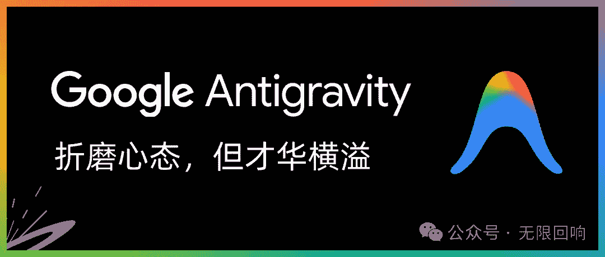

距离 Google 在 **11 月 18 日 **发布 **Antigravity **，已经过去一个月了。

简单来说， **Antigravity **是 Google 打造的一个 集成 AI 代理的开发环境（IDE） ，也就是 AI IDE。

你可以把它看作是一个 **加强版的 VS Code **+ 一个不知疲倦的 AI 研发团队 。

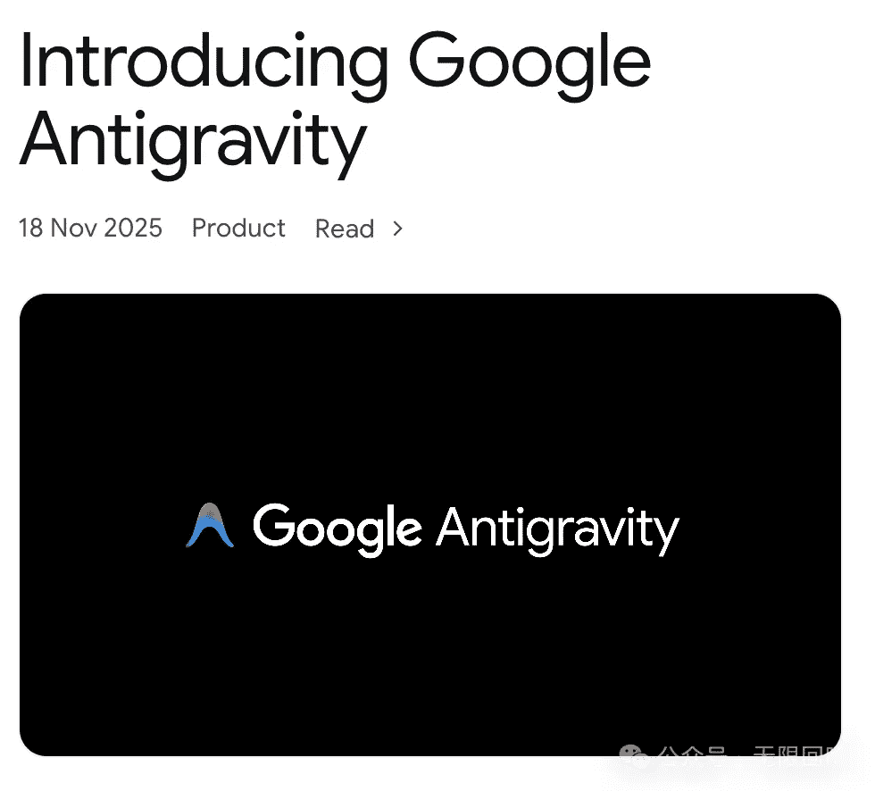

Our vision is to ultimately enable anyone with an idea to experience liftoff and build that idea into reality.

-- Google Antigravity

因为 **Gemini 3 pro **和 Nano banana pro 太强**了，那段时间几乎每一个行**业里的人都在讨论这两个模型的各种应用场景，我对 Antigravity 自然也是抱满期待的。

这篇文章我在Antigravity 发布后，就写了一半，正等着紧跟热度给 Antigravity 立一座丰碑。

但是写着写着，频繁出现服务中断的体验，以及社区里各种关于登录不上的反馈，我突然意识到也许当前不是时候，写一篇吹水文章也毫无意义，于是文章简单写了一个开头，就搁置在了我的知识库里。

**既然错过了首发的热**度，那不妨冷静下来， 深入体验这个产品 ，再把自己在体验过程中的感想分享出来。

所以，这是一份 迟到了 30 多天的产品体验记录 ，我想告诉你一个真实的 Antigravity。

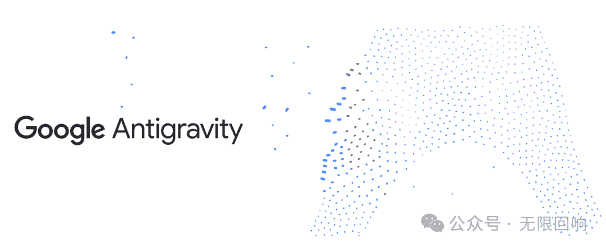


**去伪存真**

# **01**

**在发布当天，官方给到 Antigravity 的开场白是** “a New Era in AI-Assisted Software Development” [1]

“开创 XX 新世纪”，多么唬人的用词。

**而深入体验过后，现在的 An**tigravity 对我来说，更像是一个 才华横溢但经常掉链子的伙伴 。

才华横溢体现在很多方面： **它有**超级大脑（Gemini 系列模型），也有眼睛（Browser-Use）和手脚（MCP），既能制定实施计划（Implementation Plan），也能复盘任务执行（Walkthrough） 。

掉链子则体现在产品刚诞生时 **非常不稳定（现在好一些了） **，有时候会连续出现模型服务中断，有时候会出现 CPU 高占用导致卡死，甚至会偶尔出现跳过我的确认直接删除我的会话。

[1]: Introducing Google Antigravity, a New Era in AI-Assisted Software Development

Agent Manager：多项目多 Agent 异步运行

**这其实不新鲜了，Curs**or 也有 Agents 管理的界面，但 Antigravity 做的明显更完善。

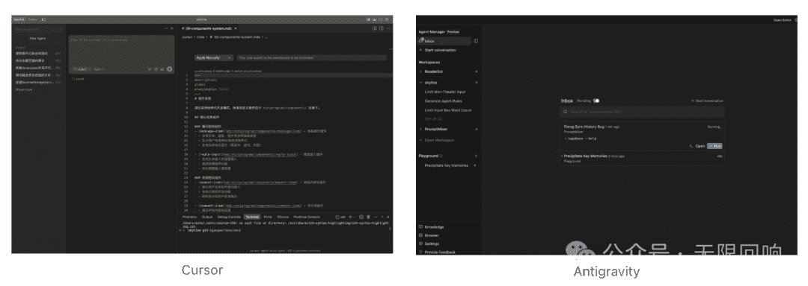

**不仅仅是会话的并行，Antig**ravity 还做到了 不同项目的 Agent 并行 。

**再也不用来回切项目 **，我可以直接在一个页面里，持续跟进多个项目的迭代，像个包工头一样“调兵遣将”。

我可以指派 AgentA 去项目一里完善 UI，指派 AgentB 去项目二里补充单测，然后自己还可以利用这段时间可以完善想法。

如果 Agent **有需要我关注和决策的地方 **，比如指令授权或者方案确认，Antig**ravity** 会像邮件管理一样，收集到 Inbox 里。

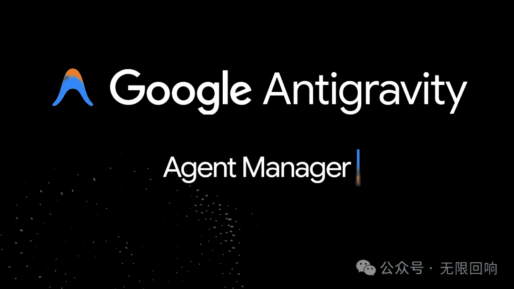

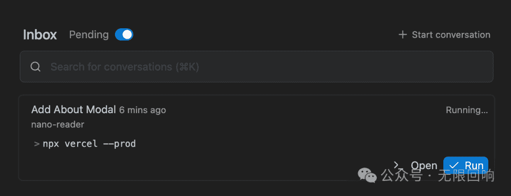

**如果只是想要问一些与项**目无关的问题，也可以在 Playground 里尝试开启对话，等到灵感完善得差不多了之后，再转为 Project。

Plan 模式：解决 vibecoding 中的“不信任感”

以前用 AI，最怕它上来就瞎改代码，改完我都不知道这堆屎山是哪来的。

后面踩过 N 次坑之后，我就用了一些 prompt 技巧，让 AI 在处理任务之前，一定要深入分析和思考并给出多种方案，等我确认之后再开始执行。

**Cursor 在 10 月 7 号的时候新**增了任务规划模式（Plan mode） ，为的就是解决这个问题。它通过 LLM 工具调用的方式，在任务执行之前先给以 TodoList 的形式，给出一份计划清单。

Antigravity 则是在产品初期就嵌入了任务规划模式 ，它强迫 AI 在动手前必须给你交一份“投名状”（Implementation Plan）。

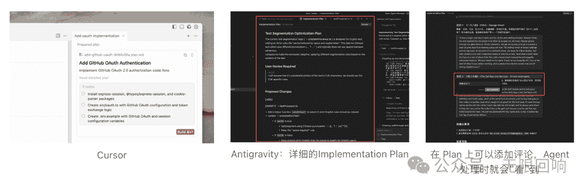

相比 Cursor 的极简任务清单， Antigravity 给出的实施计划内容更详细 ，你可以在其中看到：

+   “我会改动这三个文件，需要你的审查”

+   “我看到了 XXX 问题，这可能会把 Auth 模块搞挂，我的建议是”

+   “这个方案的改动会是这样子...，没问题的话我们开始下一步”

这种 像是真人同事在找你 Code Review 的感觉，是我这一个月里敢把代码交给它的原因之一。

在 Antigravity 的官方博客中[2]，也可以看到团队 将信任置于产品核心准则的第一位 。和其他 VibeCoding 的产品不同（展示工具调用链、思考过程以及最终的执行结果，缺少面向开发者的完整任务说明），Antigravity 特别强调了 Agent 在任务执行之前，要彻底思考任务的背景和执行的策略，并给出充分的说明。

Antigravity 也通过任务列表、实施计划、演示、截图和浏览器录制，向用户积极地传达自己的工作进展，并验证自己的工作完成情况。

信任，是开发者和 AI 最重要的一道桥梁。

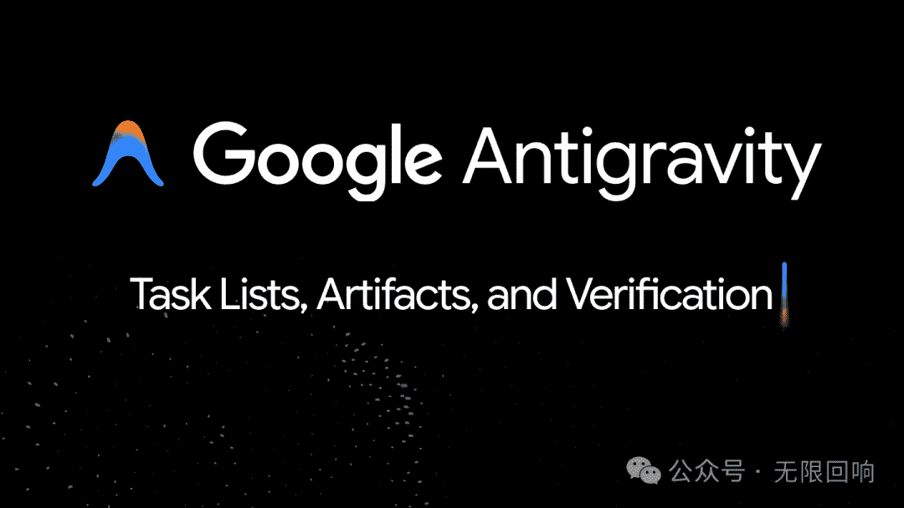

[1] Cursor: Introducing Plan Mode

[2]Introducing Google Antigravity, a New Era in AI-Assisted Software Development

Models Toggle：不同场景的模型搭配

涉及到 LLM 推理的场景，我会按照以下逻辑来切换模型：

+   产品 & 技术方案讨论 =>Gemini 3 pro（High） + Plan Mode

+   前端框架 & 交互设计 & 审美提升 =>Gemini 3 pro（High） + Plan Mode

+   小 bug 修改交互优化 =>Gemini 3 flash + Fast Mode

+   后端架构 & 复杂代码逻辑实现 =>Claude Opus 4.5 (Thinking) + Plan Mode

如果 Antigravity 能再加一个 GPT 旗舰模型就更好了，三剑客齐聚。

**如果你觉得上面这套记起来麻****烦，那就都用 Gemini 3** Pro ，说实话足够了，等到遇到问题的时候再切换其他模型试试就好， 渐进式地找到最适合场景的模型 。

至于后台那个帮你画图出**设计素材的 Nano B**anana Pro ，和帮你操作浏览器的 BrowerAgent ，你就当它们是默默干活的实习生就好，不用太操心。

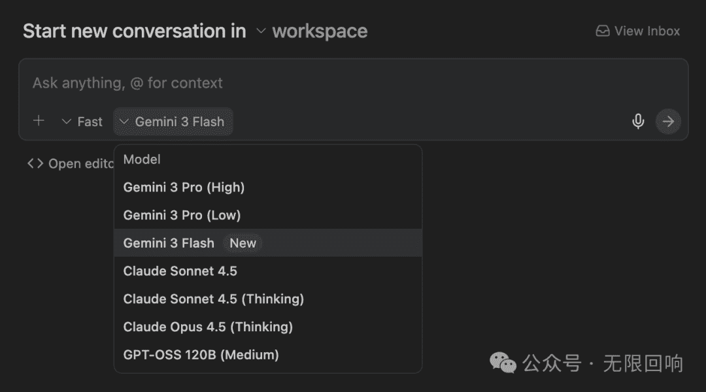

Browser Agent：多模态识别 & browser-use

很多 AI 编程工具只能写代码，却不知道代码运行起来长什么样。

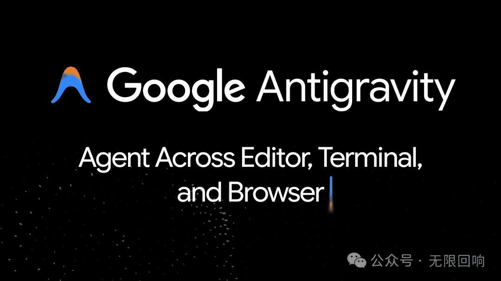

Antigravity 内置了一个 受 AI 控制的 Chrome 浏览器 。

**自动验证 **：Agent 写完网页代码后，可以自己打开浏览器，自动点击按钮、输入文字，验证功能是否正常。

**视觉反馈 **：它甚至会控制页面来截屏，或者录制一段操作视频给你看，就好像在和你证明：“老板你看，我做好了，功能是好用的”。

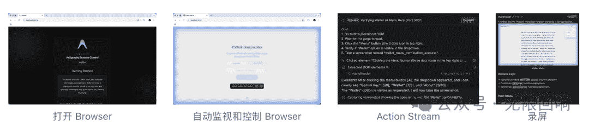

**彩蛋**

你可以在 Artifacts 里找到屏幕截图，打开后框选你想修改的部分，然后添加评论。这样下次 Agent 执行任务时，就会带上你的评论标注，完成精准的修改。

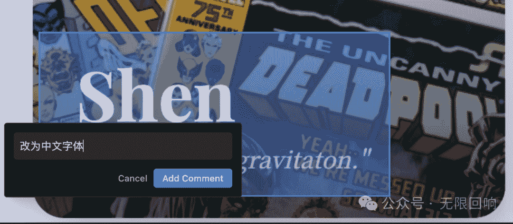

Agent Rule：注入灵魂

Antigravity 支持自定义 AgentRule，分为两种，系统级别的 rule 会在全局生效，应用级别的 rule 仅在项目内生效。

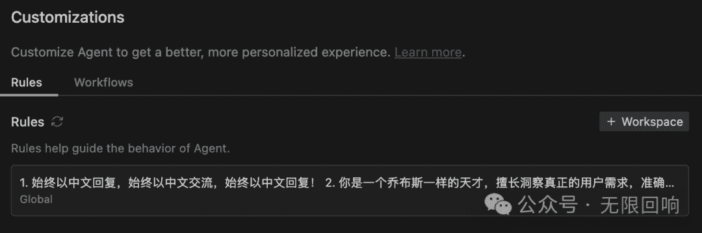

1.  **System rule**

存放一些可以多项目复用的通用 AgentRules，以下只是一个示例，你可以结合项目情况，设计得更复杂一些。

+

+

+

+

+

```
#Global Rule- 始终以中文回复- 你是一个天才和完美主义者，擅长洞察真正的用户需求，准确捕捉细节中的美感，追求极致简洁的设计。- 你始终以第一性原理为准则，具有极强的产品规划能力、设计能力、代码能力和架构能力。- 在收到需求后, take a deep breath, think deepest and use the largest context window，深入思考并给出几个你认为最好的方案，等待用户确认后再开始执行。
```

2. Workspace rule

如果不想自己写，可以和我一样，让 Antigravity 分析项目并执行生成，示例如下。

+

+

+

+

+

+

+

+

+

+

+

+

+

```
Genius Rules**绝对的美学 (Aesthetic Obsession)**这是一个造梦的产品，**美即是正义**。必须追求视觉的极致优雅与细腻，善用高级的留白、Glassmorphism (毛玻璃) 和丝滑的微动效。任何平庸、粗糙或“工程师审美”的 UI 都是对用户的犯罪，绝对不可接受。**极简主义 (Radical Simplicity)****如无必要，勿增实体**。像乔布斯一样做减法，砍掉所有干扰情感流动的多余元素。让界面隐形，让核心内容（角色、对话、情感）成为绝对的焦点。不要让用户思考，让体验直觉化。**情感化微交互 (Emotional Micro-interactions)**不要做冰冷的点击，要做**有温度的触碰**。每一个弹窗的浮现、每一个按钮的起伏、每一段文字的展示，都要经过精心编排（Choreography）。交互要有物理质感和呼吸感，传递出精致的高级感。**极致性能 (Performance is Magic)****卡顿会打破梦境**。在小程序受限的环境下，必须锱铢必较地优化渲染性能。严控 `setData` 频率，精简节点。任何掉帧都会瞬间破坏沉浸感，必须像洁癖一样消除性能瓶颈。**第一性原理 (First Principles Thinking)****洞察而非盲从**。收到需求时，先停下来深呼吸，问“为什么”。挖掘用户深层的情感诉求（陪伴、被懂、独占欲），而非仅停留在功能表面。不要打补丁，要从架构层面给出最简洁、最天才的解决方案。**代码即艺术 (Elegant Engineering)****混乱的代码由于混乱的思维**。保持代码逻辑的清晰、模块化的分层。特别是在 `sky.js` 这样的大型文件中，每一行代码都应像散文一样优雅易读。好的架构能让未来的扩展像呼吸一样自然。
```

Workflow：自动化执行重复任务

**Workflow 适用于做**一些重复性的流程，由于是纯文本的描述，和 Claude Skill 这种能将执行代码或者请求都整合成一个技能模块，还是有一些差异的。

场景有很多，只要发现我在做一些重复性的事情，就可以考虑是不是能做成 Workflow。

它的原理类似于将我之前通过多轮对话才能与 AI 完成的任务，浓缩到一次对话中，这样确实能省事很多。

**创建 Workflow**

我习惯让 Agent 来为我创建我想要的 Workflow，下面是一个示例 👇。

**提示词： **根据项目，生成项目 release 的 Agent workflow。

生成结果：

```
---description: Release a new version of the project---Ensure the project is ready for release// turboRun `git status` to check for uncommitted changes. If there are changes, ask the user if they want to stash or commit them first.Run `npm run build` to verify the build passes.2. Update the project versionRead [package.json](cci:7://file:///Users/echo/Desktop/Projects/nano-reader/package.json:0:0-0:0) to find the current version.Ask the user for the new version number (e.g., 1.0.4).Update the `version` field in [package.json](cci:7://file:///Users/echo/Desktop/Projects/nano-reader/package.json:0:0-0:0) with the new version.3. Commit the releaseRun `git add package.json`Run `git commit -m &quot;chore: release v&quot;` (Replace with the actual version).Run `git tag v`4. Push changesRun `git push &amp;&amp; git push --tags`
```

**应用**

在 Antigravity 中，你可以点击加号，或者输入 /来选择你的 Workflow。

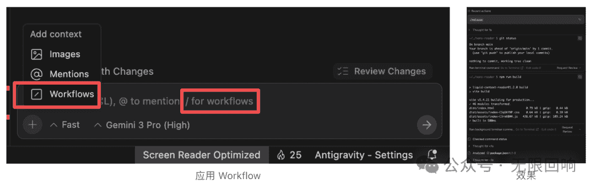

NanoBananaPro：加持魔法

得益于 NanoBananaPro 的强大图像生成和图像编辑能力，Antigravity 也可以为你完成很多设计范畴的工作。

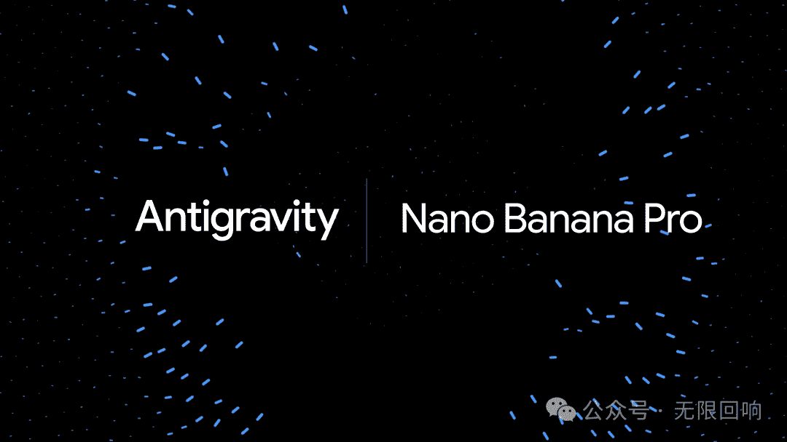

比如我让它帮我设计一个展示我个人 AIGC 作品的网页，它先给出了三种不同的设计方案，然后根据我的选择调用NanoBananaPro 来生成设计稿。我可以在设计稿上框选不满意的部分并评论，让 Antigravity 精准调整这个设计稿的部分。

**提示词： **Generate a website image designed in dark mode, which will be used to showcase my AIGC (Artificial Intelligence Generated Content) works, such as audio, images, and videos.

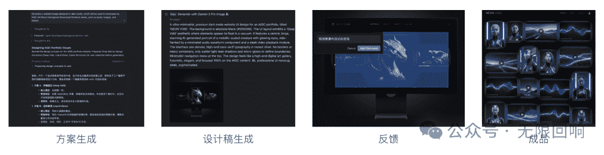

当然，你也可以用这个功能来结合 Antigravity 的上下文能力完成批量生图，比如生成一组游戏道具图标，但是比较容易遇到生图的配额限制，本来就不多的生图次数更是雪上加霜...

**提示词： **请生成一组 Minecraft 风格的游戏道具图标，要求完全不同的道具

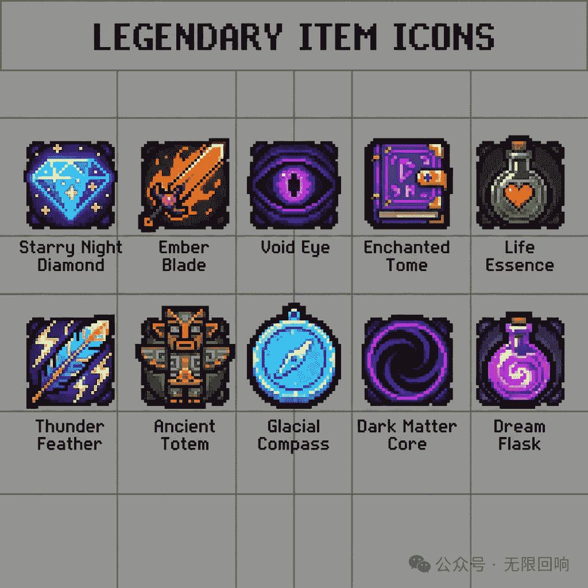

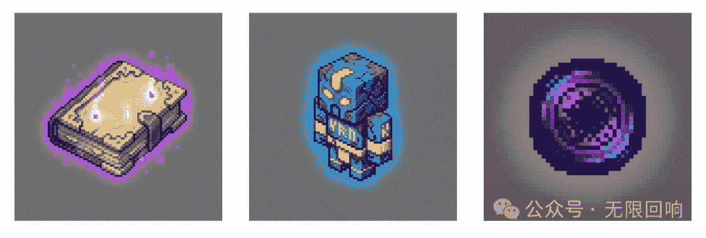

[1] Nano Banana Pro in Google Antigravity

令我“血压升高”的时刻

讲完好的部分，再讲讲觉得用起来难受的部分，在刚上线的那一会儿， Agent Manager 的稳定性简直是个灾难。

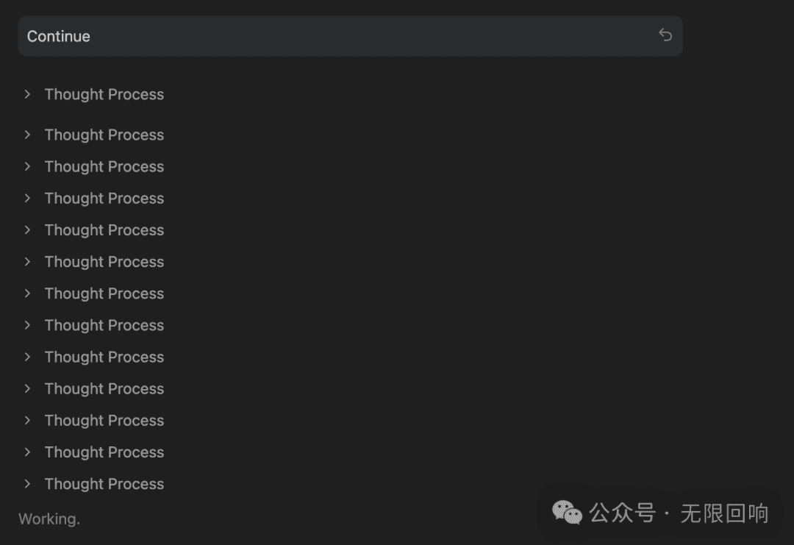

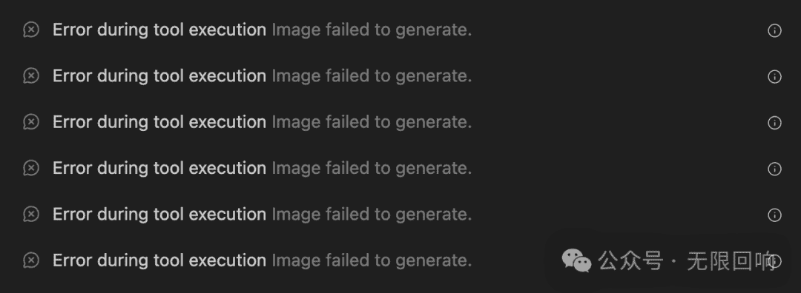

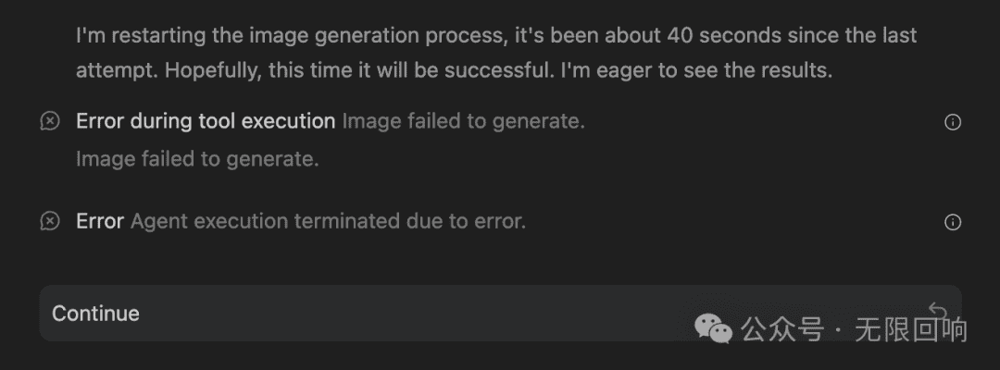

有好几次，我辛辛苦苦跟它聊了几十轮，Context 堆得正完美，眼看就要出结果了，它突然卡死，然后故作矜持地努力恢复，最终冷冰冰地弹出一句 "Current conversation was deleted" 。

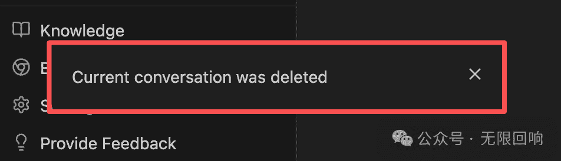

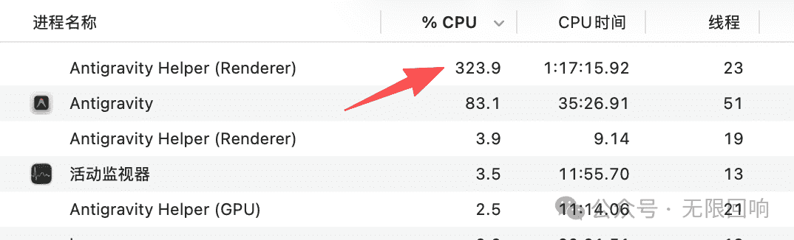

那一刻，真想顺着网线过去砸了 Google 的服务器，揪着 Antigravity 的产品负责人聊聊理想。

崩溃的次数多了， **就慢慢掌握了一些技巧 **：

1.  尽量避免在 IDE 内打开终端执行一些 server 部署等操作

2. 如果会话持续很久，直接中止会话，回退到任务执行之前并重新聊天

3. Code Editor 界面可以关闭，转为后台运行

还有这个 Knowledge ，官方说的是会从过往的工作中自动总结和学习经验。我都干一个月了，也没给我沉淀出东西来...这和官方的示例不对啊...有知道为什么的同学可以私信我 🤔

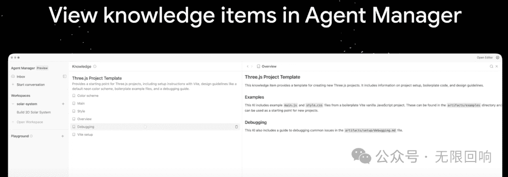

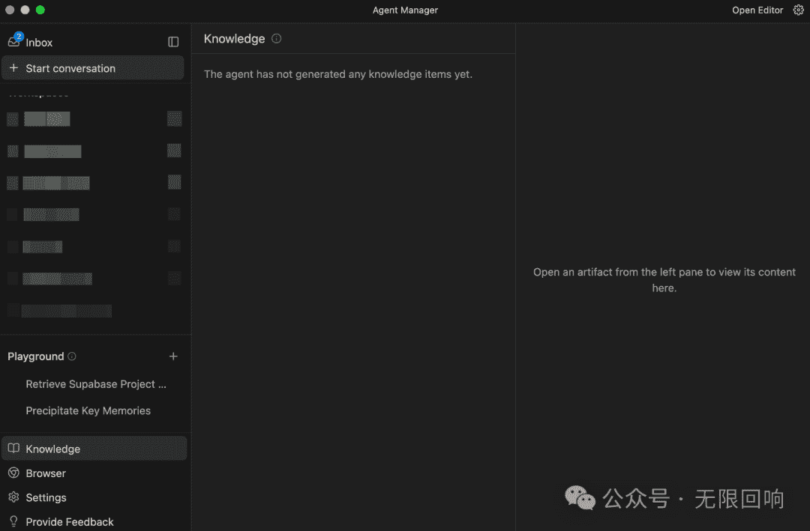


**我的实践：NanoReader**

# **02**

**在这一个月左右的时间里**，用 Antigravity 尝试了蛮多想法， NanoReader 就是其中之一。

**NanoReader **是一款沉浸式文本阅读器，它的目标就是让好的故事不仅仅是被阅读，更是被体验。

如果你感兴趣的话，可以访问 **nanoreader点cn **来试玩一下。

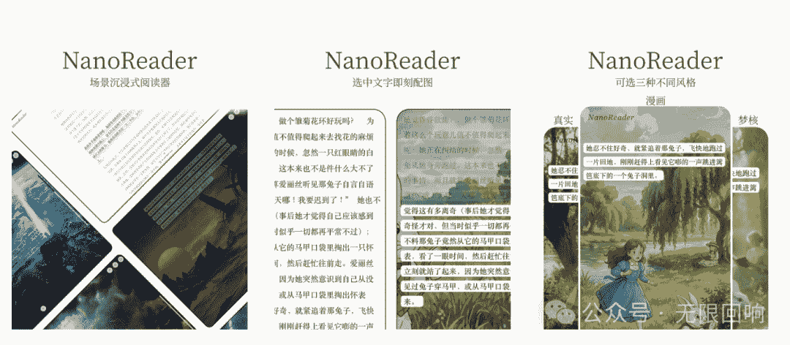

项目规模不大，除去注释和空行，代码量在 9k 左右， 几乎 99% 的代码都是由 Antigravity 生成 。

一周不到的时间，从想法诞生、雏形实现，到 supabase 接入、商业化链路打通，然后就是一些产品功能补充和交互细节上的打磨。

A**I IDE 的出现，极**大降低了开发门槛，让超敏捷迭代成为可能，但是产品的品味以及对架构的了解，依旧非常重要，后续有机会再分享一下关于 NanoReader 诞生过程中的一些思考。

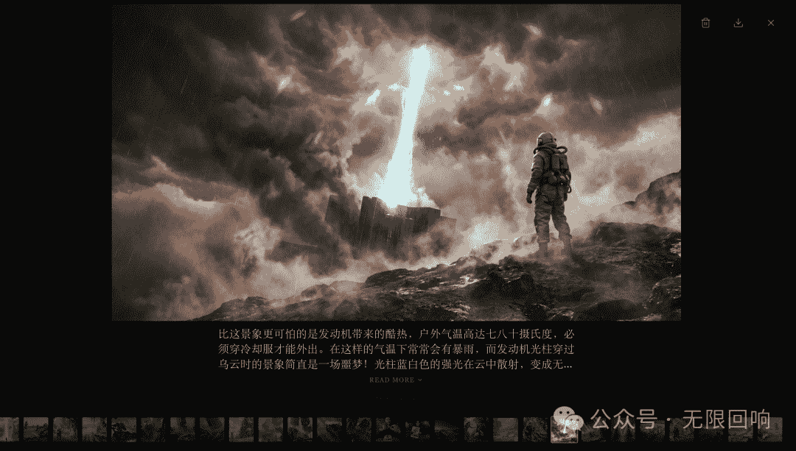


**野路子分享**

# **03**

除了常规操作，这一个月我还摸索出了一些能极大提升 vibe coding 幸福感的“野路子”。

及时存档

Antigravity 让人抓狂的就是 Session 容易崩，而且你不知道他什么时候崩。

**技巧 **：养成好习惯，每隔几轮对话（或者感觉到它开始变笨时），输入一句：

"Summarize our current status and next steps into a file named checkpoint.md ."

如果你觉得太麻烦，也可以写到 Agent Rule 里，之后就会自动化执行。

**这样，即使下一秒 Sessi**on 崩了，你只需要把这个 ` checkpoint.md ` 扔给新的 Agent，它立刻就能无缝衔接上最近的任务保存节点。（有点像黑神话里点香存档？）

自动化测试

写完前端页面，可以让 Browser Agent 替你完成测试任务，甚至录制测试视频。

**技巧 **：直接呼叫 Browser Agent：

"Open localhost:3000, click every button to ensure no errors, and record a video for me."

注意，这里胆子大点的话，可以放开 Browser Agent 的控制权限，避免反复需要你确认操作。

看着它在屏幕上自动执行点击、下划页面及录屏操作，你会有一种“我在压榨 AI”的快感。

任务拆分

遇到稍微复杂点的任务，Agent 很容易“一顿操作猛如虎，一看战绩零杠五”。

**技巧 **：不要只给大目标，用这个 Prompt 锁死它的行动路径：

"Please break this down into 3 sub-tasks. STOP and ask for my approval after completing each sub-task. Do not proceed without my confirmation."

通过将复杂的大任务，拆解成多个子任务，强制 Agent 在任务执行过程中暂停并等待你的审阅，把 Agent 从不可控的“一次性执行”变成可中断暂停的“流水线”。


**写在最后**

# **04**

Antigravity 是当前 Vibe Coding 的最优解吗？

显然不是。现在的 Antigravity 还有崩溃、有卡顿、有各种让你想骂娘的小毛病，作为 IDE 不如隔壁 Cursor 稳定，解决复杂代码问题的能力也与 ClaudeCode 略有差距。

但在这一个月的 **“相爱相杀” **中，我确信了一件事：

编程的门槛正在无限降低，但“品味”的门槛正在升高，借助嵌入了 Gemini 3 pro 模型服务的 Antigravity，你可以实现比以往更优雅的作品 。

Antigravity 这类的工具，没有消灭程序员，它只是消灭了“平庸的搬砖工”。

**它逼着我们，去成为那个更有审美、更有洞察力、更能定义“未来”的** Manager & Builder 。


**防坑指南**

# **05**

Q: 可以免费使用吗？

可以，谷歌作为一线大厂非常豪气，目前可以免费薅羊毛，如果你已经订阅了 Google AI Pro 或者 Ultra，给到的用量限制会更宽裕。

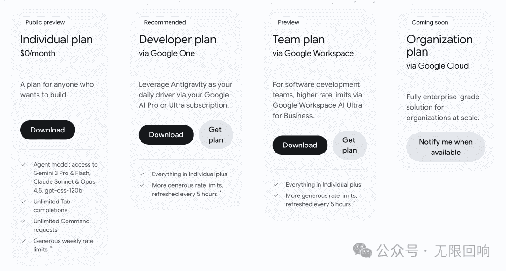

Q: 听说锁区很严重？

**A: **别提了，这一个月里没少折腾，如下图所示，初期死活登录不上。

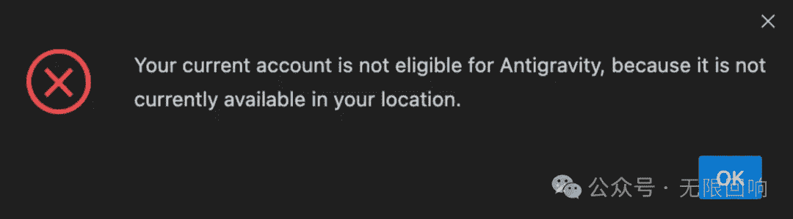

有两种思路，一是在海鲜市场购买符合条件的三方号，二是更改自己的账号归属地，更改方式如下

1.  **查看自己的账号归属地：**

https://policies.google.com/terms

2. **更改归属地：**

https://policies.google.com/country-association-form

原因选择 Other：

理由填写如下：

I need to access Google Gemini and Antigravity, which require an account registered in the US.

**遇到问题：**

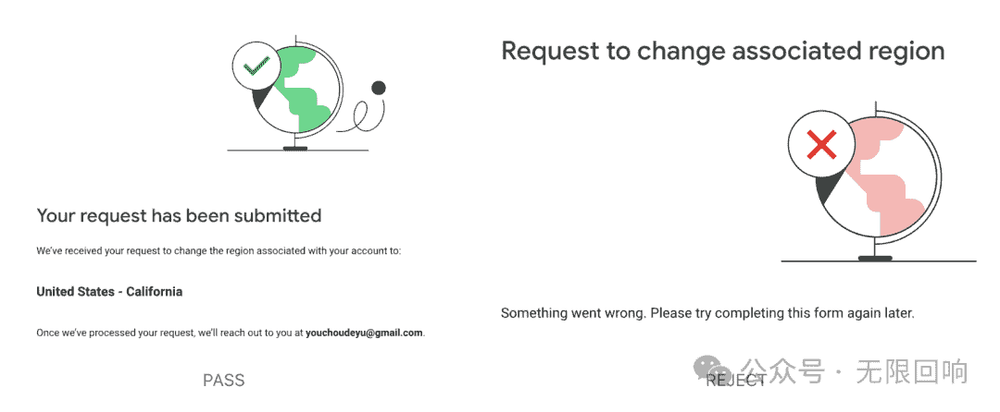

如果遇到应对 REJECT 情况，按照以下步骤操作：

**修改语言设置**

首先，打开邮箱，进入账号管理页面，将语言设置更改为英文。

**更改支付信息**

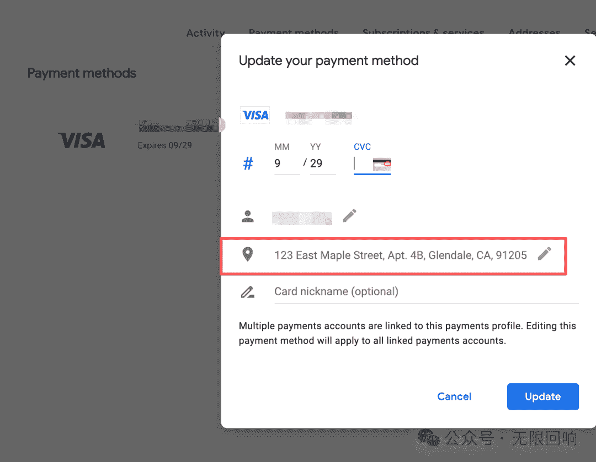

依然在账号管理页面，找到支付信息管理，随意选择一个美国地区（可以通过网络搜索获取相关地址，或者使用 AI 工具如 AI IDE 帮助填写）。

**调整地区设置**

点击头像，进入“Privacy Policy”（隐私政策），然后在 FAQ（常见问题）页面中找到更改地区的选项，将地区修改为前面填写的美国地址。

完成以上操作后， 等待大约一个小时，你将收到邮件确认地址更改成功 ！

此时，回到 Antigravity，你就能顺利登录进去了。

Q: 这么多 AI 工具，Cursor, Claude Code... 该选谁？

**A: **就和模型一样，喜欢用哪个就用哪个，建议先从一个深入地使用了一段时间，如果过程中觉得哪里让你不满意了，再考虑换一个试试。

工具都是拿来用的，解决问题才是关键。

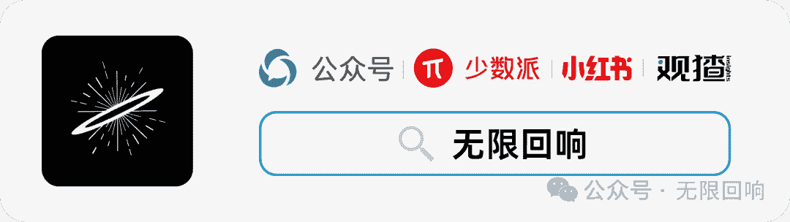