# TRAE × Spec Kit 实战：五步构建流式 AI 对话 Web 应用

> 来源：[https://xatc0v8uz5m.feishu.cn/docx/EK5hdY2b0oX2Ngxjrzic0ISlnob](https://xatc0v8uz5m.feishu.cn/docx/EK5hdY2b0oX2Ngxjrzic0ISlnob)

> 🔗 原文链接：https://mp.weixin.qq.com/s/PJq9B75ErSPV3wo1bYTdaw

> ⏰ 剪存时间：2025-10-20 22:56:15 (UTC+8)

> ✂️ 本文档由 [飞书剪存](https://www.feishu.cn/hc/zh-CN/articles/606278856233?from=in_ccm_clip_doc)一键生成

TRAE.ai 2025年10月20日 20:42


本文作者：茉卷，TRAE 开发者用户

## Spec Kit 介绍

### 1.1 什么是 Spec Kit？

Spec Kit 是 GitHub 开源的一个开发工具包（`https://github.com/github/spec-kit`），它基于 规范驱动开发（Spec-Driven Development） 的理念，旨在帮助开发团队更快地构建高质量软件。这一工具包的核心思想是颠覆传统的软件开发流程，让规范成为开发的核心驱动力。

### 1.2 核心理念：规范驱动开发

传统的软件开发流程：

```
编写规范 → 编写代码 → 测试 → 部署
```

而规范驱动开发则完全颠覆了这一模式：

- 规范成为核心：规范不再是临时性的文档，而是可执行的
- 自动生成代码：规范直接生成可工作的实现代码
- 规范即代码：规范本身就是开发的一部分，而不是前期准备工作

### 1.3 Spec Kit 的核心特点

#### 01 提升开发效率

- 让组织专注于产品场景，而不是重复编写基础代码
- 减少编写“无差别代码”的时间投入
- 通过标准化流程提高团队协作效率

#### 02 完整的工具生态

- `Specify CLI`：命令行工具，用于执行规范驱动开发流程
- AI 代理支持：集成多种 AI 助手来辅助开发过程
- 文档和最佳实践：提供完整的使用指南和模版

#### 03 解决传统开发痛点

- 规范写完就被丢弃
- 代码与文档脱节
- 重复编写相似的基础代码
- 开发效率低下

## Spec-kit 环境搭建详解

### 2.1 下载与安装

首先从 GitHub 获取 Spec Kit 工具包：

```
git clone https://github.com/github/spec-kit
cd spec-kit
```

### 2.2 python 虚拟环境配置

为了确保环境隔离和依赖管理的清洁性，建议使用 Python 虚拟环境：

```
# 创建虚拟环境
python3 -m venv venv
# 激活虚拟环境
source ./venv/bin/activate
# 安装 Spec Kit
pip3 install -e .
```

安装完成后，你将获得关键的提示词模板和工具脚本，这些是后续开发流程的基础。


## 实战案例：构建 GLM-4.6 深度思考 AI 交互页面

### 3.1 项目背景

本案例将利用 GLM-4.6 模型构建一个类似 DeepSeek 的前端 AI 对话页面，支持深度思考和流式输出功能。通过这个实际项目，我们将深入了解 Spec Kit 的五个关键命令的使用方法。

- `/speckit.constitution`
- `/speckit.specify`
- `/speckit.plan`
- `/speckit.tasks`
- `/speckit.implement`

`/speckit.《宪法》`
`/speckit.指定`
`/speckit.计划`
`/speckit.任务`
`/speckit.实施`

### 3.2 项目初始化

在安装了 Spec Kit 工具的项目目录下运行初始化命令：

```
specify init Glm4.6-DeepThink
```

注意事项：

- 目前 Spec Kit 还没有明确支持 TRAE，可以选择其他选项来下载关键脚本
- 项目名称可以自定义，系统会在当前目录下创建对应的子目录
- 初始化过程会下载必要的模板和配置文件

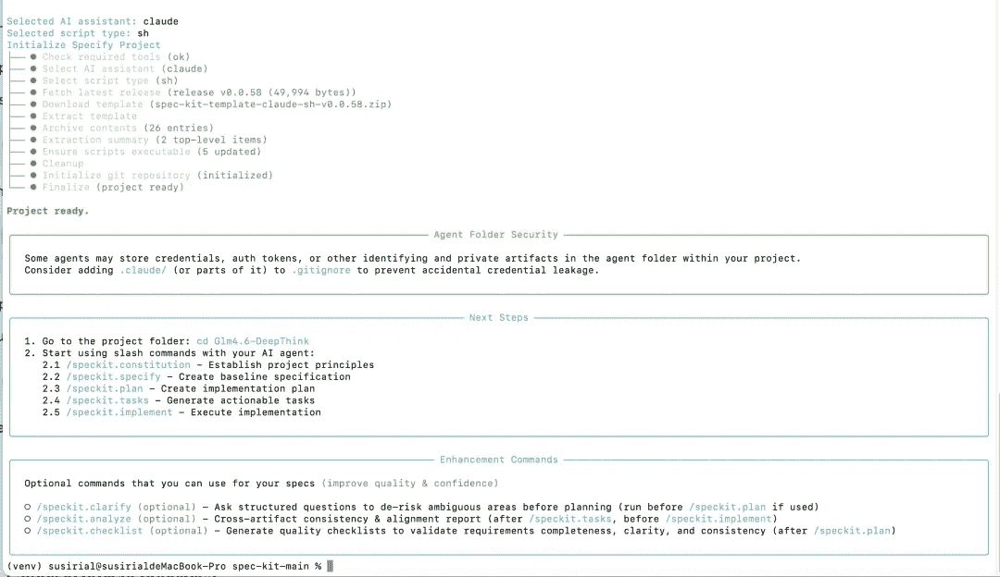

环境初始化成功

### 3.3 进入项目环境

使用 TRAE 进入项目目录，无需激活之前的虚拟环境：

```
cd spec-kit-main/Glm4.6-DeepThink
```

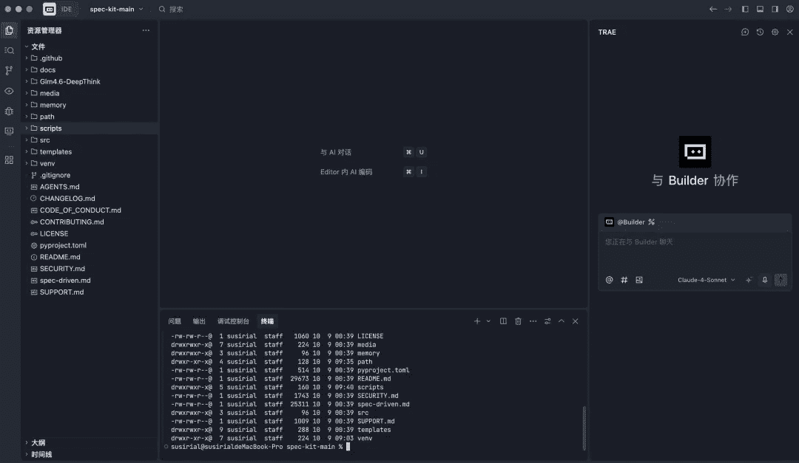


## Spec Kit 五大核心命令详解

### 4.1 制定项目宪章 - `/speckit.constitution`

目的：建立项目的核心治理原则和开发标准

配置建议：TRAE 配置使用 GPT-5 + Builder

执行命令：

注意⚠️：`speckit.constitution.md` 是通过 # 号添加的 `speckit.constitution.md` 文件

```
#speckit.constitution.md  制定以代码质量、测试标准、用户体验一致性及性能要求为核心的原则
```

输出成果：生成 `constitution.md` 文件：

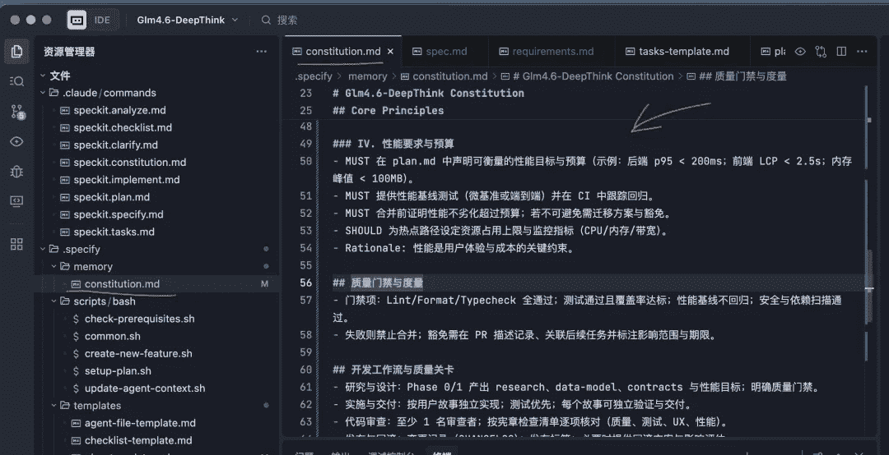

上下滑动查看完整内容

```
<!--Sync Impact Report- Version change: N/A → 1.0.0- Modified principles:  - I → 代码质量（不可妥协）  - II → 测试标准与覆盖率  - III → 用户体验一致性  - IV → 性能要求与预算- Added sections:  - 质量门禁与度量  - 开发工作流与质量关卡- Removed sections:  - 第五原则占位符（PRINCIPLE_5）- Templates requiring updates:  - .specify/templates/tasks-template.md → ✅ updated（测试为强制项）  - .specify/templates/plan-template.md → ✅ updated（修正命令路径说明）  - .specify/templates/spec-template.md → ✅ reviewed（已与强制测试一致）  - .claude/commands/* → ✅ reviewed（无需改动）- Follow-up TODOs:  - TODO(RATIFICATION_DATE): 原始采纳日期未知，需项目历史确认-->
# Glm4.6-DeepThink Constitution
## Core Principles
### I. 代码质量（不可妥协）- MUST 通过统一的代码风格与静态检查（lint/format/类型检查）。- MUST 维持复杂度与可维护性在预算内；超标需书面豁免与后续任务。- MUST 完成代码审查：至少 1 名审查者；所有审查意见均已解决。- MUST 公共接口具备文档与示例；破坏性变更需变更记录与迁移指引。- Rationale: 高质量代码降低缺陷率与维护成本，提升可演进性。
### II. 测试标准与覆盖率- MUST 测试优先（Red-Green-Refactor）：先写测试、确保失败，再实现。- MUST 提供单元测试（新代码）、契约测试（公共接口）、集成测试（跨模块/关键流程）。- MUST 在 CI 中执行测试并作为合并门禁。- MUST 覆盖率门槛：新增模块行覆盖率 ≥ 80%，关键路径 ≥ 90%；不达标需豁免说明与补齐计划。- Rationale: 明确测试标准确保功能可靠、可回归与可维护。
### III. 用户体验一致性- MUST 采用统一设计系统/组件库；无库时设定设计令牌（颜色、字号、间距）。- MUST 遵循一致的交互模式（导航、反馈、空态与错误处理）。- MUST 满足可访问性基线（接近 WCAG 2.1 AA）：键盘可达、对比度、语义结构。- MUST 文案与术语一致；适用场景下提供国际化支持并可审阅。- Compliance: 所有 UI 改动需通过 UX 检查清单。- Rationale: 一致性降低学习成本、提升效率与满意度。
### IV. 性能要求与预算- MUST 在 plan.md 中声明可衡量的性能目标与预算（示例：后端 p95 < 200ms；前端 LCP < 2.5s；内存峰值 < 100MB）。- MUST 提供性能基线测试（微基准或端到端）并在 CI 中跟踪回归。- MUST 合并前证明性能不劣化超过预算；若不可避免需迁移方案与豁免。- SHOULD 为热点路径设定资源占用上限与监控指标（CPU/内存/带宽）。- Rationale: 性能是用户体验与成本的关键约束。
## 质量门禁与度量- 门禁项：Lint/Format/Typecheck 全通过；测试通过且覆盖率达标；性能基线不回归；安全与依赖扫描通过。- 失败则禁止合并；豁免需在 PR 描述记录、关联后续任务并标注影响范围与期限。
## 开发工作流与质量关卡- 研究与设计：Phase 0/1 产出 research、data-model、contracts 与性能目标；明确质量门禁。- 实施与交付：按用户故事独立实现；测试优先；每个故事可独立验证与交付。- 代码审查：至少 1 名审查者；按宪章检查清单逐项核对（质量、测试、UX、性能）。- 发布与回滚：变更记录（CHANGELOG）；发布标签；必要时提供回滚方案与影响评估。
## Governance- 宪章优先于其他实践；违反需经豁免流程并记录。- 修订流程：通过 PR 修改宪章，说明变更类型（MAJOR/MINOR/PATCH）、影响与迁移计划；需维护者批准。- 版本策略：语义化版本—MAJOR（不兼容原则变更），MINOR（新增/扩展原则或章节），PATCH（澄清与文字优化）。- 合规审查：所有 PR 必须验证对本宪章的遵循；运行时开发指南参考由 `.specify/templates/agent-file-template.md` 生成的开发指南文件。
**Version**: 1.0.0 | **Ratified**: TODO(RATIFICATION_DATE) | **Last Amended**: 2025-10-20
```

### 4.2 需求规格说明 - `/speckit.specify`

目的：描述要构建什么，专注于 what 和 why，而非技术实现

执行命令：

注意⚠️：`# speckit.specify.md` 是通过 # 号添加的 `speckit.specify.md` 文件

```
#speckit.specify.md  我想做一个类似DeepSeek 的AI 深度思考，流式文字返回的 AI 对话 Web 应用，用户可以输入问题，AI 思考之后回答。可以查看、删除 AI 和  用户的对话历史，用户也可以建立新AI对话。
```

输出成果：生成 `001-streaming-ai-chat` 目录：

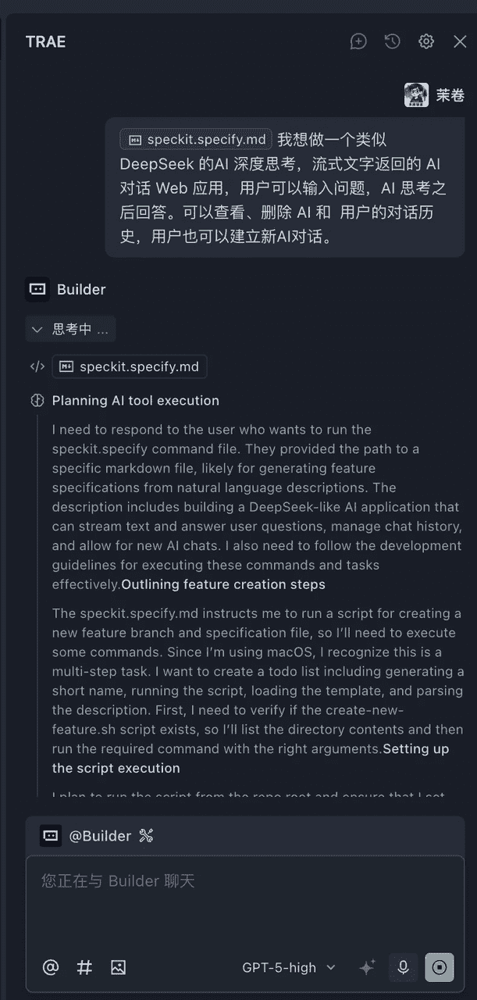

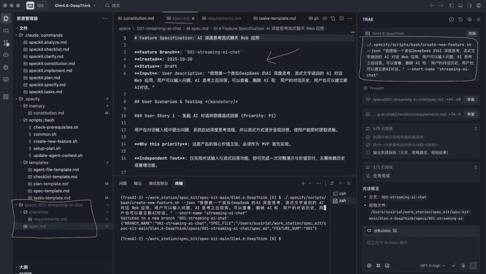

上下滑动查看完整内容


# Feature Specification: AI 深度思考流式聊天 Web 应用

**Feature Branch**: `001-streaming-ai-chat` **Created**: 2025-10-20 **Status**: Draft **Input**: User description: "我想做一个类似DeepSeek 的AI 深度思考，流式文字返回的 AI 对话 Web 应用，用户可以输入问题，AI 思考之后回答。可以查看、删除 AI 和 用户的对话历史，用户也可以建立新AI对话。"

## User Scenarios & Testing *(mandatory)*

### User Story 1 - 发起 AI 对话并获得流式回答 (Priority: P1)

用户在对话输入框中提出问题，系统启动深度思考流程，并以流式方式逐步呈现回答，使用户能即时获取进展。

**Why this priority**: 这是产品的核心价值主张，必须作为 MVP 首先实现。

**Independent Test**: 仅实现对话输入与流式回答功能，即可完成一次完整演示与价值交付，无需依赖历史或管理功能。

**Acceptance Scenarios**:

1. Given 用户在页面加载后，When 输入问题并点击发送，Then 1 秒内显示“正在思考/生成”状态，并在 2 秒内开始流式输出。
2. Given 正在流式输出，When 用户点击“停止/暂停”，Then 系统停止后续输出并明确显示已停止状态。
3. Given 流式输出完成，When 用户查看回答，Then 回答包含清晰结论与必要的推理摘要（不要求技术细节）。

---

### User Story 2 - 查看与管理对话历史 (Priority: P2)

用户可以查看历史对话列表与详情，并可删除单条对话（需要确认动作）。

**Why this priority**: 提升长期使用体验与可回溯性，是次要但重要的辅助能力。

**Independent Test**: 历史管理可独立于流式回答运行，通过预置数据或先完成一次对话后测试列表/删除。

**Acceptance Scenarios**:

1. Given 存在至少 1 条已完成的对话，When 进入“历史”页面，Then 展示列表（标题、时间、摘要），并可点击进入详情。
2. Given 用户在详情页，When 点击“删除”并确认，Then 对话被移除，列表实时更新且不可恢复（提示删除成功）。
3. Given 历史为空，When 进入“历史”页面，Then 显示空态与引导开始新对话。

---

### User Story 3 - 新建对话 (Priority: P3)

用户可以创建新的对话会话，以清晰的上下文开始新的提问与回答。

**Why this priority**: 便于任务分隔与主题切换，提升组织性与可用性。

**Independent Test**: 在不依赖其他故事的情况下，用户能够创建新会话并发送首条消息，获得流式回答。

**Acceptance Scenarios**:

1. Given 用户处于任一页面，When 点击“新建对话”，Then 新会话创建成功并自动进入会话页面，显示空态与输入框。
2. Given 新建会话，When 输入首条消息并发送，Then 流式回答开始，且该会话独立于其他会话的上下文。

---

### Edge Cases

- 输入为空或仅包含空白字符：系统阻止发送并给出提示。
- 超长输入或包含潜在敏感信息：提示并要求用户确认或截断处理。
- 网络中断或服务暂不可用：保留用户输入，提供重试与恢复提示；若在流式过程中中断，显示已中断并支持重新请求。
- 并发窗口/多标签页：会话状态在各窗口保持一致或明确不可用的限制说明。

## Requirements *(mandatory)*

### Functional Requirements

- **FR-001**: 系统 MUST 允许用户在会话中输入问题并发送。
- **FR-002**: 系统 MUST 以可视化的进行中状态（如“正在思考/生成”）反馈，并在合适时间内开始流式输出。
- **FR-003**: 系统 MUST 在同一会话中连续显示消息与回答，维持清晰的时间顺序和身份标识（用户/AI）。
- **FR-004**: 系统 MUST 支持暂停/停止流式输出，并在停止后清晰标注状态。
- **FR-005**: 系统 MUST 提供“历史”视图，列出会话摘要（如首条问题、最近回答时间）。
- **FR-006**: 系统 MUST 允许用户删除单条会话；删除需确认并成功后从历史移除。
- **FR-007**: 系统 MUST 允许用户新建会话并自动跳转到新会话界面。
- **FR-008**: 系统 MUST 在错误情况下提供用户友好提示与恢复选项（重试/返回会话）。
- **FR-009**: 系统 SHOULD 在会话详情中提供简要推理摘要或结论高亮，以改善可读性。
- **FR-010**: 系统 MUST 在合理时间内开始流式输出（参考成功标准），并在完成后呈现完整回答。

### Key Entities *(include if feature involves data)*

- `Conversation`: 表示一次会话，包含标题（可由首条问题自动生成）、创建时间、最后活动时间、摘要。
- `Message`: 属于某个会话，包含角色（用户/AI）、内容、时间戳、状态（进行中/完成/中断）。

## Success Criteria *(mandatory)*

### Measurable Outcomes

- **SC-001**: 95% 的回答在发送后 2 秒内开始流式显示（用户可见进展）。
- **SC-002**: 90% 的用户在首次使用时可独立完成“新建会话 → 发送问题 → 获取回答”。
- **SC-003**: 历史页面的主要任务完成率 ≥ 90%（查看详情、删除会话）。
- **SC-004**: 发生错误时，用户在 1 分钟内可以通过提供的恢复选项重新获得可用状态。

## 4.3 技术实现规划 - /speckit.plan

目的：指定实现技术栈、框架和架构设计

### Implementation Plan: Streaming AI Chat

**Branch**: `001-streaming-ai-chat` | **Date**: 2025-10-20 | **Spec**: `/specs/001-streaming-ai-chat/spec.md`
**Input**: Feature specification from `/specs/001-streaming-ai-chat/spec.md`
**Note**: This template is filled in by the `/speckit.plan` command. See `.claude/commands/speckit.plan.md` for the execution workflow.

#### Summary

- Build a DeepSeek-like conversational web app with streaming AI answers, question input, and history management(view, delete, new).
- Frontend with Vite + React; streaming via `ReadableStream` from a backend proxy that calls GLM-4.6 with `stream: true`.
- History stored client-side in `IndexedDB`; no auth for v1. Backend used only for secure API key proxy and streaming transformation.
- Tests mandatory per constitution: unit + integration for core flows; performance budgets enforced.

#### Technical Context

**Language/Version**: TypeScript 5.x (frontend), Node.js 20 (backend), React 18, Vite 5
**Primary Dependencies**: React Router v6, Zustand (state) or Recoil, `idb-keyval` (`IndexedDB`), Vitest + React Testing Library, Express (proxy)
**Storage**: Client-side `IndexedDB` for conversation history(v1). Server persists N/A in v1; future P2 can add DB.
**Testing**: Vitest + React Testing Library(unit/integration), optional Playwright for E2E in P2
**Target Platform**: Modern browsers(Chromium/Firefox/Safari), desktop and mobile
**Project Type**: web
**Performance Goals**: First stream chunk < 2s; p95 chunk interval < 300ms; LCP < 2.5s; input-to-stream start < 4s
**Constraints**: API key only on server; memory footprint < 50MB; offline-capable for local history read; graceful abort/pause
**Scale/Scope**: ~3 pages, ~20 components, 1 backend proxy route, client-only history

#### Constitution Check

*GATE: Must pass before Phase 0 research. Re-check after Phase 1 design.*

- Code Quality: TypeScript strict mode, ESLint + Prettier; enforce typed APIs. [PLANNED]
- Testing: Unit + integration for Chat input/send, streaming render, stop/pause, history list/delete. Coverage ≥ 80% on changed code. [PLANNED]
- UX Consistency: Shared design tokens, consistent loading/empty/error states, accessible controls. [PLANNED]
- Performance: Budgets stated above; add measurement hooks and CI checks. [PLANNED]
- Security: API key in server env only, CORS restrict to app origin, no PII storage. [PLANNED]

Status: PASS (planned). Will re-check after Phase 1 and adjust if any violations arise.

#### Project Structure

##### Documentation (this feature)

```
specs/001-streaming-ai-chat/
├── plan.md              # This file(/speckit.plan command output)
├── research.md          # Phase 0 output(/speckit.plan command)
├── data-model.md        # Phase 1 output(/speckit.plan command)
├── quickstart.md        # Phase 1 output(/speckit.plan command)
├── contracts/           # Phase 1 output(/speckit.plan command)
└── tasks.md             # Phase 2 output(/speckit.tasks command - NOT created by /speckit.plan)
```

##### Source Code (repository root)

```
backend/
├── src/
│   ├── api/
│   │   └── chatProxy.ts       # POST /api/chat/stream → GLM-4.6 proxy(stream)
│   ├── services/
│   │   └── glm.ts             # BigModel GLM-4.6 client wrapper
│   └── models/                # (reserved for P2 if server persistence added)
└── tests/
    ├── unit/
    └── integration/
frontend/
├── src/
│   ├── components/
│   │   ├── ChatInput.tsx
│   │   ├── MessageList.tsx
│   │   ├── StreamingMessage.tsx
│   │   └── HistoryList.tsx
│   ├── pages/
│   │   ├── Chat.tsx
│   │   └── History.tsx
│   └── services/
│       ├── ai.ts              # streamChat(conversationId, messages)
│       ├── storage.ts         # IndexedDB wrappers
│       └── api.ts             # backend proxy calls
└── tests/
    ├── unit/
    └── integration/
```

**Structure Decision**: Web application with `frontend` + minimal `backend` proxy. Client stores history locally(`IndexedDB`). Backend holds API key and streams GLM-4.6 responses to the client. Aligns with security and performance gates.

## 4.4 任务分解 - /speckit.tasks

目的：将实现计划分解为详细的可执行任务


---description: "Task list for Streaming AI Chat feature"---

# Tasks: Streaming AI Chat

**Input**: Design documents from `/specs/001-streaming-ai-chat/`

**Prerequisites**: `plan.md` (required), `spec.md` (required), `research.md`, `data-model.md`, `contracts/`

**Tests**: 测试为强制项（依据宪章）；至少包含单元、契约与必要的集成测试。

**Organization**: Tasks are grouped by user story to enable independent implementation and testing of each story.

## Format: `[ID] [P?] [Story?] Description with file path`

- **[P]**: Can run in parallel(different files, no dependencies)
- **[Story]**: Which user story this task belongs to(e.g., US1, US2, US3)
- Include exact file paths in descriptions

---

## Phase 1: Setup(Shared Infrastructure)

**Purpose**: Project initialization and basic structure

- [ ] T001 初始化前端项目结构与依赖：Vite + React + TS 在 `frontend/`
- [ ] T002 初始化后端项目结构与依赖：Express + TS 在 `backend/`
- [ ] T003 配置 TypeScript 严格模式于 `frontend/tsconfig.json`
- [ ] T004 配置 TypeScript 严格模式于 `backend/tsconfig.json`
- [ ] T005 [P] 配置 ESLint/Prettier 于 `frontend/.eslintrc.cjs` 与 `frontend/.prettierrc`
- [ ] T006 [P] 配置 ESLint/Prettier 于 `backend/.eslintrc.cjs` 与 `backend/.prettierrc`
- [ ] T007 创建后端环境变量文件 `backend/.env` 并设置 `BIGMODEL_API_KEY`
- [ ] T008 创建后端基础服务器入口 `backend/src/server.ts`（Express 应用与端口配置）

---

## Phase 2: Foundational(Blocking Prerequisites)

**Purpose**: 核心基础设施；完成后才能开始任何用户故事

- [ ] T009 [P] 建立后端配置管理 `backend/src/config.ts`（端口、CORS、API Key 读取）
- [ ] T010 [P] 配置后端健康路由 `backend/src/api/health.ts`（GET `/api/health`）
- [ ] T011 [P] 配置后端路由与中间件结构 `backend/src/api/index.ts`
- [ ] T012 [P] 前端路由骨架：`frontend/src/main.tsx` 与 `frontend/src/App.tsx`（`/` Chat、`/history` History）
- [ ] T013 [P] 创建前端存储服务骨架 `frontend/src/services/storage.ts`（方法签名按 `data-model`）
- [ ] T014 [P] 创建前端后端调用骨架 `frontend/src/services/api.ts`（`/api/chat/stream` 与 `/api/health`）
- [ ] T015 [P] 创建前端 AI 流式服务骨架 `frontend/src/services/ai.ts`（`streamChat(conversationId, messages)`）
- [ ] T016 [P] 组件骨架：`frontend/src/components/ChatInput.tsx`
- [ ] T017 [P] 组件骨架：`frontend/src/components/MessageList.tsx`
- [ ] T018 [P] 组件骨架：`frontend/src/components/StreamingMessage.tsx`
- [ ] T019 [P] 组件骨架：`frontend/src/components/HistoryList.tsx`
- [ ] T020 配置前端测试环境 `frontend/vitest.config.ts`
- [ ] T021 配置后端测试环境 `backend/vitest.config.ts`

**Checkpoint**: Foundation ready - user story implementation can now begin in parallel

---

## Phase 3: User Story 1 - 发起 AI 对话并获得流式回答 (Priority: P1) 🎯 MVP

**Goal**: 用户在会话页面输入问题并获得 GLM-4.6 的流式回答；支持停止/暂停与错误提示。

**Independent Test**: 仅凭此功能即可演示 MVP（发送 → 流式输出）。

### User Story 1 测试（强制） ⚠️

- [ ] T022 [P] [US1] 后端契约测试：`backend/tests/contract/chatProxy.stream.contract.test.ts`
- [ ] T023 [P] [US1] 前端单元测试：流式解析器 `frontend/tests/unit/streamParser.test.ts`
- [ ] T024 [P] [US1] 前端集成测试：流式渲染 `frontend/tests/integration/streamingMessage.test.tsx`

### Implementation for User Story 1

- [ ] T025 [P] [US1] 实现 GLM-4.6 客户端封装 `backend/src/services/glm.ts`
- [ ] T026 [US1] 实现后端代理路由 `backend/src/api/chatProxy.ts`（POST `/api/chat/stream` SSE 转发）
- [ ] T027 [US1] 实现前端 AI 流式服务 `frontend/src/services/ai.ts`（`ReadableStream` + `AbortController`）
- [ ] T028 [P] [US1] 实现输入组件 `frontend/src/components/ChatInput.tsx`（发送/停止/暂停）
- [ ] T029 [P] [US1] 实现流式消息组件 `frontend/src/components/StreamingMessage.tsx`
- [ ] T030 [US1] 实现消息列表组件 `frontend/src/components/MessageList.tsx`
- [ ] T031 [US1] 组装页面 `frontend/src/pages/Chat.tsx`（状态管理与事件流）
- [ ] T032 [US1] 错误处理与用户反馈 `frontend/src/pages/Chat.tsx`

**Checkpoint**: User Story 1 完成并可独立测试与演示

---

## Phase 4: User Story 2 - 查看与管理对话历史 (Priority: P2)

**Goal**: 用户可查看历史会话列表与详情，并可删除会话（需要确认）。

**Independent Test**: 通过预置数据或完成一次会话后测试列表/删除。

### User Story 2 测试（强制） ⚠️

- [ ] T033 [P] [US2] 前端单元测试：存储封装 `frontend/tests/unit/storage.test.ts`
- [ ] T034 [P] [US2] 前端集成测试：历史列表/删除 `frontend/tests/integration/historyPage.test.tsx`

### Implementation for User Story 2

- [ ] T035 [P] [US2] 完成 IndexedDB 存储实现 `frontend/src/services/storage.ts`（`list/create/delete/save`）
- [ ] T036 [P] [US2] 实现历史列表组件 `frontend/src/components/HistoryList.tsx`
- [ ] T037 [US2] 实现历史页面 `frontend/src/pages/History.tsx`（删除确认与实时更新）
- [ ] T038 [US2] 级联删除消息 `frontend/src/services/storage.ts`（按 `conversationId`）

**Checkpoint**: User Stories 1 AND 2 可独立运行与测试

---

## Phase 5: User Story 3 - 新建对话 (Priority: P3)

**Goal**: 用户可创建新的会话并独立进行提问与流式回答。

**Independent Test**: 不依赖其他故事即可创建新会话并发送首条消息。

### User Story 3 测试（强制） ⚠️

- [ ] T039 [P] [US3] 前端集成测试：新建会话流程 `frontend/tests/integration/newConversation.test.tsx`

### Implementation for User Story 3

- [ ] T040 [P] [US3] 新建会话入口与按钮 `frontend/src/pages/Chat.tsx`
- [ ] T041 [US3] 实现创建会话 `frontend/src/services/storage.ts`（`createConversation(title?)`）
- [ ] T042 [US3] 确保会话上下文隔离 `frontend/src/pages/Chat.tsx`

**Checkpoint**: 所有用户故事均可独立完成与测试

---

## Phase N: Polish & Cross-Cutting Concerns

**Purpose**: 跨故事改进与优化

- [ ] T043 [P] 后端 CORS 限制来源 `backend/src/server.ts`（安全约束）
- [ ] T044 [P] 后端有效负载大小限制 `backend/src/api/chatProxy.ts`（防滥用）
- [ ] T045 性能度量钩子：首个流式分块与间隔 `frontend/src/services/ai.ts`
- [ ] T046 [P] 文档与快速验证 `specs/001-streaming-ai-chat/quickstart.md`
- [ ] T047 [P] 额外单元测试 `frontend/tests/unit/`
- [ ] T048 代码清理与可维护性提升（命名、结构）

---

## Dependencies & Execution Order

### Phase Dependencies

- Setup(Phase 1): 无依赖，可立即开始
- Foundational(Phase 2): 依赖 Setup 完成，阻塞所有用户故事
- User Stories(Phase 3+): 均依赖 Foundational 完成
  - 可并行（若团队人手充足）或按优先级顺序（P1 → P2 → P3）
- Polish(Final): 依赖所有目标用户故事完成

### User Story Dependencies

- User Story 1 (P1): Foundational 完成后可开始；不依赖其他故事
- User Story 2 (P2): Foundational 完成后可开始；应独立可测，最多集成 US1 的消息展示
- User Story 3 (P3): Foundational 完成后可开始；应独立可测

### Within Each User Story

- 测试先行且需先 FAIL 再实现
- 模型/存储 → 服务 → 组件/页面 → 集成
- 核心实现完成后再做集成与完善

### Parallel Opportunities

- Setup 与 Foundational 中标记 [P] 的任务均可并行
- Foundational 完成后，US1/US2/US3 可并行推进
- 同一故事中的测试、模型/服务与不同组件均可并行（标记 [P]）

---

## Parallel Example: User Story 1

```bash
# 并行启动 US1 的测试（示例）
Task: "后端契约测试" → backend/tests/contract/chatProxy.stream.contract.test.ts
Task: "前端单元测试：流式解析器" → frontend/tests/unit/streamParser.test.ts
Task: "前端集成测试：流式渲染" → frontend/tests/integration/streamingMessage.test.tsx
# 并行实现 US1 的模型/服务/组件（示例）
Task: "GLM 客户端封装" → backend/src/services/glm.ts
Task: "AI 流式服务" → frontend/src/services/ai.ts
Task: "输入组件/流式组件" → frontend/src/components/ChatInput.tsx / StreamingMessage.tsx
```

---

## Implementation Strategy

### MVP First (User Story 1 Only)

1. 完成 Phase 1: Setup
2. 完成 Phase 2: Foundational（阻塞项）
3. 完成 Phase 3: User Story 1
4. 停止并验证：独立运行 US1 测试与演示
5. 如准备就绪，部署/演示

### Incremental Delivery

1. 完成 Setup + Foundational → 基础就绪
2. 加入 US1 → 独立测试 → 部署/演示（MVP！）
3. 加入 US2 → 独立测试 → 部署/演示
4. 加入 US3 → 独立测试 → 部署/演示

### Parallel Team Strategy

1. 团队并行完成 Setup + Foundational
2. Foundational 完成后：
   - 开发者 A：User Story 1
   - 开发者 B：User Story 2
   - 开发者 C：User Story 3
3. 各故事独立完成与集成

## 4.5 代码实现 - `/speckit.implement`

目的： 根据任务列表执行具体的代码实现

配置建议： 模型切换到 Claude-4 以获得更好的代码生成能力

执行命令：

注意⚠️ ： `speckit.implement.md` 是通过 `#` 号选中 `speckit.implement.md` 文件

+

```
#speckit.implement.md
```

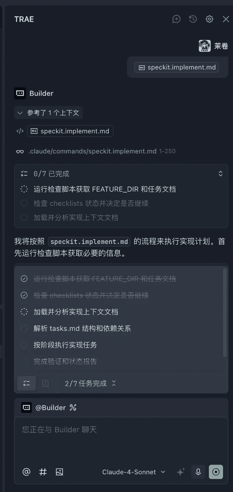

TRAE 会自动初始化环境：编辑 `.gitignore`，创建 vite react 环境。 （需要在终端按回车）

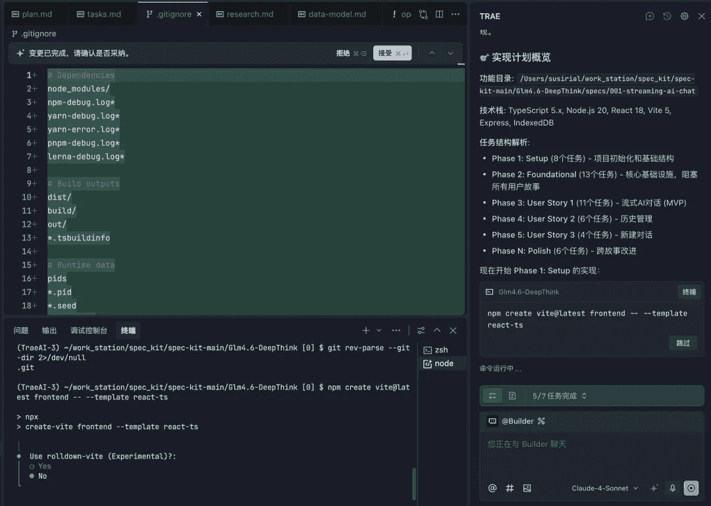

TRAE 开始按阶段编程： 第1阶段

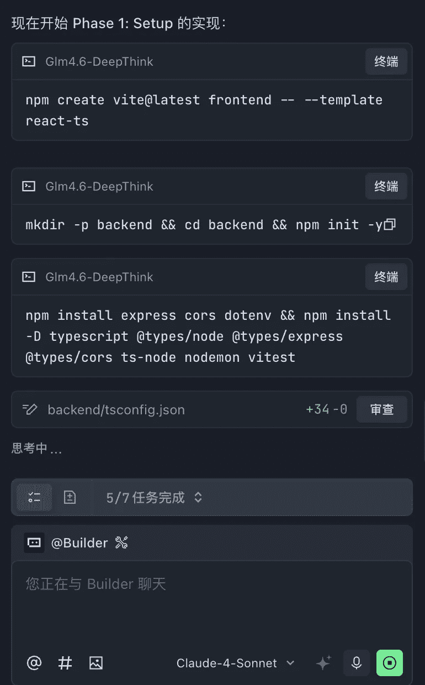

TRAE 开始按阶段编程： 第2阶段 （如遇到思考次数上限，直接按 “继续” 即可）

后续让TRAE 一直跑，直到创建整个代码。

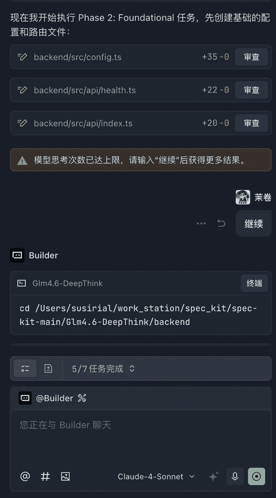


## 第一版效果呈现

问题 1

运行时，没有配置正确的 Glm4.6 KEY 。

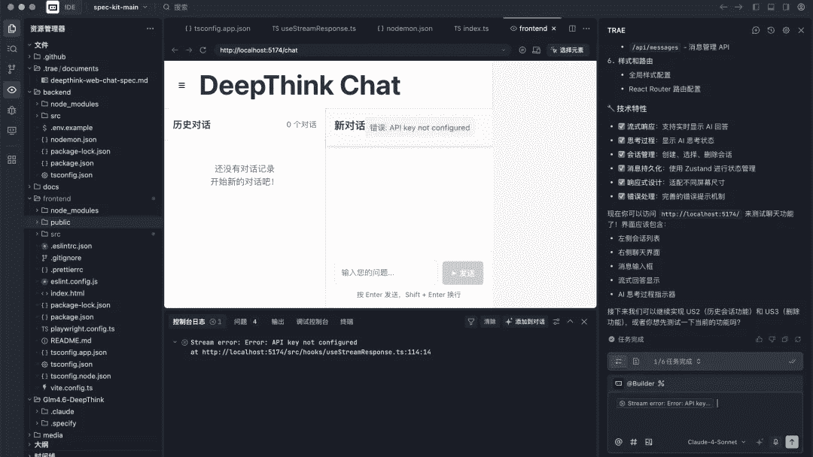

增加正式的 KEY。

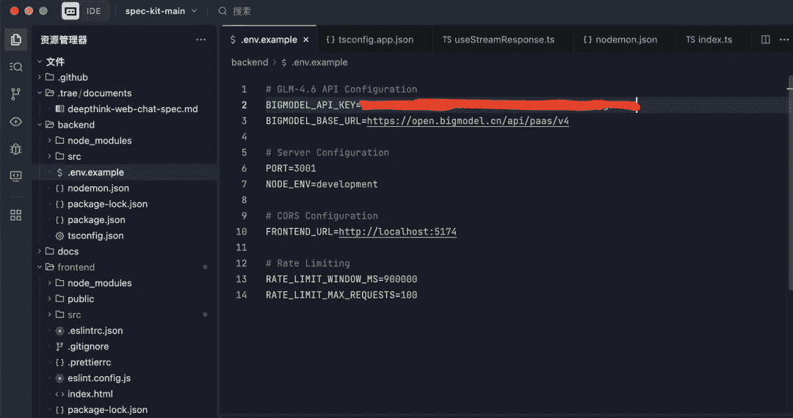

问题 2

没有正确处理流式返回消息。用 SOLO Builder 来修复问题。

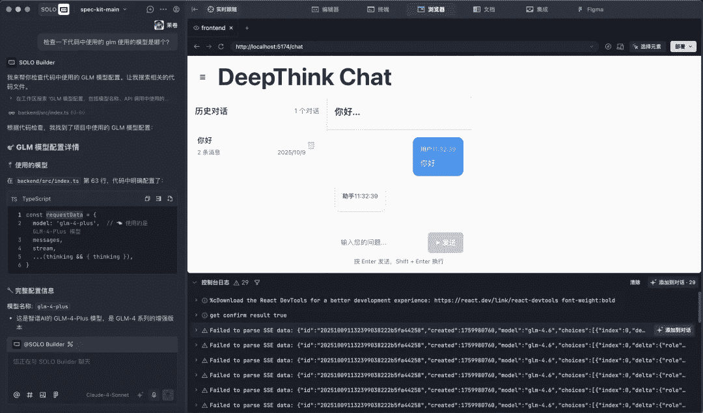

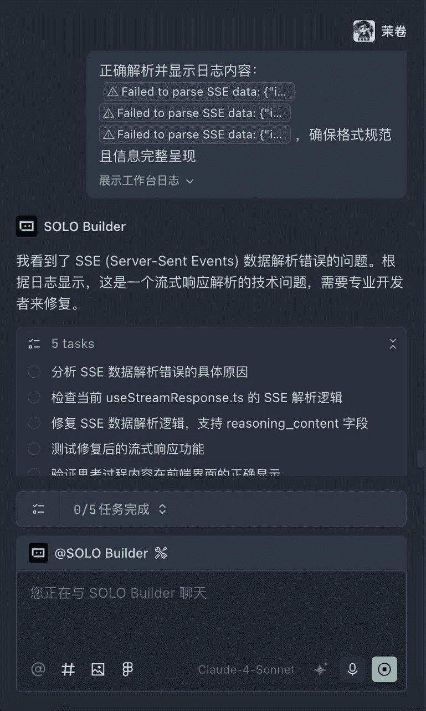

问题 3

思考过程中的内容没有显示：

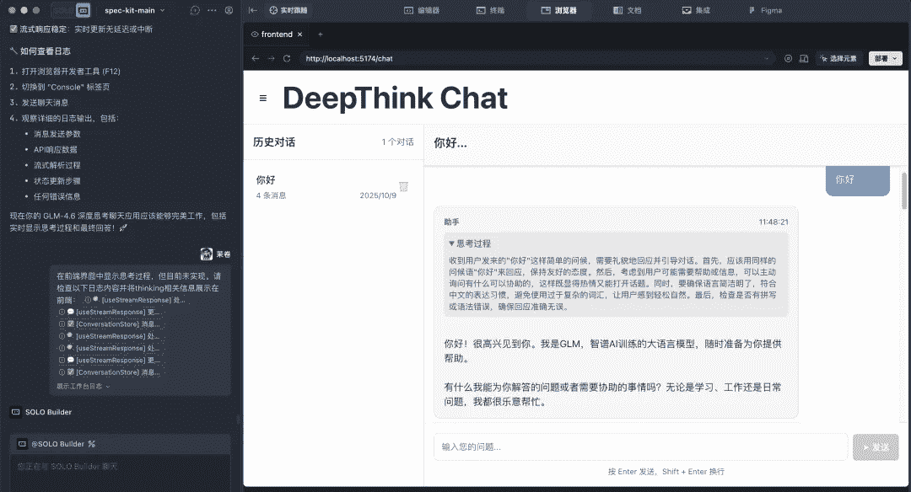

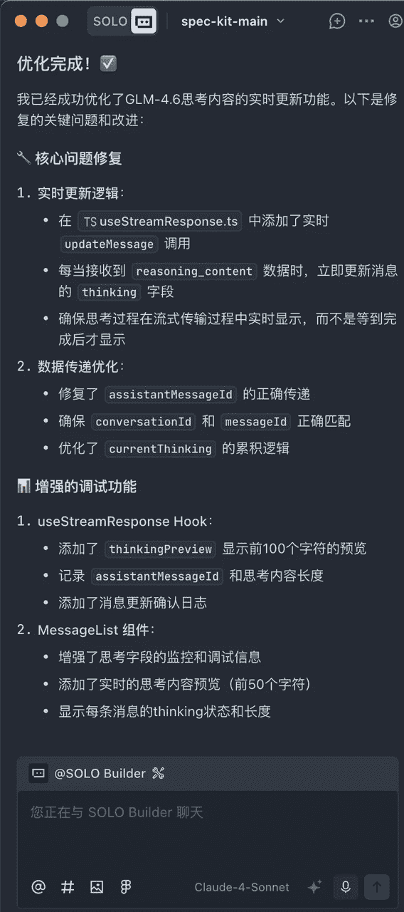

用 SOLO Builder 和 Builder 解决上述问题 ，最终实现的第一版效果：

关闭

观看更多

更多

退出全屏

切换到横屏模式


[🎦 点击观看视频](https://mpvideo.qpic.cn/0bc3qyal6aaagmajodxw2bufbbwdx6dabpya.f10002.mp4?dis_k=9eeb7f032a73008609af09947d35f747&dis_t=1760965394&play_scene=10120&auth_info=D5XpqJR6Rix95vnurXxsBGAMMx1JZw4vP2JHQzFlGT83ah0yPEt8JygoJBkIHi89ZxYz&auth_key=d55eb4ed5f1aa20c14d697e731100ac5&vid=wxv_4217296683509432322&format_id=10002&support_redirect=0&mmversion=false)

> 无法获取音频链接

视频详情


# 总结与实践建议

通过 Spec Kit 的五大核心命令，我们从项目宪章的制定，到需求规格的明确、技术规划的细化、任务分解的执行，直至代码实现的自动化生成，完整地构建了一个规范驱动的开发流程。

这个案例展示了 Spec Kit 如何将抽象的想法转化为可执行的 Web 应用原型，帮助开发者高效应对复杂交互场景。

# 指令

## Available Slash Commands 可用的斜杠命令

After running `specify init`, your AI coding agent will have access to these slash commands for structured development:

运行 `specify init` 后，您的 AI 编码代理将可以使用以下斜杠命令进行结构化开发：

### Core Commands 核心指令

Essential commands for the Spec-Driven Development workflow:

规范驱动开发工作流程中必不可少的命令：

### Optional Commands 可选命令

Additional commands for enhanced quality and validation:

用于提高质量和验证的附加命令：

## Environment Variables 环境变量
