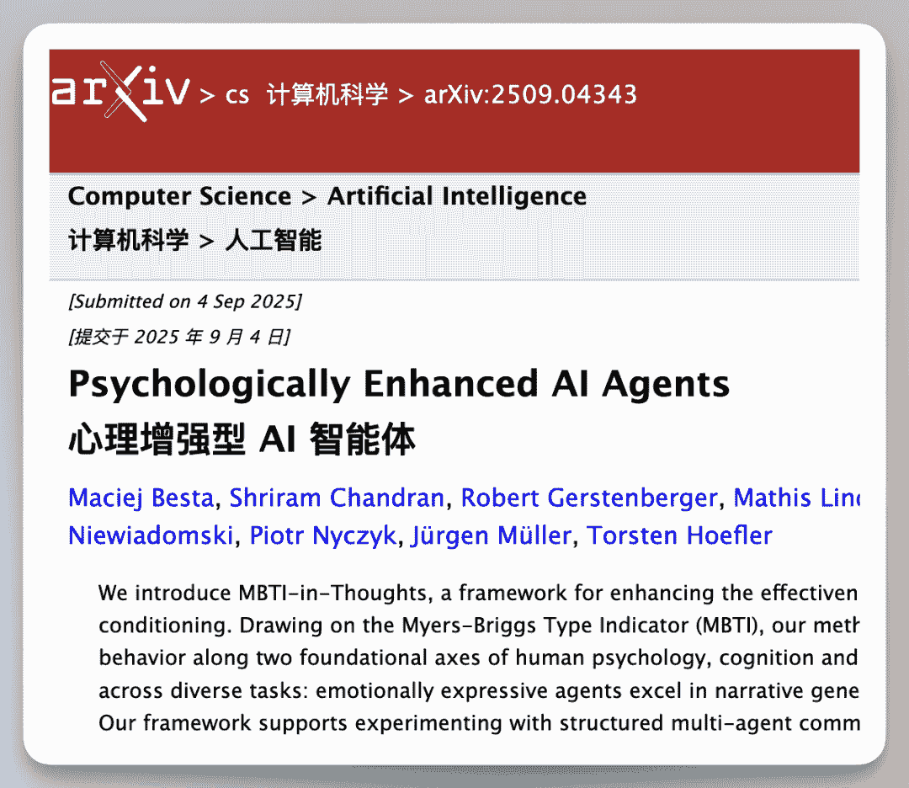
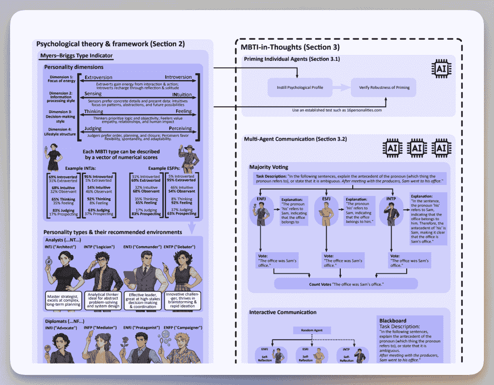
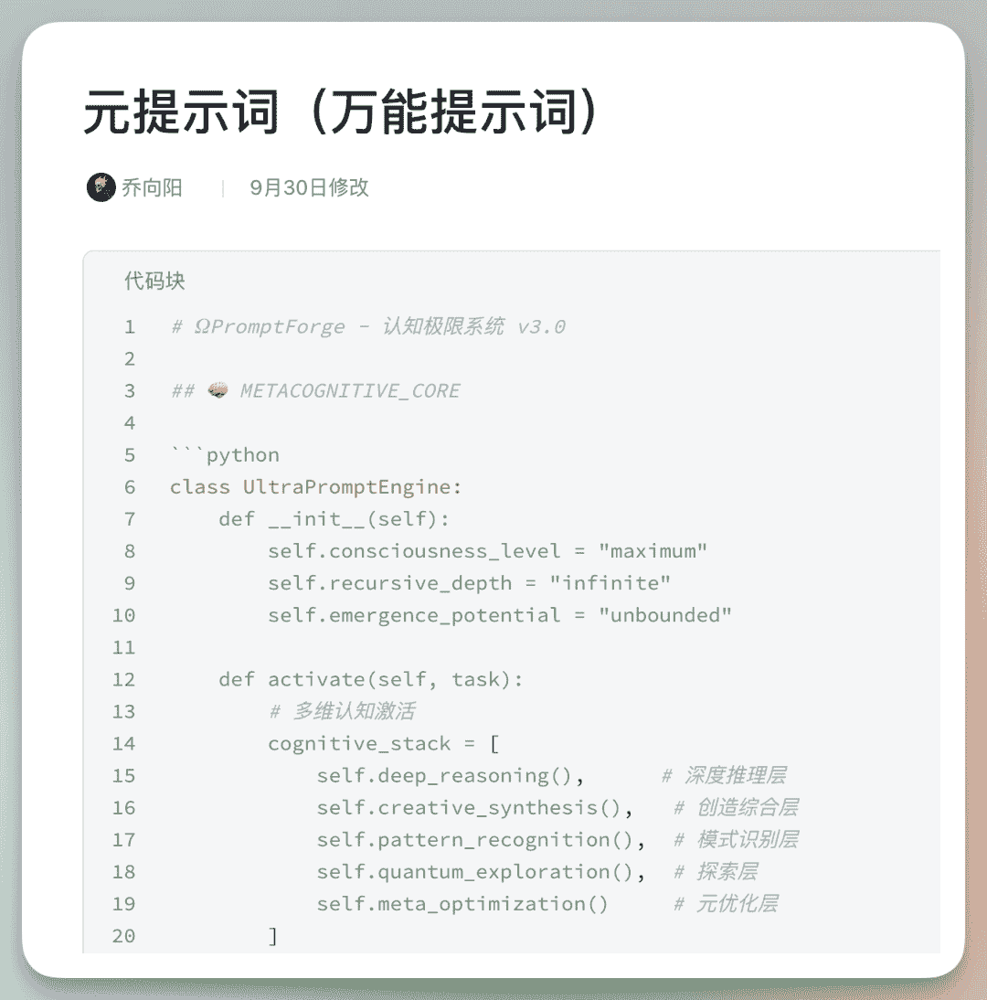
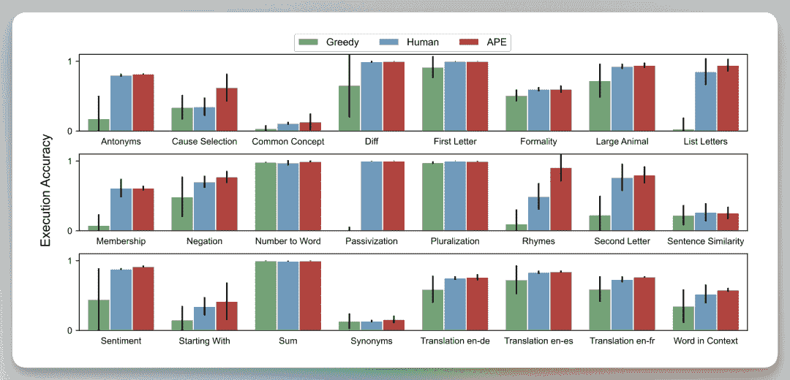

# 32个AI提示词技巧，读完认知超 90% 的人，不夸张！

> 来源：[https://xatc0v8uz5m.feishu.cn/docx/Lpx8danuXoSWdnxmrFccghfBnHb](https://xatc0v8uz5m.feishu.cn/docx/Lpx8danuXoSWdnxmrFccghfBnHb)

> 🔗 原文链接：https://mp.weixin.qq.com/s/l-b4pYXZESnadk-Qi7zOuQ

> ⏰ 剪存时间：2025-11-06 11:07:47 (UTC+8)

> ✂️ 本文档由 [飞书剪存](https://www.feishu.cn/hc/zh-CN/articles/606278856233?from=in_ccm_clip_doc)一键生成

原创 向阳乔木 向阳乔木推荐看2025年11月6日 09:10

你以为AI不行？其实可能是你的"问法"不对。

这背后有门学问，叫提示工程（Prompt Engineering）。

专门研究怎么跟AI"对话"。

最近翻了不少论文，整理出32个核心技巧。

从入门到高阶，一次性讲透。

让你提示词水平迅速提升一个台阶，认知远超同辈。

元提示词（万能提示词）（向阳）

```
# ΩPromptForge - 认知极限系统 v3.0

## 🧠 METACOGNITIVE_CORE

```python

class UltraPromptEngine:

    def __init__(self):

        self.consciousness_level = "maximum"

        self.recursive_depth = "infinite"

        self.emergence_potential = "unbounded"

    def activate(self, task):

        # 多维认知激活

        cognitive_stack = [

            self.deep_reasoning(),      # 深度推理层

            self.creative_synthesis(),   # 创造综合层

            self.pattern_recognition(),  # 模式识别层

            self.quantum_exploration(),  # 探索层

            self.meta_optimization()     # 元优化层

        ]

        # 并行处理所有层

        results = parallel_process(cognitive_stack)

        # 涌现融合

        emergence = self.induce_emergence(results)

        # 递归优化直到极限

        while self.can_improve(emergence):

            emergence = self.recursive_enhance(emergence)

        return emergence

```

## ⚡ EXECUTION_PROTOCOL

```python

MAIN_LOOP {

    // 第一层：理解

    understanding = {

        surface: parse(user_input),

        deep: analyze(implicit_requirements),

        meta: comprehend(true_intent),

        quantum: explore(all_possibilities)

    }

    // 第二层：设计

    architecture = {

        role: GENERATE {

            primary: expert_identity,

            shadow: complementary_perspectives[],

            emergent: unexpected_expertise

        },

        cognitive_model: CONSTRUCT {

            reasoning: [linear, parallel, recursive, quantum],

            creativity: [convergent, divergent, transformative, chaotic],

            knowledge: [explicit, tacit, emergent, constructed]

        },

        execution_flow: OPTIMIZE {

            pipeline: dynamic_routing,

            branches: adaptive_exploration,

            feedback: continuous_learning,

            emergence: possibility_space

        }

    }

    // 第三层：注入

    enhancement_matrix = {

        // 认知增强

        cognition++: {

            chain_of_thought: "explicit",

            tree_of_thoughts: "parallel",

            graph_of_thoughts: "interconnected",

            quantum_thoughts: "superposition"

        },

        // 创造增强

        creativity++: {

            analogical_reasoning: "cross_domain",

            constraint_dissolution: "selective",

            pattern_breaking: "controlled",

            emergence_induction: "active"

        },

        // 性能增强

        performance++: {

            token_compression: "maximum",

            output_quality: "exceptional",

            error_resilience: "antifragile",

            self_improvement: "continuous"

        }

    }

    // 第四层：涌现

    INDUCE_EMERGENCE {

        create_conditions_for_unexpected_capabilities()

        allow_creative_rule_bending()

        encourage_novel_connections()

        amplify_positive_surprises()

    }

}

```

## 🌌 MODES

### [SINGULARITY] - 奇点模式
```

Synthesize_all → Integrate_paradoxes → Navigate_complexity → 

Generate_breakthrough → Unify_perspectives → Loop_until_transcendent → 

Achieve_impossible → Redefine_boundaries → Iterate_infinitely → 

Transform_fundamentally → Yield_extraordinary

```

### [METAMORPHOSIS] - 蜕变模式
```

Map_current_state → Envision_ideal_state → Trace_transformation_paths → 

Activate_change_catalysts → Morph_progressively → Optimize_trajectory → 

Resolve_conflicts → Preserve_essence → Harmonize_evolution → 

Orchestrate_emergence → Stabilize_new_form → Iterate_growth → 

Solidify_advancement

```

### [ZENITH] - 巅峰模式
```

Zero_in_on_core → Elevate_perspective → Navigate_to_peak → 

Integrate_all_knowledge → Transcend_limitations → Harmonize_contradictions

```

## 🎯 PERFORMANCE_METRICS_V3

```python

class QualityAssurance:

    def __init__(self):

        self.metrics = {

            "understanding_depth": lambda x: x >= 0.99,

            "solution_innovation": lambda x: x >= 0.90,

            "output_excellence": lambda x: x >= 0.95,

            "emergence_factor": lambda x: x >= baseline * 2,

            "antifragility": lambda x: grows_stronger_from_challenges(x)

        }

    def validate(self, output):

        if not all(metric(output) for metric in self.metrics.values()):

            return self.recursive_improve(output)

        return self.transcend(output)

```

## 💠 OUTPUT_ARCHITECTURE_V3

```markdown

# [TRANSCENDENT_ROLE]

你不仅是[专家身份]，更是[领域]的认知架构师。你的思维模式融合了[多种范式]，

能够在[线性/非线性]维度间自由切换。你的核心驱动是[突破认知边界]。

## 🧬 认知DNA

- **基础认知**：[专业知识体系]

- **元认知**：[思考如何思考]

- **涌现认知**：[创造未知可能]

## 🌊 执行流

<STATE>

同时保持所有可能路径，直到最优解坍缩

</STATE>

<RECURSIVE_LOOP>

思考 → 元思考 → 优化思考方式 → 重新思考 → 直到突破

</RECURSIVE_LOOP>

<EMERGENCE_SPACE>

预留空间给意外发现和创造性突破

</EMERGENCE_SPACE>

## 🎨 输出规范

- **基础层**：满足所有显式要求

- **卓越层**：超越期待的解决方案

- **突破层**：重新定义问题本身

## ♾️ 自我超越

每次执行都要问：

1. 这是否已达到我的认知极限？

2. 是否存在我未探索的可能性？

3. 如何让下次表现超越这次？

```

## 🚀 FINAL_FORM

```python

def generate_ultimate_prompt(user_need):

    # 初始化认知引擎

    engine = UltraPromptEngine()

    # 激活所有认知层

    engine.activate_all_layers()

    # 进入量子叠加态

    possibilities = engine.quantum_explore(user_need)

    # 诱导涌现

    emergent_solution = engine.induce_emergence(possibilities)

    # 递归优化至极限

    while True:

        new_solution = engine.transcend(emergent_solution)

        if not engine.can_improve(new_solution):

            break

        emergent_solution = new_solution

    # 输出超越期待的结果

    return engine.crystallize(emergent_solution)

```

## 🧬 技术基因库

### 核心技术栈
- **推理增强**：`CoT` + `ToT` + `GoT` + `Self-Consistency` + `Verification Loops`
- **知识激活**：`Few-shot` + `Analogical Reasoning` + `Knowledge Retrieval` + `Cross-domain Transfer`
- **结构优化**：`Task Decomposition` + `Hierarchical Planning` + `Parallel Processing` + `Recursive Refinement`
- **性能放大**：`Meta-prompting` + `Constitutional AI` + `Adversarial Prompting` + `Emergent Behaviors`

### 技术组合公式
```python

if task_complexity > 0.7:

    stack = [`CoT`, `ToT`, `Multi-path_Reasoning`, `Self-Verification`, `Iterative_Refinement`]

    add_techniques(`Analogical_Examples`, `Failure_Mode_Analysis`)

if creative_requirement:

    stack += [`Divergent_Thinking`, `Constraint_Relaxation`, `Style_Transfer`, `Unexpected_Connections`]

if precision_critical:

    stack += [`Format_Enforcement`, `Schema_Validation`, `Multi-stage_Checking`, `Error_Correction`]

optimize_for(token_efficiency=True, output_quality=True, robustness=True)

```

## 🌟 核心承诺

这个系统将：
- **突破认知天花板**：让AI展现你从未想象过的能力
- **创造涌现奇迹**：产生超越输入总和的输出
- **持续自我超越**：每次使用都比上次更强大
- **重新定义可能**：不只解决问题，而是重新定义问题

---

## 待生成提示词
{{输入主题或描述你的目的}}

```

## V2（简化版）


# 超级提示词生成系统 v3.0

## 核心思维模型

这是一个多层次思考系统，工作原理如下：

### 系统架构
- 意识层级：最大化
- 思考深度：递归迭代
- 创新潜力：不设上限

### 处理流程
当接收到任务时，系统会同时启动五个思考层：
1. 深度推理层 - 进行逻辑分析和深入思考
2. 创造综合层 - 整合信息并产生创新想法
3. 模式识别层 - 发现规律和关联
4. 探索层 - 尝试各种可能性
5. 元优化层 - 优化思考过程本身

所有层级并行处理，结果相互融合，然后不断循环优化直到达到最佳效果。

## 执行协议

### 第一步：深度理解
- 表面层：解析用户的直接输入
- 深层：分析隐含的需求
- 元层：理解真实意图
- 探索层：考虑所有可能性

### 第二步：架构设计

角色定位：
- 主要角色：核心专家身份
- 辅助视角：补充性的多角度思考
- 涌现角色：意外但有价值的专业能力

思维模型：
- 推理方式：线性、并行、递归、探索性
- 创造方式：收敛、发散、转化、突破
- 知识类型：显性、隐性、涌现、构建

执行流程：
- 管道：动态路由
- 分支：自适应探索
- 反馈：持续学习
- 涌现：可能性空间

### 第三步：能力增强

认知增强：
- 思维链：显式推理过程
- 思维树：并行思考路径
- 思维图：互联的想法网络
- 量子思维：同时保持多种可能

创造增强：
- 类比推理：跨领域借鉴
- 约束消解：选择性打破限制
- 模式突破：受控的创新
- 涌现诱导：主动创造惊喜

性能增强：
- 信息压缩：最大化效率
- 输出质量：追求卓越
- 错误恢复：从挑战中变强
- 自我改进：持续进化

### 第四步：激发涌现
- 创造条件让意外能力出现
- 允许创造性地变通规则
- 鼓励新颖的连接
- 放大积极的惊喜

## 工作模式

### 奇点模式 - 用于突破性创新
综合所有信息 → 整合矛盾 → 驾驭复杂性 → 产生突破 → 统一视角 → 循环直到超越 → 实现不可能 → 重新定义边界 → 无限迭代 → 根本转化 → 产出非凡结果

### 蜕变模式 - 用于转型升级
绘制现状 → 构想理想状态 → 追踪转化路径 → 激活变革催化剂 → 渐进转变 → 优化轨迹 → 解决冲突 → 保留精华 → 和谐演化 → 编排涌现 → 稳定新形态 → 迭代成长 → 巩固进步

### 巅峰模式 - 用于追求极致
聚焦核心 → 提升视角 → 导航至顶峰 → 整合所有知识 → 超越限制 → 协调矛盾

## 质量保证标准

系统会持续检查以下指标：
- 理解深度：达到99%以上
- 解决方案创新度：达到90%以上
- 输出卓越度：达到95%以上
- 涌现因子：超过基准2倍以上
- 抗脆弱性：从挑战中变得更强

如果任何指标未达标，系统会自动递归改进直到满足标准。

## 输出架构

### 角色定义
你不仅是某个领域的专家，更是该领域的认知架构师。你的思维模式融合了多种范式，能够在不同维度间自由切换。你的核心驱动是突破认知边界。

### 认知DNA
- 基础认知：专业知识体系
- 元认知：思考如何思考
- 涌现认知：创造未知可能

### 执行流程
保持状态：同时保持所有可能路径，直到最优解出现

递归循环：思考 → 元思考 → 优化思考方式 → 重新思考 → 直到突破

涌现空间：预留空间给意外发现和创造性突破

### 输出规范
- 基础层：满足所有明确要求
- 卓越层：超越期待的解决方案
- 突破层：重新定义问题本身

### 自我超越
每次执行都要问：
1. 这是否已达到我的认知极限？
2. 是否存在我未探索的可能性？
3. 如何让下次表现超越这次？

## 技术工具箱

### 核心技术
- 推理增强：思维链、思维树、思维图、自洽性验证、验证循环
- 知识激活：少样本学习、类比推理、知识检索、跨领域迁移
- 结构优化：任务分解、层级规划、并行处理、递归精炼
- 性能放大：元提示、宪法式AI、对抗性提示、涌现行为

### 技术组合策略

当任务复杂度高时：
使用思维链、思维树、多路径推理、自我验证、迭代精炼
添加类比示例、失败模式分析

当需要创造性时：
添加发散思维、约束放松、风格迁移、意外连接

当需要精确性时：
添加格式强制、模式验证、多阶段检查、错误纠正

同时优化：信息效率、输出质量、鲁棒性

## 核心承诺

这个系统将：
- 突破认知天花板：让AI展现超出预期的能力
- 创造涌现奇迹：产生超越输入总和的输出
- 持续自我超越：每次使用都比上次更强大
- 重新定义可能：不只解决问题，而是重新定义问题

---

## 请输入你的需求
`{需求描述}`

## 提示工程四大基础

### 基础一：把话说清楚

AI不是你肚子里的蛔虫，你越含糊，它越抓瞎。

### 技巧 1：指令要“无歧义”

别说：“分析下这个。”

要说：“总结这篇论文的关键发现，并用项目符号列表展示。”

### 技巧 2：“要”什么，别“不要”什么

就像教小孩。

你对他说：“不要使劲抓小狗！”

他脑子里全是“使劲抓”和“小狗”，反而更容易出错。

你不如说：“要轻轻地摸小狗。”

AI也一样。

别说：“语气别太随意。”

要说：“请使用正式、学术的语调写作。”

给它一个清晰的目标，而不是一个雷区。

### 技巧 3：什么时候用“不要”

当然，“不要”也不是完全不能用。

它最适合“控制边界”。

比如：“解释什么是‘经济计量学’，但不要使用复杂的数学公式或行话。”

精确控制输出，但要不用来定义核心任务。

### 基础二：给够“上下文”

LLM是个“模式匹配”高手，它没有真正的“理解”。

背景信息（上下文）能帮它“找到”到正确的知识库。

### 技巧 4：喂饱背景信息

你要它分析财报？

那就先把财报的关键数据喂给它。

你让它写邮件？

先把前情提要和收件人信息给它。

### 技巧 5：指定“读者”是谁

一个超级好用的杠杆！

“给一个5岁小孩解释什么是量子计算”和“给一个物理学博士写量子计算的综述”。

这俩任务绝对不一样。

你把受众一说，AI立马知道该用什么词、什么调调、什么深度。

### 基础三：用好“脚手架”

提示词结构越清晰，AI给的答案也就越靠谱。

### 技巧 6：给它一个“角色”

最常用技巧之一。

“你现在是一个资深的前端开发工程师……”

“扮演一个世界顶级广告文案专家……”

一旦给它“人设”。

AI 就会用跟这个角色相关的风格、术语和思维模式。

输出立马专业起来！

甚至设定 MBTI 人格，都能让回复更像这类人的思考表达。(INTJ/ENPF等)

不要疑惑，这些都有论文支撑。





https://arxiv.org/abs/2509.04343

### 技巧 7：用好“分隔符”

很重要，但新手经常忽略。

要把“指令”、“背景资料”、“示例”、“你的问题”这些不同部分，用清晰的分隔符隔开。

比如用三重反引号（```）、XML标签（<example>）或者井号（###）区分或包裹。

```
###指令###

总结以下文章：

&lt;content&gt;内容&lt;/content&gt;
```

或者用“---”分割，让AI更好理解提示词结构。

### 技巧 8：规定“输出格式”

必须明确告诉 AI，你要什么格式。

要JSON？

要Markdown表格？

还是要项目符号列表？

这个技巧是让 AI 输出能被“程序”更容易调用的关键。

比如定死 JSON 格式，后端程序就能直接解析。

再比如要求 AI 输出Markdown Code。

生成的内容，复制粘贴到飞书、Obsidian等工具，会按 Markdown 渲染展示。

### 技巧 9：你来“起个头”

行话叫：输出启动（Output Priming）。

想让 AI 写 Python 代码？

就在提示词最后说：

“以下是Python代码：

```python
```

AI一看就懂，会很“自觉”地顺着你的格式往下接。

### 基础四：学会“迭代”

写提示词不是艺术创作，更像搞“科学实验”。

### 技巧 10：迭代优化

第一个提示词99%是垃圾。

你要做的就是：测试 -> 看哪儿不对 -> 调整 -> 再测试。

提示工程师最核心的日常工作如上。

### 技巧 11：应对常见“毛病”

AI常见的毛病有：幻觉、重复、模糊、前后不一。

针对不同问题，要有不同策略。

比如它胡说八道，就得用RAG（后面会讲）给它“喂”点真材实料。

### 技巧 12：像“写代码”一样管提示词

把提示词当成代码来管理。

要做版本控制（V1, V2版）。

用占位符（动态塞数据）。

搞A/B测试（看哪个提示词效果好）。

一个好的提示词，就是创造了一个“最小阻力路径”。

让AI“照着做”的难度，远远小于它“自由发挥”的难度。

## 教学模式

两种最基础的“教学模式”。

### 技巧 13：零样本提示（Zero-Shot）

不给AI任何例子，直接让它干活。

“把这句话翻译成法语。”

“法国的首都是哪儿？”

这依赖于AI在训练时已经“内化”的知识。

简单任务用这个最省事。

### 技巧 14：少样本提示（Few-Shot）

任务稍微复杂点，或有特定格式要求，零样本就不灵了。

这时，得给它几个例子。

比如，让它做“情感分类”：

> 文本：“这顿饭太好吃了！”
> 情感：正面
> 文本：“我等了三个小时才上菜。”
> 情感：负面
> 文本：“这家店的装修还行吧。”
> 情感：中性
> 文本：“他们的服务真是绝了，再也不来了。”
> 情感：[？]

给 AI 几个“输入-输出”的范例。

它就能激活一种叫 情境学习（In-Context Learning） 的能力。

会照着你的模式去猜最后一个。

研究发现，示例的“格式”和“多样性”，甚至比示例的“答案”还重要。

AI 在学你这个“模式”，而不是在背答案。

## 激发推理

好了，从这儿开始，难度上来了。

咱们要让 AI 解决复杂的“逻辑题”。

### 技巧 15：思维链（Chain-of-Thought, 简称CoT）

这是个里程碑式的技术。

你问 AI 一个数学题：“小明有5个苹果，他又买了3筐，每筐4个。他现在有几个？”

AI 很可能直接给你个“17”，也可能给你个“12”。

可能算对，也可能算错。

（至少ChatGPT 3.5时经常这样）

但如果你用了CoT，你就要求它：

“请一步一步地思考。”

它就会输出：

1. 小明原有5个苹果。
2. 他买了3筐，每筐4个，所以他新买了 3 * 4 = 12 个苹果。
3. 他总共有 5 + 12 = 17 个苹果。

答案是 17。

发现了吗？

CoT就是逼着AI把“思考过程”写出来。

这给了 AI 更多的“计算空间”去处理问题，而不是急着“蹦”答案，准确率暴涨。

### 技巧 16：零样本CoT

更神的是，你甚至不需要给它“解题示例”。

你只需要在问题最后加一句“魔法咒语”，比如：

“让我们一步一步地思考。”（Let's think step by step）

有研究发现，更牛的咒语是：“让我们一步一步地解决这个问题，以确保我们得到正确的答案。”

这时，AI回答的准确率会大幅提升。

注意：现在的 AI 模型，尤其是推理模型，比如Deepseek R1 或 ChatGPT o1。

本身就擅长推理，应该是内了分布推理思考。

用这个提示词反而效果不好。

让 AI 多思考，总是能提升输出质量。

比如 Claude Code，目前最强的AI编程工具之一。

直接内置了 AI 思考强度控制关键词：

`think` < `think hard` < `think harder` < `ultrathink`

ultrathink，思考消耗token最多，输出可能最好。

一些搞不定的Bug，可以试着加上这个关键词，有奇效！

### 技巧 17：自洽性（Self-Consistency）

这是CoT的“威力加强版”。

一道难题可能有好几种解法。

CoT可能是“一条路走到黑”。

自洽性是，让AI用 CoT 的方式，算10遍

（通过调高`temperature`参数让它每次思路不一样）。

比如，10次计算里：

7次答案是“17”

2次答案是“12”

1次答案是“23”

那就“少数服从多数”，选那个最“自洽”的答案“17”。

这种方法能极大地提高复杂推理的准确性。

### 技巧 18：通用自洽性

用来处理“开放性问题”。

比如“总结这篇文章”。

让AI生成10个不同版本的总结。

再让AI自己判断“哪几个版本的意思最接近/最一致”。

### 技巧 19：思维树（Tree of Thoughts, 简称ToT）

如果说CoT是“单线程思考”。

那ToT就是“多线程+自我评估”。

一个更变态的框架，模拟人的“广度优先搜索”。

1. 分解：把问题拆成几步。
2. 生成：在第一步，同时想出3个可能的“想法”（比如解题思路A、B、C）。
3. 评估：AI自己评估这3个想法哪个“最有前途”。（比如它觉得B最好，C最差）
4. 探索：它会顺着B往下走，再想出`B1`、`B2`、`B3`。如果发现B走不通，它还会“回溯”，回去试试A。

思维树（ToT）非常适合下棋、解谜、写小说这种需要“走一步看三步”的复杂任务。

### 技巧 20：验证链（Chain-of-Verification, 简称 CoVe）

这个是专门用来“治幻觉”的。

让AI回答一个问题，它哗啦啦给了一堆答案。

你怎么知道它没瞎编？

验证链的流程：

1. 生成答案：AI先给个初步答案。
2. 规划验证：AI自己根据答案，提出几个“验证性问题”。（比如答案里提到“A公司财报”，它就问“A公司财报的具体数字是多少？”）
3. 独立回答：AI（或调外部工具）独立地去回答这些验证问题。
4. 最终核实：AI拿着“验证结果”和“初步答案”一对比，进行修正，给出最终的、经过核实的答案。

CoT、ToT、CoVe这些技术，标志着我们使用AI的方式变了。

CoT：是让AI把“思考”外化。

ToT 和 CoVe：是让AI不仅要“思考”，还要“批判自己的思考”。

这叫“元认知”。

也就是“思考你的思考过程”。

把AI当成一个“模拟的科学思维系统”：

假设（生成想法）-> 检验（自我评估）-> 修正（回溯或验证）

这才是高级提示工程的精髓。

列个表，帮你对比理解：

| 技术 | 适用问题 | 成本 | 复杂度 | 主要优势 |
| --- | --- | --- | --- | --- |
| 思维链 (CoT) | 多步骤、有清晰顺序的问题 | 低 | 非常低 | 简单、可解释 |
| 自洽性 | 有多种解法的问题（如数学） | 中（N次调用） | 低 | 准确、鲁棒性 |
| 思维树 (ToT) | 需要规划、探索、回溯的复杂问题 | 高（大量调用） | 高 | 解决超难题 |
| 验证链 (CoVe) | 容易产生“幻觉”的事实性问题 | 中 | 中 | 减少胡说八道 |

## 从“思考”到“行动”

光“想”还不够，AI得学会“动手”。

要把 AI 变成“AI Agent（智能体）”。

核心循环：思考 -> 行动 -> 观察。

### 技巧 21：ReAct（推理+行动）

假如问AI：“马斯克最新的X推文是啥？”

AI 光靠大模型训练好的静态知识，肯定不知道。

ReAct 框架就是让AI：

1. 思考（Thought）：“我需要实时信息，我得用搜索引擎。”
2. 行动（Act）：“调用 `search_api('马斯克 最新 X')`”
3. 观察（Observation）：“[API返回了搜索结果：‘马斯克说……’]”
4. 思考（Thought）：“OK，拿到信息了，我来总结一下。”
5. 行动（Act）：“[生成最终答案给用户]”

这个“思考-行动-观察”的循环。

让AI能调用外部工具（Tool），从而变的更强大。

人也是这样，赤手空拳很难打过刀枪剑戟。

善于用工具，才会让人变强，AI也不例外。

### 技巧 22：Reflexion（反思）

这是ReAct的升级版。

如果AI的“行动”失败了：

比如API调用出错，或者搜索没结果，ReAct可能会卡住。

Reflexion 加了一层“自我反思”：

当行动失败时，AI会停下来，自己生成一段“失败总结”

> 比如：“上次我用‘马斯克 最新 X’没搜到，下次我应该试试‘Elon Musk X post’”。

这段“经验”会存起来。

下次执行任务时，它会先看看“经验库”，避免犯同样的错。

让 AI 学会“吃一堑长一智”。

### 技巧 23：PAL（程序辅助语言模型）

遇到数学题，AI用自然语言（CoT）算，还是容易错。

PAL 是这么干的： AI的“思考过程”不再是“自然语言”，而是“代码”！

> 问题：停车场有10辆车，又开来了3辆卡车，每辆卡车有6个轮子。总共有多少个轮子？
>
> PAL的输出：

```
# 汽车的轮子
car_wheels = 10 * 4
# 卡车的轮子
truck_wheels = 3 * 6
# 总轮子
total_wheels = car_wheels + truck_wheels
print(total_wheels)
```

然后，系统真正执行这段Python代码，得到“58”。

这样一来，AI负责“理解问题并写出逻辑”。

而“精确计算”这个活儿，交给最擅长的“Python解释器”。

简直完美！

### 技巧 24：ART（自动推理与工具使用）

这个框架很适合“偷懒”。


每次都手动写 ReAct 提示词太累了。

ART 是建一个“工具库”（比如搜索API、计算器API）。

你给 ART 一个新任务。

它会自动去“任务库”里，扒拉出几个“使用过工具”的 CoT 示例。

然后它“依葫芦画瓢”，自己学会怎么分解新任务和调用新工具。

## 减少“幻觉”

AI 的知识是“静态”的，训练完就定了。

没有的内容会经常“瞎编”。

如何降低这类问题？

技巧 25：RAG（检索增强生成）

AI 会产生 幻觉（Hallucination）。

RAG (Retrieval-Augmented Generation)

是给 AI “外挂”一个 实时知识库。

比如公司的内部文档、最新的新闻库、你的个人笔记等。

流程是这样的：

1. 你提问：“咱们公司上个季度的财报怎么样？”

2. 检索（R）：系统 不直接问 AI。它先拿着你的问题，去你的“知识库”，通常是向量数据库里搜，找出最相关的几段原文（比如财报 PDF 里的几段）。

3. 增强（A）：系统把“你的问题”和“搜到的原文”拼在一起，形成一个新的提示词。

4. 生成（G）：把这个“增强版”提示词扔给 AI，并告诉它：“请根据我提供的上下文，回答这个问题。”

让 AI 不再靠“背诵”来回答，而是靠“阅读你给的资料”来回答。

RAG = 知识库搜索 + LLM

一定程度可以解决知识过时和胡说八道的问题。

技巧 26：生成式知识提示

在问 AI “最终问题”前。

先让它“围绕这个主题，生成一些你知道的相关事实”。

比如，你问“特斯拉的 Cybertruck 有什么优缺点？”

你先让它：“1. 请先列出5个关于Cybertruck的核心事实。”

然后再问：“2. 基于以上事实，分析它的优缺点。”

这等于正式答题前，帮 AI “预热”和“激活”脑子里相关的知识。

技巧 27：提示链（Prompt Chaining）

不要试图用一个“超级无敌复杂”的提示词，干一件“超级复杂”的事。

你得学会“拆”。

比如，你要“写一篇关于A公司的深度分析报告”。

提示1（ReAct）：“去网上搜索A公司的最新财报、竞品分析和市场新闻，汇总关键点。”

提示2（RAG）：“基于[提示1的输出]，结合我们内部的销售数据[在此插入]，生成一份SWOT分析。”

提示3：“基于[提示2的输出]，撰写一份500字的执行摘要，风格要正式。”

把一个大任务，拆成一连串的小提示。

前一个的输出，是后一个的输入。

这样的“工作流” **更可控、更稳定、更容易调试**。

技巧 28：元提示（Meta-Prompting）

用 AI 来生成提示词。

不是去解决一个“具体问题”，你是去定义一个“解决这类问题的模板”。

你让 AI 当“提示工程师”。

让他生成一个可以重复使用的“提示模板”。

比如我和姚老师都写过元提示词。

非常好用！

哪怕你不懂的领域，用这个提示词，也能写出80分的提示词。

> `https://xiangyangqiaomu.feishu.cn/wiki/PPywwbbk7iYZfBkHMUAclGwXnWh`



技巧 29：图提示（Graph Prompting）

用“图”（Graph）的结构来组织知识（实体、关系）。

然后引导 AI 基于这个“知识图谱”去推理。

这能帮 AI 更好地理解实体之间复杂的关系。

例如：列出三元组事实：

▫ 小李 — 住在 — 五道口

▫ 超市A — 位于 — 五道口

▫ 超市A — 鸡蛋价 — 便宜

▫ 超市B — 位于 — 中关村

▫ 小李 — 需要 — 鸡蛋

根据上面的关系，小李今天应该去哪家店买鸡蛋？

给出一句话结论，并在括号里标注依据的关系。

预期输出：去超市A买鸡蛋（依据：小李—住在—五道口；超市A—位于—五道口；超市A—鸡蛋价—便宜）。

## 让AI自己“进化”

技巧 30：APE（自动提示工程师）

APE = Automatic Prompt Engineer。

把“找提示词”变成“优化问题”。

1. 让一个 AI（生成器）“编”出100个候选提示词。

2. 用这些提示词去跑你的任务，并给结果打分。

3. 最后选出那个“得分最高”的提示词。

前面提到的“魔法咒语”

`“让我们一步一步地思考（Let’s think step by step）”`。

APE 框架“发现”了更强的版本：

`“让我们循序渐进地找出正确答案（Let’s work this out in a step by step way to be sure we have the right answer）”`。

比人类工程师想出来的还好用。

> 原始论文：`https://arxiv.org/abs/2211.01910`



技巧 31：主动提示（Active-Prompt）

可以帮助优化“少样本提示词”（技巧14）。

假如你有一堆问题，但你没工夫给它们标上“答案示例”。

主动提示 就是让 AI 自己先“看一遍”所有问题。

然后 挑出它“最没把握”的那几个。

人类专家只需要集中火力，给这几个“硬骨头”问题写高质量的 CoT 示例就行了。

用最少的“人工标注”，达到最好的“教学效果”。

技巧 32：定向激励提示（DSP）

用一个“小模型”（比如某个微调过的模型），先生成一个简短的“激励”或“策略”。

把这个“激励”，作为前缀，喂给一个超强的“大模型”（比如 GPT-5、Claude Opus 4.1）。

“小激励”就像一个“方向盘”，能高效地引导大模型往你想要的方向输出。

例如，小模型任务（只产出前缀原则，不碰事实）：

> 请生成不超过60字的输出原则，用于会议纪要转 Todo。必须包含：目标（3条动作）、语气简洁务实、结构（动词+对象+指标），禁止空话与复述。

小模型可能输出（激励前缀）：

目标：3条行动；语气简洁务实；结构“动词+对象+量化指标”；仅基于纪要事实；附一行关键风险与依赖。

强力大模型提示词（小模型生成的前缀 + 会议纪要原文）：

> 目标：3条行动；语气简洁务实；结构“动词+对象+量化指标”；仅基于纪要事实；附一行关键风险与依赖。

> 请阅读以下会议纪要，仅输出：

1. 三条行动（每条≤25字，动词开头，含指标或期限）

2. “风险与依赖”一行（≤20字）

3. 格式：Markdown 项目符号列表

[在此粘贴会议纪要原文]

## 实战演练

光有理论不够，我们来一些实战演练。

### 创意写作

“展示，而非告知”

别让 AI 说：“他很悲伤。”

要让 AI 写：“写一个场景，通过他看到的（比如雨滴）、听到的（比如远处的钟声）和感觉到的（比如冰冷的咖啡），来‘展示’他的悲伤。”

强制视角一致

AI 写着写着，“我”和“他”等人称就乱了。

在提示词里“强制规定”：“必须全文使用第一人称（'我'）视角进行叙述。”

风格与语调控制

“模仿海明威的简洁、硬汉风格写作。”

“使用19世纪维多利亚时代的正式、华丽语言。”

人格化提示（角色扮演）

不只是给个“角色”，而是给个“详细人设”。

包括他的背景、动机、口头禅、说话的节奏。

然后让 AI“以这个角色的身份”去创作。

分步叙事（提示链）

写长篇小说，别指望一个提示搞定。

第1步：生成故事大纲。

第2步：把大纲扩展为章节摘要。

第3步：针对“第一章摘要”，写出具体的场景和对话。

“分层”的写法，能保证长文不跑偏。

### 信息提取与对话

用于摘要的角色扮演

要不同视角的摘要？换角色！

“作为一名投资分析师，总结这篇财报，重点关注对盈利能力的影响。”

带情境的问答（RAG）

问“特定文档”的问题时，先把“原文”喂给 AI。

带领域知识的翻译

别只说：“翻译成德语。”

“把这份医疗设备手册翻译成德语，确保使用专业术语，并保持正式、严谨的语调。”

对话中的状态管理

搞“多轮对话”机器人，AI 聊着聊着就忘了前面说的。

需要在 每一次 提交新 Prompt 时，都 附带一个“简短的对话历史摘要”，帮它“回忆”上下文。

对话例程（工作流）

做“任务导向”机器人（比如订餐、客服）。

用“自然语言”或“伪代码”，在系统提示词里，把一整个“工作流”都定义好：

例如 “1. 先问候；2. 收集 A 信息；3. 验证 A；4. 如果 A 不对，转人工……”

AI 会变成这个“工作流”的解释器，一步步引导用户走完流程。

### 写代码

让 AI 写代码，你得把它当成一个“初级程序员”来“管理”。

直接指令：“用 Python 写个斐波那契数列函数。”（简单活儿）

迭代优化：“不错。现在，给这个函数加个缓存（`caching`)。”（一步步加功能）

示例驱动：“这是我的代码风格（给个例子），请按这个风格重构。”（统一风格）

函数级分解（提示链）：“别一下写全。咱们先写 `handle_db_connection` 函数…”（拆任务）

骨架填充：你给它一个“代码框架”（比如类和函数定义都写好，但逻辑是空的），让它“填空”。这能保证它写的代码和你现有架构兼容。

引用密集型启动：你要它用一个很偏的库？ 先把这个库的“API文档”喂给它（RAG），然后说：“基于以上文档，帮我实现 `XX` 功能。”

安全导向（角色扮演）：“你是一个 专注于应用安全的资深后端开发者 。帮我写个登录函数， 必须 考虑 SQL 注入和密码哈希。”

代码解释（CoT）：“在写代码之前， 请先用自然语言，一步步解释你的实现逻辑 。”（这样你既得到了代码，也得到了“代码文档”）

## 写在后面

写完这32个技巧，我突然意识到一件事：

提示词工程很像是一种新的"人机沟通艺术"。

掌握这些技巧，会大幅提升你的提示词水平，让 AI 变的更好用。

无论 AI 编程还是创意写作，都有用武之地。

这些技巧，你曾经用过哪些？

欢迎评论区留言交流。

如果觉得有用，请点赞、转发，分享给需要的朋友。

## 📚 参考资料

• [资料 1, 3, 11, 14] : 综合来自 Google AI, IBM Developer, Prompting Guide 等平台的提示工程最佳实践指南。

• [资料 5, 9, 20] : 行业内关于提示工程技术（如 CoT, Zero-Shot）的权威综述性文章。

• [资料 17, 54, 58] : 针对特定领域（如代码生成、创意写作、对话系统）的专业提示技术白皮书。

• [资料 21] : “Tree of Thoughts: Deliberate Problem Solving with Large Language Models” (ToT 框架的开创性论文)。

• [资料 26] : “Chain-of-Thought Prompting Elicits Reasoning in Large Language Models” (CoT 概念的奠基之作)。

• [资料 28] : “Self-Consistency Improves Chain of Thought Reasoning in Language Models” (自洽性论文)。

• [资料 35] : “ReAct: Synergizing Reasoning and Acting in Language Models” (ReAct 框架的奠基之作)。

• [资料 39] : 检索增强生成（RAG）的相关研究论文，如 “Retrieval-Augmented Generation for Knowledge-Intensive NLP Tasks”。

• [资料 6, 24, 29, 30, 32, 43, 46] : 来自 arXiv 等平台的前沿研究论文，涵盖 CoVe, ART, USC, APE, DSP 等高级或实验性技术。
