# 建筑+Nano Banana，超多提示词分享

> 来源：[https://xatc0v8uz5m.feishu.cn/docx/Ma39dxQXYozM8mxOuapc6hhwnve](https://xatc0v8uz5m.feishu.cn/docx/Ma39dxQXYozM8mxOuapc6hhwnve)

> 🔗 原文链接： h[ttps://mp.weixin.q](https://mp.weixin.qq.com/s/QLHipm-0juawS5vGwfGrYA)q.com/s/QLHipm-0...

> ⏰ 剪存时间：2025-11-18 22:00:17 (UTC+8)

> ✂️ 本文档由 [飞书剪存 ](https://www.feishu.cn/hc/zh-CN/articles/606278856233?from=in_ccm_clip_doc)一键生成

原创 小角落 角落工作室2025年11月11日 18:10

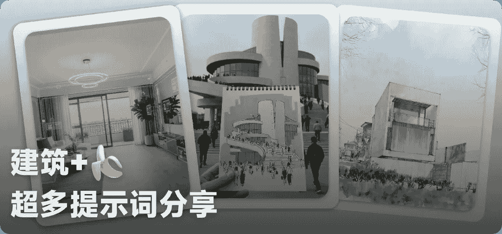

作为建筑师背景的我，前一阵子给大家分享了一些关于 Nano🍌结合建筑的各种玩法，“意外地”很受欢迎。

建筑设计的全新玩法，试试这个工具搭配NanoBanana

用Nano Banana把建筑玩出花。用这个工具超简单

于是我准备再发掘一些有趣的，有生产价值的玩法，让大家再深挖一下这个 Nano🍌的能力边界~

工具还是之前的，话不多说，咱们直接上链接

https://www.concetto.cn/render/

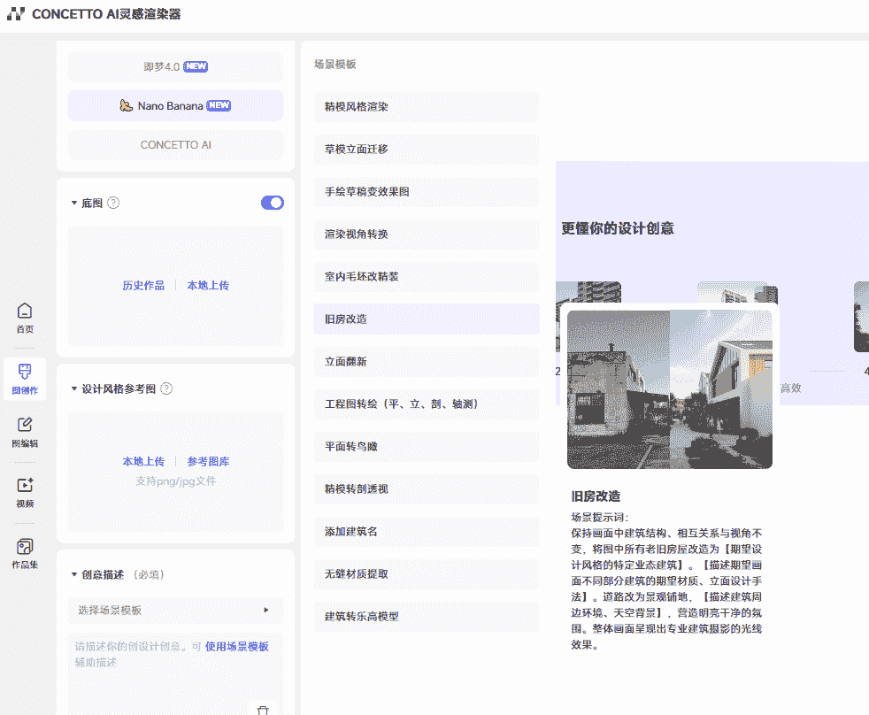

几天不见，还多了很多模版哦~，咱们结合这波更新，再给大家看看我又搞出了哪些有趣的提示词

# **实战用法**

**转绘水彩风格**

让咱一下梦回当年拿着A1画板去水房裱纸的时代

原图：

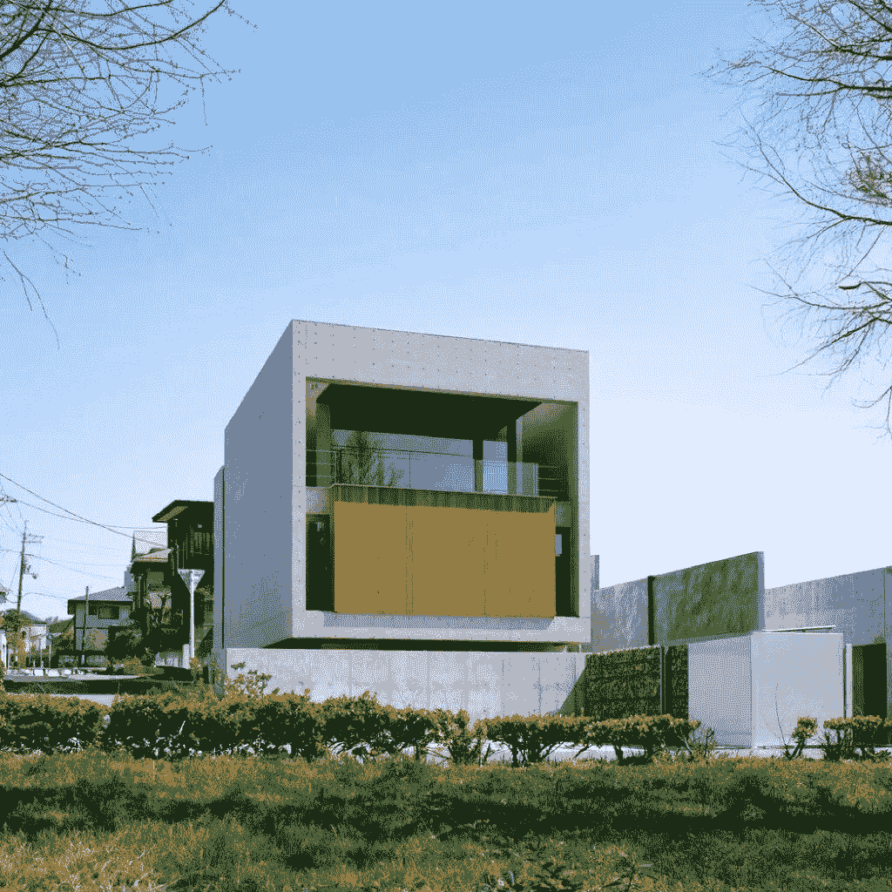

提示词：

将图像转变成具有创意的概念性水彩手绘构思草图，色彩清新淡雅，线条具有张力与表现力，色彩晕染笔触极具真实感

成果：

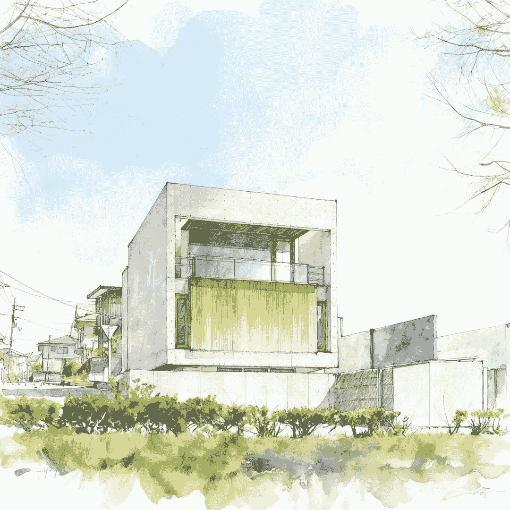

也不知道现在的小朋友们还用不用水彩做渲染了……

**现场写生版**

如果你想让你的手绘草稿，既真实又保留手绘的味道，那么就试试这个现场写生版吧

原图：

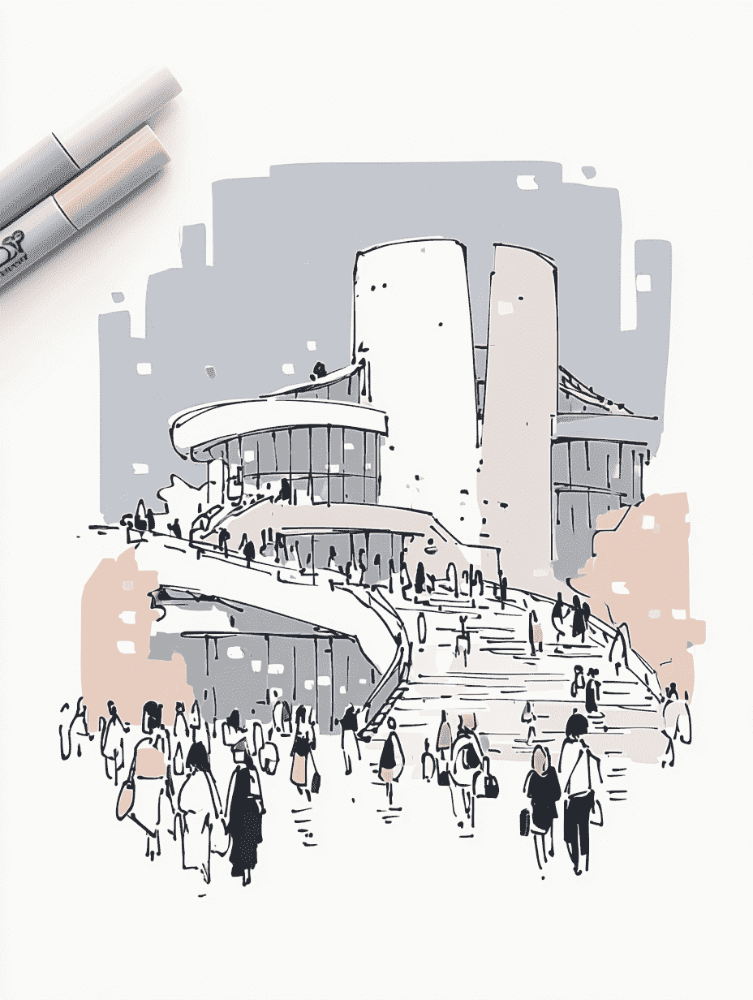

提示词：

将这张手绘稿转为如下场景：手持一张建筑速写的写生稿（如图所示），远处是这个建筑（现代风格的博物馆，前方有宽阔的大台阶，螺旋上升），这个速写就是基于眼前的建筑绘制而成。整体图片的质感是由手机拍摄而成，体现手绘稿与真实建筑的对比。

成果：

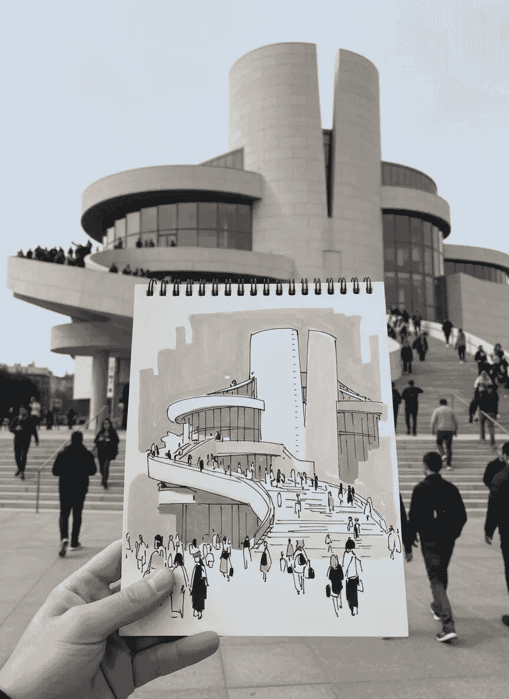

这写生效果能不能唬人

**户型平面转模型**

**当年咱们也是这么一点**点做模型做出来的， 诶，谁看见我U胶了 。

原图：

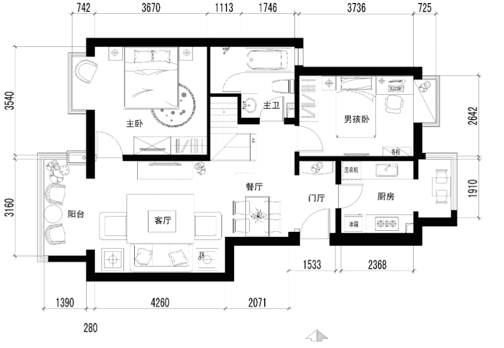

提示词：

将这张户型平面稿转为如下场景：严格按照平面图纸生成住宅建筑内部的手工模型，采用半俯视的视角查看手工模型，模型墙面使用白色的哑光板制作而成，玻璃部分使用亚克力材质，内部铺装使用概念化的精致模型作为家具。手工模型上不要出现任何文字，这张平面图纸放置于模型的底部。整体是一张建筑师的桌面，桌上还有一些模型制作的物品，例如胶水和刻刀

结果：

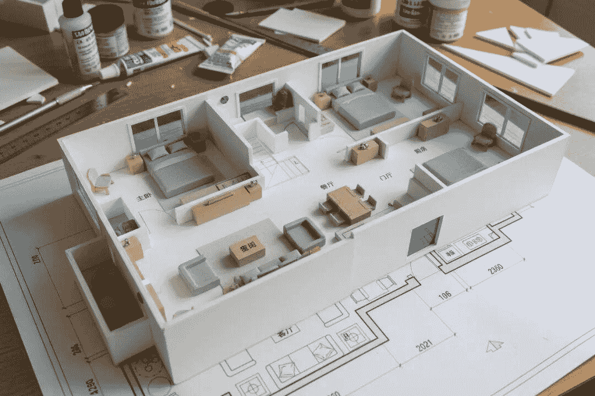

**彩平转鸟瞰**

直接生产力再跃迁，上一个台阶

原图：

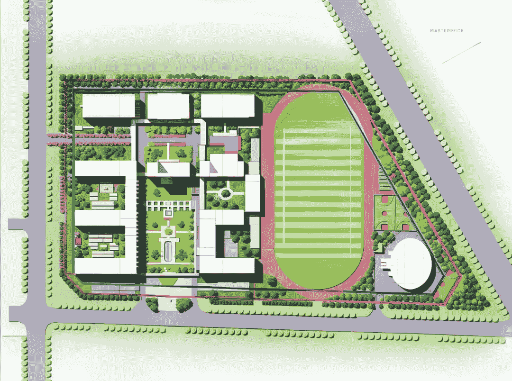

提示词：

将这张平面图转换为鸟瞰渲染图，呈现真实高清质感的建筑摄影风格，具备专业摄影视角与画面构图。画面视角为低空航拍鸟瞰视角，可看见完整主体建筑立面，建筑屋顶颜色维持原图颜色不变。画面建筑配置为：操场左侧为6层教学楼（中轴对称设计），操场右侧为2层圆形大礼堂。周边为城市住宅环境，包含真实城市道路和行驶的汽车，适当的城市绿化。请按照平面图的比例关系生成符合以上要求的鸟瞰渲染图，整体采用春夏白天氛围，自然光照与柔和阴影。

结果：

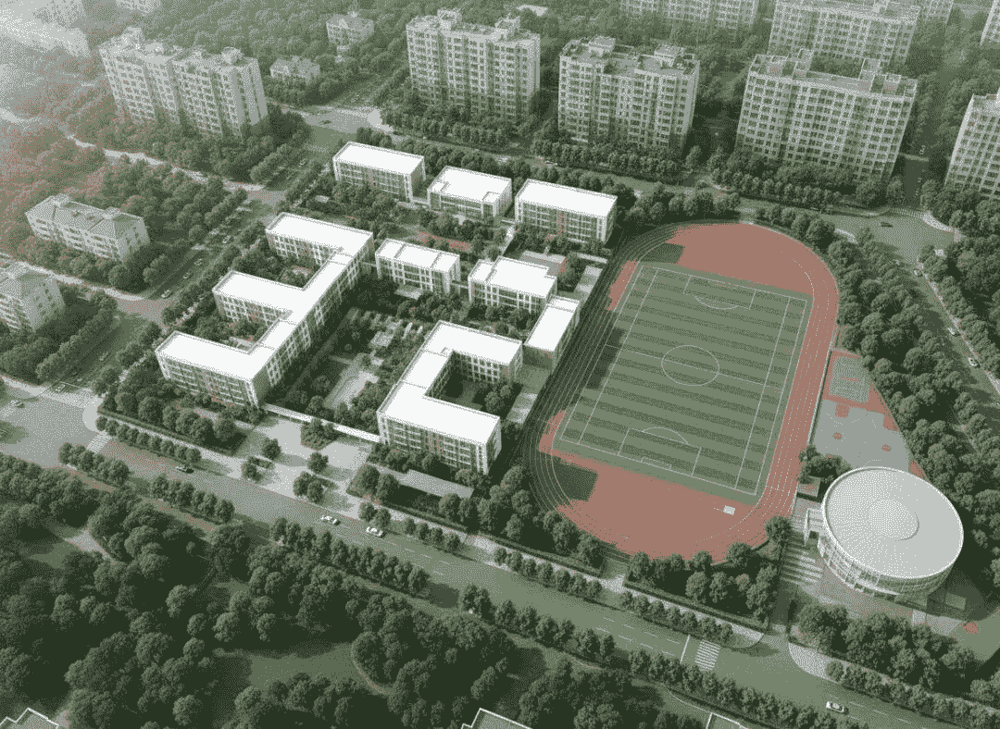

**室内爆改**

毛坯房拯救者，家居博主的最爱

原图：

提示词：

保持原图视角和墙体结构，生成室内真实渲染图，画面主体为客厅，右侧一角为卧室。进行合理的室内家具布置与材质搭配，为室内天花板、墙面、地板赋予材质，整体呈现现代轻奢风格。房间内外均进行真实感渲染。左侧为沙发，右侧墙面有电视，淡色原木地板，材质质感逼真，光线自然。整体画面呈现出专业建筑摄影的光线效果，具备4K超高清分辨率的图像细节。

结果：

然后再这张图的基础上，咱们再来个AR加持，让科技感瞬间拉满

提示词：

将底图改为在XR（Mixed Reality）加持下的显示效果，墙壁对应位置以半透明的形式显示管道与房屋结构，家居上使用高级的引线和卡片显示网购图示与价签，呈现一种可以点击交互的样式

成果：

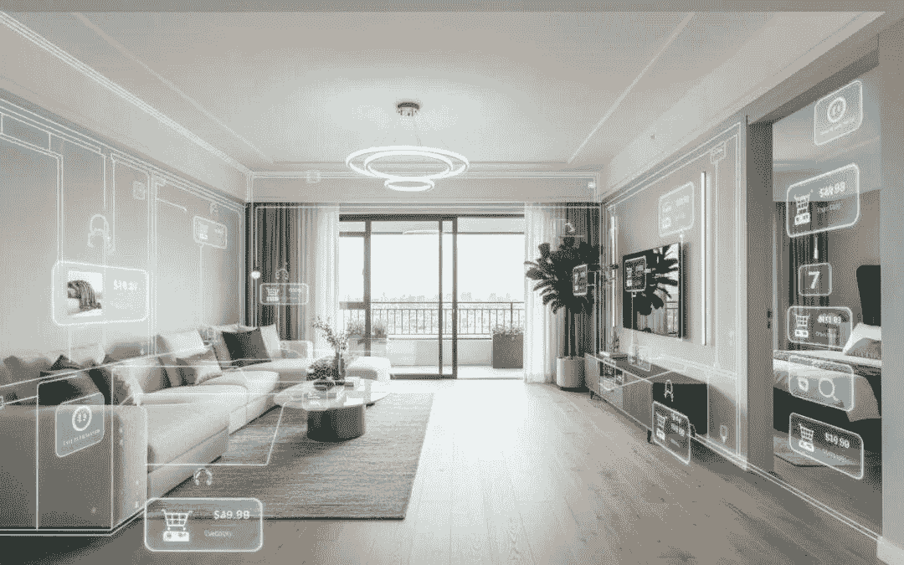

**外立面改造**

咱们爆改完室内，再爆改一轮室外。这种带有反差的爆改非常有流量的哈哈哈

原图：

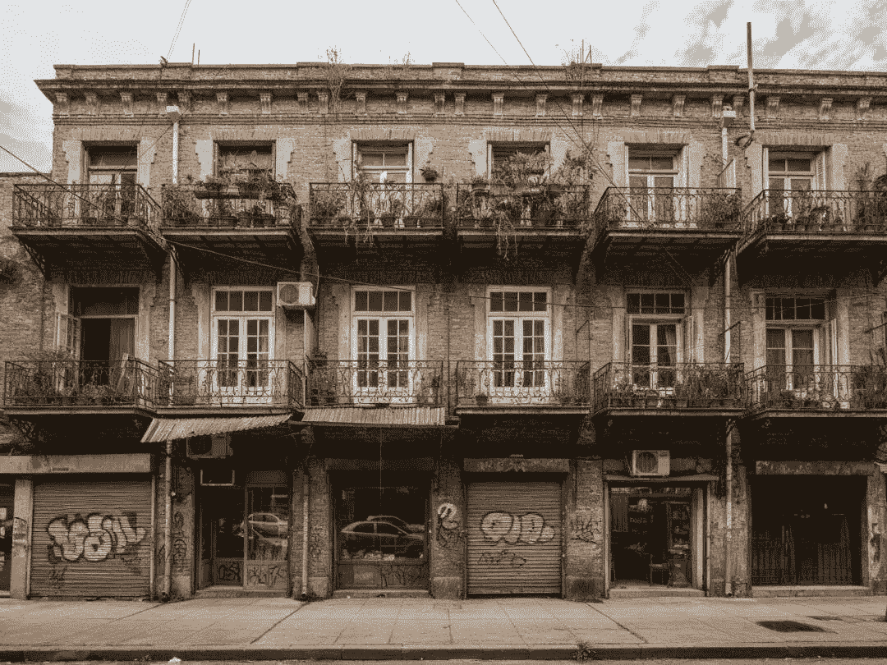

提示词：

对原建筑立面进行改造，保留其砖墙的历史质感。彻底拆除所有杂乱元素（如涂鸦、老旧招牌、凌乱盆栽），重塑空间布局，以现代简约风格重新设计门窗及阳台。选用光滑的白色/灰色涂料、大面积玻璃、简洁金属线条等新材料，并策略性地增添绿植（如垂直绿化、窗台花箱）。进行必要的结构加固。改造后的立面应在尊重历史的同时，营造出热闹有活力的现代商业街区氛围，画面中包含商业街区的灯光和少量行人，建筑内窗户透出淡黄色的暖光，隐约照亮部分室内场景，呈现出整洁、高品质且充满生机的全新形象。

结果：

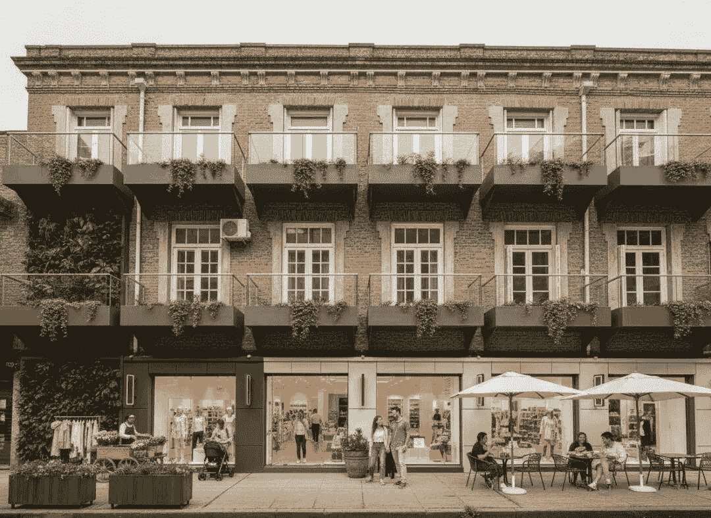

如果结合 CONCETTO 的一些后期编辑能力，会有更好的体验和结果。

比如多种模式的高清放大

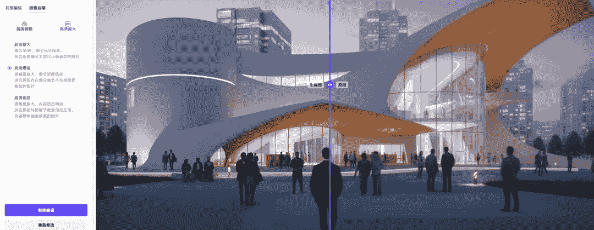

再比如图片直接转视频

甚至还保留了之前比较传统的AI渲染的模版模式，对于一些场景会比Banana更有优势

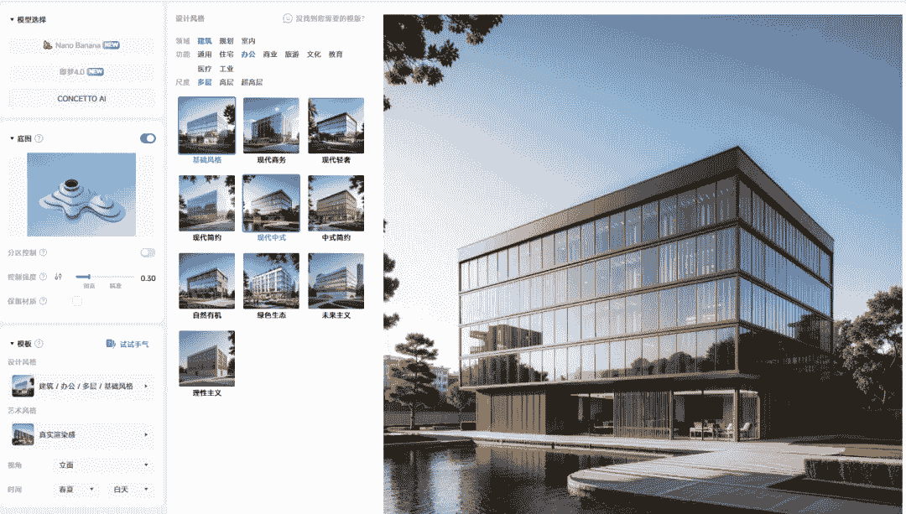

工具地址：

https://www.concetto.cn/render

大家玩的愉快

如果有比较好用有趣的提示词和返图，欢迎评论区分享

—The End—

本文文字内容全部由碳基生物体撰写

点个关注，追更更方便