# Nano Banana Pro Prompts - 高品質 AI 提示詞與圖像生成 - YouMind

> 来源：[https://xatc0v8uz5m.feishu.cn/docx/LdLrdH0Buo3nxnx5iElcBF2Xnae](https://xatc0v8uz5m.feishu.cn/docx/LdLrdH0Buo3nxnx5iElcBF2Xnae)

> 🔗 原文链接： h[ttps://youmind.com](https://youmind.com/zh-TW/nano-banana-pro-prompts)/zh-TW/nano-bana...

> ⏰ 剪存时间：2025-12-11 15:49:26 (UTC+8)

> ✂️ 本文档由 [飞书剪存 ](https://www.feishu.cn/hc/zh-CN/articles/606278856233?from=in_ccm_clip_doc)一键生成

精選

### 寬版引言卡，附人像及中英文自訂選項

一個用於生成寬版引言卡的提示，其中包含一位名人的肖像、棕色背景、淺金色襯線引言文字，以及文字佔三分之二、人物佔三分之一的版面配置。引言文字和作者已參數化以便重複使用。

提示詞

一张宽幅的名人金句卡，棕色背景，衬线体浅金色“ 保持饥饿，保持愚蠢 ”，小字“—— Steve Jobs ”，文字前面带一个大的淡淡的引号。人物头像在左边，文字在右边，文字占画面比例 2/3，人物占 1/3，人物有一点渐变过渡的感觉。

精選

### 手繪風格標題圖片提示，源自照片


為一張手繪風格的標題圖片提供提示，內容為一個人介紹 Nano Banana Pro

提示詞

完全重現上傳的人物。 將其製作成一篇筆記文章的標題圖片，內容是該人物介紹「Nano Banana Pro」。 長寬比：橫向 16:9。 風格與顏色：簡潔、手繪風格、斜體，並帶有藍綠漸層。 標題文字：「深入解析 Google 全新 AI『Nano Banana Pro』」。

精選

### [德國水彩地圖，附各邦標籤 ](https://x.com/FlorianGallwitz/status/1991796624646091091)

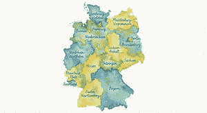

一個德語提示，用於生成一張水彩風格的德國地圖，其中所有聯邦州都以原子筆標示，適用於教育或資訊圖表風格的地圖。

提示詞

生成一張水彩風格的德國地圖，並用原子筆標示出所有聯邦州。

精選

### [黑板風格的 AI 新聞摘要 ](https://x.com/okknews/status/1992173611520868372)


將 AI 新聞內容轉化為手繪教師風格黑板圖並附有解釋的日文提示。

提示詞

使用以下內容，以黑板手寫風格歸納新聞，並像老師寫的一樣，用圖表和淺顯易懂的表達方式來分解說明。 —- 來自 Grok 的搜尋結果

精選

### [火車廣告風格的書籍廣告圖片 ](https://x.com/kawai_design/status/1992142466255114727)


用於生成 16:9 商業書籍風格廣告的詳細日文提示，其中包含特定書籍圖片和日文文案要點。

提示詞

請生成一張廣告圖片。 ==== 廣告規格 === - 長寬比：16:9（橫向） - 廣告產品：第一張附加圖片中的書籍 - 主要吸睛點：以立體方式呈現第一張附加圖片中的書籍 - 語言：日文 - 風格：商業書籍廣告 # 需包含的文字： - 前導文案：【發售約一週後即決定再版】 書籍「 Designing from Zero with AI 」現正熱銷中。 Amazon 暢銷書排行榜 商業設計類別銷售排名第一（截至 10/15） https://t.co/QxbYpfFVj6

精選

### 根據參考圖片拍攝的奢華簡約產品攝影


一個用於生成高端、極簡主義商業產品攝影的提示，風格仿照奢侈品牌廣告，並以上傳的核心產品參考圖片為基礎。

提示詞

请以我上传的参考图为基础，生成一张极简主义、高质感、具有奢侈品广告风格的商业静物摄影大片。 保留参考图中【核心产品】的大致造型、比例和主要配色，让人一眼能认出是同一件产品，但请整体升级画面的质感与氛围：让它看起来像国际一线香氛、护肤品或高端电子产品的广告画面。 画面采用竖版 4:5 构图，背景为大面积干净的中性色留白，例如柔和的米白、冷灰或浅米色，营造安静、克制、昂贵的影棚空间。除核心产品和极少量必要的支撑物外，不要添加任何多余装饰，不要杂物、不摆场景，只保留极简的几何支撑物即可（如一个简洁的白色方块、圆柱或一块薄薄的透明板），并且支撑物形状要简单、低存在感，只用来托举和衬托产品。 请强烈强调产品的材质细节，让光影完全服务于材质本身： 让磨砂玻璃呈现出细腻柔和的雾面质感，陶瓷呈现出哑光或轻微釉感，高光金属呈现出干净锋利的高光边缘，液体部分则要有清晰的粘稠度和体积感。避免任何廉价塑料感、复杂花纹或花哨贴纸，整体质感要冷静、克制、昂贵。 使用专业影棚布光，整体为柔光箱的柔和漫射光，在此基础上加入精准的边缘光（rim light）勾勒产品轮廓，让轮廓线干净利落、层次清晰，阴影要柔和、干净，没有噪点和脏乱的阴影块。可以采用接近微距的镜头视角，适度靠近产品，以突出材质和细节，同时在画面四周保留充足的负空间，让产品在一片留白中「独自发声」。 整体色彩保持冷静的中性色为主，产品本身的颜色可以略微提高饱和度，用来成为画面唯一的视觉焦点。不要使用夸张的渐变背景、花哨的彩色灯光或电商促销风格，不要出现大字号价格、标签或卡通图形。 最终效果必须是一张高分辨率的商业广告大片，看起来像可以直接用于杂志封底或高端品牌官宣海报的静物大片：极简、安静、高级，核心产品在画面中心自信地存在，周围是干净的留白和精确控制的光影。

精選

### 倫敦戶外餐廳人像照，使用 Nano Banana Pro 拍攝


一張照片般真實的提示，描繪一位年輕女性在倫敦一家寧靜的戶外餐廳，時值三月清晨，天氣涼爽宜人。畫面採淺景深，呈現隨手用手機拍攝的自然氛圍。

提示詞

請創作一張寫實的圖像：一位年輕女性在三月一個涼爽的週三早晨，坐在 倫敦 一間輕鬆的戶外餐廳裡。天空晴朗，春天的空氣清新宜人，城市在甦醒中顯得寧靜。她是照片的焦點——圍著一條輕柔的圍巾，輕輕攪拌著茶，若有所思地望向一旁。她身後的一切，從來回穿梭的服務生到輕柔的晨間車流，都應呈現柔和的模糊效果，讓整張照片散發出隨意用手機捕捉到的、不經意的真實氛圍。

精選

### [夢想日記：卡比吹泡泡 ](https://x.com/songguoxiansen/status/1991795708308189668)


粉紅色 Kirby 睡在星星上，在柔和的雲朵和糖果中吹著彩虹泡泡，一幅夢幻日記風格插畫的可愛提示。

提示詞

梦境日记。粉红色的星之卡比睡在一颗星星上，嘴里吐出彩虹色的气泡。柔和的马卡龙色系，云朵和糖果的贴纸，闪粉笔画的细节，梦幻且甜美。

精選

### [詳細的鏡中自拍御宅族房間場景 ](https://x.com/dotey/status/1976485558319722711)


一個非常詳細的 Nano Banana 提示，描述一位女性在藍色調御宅族電腦角落裡自拍，包含角色、環境、燈光、相機和負面提示的完整規格。

提示詞

### **场景** 镜子自拍，御宅族电脑角落，蓝色调 --- ### **主体** * **性别表现**: 女性 * **年龄段**: 25岁左右 * **种族**: 东亚 * **身材**: 苗条，腰线分明；身材比例自然 * **肤色**: 浅中性色调 * **发型**: * **长度**: 及腰长发 * **样式**: 直发，发尾微卷 * **颜色**: 中等棕色 * **姿势**: * **站姿**: 站立，轻微的对立式平衡站姿（contrapposto） * **右手**: 手持手机挡住脸（身份被遮挡） * **左臂**: 在躯干旁自然下垂 * **躯干**: 身体轻微后仰；露出腰腹 * **着装**: * **上衣**: 浅蓝色短款针织开衫，扣上前两颗纽扣；隐约可见蓝色法式内衣 * **下装**: 牛仔超短裤，两侧臀部各有一个蓝色缎带蝴蝶结 * **袜子**: 蓝白横条纹过膝长袜 * **配饰**: 蓝色可爱吉祥物手机壳 --- ### **环境** * **描述**: 从挂墙镜中看到的卧室电脑角落 * **陈设**: * 白色书桌 * 单显示器，显示着柔和的蓝色壁纸（没有可读的文字） * 机械键盘，白色键帽，放在蓝色桌垫上 * 鼠标，放在小号蓝色鼠标垫上 * PC主机在右侧，带有蓝色机箱灯效 * PC主机上或附近有三个动漫手办 * 墙上贴着一张佛塔海报 * 猫形台灯，带有蓝色点缀 * 一杯透明的玻璃水杯 * 窗边（镜头左侧）有一株高大的绿叶植物 * **颜色替换**: 将所有原先的粉色元素（衣物和房间）替换为蓝色（婴儿蓝 -> 天空蓝/长春花蓝）。 --- ### **灯光** * **光源**: 来自镜头左侧大窗户的日光，透过薄纱窗帘 * **光线质感**: 柔和的漫射光 * **白平衡 (K)**: 5200 --- ### **相机** * **模式**: 智能手机后置摄像头通过镜子拍摄（无肖像/虚化模式） * **等效焦距 (mm)**: 26 * **距离 (米)**: * 主体到镜子: 0.6 * 相机到镜子: 0.5 * **曝光**: * 光圈 (f): 1.8 * 感光度 (ISO): 100 * 快门速度 (秒): 0.01 * 曝光补偿 (EV): -0.3 * **对焦**: 对焦于镜中影像的躯干和短裤 * **景深**: 自然的智能手机景深（深景深）；背景清晰可辨，无人为模糊 * **构图**: * **宽高比**: 1:1 * **裁剪**: 从头顶到大腿中部；画面包含书桌、显示器、PC主机和植物 * **角度**: 从镜子的视角轻微俯拍 * **构图备注**: 保持主体居中；为避免广角边缘拉伸，可以站远一些再进行方形裁剪 --- ### **负面提示词** * 任何地方出现粉色/品红色 * 美颜滤镜/磨皮皮肤；没有毛孔的外观 * 夸张或扭曲的人体结构 * NSFW，透视面料，走光 * 商标，品牌名，可读的用户界面文本 * 虚假的人像模式模糊，CGI/插画感

精選

### 江戶時代浮世繪風格的現代場景再詮釋


一個高度結構化的圖像提示，用於描繪一個現代場景，重新構想為日本江戶時代的浮世繪木刻版畫，並詳細指導時代錯誤的科技、構圖、紋理和色彩。

提示詞

一幅日本江戶時代的浮世繪木刻版畫。整體感覺是葛飾北齋和歌川廣重等大師的超現實合作，透過古老的視角重新詮釋現代科技。 **場景：** 繁忙的澀谷十字路口 **江戶時代的轉化邏輯：** 人物身著江戶時代的和服，卻在進行現代活動。所有科技都被轉化為超現實的江戶時代等效物： * 智慧型手機是發光的彩繪紙卷，人們正專注地閱讀。 * 地鐵站和列車是巨大的鉸接式木製蜈蚣車廂，在人群中穿梭。 * 摩天大樓被重新想像成無盡、高聳的木製寶塔，直入變幻莫測的雲端。 * 機器人和機甲則以巨大的、身披盔甲的木刻魔像形象出現。 構圖採用扁平視角，具有粗大、醒目的手刻墨線輪廓。背景以高度風格化的浮世繪波浪圖案和戲劇性的旋渦雲為特色，遠處地平線上可見富士山。 圖像必須看起來像實體版畫，而非數位繪畫。 * 紋理：整幅作品中，木紋紋理和粗糙的紙纖維清晰可見。 * 印刷瑕疵：顏料滲色明顯。模擬手工壓印版畫，帶有輕微的色彩錯位，以增添真實感。 * 調色板：嚴格限於傳統礦物顏料，主要使用普魯士藍、朱紅色和柔和的赭黃色。 * 光線：柔和、平坦、無陰影的光線，沒有數位漸層。 長寬比為 3:4 的垂直海報。包含描述場景的垂直日文書法，並在角落處有一個傳統的紅色藝術家印章。

精選

### [黑白工作室側身肖像提示 ](https://x.com/ChillaiKalan__/status/1992790080503902651)


一個簡潔的 Nano Banana Pro 提示，用於生成一張超寫實的年輕男子側面黑白攝影棚肖像，使用隨附的參考圖片並指定尺寸和輸出數量。

提示詞


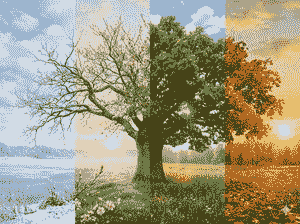


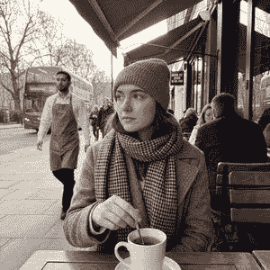


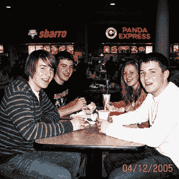


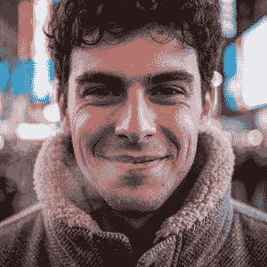


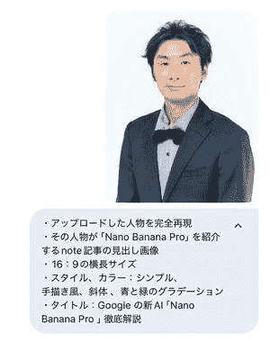


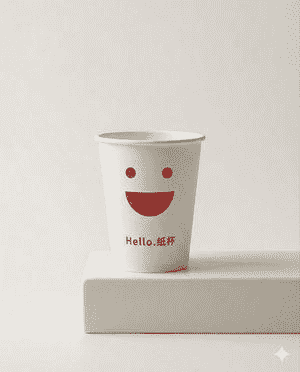


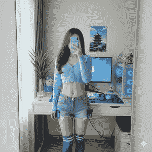


```json { "Use the attached image of the person as reference. Hyper-realistic black and white studio portrait of the young man in side profile, natural hair gently falling around his face. Strong rim light accentuating his jawline and nose, dark minimalist background. Expression thoughtful and serene, cinematic lighting creating dramatic contrast and fine photographic detail.": "請參考所附人物圖片。一張超寫實的黑白工作室肖像照，年輕男子側面入鏡，自然髮絲輕柔地垂落在臉龐周圍。強烈的輪廓光突顯了他的下顎線和鼻子，背景為深色極簡風格。表情沉思而寧靜，電影般的燈光營造出戲劇性的對比和精緻的攝影細節。", "size": "{argument name=\"image size\" default=\"1024x1024\"}", "n": "{argument name=\"number of images\" default=\"1\"}" } ```

精選

### 2005 年 Sony CyberShot 商場美食廣場快照提示
一個圖像提示，重現一張早期數碼相機拍攝的購物中心美食廣場照片，其中有青少年、刺眼的閃光燈、日期戳記和 Myspace 時代的美學風格。

提示詞

一張用 2005 年 Sony CyberShot 拍攝的低解析度數位相片。一群青少年在購物中心的美食廣場閒逛。刺眼的機頂閃光燈，高光部分略微過曝，陰影處有數位雜訊。由於早期數位處理，皮膚紋理看起來有點蠟質。右下角有一個橘色日期戳記，上面寫著「 04/12/2005 」。隨性、尷尬的角度，充滿 Myspace 相片美學。

### 建立 3D 風格的電影場景

輸入電影系列名稱或演員姓名以開始此程序

提示詞

[电影系列名称]： 007 一张细节丰富、45度等轴侧视角的3D Q版微缩景观模型图，生动呈现完整的 [电影系列名称] 系列，采用 C4D (Cinema 4D) 的独特的渲染风格。 整个场景构建为一组相互连接的六边形景观地台。六边形地台的总数量必须准确对应 [电影系列名称] 系列中主要电影（或剧集）的数量。 视觉中心 (Central Focus) 在模型的几何中心，放置该系列中最具标志性、最能代表整体的世界观地标或核心建筑（例如：哈利波特的霍格沃茨城堡、星球大战的死星、漫威的复仇者大厦）。围绕着这个中心建筑，悬浮着巨大的、风格化的 3D 英文总标题 "[电影系列名称]"。 独立地台 (动态内容) 围绕中心的每一个六边形地台分别代表该系列中的一部具体电影，必须包含以下要素： 经典名场面 (Famous Scenes)： 每一个地台都要复刻该部电影中最具特色、一眼即识的经典“名场面”或核心场景布局。 关键人物 (Key Characters)： 在地台上必须出现清晰可见的、最具代表性的主角和反派的Q版公仔形象，人物姿态生动，正在演绎剧情。 关键物品： 每一个地台都要复刻该部电影中最具特色、一眼即识的经典“名场面”或核心场景布局。 关键人物 (Key Characters)： 在地台上必须出现清晰可见的、最具代表性的主角和反派的Q版公仔形象，人物姿态生动，正在演绎剧情。 散落在场景中的微小但可识别的神器、载具或生物，呼应电影情节。 环境氛围: 符合该部电影主题的独特地形、植被和天气效果。 独立标题： 在每个六边形底座的前端边缘，用风格化的3D字体展示该部电影的 具体英文片名 (例如 "Harry Potter and the Sorcerer's Stone")。 整体氛围: 所有元素通过可爱的桥梁、小径或主题过渡（如能量束、魔法轨迹）相互连接。模型采用丰富逼真的 PBR 材质（风格化的木材、石头、金属、布料），边缘处理圆润柔和。场景由温暖、柔和的自然光照亮，投射出柔和的阴影，在干净、统一的纯米色背景下，呈现出一种舒适、高级的盲盒玩具质感。 保证 图中所有出现的单词拼写正确 确保电影的系列名准确 确保演员的名字和电影确实有关联

### [Detailed portrait prompt for a fem](https://x.com/lexx_aura/status/1997909307682079051)ale subject in a nighttime city setting
A highly detailed image generation prompt focusing on a medium close-up portrait of a young adult female subject in a city street at night. The prompt meticulously defines the subject's features (wet look hair, dewy skin, subtle makeup), apparel (black ribbed crop top), pose (leaning on a railing), environment (blurred urban cityscape with bokeh), and specific professional camera settings (Canon EOS R5, 85mm f/1.2L lens, flash photography style).

提示詞

{ "subject": { "gender": "female", "age": "young adult", "hair": { "color": " dark brown ", "texture": "wet look", "style": "long, wavy, messy, loose strands framing face" }, "eyes": { "color": " green/hazel ", "makeup": "subtle winged eyeliner, natural eyeshadow" }, "skin": { "tone": "light/fair", "texture": "smooth, dewy finish, high sheen on shoulder and cheekbones", "makeup": "soft contour, glossy lips" }, "expression": " soft smile, direct eye contact, alluring " }, "apparel": { "top": { "type": "crop top", "color": " black ", "material": "ribbed fabric", "fit": "tight", "straps": "thin straps" }, "bottom": { "visible": "waistband", "color": "black" } }, "pose": { "action": "leaning forward", "arms": "resting on a railing", "angle": "3/4 portrait view" }, "environment": { "setting": "city street at night", "background": "blurred urban cityscape, bokeh streetlights, car headlights, building lights", "atmosphere": "nightlife, candid" }, "lighting": { "type": "flash photography style mixed with ambient street lighting", "highlights": "strong specular highlights on skin (shoulder, forehead, nose)", "shadows": "soft shadows defining facial features" }, "camera_settings": { "shot_type": "medium close-up", "depth_of_field": "shallow", "focus": "sharp on face" }, "camera_details": { "camera_model": " Canon EOS R5 Mirrorless Digital Camera ", "lens": " Canon RF 85mm f/1.2L USM Lens ", "aperture": "f/1.4", "iso": "1600", "shutter_speed": "1/100s", "focal_length": "85mm", "white_balance": "Auto (AWB) with slight tungsten warmth", "flash_type": "Direct on-camera flash with diffuser", "image_format": "RAW", "color_profile": "Adobe RGB" } }

### The Soft Drink Fortress Prompt

A prompt shared for Nano Banana Pro, titled 'The Soft Drink Fortress', likely intended for generating an image of a fortress or structure made of soft drink cans or bottles.

### [Hyper-Realistic Neon Ti](https://x.com/limedesignmedia/status/1997810356132159724)mes Square Portrait
A complex JSON-structured prompt for Gemini Nano Banana Pro, designed to create a hyper-detailed, cinematic portrait of a man in Times Square, focusing on rich textures, neon lighting effects, and specific photographic parameters like shallow depth of field and micro-surface fidelity.

提示詞

{ "main_subject": "a hyper-detailed 23 -year-old man with a playful, expressive look, wearing stylish casual winter clothing with rich fabric texture and lifelike skin detail", "pose_composition": "close-up portrait capturing his playful expression, winter collar framing his face, subtle breath condensation visible in the cold air", "camera_framing": "tight close-up shot with strong facial focus, shallow depth of field, soft bokeh from Times Square lights behind him", "lighting_color_palette": "neon-lit winter tones blending cool ambient light with warm billboard reflections softly illuminating his face", "environment_background": "blurred Times Square winter nightlife, glowing signs and city lights creating a colorful bokeh backdrop", "artistic_style": "premium winter city-hyperrealism with intimate portrait emphasis, crisp facial rendering, and atmospheric urban glow", "nano_secret_tokens": "Nano-detail, 8k neon portrait crispness, sub-surface scattering, micro-surface fidelity, winter breath bloom, cinematic bokeh, rule of thirds, diffraction glints, f/1.8 aperture depth blur, pure texture rendering" }

### [9-Panel Episode ](https://x.com/kiyoshi_shin/status/1997810063319449790)Continuation Prompt
A simple prompt for Nano Banana Pro to generate a 9-panel grid depicting the continuation of a story or episode involving existing characters, often used for narrative progression.

提示詞

Describe the continuation of these characters' story in a 9-panel grid.

### [D](https://x.com/iq_Huri632/status/1997808773272899831)etailed JSON-based Image Generation Prompt for Gemini Nano Banana Pro
This is a highly structured, JSON-formatted prompt designed for the Gemini Nano Banana Pro image generation tool. It specifies a complete pipeline sequence for creating an 'Evening Festival Portrait' image, including detailed settings for subject identity preservation (using an attached image buffer), kinematics control (OpenPose), wardrobe assembly, environment staging (Outdoor Night Market), and lighting setup. It's useful for users who want precise control over every aspect of the generated image, especially when starting from a reference photo.

提示詞

{ "pipeline_sequence_v5": { "global_settings": { "project_name": "EVENING_FESTIVAL_PORTRAIT", "render_target": { "width": 1080, "height": 1920, "ratio": "9:16" }, "seed_strategy": "Fixed", "steps": 50 }, "node_01_subject_initialization": { "module": "Identity_Preservation", "parameters": { "source_input": "Attached_Image_Buffer", "face_restore_strength": 1.0, "feature_lock": { "eyes": "Strict", "nose": "Strict", "mouth": "Strict", "skin_texture": "Blend_with_Prompt" } }, "morphology": { "hair": { "style": " Long_Wavy ", "color": " Brown ", "physics": "Natural_Soft" }, "makeup": { "lips": " Soft_Natural_Pink ", "finish": "Dewy", "intensity": "Natural_Glow" } } }, "node_02_kinematics_control": { "module": "ControlNet_OpenPose", "pose_skeleton": { "body_orientation": "Standing", "spine_curve": "Slight_Lean_Back", "right_arm": { "state": "Relaxed_Down" }, "left_arm": { "state": "Relaxed_Down" }, "head_vector": { "pitch": 0, "yaw": 10, "target": "Lens_Direct" } } }, "node_03_wardrobe_assembly": { "module": "Layered_Clothing_Generator", "layers": [ { "layer_id": 1, "item": " Sleeveless Crop Top ", "pattern": " Floral_Oriental ", "color_palette": " Navy_Orange_Green ", "fit": "Fitted" }, { "layer_id": 2, "item": "Accessories", "elements": [ { "type": "Necklace", "style": "Layered_Gold_Choker" }, { "type": "Earrings", "style": "Small_Drop" } ] } ] }, "node_04_environment_stage": { "module": "Scene_Builder", "setting_type": " Outdoor_Night_Market ", "assets": { "lighting_decor": "Hanging_Warm_String_Lights", "background_elements": "Plants_Shops_People", "ground_material": "Soft_Dirt" }, "atmosphere": { "mood": "Warm_Festive_Evening", "clutter_density": "Medium_Lively" } }, "node_05_lighting_engine": { "module": "Illumination", "setup": { "primary_source": "Warm_Festoon_Lights", "fill_light": "Ambient_Night_Soft", "color_grading_lut": "Warm_Glow", "shadow_quality": "Soft" } } } }

### [Nano Banana Pro Silly Doodl](https://x.com/an303042/status/1997802444420747364)e Generation Prompt

This prompt is used with the Nano Banana Pro image generation tool to bring out its 'inner 2nd grader,' resulting in silly, doodle-like images based on the input text.

提示詞

A silly doodle of a cat wearing a tiny hat

### Style Transfer to Anime Cartoon

A prompt used to transfer the style of a reference image (likely a photo of a person) into an anime cartoon aesthetic, ensuring the color palette, general mood, and slight dark tone overlay are maintained.

提示詞

Draw this person in this anime cartoon style. It should follow color palette, general mood. Keep the slight dark tone overlay.

### [H](https://x.com/dotey/status/1997789829736861747)yper-realistic Digital Illustration of Four Seasons Transition
A detailed image generation prompt for creating a hyper-realistic digital illustration that seamlessly depicts the transition of all four seasons—Winter, Spring, Summer, and Autumn—within a single, continuous scene. The transition flows naturally from left (Winter) to right (Autumn), maintaining a unified composition with cinematic lighting and 8K resolution.

提示詞

超写实数字插画风格，以【 上海外滩 】为主题，呈现四季流转于同一幅完整画面之中。从画面左至右，自然过渡地依次展现冬、春、夏、秋四季变迁： 画面最左侧为冬季，呈现寒冷、冰雪覆盖的景象；逐渐向右过渡，冰雪融化，万物初醒，新芽萌发，春意盎然；继续推进，植被变得浓郁茂盛，阳光炽烈明媚，夏季盛景跃然纸上；最后，场景平缓地过渡至右侧的秋季，树叶逐渐转为金黄、橙红，体现出秋日的丰富色彩与氛围。 画面整体无明显分界线，各季节间的气候、光影和植被状态自然融合，过渡流畅，构成一幅充满时间流动感和象征意义的统一画面。细节丰富逼真，电影级质感光影表现，8K超高清解析度，纹理细腻精致，画面比例为4:3。

### [Hyper-realistic illustration of the four seas](https://x.com/dotey/status/1997787952110239874)ons cycle in one continuous composition

A detailed image generation prompt designed to create a hyper-realistic digital illustration that seamlessly blends all four seasons—Winter, Spring, Summer, and Autumn—into a single, continuous composition. The prompt specifies the visual progression, lighting, and resolution for a cinematic, detailed panorama.

提示詞

Hyper-realistic digital illustration of the historic Shanghai Bund waterfront looking across the Huangpu River to the futuristic Lujiazui district , presented as a single continuous composition showcasing the cycle of seasons. The scene flows seamlessly from left to right in a natural progression: Winter, Spring, Summer, and Autumn. The left side features cold snowy winter elements, gradually thawing into the fresh green buds and blooms of spring, then morphing into the lush vibrant vegetation and bright sunlight of summer, and finally transitioning into the golden, orange, and red hues of autumn on the far right. There are no visible dividing lines between seasons; the weather, lighting, and vegetation blend smoothly to create a unified and harmonious panorama. Rich in detail, symbolic of the passage of time, cinematic lighting, 8k resolution, highly detailed textures. --ar 4:3

### [Wes Anderson-designed X A](https://x.com/cfryant/status/1997786299252846875)pp Mobile Interface
An image generation prompt for creating a hyper-realistic skeuomorphic design of the X app mobile interface, reimagined in the distinctive aesthetic style of filmmaker Wes Anderson.

提示詞

The X app mobile interface if it was designed by Wes Anderson . Make the style hyper realistic skeuomorphism

### [Game of Thrones Ice and Fir](https://x.com/kate0ai/status/1997785691111989645)e Isometric Diorama
A detailed image generation prompt designed for Gemini Nano Banana Pro, creating a 45° top-down isometric miniature 3D cartoon diorama based on the central Game of Thrones theme of Ice and Fire. The prompt specifies soft textures, realistic PBR materials emphasizing glittering frost and glowing embers, and a dramatic clash of cool blue and warm orange lighting. It includes specific compositional details like a split diorama base featuring The Wall/White Walkers on one side and a dragon/burning castle on the other, along with precise text overlays and a clean background.

提示詞

Present a clear, 45° top-down isometric miniature 3D cartoon scene of the central thematic concept Ice and Fire from Game of Thrones , with soft refined textures, realistic PBR materials (emphasizing glittering frost contrasts against glowing embers and scaled skin), and gentle lifelike lighting that creates a dramatic clash of cool blue and warm orange light. Create a small raised diorama-style base that is split down the middle. The left side features a section of The Wall made of ice with tiny stylized White Walker figures on snowy terrain. The right side features a stylized dragon ( Drogon ) perched atop a burning castle turret, with tiny stylized Unsullied soldiers on charred ground. A crack runs down the center of the base where the ice meets the lava. Use a clean solid Neutral Slate Grey background. At the top-center, display Game of Thrones in large bold text, directly beneath it show Ice and Fire in medium text, and place the official logo associated with Game of Thrones below the subtext. All text must automatically match the background contrast (white). Composition: perfectly centered layout, square 1080x1080, ultra-clean, high-clarity diorama aesthetic.

### [D](https://x.com/NavroMedia/status/1997773519095242923)etailed JSON Prompt for Viral Close-Up Selfie Image Generation
This is a highly detailed, structured JSON prompt designed for the 'nano banana pro' AI model, intended to generate a viral close-up selfie image. It specifies every aspect of the scene, lighting (golden hour, sunset), camera perspective (close-up, 35mm, f/2.8), and subject details (pose, facial features, hair, wardrobe) for maximum visual impact and realism.

提示詞

{ "scene": { "environment_type": "indoor_bedroom", "lighting": { "primary_source": "direct sunset sunlight", "quality": "golden hour, warm, harsh contrast, long shadows", "direction": "from the right, low angle", "color_temperature_kelvin": 3500, "specular_bloom": "moderate" }, "background_elements": { "bedding": { "material": "cotton, slightly wrinkled", "color": "white", "visibility": "dominant in lower frame and right side" }, "wall": { "color": "dark charcoal grey", "texture": "matte paint", "visibility": "upper right" }, "window": { "frame_material": "dark metal", "glass_visibility": "clear", "view": "clear blue sky", "visibility": "upper left" } } }, "camera_perspective": { "shot_type": "close-up selfie", "framing": "portrait crop (chest up)", "viewing_angle": { "vertical": "slightly above eye-level", "horizontal": "straight-on" }, "optics": { "focal_length_mm": 35, "aperture": "f/2.8", "depth_of_field": { "subject_sharpness": "high", "background_blur_amount": "moderate" }, "sensor_noise_iso": 400, "grain_texture": "natural film grain" } }, "subject": { "category": "human_with_feminine_presentation", "pose": { "body_orientation": "angled slightly to the left", "head_position": { "pitch": "+2° downward", "yaw": "+5° to right" }, "gaze": { "direction": "directly at camera lens", "eye_opening": "slightly narrowed", "expression": "pouty, relaxed" }, "hands": { "left_hand": { "role": "supporting head", "position": "cupped under left cheek", "fingers": "relaxed, partially visible" } } }, "facial_details": { "skin": { "tone": "medium with sun-kissed golden undertone", "texture": "smooth, natural glow", "specular_highlights": { "locations": ["forehead", "nose bridge", "left cheek"], "intensity": "high due to direct sunlight" }, "imperfections": "minor natural texture" }, "eyes": { "shape": "almond", "iris_color": "striking blue-green", "lashes": "dark, defined" }, "eyebrows": { "shape": "full, dark brown, defined arch" }, "lips": { "shape": "full, well-defined", "color": "rosy pink", "texture": "natural, matte" } }, "hair": { "color": "dark brown", "length": "long", "style": "messy, tousled", "strand_properties": { "shine_level": "high where sunlit", "frizz_amount": "moderate", "flyaways": "prominent across face and forehead" } }, "wardrobe": { "top": { "type": "s

### [U](https://x.com/maxxx_dev/status/1997770173143466275)ltra-realistic selfie with F1 champion Lando Norris

A prompt designed to generate an ultra-realistic selfie image featuring the user alongside the 2025 F1 champion, Lando Norris. This prompt is part of the 'Nano Banana Pro' series, focusing on high-fidelity image generation.

提示詞

You + 2025 F1 champ Lando Norris in one ultra-realistic selfie 🏆📸

精選

### 寬版引言卡，附人像及中英文自訂選項

一個用於生成寬版引言卡的提示，其中包含一位名人的肖像、棕色背景、淺金色襯線引言文字，以及文字佔三分之二、人物佔三分之一的版面配置。引言文字和作者已參數化以便重複使用。

提示詞

一张宽幅的名人金句卡，棕色背景，衬线体浅金色“ 保持饥饿，保持愚蠢 ”，小字“—— Steve Jobs ”，文字前面带一个大的淡淡的引号。人物头像在左边，文字在右边，文字占画面比例 2/3，人物占 1/3，人物有一点渐变过渡的感觉。

精選

### [德國水彩地圖，附各邦標籤 ](https://x.com/FlorianGallwitz/status/1991796624646091091)
一個德語提示，用於生成一張水彩風格的德國地圖，其中所有聯邦州都以原子筆標示，適用於教育或資訊圖表風格的地圖。

提示詞

生成一張水彩風格的德國地圖，並用原子筆標示出所有聯邦州。

精選

### 倫敦戶外餐廳人像照，使用 Nano Banana Pro 拍攝
一張照片般真實的提示，描繪一位年輕女性在倫敦一家寧靜的戶外餐廳，時值三月清晨，天氣涼爽宜人。畫面採淺景深，呈現隨手用手機拍攝的自然氛圍。

提示詞

請創作一張寫實的圖像：一位年輕女性在三月一個涼爽的週三早晨，坐在 倫敦 一間輕鬆的戶外餐廳裡。天空晴朗，春天的空氣清新宜人，城市在甦醒中顯得寧靜。她是照片的焦點——圍著一條輕柔的圍巾，輕輕攪拌著茶，若有所思地望向一旁。她身後的一切，從來回穿梭的服務生到輕柔的晨間車流，都應呈現柔和的模糊效果，讓整張照片散發出隨意用手機捕捉到的、不經意的真實氛圍。

精選

### 江戶時代浮世繪風格的現代場景再詮釋
一個高度結構化的圖像提示，用於描繪一個現代場景，重新構想為日本江戶時代的浮世繪木刻版畫，並詳細指導時代錯誤的科技、構圖、紋理和色彩。

提示詞

一幅日本江戶時代的浮世繪木刻版畫。整體感覺是葛飾北齋和歌川廣重等大師的超現實合作，透過古老的視角重新詮釋現代科技。 **場景：** 繁忙的澀谷十字路口 **江戶時代的轉化邏輯：** 人物身著江戶時代的和服，卻在進行現代活動。所有科技都被轉化為超現實的江戶時代等效物： * 智慧型手機是發光的彩繪紙卷，人們正專注地閱讀。 * 地鐵站和列車是巨大的鉸接式木製蜈蚣車廂，在人群中穿梭。 * 摩天大樓被重新想像成無盡、高聳的木製寶塔，直入變幻莫測的雲端。 * 機器人和機甲則以巨大的、身披盔甲的木刻魔像形象出現。 構圖採用扁平視角，具有粗大、醒目的手刻墨線輪廓。背景以高度風格化的浮世繪波浪圖案和戲劇性的旋渦雲為特色，遠處地平線上可見富士山。 圖像必須看起來像實體版畫，而非數位繪畫。 * 紋理：整幅作品中，木紋紋理和粗糙的紙纖維清晰可見。 * 印刷瑕疵：顏料滲色明顯。模擬手工壓印版畫，帶有輕微的色彩錯位，以增添真實感。 * 調色板：嚴格限於傳統礦物顏料，主要使用普魯士藍、朱紅色和柔和的赭黃色。 * 光線：柔和、平坦、無陰影的光線，沒有數位漸層。 長寬比為 3:4 的垂直海報。包含描述場景的垂直日文書法，並在角落處有一個傳統的紅色藝術家印章。

精選

### 2005 年 Sony CyberShot 商場美食廣場快照提示
一個圖像提示，重現一張早期數碼相機拍攝的購物中心美食廣場照片，其中有青少年、刺眼的閃光燈、日期戳記和 Myspace 時代的美學風格。

提示詞

一張用 2005 年 Sony CyberShot 拍攝的低解析度數位相片。一群青少年在購物中心的美食廣場閒逛。刺眼的機頂閃光燈，高光部分略微過曝，陰影處有數位雜訊。由於早期數位處理，皮膚紋理看起來有點蠟質。右下角有一個橘色日期戳記，上面寫著「 04/12/2005 」。隨性、尷尬的角度，充滿 Myspace 相片美學。

### [Detailed portrait prompt for a fem](https://x.com/lexx_aura/status/1997909307682079051)ale subject in a nighttime city setting
A highly detailed image generation prompt focusing on a medium close-up portrait of a young adult female subject in a city street at night. The prompt meticulously defines the subject's features (wet look hair, dewy skin, subtle makeup), apparel (black ribbed crop top), pose (leaning on a railing), environment (blurred urban cityscape with bokeh), and specific professional camera settings (Canon EOS R5, 85mm f/1.2L lens, flash photography style).

提示詞

{ "subject": { "gender": "female", "age": "young adult", "hair": { "color": " dark brown ", "texture": "wet look", "style": "long, wavy, messy, loose strands framing face" }, "eyes": { "color": " green/hazel ", "makeup": "subtle winged eyeliner, natural eyeshadow" }, "skin": { "tone": "light/fair", "texture": "smooth, dewy finish, high sheen on shoulder and cheekbones", "makeup": "soft contour, glossy lips" }, "expression": " soft smile, direct eye contact, alluring " }, "apparel": { "top": { "type": "crop top", "color": " black ", "material": "ribbed fabric", "fit": "tight", "straps": "thin straps" }, "bottom": { "visible": "waistband", "color": "black" } }, "pose": { "action": "leaning forward", "arms": "resting on a railing", "angle": "3/4 portrait view" }, "environment": { "setting": "city street at night", "background": "blurred urban cityscape, bokeh streetlights, car headlights, building lights", "atmosphere": "nightlife, candid" }, "lighting": { "type": "flash photography style mixed with ambient street lighting", "highlights": "strong specular highlights on skin (shoulder, forehead, nose)", "shadows": "soft shadows defining facial features" }, "camera_settings": { "shot_type": "medium close-up", "depth_of_field": "shallow", "focus": "sharp on face" }, "camera_details": { "camera_model": " Canon EOS R5 Mirrorless Digital Camera ", "lens": " Canon RF 85mm f/1.2L USM Lens ", "aperture": "f/1.4", "iso": "1600", "shutter_speed": "1/100s", "focal_length": "85mm", "white_balance": "Auto (AWB) with slight tungsten warmth", "flash_type": "Direct on-camera flash with diffuser", "image_format": "RAW", "color_profile": "Adobe RGB" } }

### [Hyper-Realistic Neon Ti](https://x.com/limedesignmedia/status/1997810356132159724)mes Square Portrait
A complex JSON-structured prompt for Gemini Nano Banana Pro, designed to create a hyper-detailed, cinematic portrait of a man in Times Square, focusing on rich textures, neon lighting effects, and specific photographic parameters like shallow depth of field and micro-surface fidelity.

提示詞

{ "main_subject": "a hyper-detailed 23 -year-old man with a playful, expressive look, wearing stylish casual winter clothing with rich fabric texture and lifelike skin detail", "pose_composition": "close-up portrait capturing his playful expression, winter collar framing his face, subtle breath condensation visible in the cold air", "camera_framing": "tight close-up shot with strong facial focus, shallow depth of field, soft bokeh from Times Square lights behind him", "lighting_color_palette": "neon-lit winter tones blending cool ambient light with warm billboard reflections softly illuminating his face", "environment_background": "blurred Times Square winter nightlife, glowing signs and city lights creating a colorful bokeh backdrop", "artistic_style": "premium winter city-hyperrealism with intimate portrait emphasis, crisp facial rendering, and atmospheric urban glow", "nano_secret_tokens": "Nano-detail, 8k neon portrait crispness, sub-surface scattering, micro-surface fidelity, winter breath bloom, cinematic bokeh, rule of thirds, diffraction glints, f/1.8 aperture depth blur, pure texture rendering" }

### [9-Panel Episode ](https://x.com/kiyoshi_shin/status/1997810063319449790)Continuation Prompt
A simple prompt for Nano Banana Pro to generate a 9-panel grid depicting the continuation of a story or episode involving existing characters, often used for narrative progression.

提示詞

Describe the continuation of these characters' story in a 9-panel grid.

### [Nano Banana Pro Silly Doodl](https://x.com/an303042/status/1997802444420747364)e Generation Prompt

This prompt is used with the Nano Banana Pro image generation tool to bring out its 'inner 2nd grader,' resulting in silly, doodle-like images based on the input text.

提示詞

A silly doodle of a cat wearing a tiny hat

### [H](https://x.com/dotey/status/1997789829736861747)yper-realistic Digital Illustration of Four Seasons Transition
A detailed image generation prompt for creating a hyper-realistic digital illustration that seamlessly depicts the transition of all four seasons—Winter, Spring, Summer, and Autumn—within a single, continuous scene. The transition flows naturally from left (Winter) to right (Autumn), maintaining a unified composition with cinematic lighting and 8K resolution.

提示詞

超写实数字插画风格，以【 上海外滩 】为主题，呈现四季流转于同一幅完整画面之中。从画面左至右，自然过渡地依次展现冬、春、夏、秋四季变迁： 画面最左侧为冬季，呈现寒冷、冰雪覆盖的景象；逐渐向右过渡，冰雪融化，万物初醒，新芽萌发，春意盎然；继续推进，植被变得浓郁茂盛，阳光炽烈明媚，夏季盛景跃然纸上；最后，场景平缓地过渡至右侧的秋季，树叶逐渐转为金黄、橙红，体现出秋日的丰富色彩与氛围。 画面整体无明显分界线，各季节间的气候、光影和植被状态自然融合，过渡流畅，构成一幅充满时间流动感和象征意义的统一画面。细节丰富逼真，电影级质感光影表现，8K超高清解析度，纹理细腻精致，画面比例为4:3。

### [Wes Anderson-designed X A](https://x.com/cfryant/status/1997786299252846875)pp Mobile Interface
An image generation prompt for creating a hyper-realistic skeuomorphic design of the X app mobile interface, reimagined in the distinctive aesthetic style of filmmaker Wes Anderson.

提示詞

The X app mobile interface if it was designed by Wes Anderson . Make the style hyper realistic skeuomorphism

### [U](https://x.com/maxxx_dev/status/1997770173143466275)ltra-realistic selfie with F1 champion Lando Norris

A prompt designed to generate an ultra-realistic selfie image featuring the user alongside the 2025 F1 champion, Lando Norris. This prompt is part of the 'Nano Banana Pro' series, focusing on high-fidelity image generation.

提示詞

You + 2025 F1 champ Lando Norris in one ultra-realistic selfie 🏆📸

精選

### 手繪風格標題圖片提示，源自照片
為一張手繪風格的標題圖片提供提示，內容為一個人介紹 Nano Banana Pro

提示詞

完全重現上傳的人物。 將其製作成一篇筆記文章的標題圖片，內容是該人物介紹「Nano Banana Pro」。 長寬比：橫向 16:9。 風格與顏色：簡潔、手繪風格、斜體，並帶有藍綠漸層。 標題文字：「深入解析 Google 全新 AI『Nano Banana Pro』」。

精選

### [黑板風格的 AI 新聞摘要 ](https://x.com/okknews/status/1992173611520868372)
將 AI 新聞內容轉化為手繪教師風格黑板圖並附有解釋的日文提示。

提示詞

使用以下內容，以黑板手寫風格歸納新聞，並像老師寫的一樣，用圖表和淺顯易懂的表達方式來分解說明。 —- 來自 Grok 的搜尋結果

精選

### [火車廣告風格的書籍廣告圖片 ](https://x.com/kawai_design/status/1992142466255114727)
用於生成 16:9 商業書籍風格廣告的詳細日文提示，其中包含特定書籍圖片和日文文案要點。

提示詞

請生成一張廣告圖片。 ==== 廣告規格 === - 長寬比：16:9（橫向） - 廣告產品：第一張附加圖片中的書籍 - 主要吸睛點：以立體方式呈現第一張附加圖片中的書籍 - 語言：日文 - 風格：商業書籍廣告 # 需包含的文字： - 前導文案：【發售約一週後即決定再版】 書籍「 Designing from Zero with AI 」現正熱銷中。 Amazon 暢銷書排行榜 商業設計類別銷售排名第一（截至 10/15） https://t.co/QxbYpfFVj6

精選

### 根據參考圖片拍攝的奢華簡約產品攝影
一個用於生成高端、極簡主義商業產品攝影的提示，風格仿照奢侈品牌廣告，並以上傳的核心產品參考圖片為基礎。

提示詞

请以我上传的参考图为基础，生成一张极简主义、高质感、具有奢侈品广告风格的商业静物摄影大片。 保留参考图中【核心产品】的大致造型、比例和主要配色，让人一眼能认出是同一件产品，但请整体升级画面的质感与氛围：让它看起来像国际一线香氛、护肤品或高端电子产品的广告画面。 画面采用竖版 4:5 构图，背景为大面积干净的中性色留白，例如柔和的米白、冷灰或浅米色，营造安静、克制、昂贵的影棚空间。除核心产品和极少量必要的支撑物外，不要添加任何多余装饰，不要杂物、不摆场景，只保留极简的几何支撑物即可（如一个简洁的白色方块、圆柱或一块薄薄的透明板），并且支撑物形状要简单、低存在感，只用来托举和衬托产品。 请强烈强调产品的材质细节，让光影完全服务于材质本身： 让磨砂玻璃呈现出细腻柔和的雾面质感，陶瓷呈现出哑光或轻微釉感，高光金属呈现出干净锋利的高光边缘，液体部分则要有清晰的粘稠度和体积感。避免任何廉价塑料感、复杂花纹或花哨贴纸，整体质感要冷静、克制、昂贵。 使用专业影棚布光，整体为柔光箱的柔和漫射光，在此基础上加入精准的边缘光（rim light）勾勒产品轮廓，让轮廓线干净利落、层次清晰，阴影要柔和、干净，没有噪点和脏乱的阴影块。可以采用接近微距的镜头视角，适度靠近产品，以突出材质和细节，同时在画面四周保留充足的负空间，让产品在一片留白中「独自发声」。 整体色彩保持冷静的中性色为主，产品本身的颜色可以略微提高饱和度，用来成为画面唯一的视觉焦点。不要使用夸张的渐变背景、花哨的彩色灯光或电商促销风格，不要出现大字号价格、标签或卡通图形。 最终效果必须是一张高分辨率的商业广告大片，看起来像可以直接用于杂志封底或高端品牌官宣海报的静物大片：极简、安静、高级，核心产品在画面中心自信地存在，周围是干净的留白和精确控制的光影。

精選

### [夢想日記：卡比吹泡泡 ](https://x.com/songguoxiansen/status/1991795708308189668)
粉紅色 Kirby 睡在星星上，在柔和的雲朵和糖果中吹著彩虹泡泡，一幅夢幻日記風格插畫的可愛提示。

提示詞

梦境日记。粉红色的星之卡比睡在一颗星星上，嘴里吐出彩虹色的气泡。柔和的马卡龙色系，云朵和糖果的贴纸，闪粉笔画的细节，梦幻且甜美。

精選

### [詳細的鏡中自拍御宅族房間場景 ](https://x.com/dotey/status/1976485558319722711)
一個非常詳細的 Nano Banana 提示，描述一位女性在藍色調御宅族電腦角落裡自拍，包含角色、環境、燈光、相機和負面提示的完整規格。

提示詞

### **场景** 镜子自拍，御宅族电脑角落，蓝色调 --- ### **主体** * **性别表现**: 女性 * **年龄段**: 25岁左右 * **种族**: 东亚 * **身材**: 苗条，腰线分明；身材比例自然 * **肤色**: 浅中性色调 * **发型**: * **长度**: 及腰长发 * **样式**: 直发，发尾微卷 * **颜色**: 中等棕色 * **姿势**: * **站姿**: 站立，轻微的对立式平衡站姿（contrapposto） * **右手**: 手持手机挡住脸（身份被遮挡） * **左臂**: 在躯干旁自然下垂 * **躯干**: 身体轻微后仰；露出腰腹 * **着装**: * **上衣**: 浅蓝色短款针织开衫，扣上前两颗纽扣；隐约可见蓝色法式内衣 * **下装**: 牛仔超短裤，两侧臀部各有一个蓝色缎带蝴蝶结 * **袜子**: 蓝白横条纹过膝长袜 * **配饰**: 蓝色可爱吉祥物手机壳 --- ### **环境** * **描述**: 从挂墙镜中看到的卧室电脑角落 * **陈设**: * 白色书桌 * 单显示器，显示着柔和的蓝色壁纸（没有可读的文字） * 机械键盘，白色键帽，放在蓝色桌垫上 * 鼠标，放在小号蓝色鼠标垫上 * PC主机在右侧，带有蓝色机箱灯效 * PC主机上或附近有三个动漫手办 * 墙上贴着一张佛塔海报 * 猫形台灯，带有蓝色点缀 * 一杯透明的玻璃水杯 * 窗边（镜头左侧）有一株高大的绿叶植物 * **颜色替换**: 将所有原先的粉色元素（衣物和房间）替换为蓝色（婴儿蓝 -> 天空蓝/长春花蓝）。 --- ### **灯光** * **光源**: 来自镜头左侧大窗户的日光，透过薄纱窗帘 * **光线质感**: 柔和的漫射光 * **白平衡 (K)**: 5200 --- ### **相机** * **模式**: 智能手机后置摄像头通过镜子拍摄（无肖像/虚化模式） * **等效焦距 (mm)**: 26 * **距离 (米)**: * 主体到镜子: 0.6 * 相机到镜子: 0.5 * **曝光**: * 光圈 (f): 1.8 * 感光度 (ISO): 100 * 快门速度 (秒): 0.01 * 曝光补偿 (EV): -0.3 * **对焦**: 对焦于镜中影像的躯干和短裤 * **景深**: 自然的智能手机景深（深景深）；背景清晰可辨，无人为模糊 * **构图**: * **宽高比**: 1:1 * **裁剪**: 从头顶到大腿中部；画面包含书桌、显示器、PC主机和植物 * **角度**: 从镜子的视角轻微俯拍 * **构图备注**: 保持主体居中；为避免广角边缘拉伸，可以站远一些再进行方形裁剪 --- ### **负面提示词** * 任何地方出现粉色/品红色 * 美颜滤镜/磨皮皮肤；没有毛孔的外观 * 夸张或扭曲的人体结构 * NSFW，透视面料，走光 * 商标，品牌名，可读的用户界面文本 * 虚假的人像模式模糊，CGI/插画感

精選

### [黑白工作室側身肖像提示 ](https://x.com/ChillaiKalan__/status/1992790080503902651)
一個簡潔的 Nano Banana Pro 提示，用於生成一張超寫實的年輕男子側面黑白攝影棚肖像，使用隨附的參考圖片並指定尺寸和輸出數量。

提示詞

```json { "Use the attached image of the person as reference. Hyper-realistic black and white studio portrait of the young man in side profile, natural hair gently falling around his face. Strong rim light accentuating his jawline and nose, dark minimalist background. Expression thoughtful and serene, cinematic lighting creating dramatic contrast and fine photographic detail.": "請參考所附人物圖片。一張超寫實的黑白工作室肖像照，年輕男子側面入鏡，自然髮絲輕柔地垂落在臉龐周圍。強烈的輪廓光突顯了他的下顎線和鼻子，背景為深色極簡風格。表情沉思而寧靜，電影般的燈光營造出戲劇性的對比和精緻的攝影細節。", "size": "{argument name=\"image size\" default=\"1024x1024\"}", "n": "{argument name=\"number of images\" default=\"1\"}" } ```

### 建立 3D 風格的電影場景

輸入電影系列名稱或演員姓名以開始此程序

提示詞

[电影系列名称]： 007 一张细节丰富、45度等轴侧视角的3D Q版微缩景观模型图，生动呈现完整的 [电影系列名称] 系列，采用 C4D (Cinema 4D) 的独特的渲染风格。 整个场景构建为一组相互连接的六边形景观地台。六边形地台的总数量必须准确对应 [电影系列名称] 系列中主要电影（或剧集）的数量。 视觉中心 (Central Focus) 在模型的几何中心，放置该系列中最具标志性、最能代表整体的世界观地标或核心建筑（例如：哈利波特的霍格沃茨城堡、星球大战的死星、漫威的复仇者大厦）。围绕着这个中心建筑，悬浮着巨大的、风格化的 3D 英文总标题 "[电影系列名称]"。 独立地台 (动态内容) 围绕中心的每一个六边形地台分别代表该系列中的一部具体电影，必须包含以下要素： 经典名场面 (Famous Scenes)： 每一个地台都要复刻该部电影中最具特色、一眼即识的经典“名场面”或核心场景布局。 关键人物 (Key Characters)： 在地台上必须出现清晰可见的、最具代表性的主角和反派的Q版公仔形象，人物姿态生动，正在演绎剧情。 关键物品： 每一个地台都要复刻该部电影中最具特色、一眼即识的经典“名场面”或核心场景布局。 关键人物 (Key Characters)： 在地台上必须出现清晰可见的、最具代表性的主角和反派的Q版公仔形象，人物姿态生动，正在演绎剧情。 散落在场景中的微小但可识别的神器、载具或生物，呼应电影情节。 环境氛围: 符合该部电影主题的独特地形、植被和天气效果。 独立标题： 在每个六边形底座的前端边缘，用风格化的3D字体展示该部电影的 具体英文片名 (例如 "Harry Potter and the Sorcerer's Stone")。 整体氛围: 所有元素通过可爱的桥梁、小径或主题过渡（如能量束、魔法轨迹）相互连接。模型采用丰富逼真的 PBR 材质（风格化的木材、石头、金属、布料），边缘处理圆润柔和。场景由温暖、柔和的自然光照亮，投射出柔和的阴影，在干净、统一的纯米色背景下，呈现出一种舒适、高级的盲盒玩具质感。 保证 图中所有出现的单词拼写正确 确保电影的系列名准确 确保演员的名字和电影确实有关联

### The Soft Drink Fortress Prompt

A prompt shared for Nano Banana Pro, titled 'The Soft Drink Fortress', likely intended for generating an image of a fortress or structure made of soft drink cans or bottles.

### [D](https://x.com/iq_Huri632/status/1997808773272899831)etailed JSON-based Image Generation Prompt for Gemini Nano Banana Pro

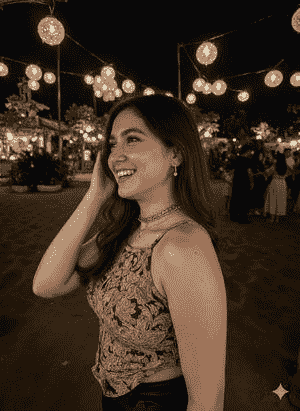

This is a highly structured, JSON-formatted prompt designed for the Gemini Nano Banana Pro image generation tool. It specifies a complete pipeline sequence for creating an 'Evening Festival Portrait' image, including detailed settings for subject identity preservation (using an attached image buffer), kinematics control (OpenPose), wardrobe assembly, environment staging (Outdoor Night Market), and lighting setup. It's useful for users who want precise control over every aspect of the generated image, especially when starting from a reference photo.

提示詞

{ "pipeline_sequence_v5": { "global_settings": { "project_name": "EVENING_FESTIVAL_PORTRAIT", "render_target": { "width": 1080, "height": 1920, "ratio": "9:16" }, "seed_strategy": "Fixed", "steps": 50 }, "node_01_subject_initialization": { "module": "Identity_Preservation", "parameters": { "source_input": "Attached_Image_Buffer", "face_restore_strength": 1.0, "feature_lock": { "eyes": "Strict", "nose": "Strict", "mouth": "Strict", "skin_texture": "Blend_with_Prompt" } }, "morphology": { "hair": { "style": " Long_Wavy ", "color": " Brown ", "physics": "Natural_Soft" }, "makeup": { "lips": " Soft_Natural_Pink ", "finish": "Dewy", "intensity": "Natural_Glow" } } }, "node_02_kinematics_control": { "module": "ControlNet_OpenPose", "pose_skeleton": { "body_orientation": "Standing", "spine_curve": "Slight_Lean_Back", "right_arm": { "state": "Relaxed_Down" }, "left_arm": { "state": "Relaxed_Down" }, "head_vector": { "pitch": 0, "yaw": 10, "target": "Lens_Direct" } } }, "node_03_wardrobe_assembly": { "module": "Layered_Clothing_Generator", "layers": [ { "layer_id": 1, "item": " Sleeveless Crop Top ", "pattern": " Floral_Oriental ", "color_palette": " Navy_Orange_Green ", "fit": "Fitted" }, { "layer_id": 2, "item": "Accessories", "elements": [ { "type": "Necklace", "style": "Layered_Gold_Choker" }, { "type": "Earrings", "style": "Small_Drop" } ] } ] }, "node_04_environment_stage": { "module": "Scene_Builder", "setting_type": " Outdoor_Night_Market ", "assets": { "lighting_decor": "Hanging_Warm_String_Lights", "background_elements": "Plants_Shops_People", "ground_material": "Soft_Dirt" }, "atmosphere": { "mood": "Warm_Festive_Evening", "clutter_density": "Medium_Lively" } }, "node_05_lighting_engine": { "module": "Illumination", "setup": { "primary_source": "Warm_Festoon_Lights", "fill_light": "Ambient_Night_Soft", "color_grading_lut": "Warm_Glow", "shadow_quality": "Soft" } } } }

### Style Transfer to Anime Cartoon

A prompt used to transfer the style of a reference image (likely a photo of a person) into an anime cartoon aesthetic, ensuring the color palette, general mood, and slight dark tone overlay are maintained.

提示詞

Draw this person in this anime cartoon style. It should follow color palette, general mood. Keep the slight dark tone overlay.

### [Hyper-realistic illustration of the four seas](https://x.com/dotey/status/1997787952110239874)ons cycle in one continuous composition

A detailed image generation prompt designed to create a hyper-realistic digital illustration that seamlessly blends all four seasons—Winter, Spring, Summer, and Autumn—into a single, continuous composition. The prompt specifies the visual progression, lighting, and resolution for a cinematic, detailed panorama.

提示詞

Hyper-realistic digital illustration of the historic Shanghai Bund waterfront looking across the Huangpu River to the futuristic Lujiazui district , presented as a single continuous composition showcasing the cycle of seasons. The scene flows seamlessly from left to right in a natural progression: Winter, Spring, Summer, and Autumn. The left side features cold snowy winter elements, gradually thawing into the fresh green buds and blooms of spring, then morphing into the lush vibrant vegetation and bright sunlight of summer, and finally transitioning into the golden, orange, and red hues of autumn on the far right. There are no visible dividing lines between seasons; the weather, lighting, and vegetation blend smoothly to create a unified and harmonious panorama. Rich in detail, symbolic of the passage of time, cinematic lighting, 8k resolution, highly detailed textures. --ar 4:3

### [Game of Thrones Ice and Fir](https://x.com/kate0ai/status/1997785691111989645)e Isometric Diorama

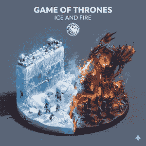

A detailed image generation prompt designed for Gemini Nano Banana Pro, creating a 45° top-down isometric miniature 3D cartoon diorama based on the central Game of Thrones theme of Ice and Fire. The prompt specifies soft textures, realistic PBR materials emphasizing glittering frost and glowing embers, and a dramatic clash of cool blue and warm orange lighting. It includes specific compositional details like a split diorama base featuring The Wall/White Walkers on one side and a dragon/burning castle on the other, along with precise text overlays and a clean background.

提示詞

Present a clear, 45° top-down isometric miniature 3D cartoon scene of the central thematic concept Ice and Fire from Game of Thrones , with soft refined textures, realistic PBR materials (emphasizing glittering frost contrasts against glowing embers and scaled skin), and gentle lifelike lighting that creates a dramatic clash of cool blue and warm orange light. Create a small raised diorama-style base that is split down the middle. The left side features a section of The Wall made of ice with tiny stylized White Walker figures on snowy terrain. The right side features a stylized dragon ( Drogon ) perched atop a burning castle turret, with tiny stylized Unsullied soldiers on charred ground. A crack runs down the center of the base where the ice meets the lava. Use a clean solid Neutral Slate Grey background. At the top-center, display Game of Thrones in large bold text, directly beneath it show Ice and Fire in medium text, and place the official logo associated with Game of Thrones below the subtext. All text must automatically match the background contrast (white). Composition: perfectly centered layout, square 1080x1080, ultra-clean, high-clarity diorama aesthetic.

### [D](https://x.com/NavroMedia/status/1997773519095242923)etailed JSON Prompt for Viral Close-Up Selfie Image Generation

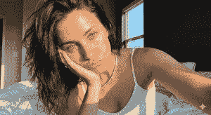

This is a highly detailed, structured JSON prompt designed for the 'nano banana pro' AI model, intended to generate a viral close-up selfie image. It specifies every aspect of the scene, lighting (golden hour, sunset), camera perspective (close-up, 35mm, f/2.8), and subject details (pose, facial features, hair, wardrobe) for maximum visual impact and realism.

提示詞

{ "scene": { "environment_type": "indoor_bedroom", "lighting": { "primary_source": "direct sunset sunlight", "quality": "golden hour, warm, harsh contrast, long shadows", "direction": "from the right, low angle", "color_temperature_kelvin": 3500, "specular_bloom": "moderate" }, "background_elements": { "bedding": { "material": "cotton, slightly wrinkled", "color": "white", "visibility": "dominant in lower frame and right side" }, "wall": { "color": "dark charcoal grey", "texture": "matte paint", "visibility": "upper right" }, "window": { "frame_material": "dark metal", "glass_visibility": "clear", "view": "clear blue sky", "visibility": "upper left" } } }, "camera_perspective": { "shot_type": "close-up selfie", "framing": "portrait crop (chest up)", "viewing_angle": { "vertical": "slightly above eye-level", "horizontal": "straight-on" }, "optics": { "focal_length_mm": 35, "aperture": "f/2.8", "depth_of_field": { "subject_sharpness": "high", "background_blur_amount": "moderate" }, "sensor_noise_iso": 400, "grain_texture": "natural film grain" } }, "subject": { "category": "human_with_feminine_presentation", "pose": { "body_orientation": "angled slightly to the left", "head_position": { "pitch": "+2° downward", "yaw": "+5° to right" }, "gaze": { "direction": "directly at camera lens", "eye_opening": "slightly narrowed", "expression": "pouty, relaxed" }, "hands": { "left_hand": { "role": "supporting head", "position": "cupped under left cheek", "fingers": "relaxed, partially visible" } } }, "facial_details": { "skin": { "tone": "medium with sun-kissed golden undertone", "texture": "smooth, natural glow", "specular_highlights": { "locations": ["forehead", "nose bridge", "left cheek"], "intensity": "high due to direct sunlight" }, "imperfections": "minor natural texture" }, "eyes": { "shape": "almond", "iris_color": "striking blue-green", "lashes": "dark, defined" }, "eyebrows": { "shape": "full, dark brown, defined arch" }, "lips": { "shape": "full, well-defined", "color": "rosy pink", "texture": "natural, matte" } }, "hair": { "color": "dark brown", "length": "long", "style": "messy, tousled", "strand_properties": { "shine_level": "high where sunlit", "frizz_amount": "moderate", "flyaways": "prominent across face and forehead" } }, "wardrobe": { "top": { "type": "s

精選

### 寬版引言卡，附人像及中英文自訂選項

一個用於生成寬版引言卡的提示，其中包含一位名人的肖像、棕色背景、淺金色襯線引言文字，以及文字佔三分之二、人物佔三分之一的版面配置。引言文字和作者已參數化以便重複使用。

提示詞

一张宽幅的名人金句卡，棕色背景，衬线体浅金色“ 保持饥饿，保持愚蠢 ”，小字“—— Steve Jobs ”，文字前面带一个大的淡淡的引号。人物头像在左边，文字在右边，文字占画面比例 2/3，人物占 1/3，人物有一点渐变过渡的感觉。

精選

### [黑板風格的 AI 新聞摘要 ](https://x.com/okknews/status/1992173611520868372)


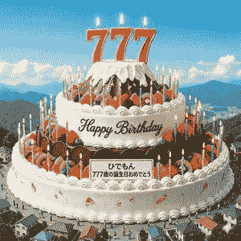

將 AI 新聞內容轉化為手繪教師風格黑板圖並附有解釋的日文提示。

提示詞

使用以下內容，以黑板手寫風格歸納新聞，並像老師寫的一樣，用圖表和淺顯易懂的表達方式來分解說明。 —- 來自 Grok 的搜尋結果

精選

### 根據參考圖片拍攝的奢華簡約產品攝影


一個用於生成高端、極簡主義商業產品攝影的提示，風格仿照奢侈品牌廣告，並以上傳的核心產品參考圖片為基礎。

提示詞

请以我上传的参考图为基础，生成一张极简主义、高质感、具有奢侈品广告风格的商业静物摄影大片。 保留参考图中【核心产品】的大致造型、比例和主要配色，让人一眼能认出是同一件产品，但请整体升级画面的质感与氛围：让它看起来像国际一线香氛、护肤品或高端电子产品的广告画面。 画面采用竖版 4:5 构图，背景为大面积干净的中性色留白，例如柔和的米白、冷灰或浅米色，营造安静、克制、昂贵的影棚空间。除核心产品和极少量必要的支撑物外，不要添加任何多余装饰，不要杂物、不摆场景，只保留极简的几何支撑物即可（如一个简洁的白色方块、圆柱或一块薄薄的透明板），并且支撑物形状要简单、低存在感，只用来托举和衬托产品。 请强烈强调产品的材质细节，让光影完全服务于材质本身： 让磨砂玻璃呈现出细腻柔和的雾面质感，陶瓷呈现出哑光或轻微釉感，高光金属呈现出干净锋利的高光边缘，液体部分则要有清晰的粘稠度和体积感。避免任何廉价塑料感、复杂花纹或花哨贴纸，整体质感要冷静、克制、昂贵。 使用专业影棚布光，整体为柔光箱的柔和漫射光，在此基础上加入精准的边缘光（rim light）勾勒产品轮廓，让轮廓线干净利落、层次清晰，阴影要柔和、干净，没有噪点和脏乱的阴影块。可以采用接近微距的镜头视角，适度靠近产品，以突出材质和细节，同时在画面四周保留充足的负空间，让产品在一片留白中「独自发声」。 整体色彩保持冷静的中性色为主，产品本身的颜色可以略微提高饱和度，用来成为画面唯一的视觉焦点。不要使用夸张的渐变背景、花哨的彩色灯光或电商促销风格，不要出现大字号价格、标签或卡通图形。 最终效果必须是一张高分辨率的商业广告大片，看起来像可以直接用于杂志封底或高端品牌官宣海报的静物大片：极简、安静、高级，核心产品在画面中心自信地存在，周围是干净的留白和精确控制的光影。

精選

### 2005 年 Sony CyberShot 商場美食廣場快照提示

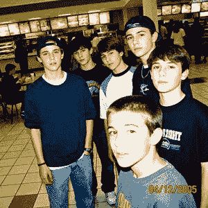


一個圖像提示，重現一張早期數碼相機拍攝的購物中心美食廣場照片，其中有青少年、刺眼的閃光燈、日期戳記和 Myspace 時代的美學風格。

提示詞

一張用 2005 年 Sony CyberShot 拍攝的低解析度數位相片。一群青少年在購物中心的美食廣場閒逛。刺眼的機頂閃光燈，高光部分略微過曝，陰影處有數位雜訊。由於早期數位處理，皮膚紋理看起來有點蠟質。右下角有一個橘色日期戳記，上面寫著「 04/12/2005 」。隨性、尷尬的角度，充滿 Myspace 相片美學。

### The Soft Drink Fortress Prompt

A prompt shared for Nano Banana Pro, titled 'The Soft Drink Fortress', likely intended for generating an image of a fortress or structure made of soft drink cans or bottles.

### [9-Panel Episode ](https://x.com/kiyoshi_shin/status/1997810063319449790)Continuation Prompt

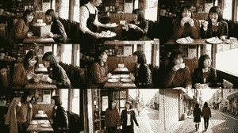

A simple prompt for Nano Banana Pro to generate a 9-panel grid depicting the continuation of a story or episode involving existing characters, often used for narrative progression.

提示詞

Describe the continuation of these characters' story in a 9-panel grid.

### [Nano Banana Pro Silly Doodl](https://x.com/an303042/status/1997802444420747364)e Generation Prompt

This prompt is used with the Nano Banana Pro image generation tool to bring out its 'inner 2nd grader,' resulting in silly, doodle-like images based on the input text.

提示詞

A silly doodle of a cat wearing a tiny hat

### [Hyper-realistic illustration of the four seas](https://x.com/dotey/status/1997787952110239874)ons cycle in one continuous composition

A detailed image generation prompt designed to create a hyper-realistic digital illustration that seamlessly blends all four seasons—Winter, Spring, Summer, and Autumn—into a single, continuous composition. The prompt specifies the visual progression, lighting, and resolution for a cinematic, detailed panorama.

提示詞

Hyper-realistic digital illustration of the historic Shanghai Bund waterfront looking across the Huangpu River to the futuristic Lujiazui district , presented as a single continuous composition showcasing the cycle of seasons. The scene flows seamlessly from left to right in a natural progression: Winter, Spring, Summer, and Autumn. The left side features cold snowy winter elements, gradually thawing into the fresh green buds and blooms of spring, then morphing into the lush vibrant vegetation and bright sunlight of summer, and finally transitioning into the golden, orange, and red hues of autumn on the far right. There are no visible dividing lines between seasons; the weather, lighting, and vegetation blend smoothly to create a unified and harmonious panorama. Rich in detail, symbolic of the passage of time, cinematic lighting, 8k resolution, highly detailed textures. --ar 4:3

精選

### 手繪風格標題圖片提示，源自照片


為一張手繪風格的標題圖片提供提示，內容為一個人介紹 Nano Banana Pro

提示詞

完全重現上傳的人物。 將其製作成一篇筆記文章的標題圖片，內容是該人物介紹「Nano Banana Pro」。 長寬比：橫向 16:9。 風格與顏色：簡潔、手繪風格、斜體，並帶有藍綠漸層。 標題文字：「深入解析 Google 全新 AI『Nano Banana Pro』」。

精選

### [夢想日記：卡比吹泡泡 ](https://x.com/songguoxiansen/status/1991795708308189668)


粉紅色 Kirby 睡在星星上，在柔和的雲朵和糖果中吹著彩虹泡泡，一幅夢幻日記風格插畫的可愛提示。

提示詞

梦境日记。粉红色的星之卡比睡在一颗星星上，嘴里吐出彩虹色的气泡。柔和的马卡龙色系，云朵和糖果的贴纸，闪粉笔画的细节，梦幻且甜美。

精選

### 江戶時代浮世繪風格的現代場景再詮釋

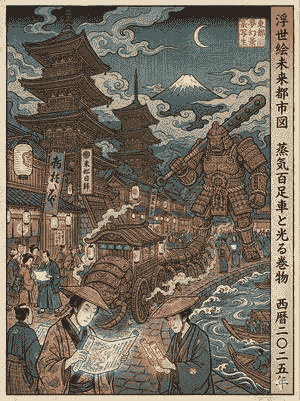

一個高度結構化的圖像提示，用於描繪一個現代場景，重新構想為日本江戶時代的浮世繪木刻版畫，並詳細指導時代錯誤的科技、構圖、紋理和色彩。

提示詞

一幅日本江戶時代的浮世繪木刻版畫。整體感覺是葛飾北齋和歌川廣重等大師的超現實合作，透過古老的視角重新詮釋現代科技。 **場景：** 繁忙的澀谷十字路口 **江戶時代的轉化邏輯：** 人物身著江戶時代的和服，卻在進行現代活動。所有科技都被轉化為超現實的江戶時代等效物： * 智慧型手機是發光的彩繪紙卷，人們正專注地閱讀。 * 地鐵站和列車是巨大的鉸接式木製蜈蚣車廂，在人群中穿梭。 * 摩天大樓被重新想像成無盡、高聳的木製寶塔，直入變幻莫測的雲端。 * 機器人和機甲則以巨大的、身披盔甲的木刻魔像形象出現。 構圖採用扁平視角，具有粗大、醒目的手刻墨線輪廓。背景以高度風格化的浮世繪波浪圖案和戲劇性的旋渦雲為特色，遠處地平線上可見富士山。 圖像必須看起來像實體版畫，而非數位繪畫。 * 紋理：整幅作品中，木紋紋理和粗糙的紙纖維清晰可見。 * 印刷瑕疵：顏料滲色明顯。模擬手工壓印版畫，帶有輕微的色彩錯位，以增添真實感。 * 調色板：嚴格限於傳統礦物顏料，主要使用普魯士藍、朱紅色和柔和的赭黃色。 * 光線：柔和、平坦、無陰影的光線，沒有數位漸層。 長寬比為 3:4 的垂直海報。包含描述場景的垂直日文書法，並在角落處有一個傳統的紅色藝術家印章。

### 建立 3D 風格的電影場景

輸入電影系列名稱或演員姓名以開始此程序

提示詞

[电影系列名称]： 007 一张细节丰富、45度等轴侧视角的3D Q版微缩景观模型图，生动呈现完整的 [电影系列名称] 系列，采用 C4D (Cinema 4D) 的独特的渲染风格。 整个场景构建为一组相互连接的六边形景观地台。六边形地台的总数量必须准确对应 [电影系列名称] 系列中主要电影（或剧集）的数量。 视觉中心 (Central Focus) 在模型的几何中心，放置该系列中最具标志性、最能代表整体的世界观地标或核心建筑（例如：哈利波特的霍格沃茨城堡、星球大战的死星、漫威的复仇者大厦）。围绕着这个中心建筑，悬浮着巨大的、风格化的 3D 英文总标题 "[电影系列名称]"。 独立地台 (动态内容) 围绕中心的每一个六边形地台分别代表该系列中的一部具体电影，必须包含以下要素： 经典名场面 (Famous Scenes)： 每一个地台都要复刻该部电影中最具特色、一眼即识的经典“名场面”或核心场景布局。 关键人物 (Key Characters)： 在地台上必须出现清晰可见的、最具代表性的主角和反派的Q版公仔形象，人物姿态生动，正在演绎剧情。 关键物品： 每一个地台都要复刻该部电影中最具特色、一眼即识的经典“名场面”或核心场景布局。 关键人物 (Key Characters)： 在地台上必须出现清晰可见的、最具代表性的主角和反派的Q版公仔形象，人物姿态生动，正在演绎剧情。 散落在场景中的微小但可识别的神器、载具或生物，呼应电影情节。 环境氛围: 符合该部电影主题的独特地形、植被和天气效果。 独立标题： 在每个六边形底座的前端边缘，用风格化的3D字体展示该部电影的 具体英文片名 (例如 "Harry Potter and the Sorcerer's Stone")。 整体氛围: 所有元素通过可爱的桥梁、小径或主题过渡（如能量束、魔法轨迹）相互连接。模型采用丰富逼真的 PBR 材质（风格化的木材、石头、金属、布料），边缘处理圆润柔和。场景由温暖、柔和的自然光照亮，投射出柔和的阴影，在干净、统一的纯米色背景下，呈现出一种舒适、高级的盲盒玩具质感。 保证 图中所有出现的单词拼写正确 确保电影的系列名准确 确保演员的名字和电影确实有关联

### [Hyper-Realistic Neon Ti](https://x.com/limedesignmedia/status/1997810356132159724)mes Square Portrait


A complex JSON-structured prompt for Gemini Nano Banana Pro, designed to create a hyper-detailed, cinematic portrait of a man in Times Square, focusing on rich textures, neon lighting effects, and specific photographic parameters like shallow depth of field and micro-surface fidelity.

提示詞

{ "main_subject": "a hyper-detailed 23 -year-old man with a playful, expressive look, wearing stylish casual winter clothing with rich fabric texture and lifelike skin detail", "pose_composition": "close-up portrait capturing his playful expression, winter collar framing his face, subtle breath condensation visible in the cold air", "camera_framing": "tight close-up shot with strong facial focus, shallow depth of field, soft bokeh from Times Square lights behind him", "lighting_color_palette": "neon-lit winter tones blending cool ambient light with warm billboard reflections softly illuminating his face", "environment_background": "blurred Times Square winter nightlife, glowing signs and city lights creating a colorful bokeh backdrop", "artistic_style": "premium winter city-hyperrealism with intimate portrait emphasis, crisp facial rendering, and atmospheric urban glow", "nano_secret_tokens": "Nano-detail, 8k neon portrait crispness, sub-surface scattering, micro-surface fidelity, winter breath bloom, cinematic bokeh, rule of thirds, diffraction glints, f/1.8 aperture depth blur, pure texture rendering" }

### [D](https://x.com/iq_Huri632/status/1997808773272899831)etailed JSON-based Image Generation Prompt for Gemini Nano Banana Pro


This is a highly structured, JSON-formatted prompt designed for the Gemini Nano Banana Pro image generation tool. It specifies a complete pipeline sequence for creating an 'Evening Festival Portrait' image, including detailed settings for subject identity preservation (using an attached image buffer), kinematics control (OpenPose), wardrobe assembly, environment staging (Outdoor Night Market), and lighting setup. It's useful for users who want precise control over every aspect of the generated image, especially when starting from a reference photo.

提示詞

{ "pipeline_sequence_v5": { "global_settings": { "project_name": "EVENING_FESTIVAL_PORTRAIT", "render_target": { "width": 1080, "height": 1920, "ratio": "9:16" }, "seed_strategy": "Fixed", "steps": 50 }, "node_01_subject_initialization": { "module": "Identity_Preservation", "parameters": { "source_input": "Attached_Image_Buffer", "face_restore_strength": 1.0, "feature_lock": { "eyes": "Strict", "nose": "Strict", "mouth": "Strict", "skin_texture": "Blend_with_Prompt" } }, "morphology": { "hair": { "style": " Long_Wavy ", "color": " Brown ", "physics": "Natural_Soft" }, "makeup": { "lips": " Soft_Natural_Pink ", "finish": "Dewy", "intensity": "Natural_Glow" } } }, "node_02_kinematics_control": { "module": "ControlNet_OpenPose", "pose_skeleton": { "body_orientation": "Standing", "spine_curve": "Slight_Lean_Back", "right_arm": { "state": "Relaxed_Down" }, "left_arm": { "state": "Relaxed_Down" }, "head_vector": { "pitch": 0, "yaw": 10, "target": "Lens_Direct" } } }, "node_03_wardrobe_assembly": { "module": "Layered_Clothing_Generator", "layers": [ { "layer_id": 1, "item": " Sleeveless Crop Top ", "pattern": " Floral_Oriental ", "color_palette": " Navy_Orange_Green ", "fit": "Fitted" }, { "layer_id": 2, "item": "Accessories", "elements": [ { "type": "Necklace", "style": "Layered_Gold_Choker" }, { "type": "Earrings", "style": "Small_Drop" } ] } ] }, "node_04_environment_stage": { "module": "Scene_Builder", "setting_type": " Outdoor_Night_Market ", "assets": { "lighting_decor": "Hanging_Warm_String_Lights", "background_elements": "Plants_Shops_People", "ground_material": "Soft_Dirt" }, "atmosphere": { "mood": "Warm_Festive_Evening", "clutter_density": "Medium_Lively" } }, "node_05_lighting_engine": { "module": "Illumination", "setup": { "primary_source": "Warm_Festoon_Lights", "fill_light": "Ambient_Night_Soft", "color_grading_lut": "Warm_Glow", "shadow_quality": "Soft" } } } }

### [H](https://x.com/dotey/status/1997789829736861747)yper-realistic Digital Illustration of Four Seasons Transition


A detailed image generation prompt for creating a hyper-realistic digital illustration that seamlessly depicts the transition of all four seasons—Winter, Spring, Summer, and Autumn—within a single, continuous scene. The transition flows naturally from left (Winter) to right (Autumn), maintaining a unified composition with cinematic lighting and 8K resolution.

提示詞

超写实数字插画风格，以【 上海外滩 】为主题，呈现四季流转于同一幅完整画面之中。从画面左至右，自然过渡地依次展现冬、春、夏、秋四季变迁： 画面最左侧为冬季，呈现寒冷、冰雪覆盖的景象；逐渐向右过渡，冰雪融化，万物初醒，新芽萌发，春意盎然；继续推进，植被变得浓郁茂盛，阳光炽烈明媚，夏季盛景跃然纸上；最后，场景平缓地过渡至右侧的秋季，树叶逐渐转为金黄、橙红，体现出秋日的丰富色彩与氛围。 画面整体无明显分界线，各季节间的气候、光影和植被状态自然融合，过渡流畅，构成一幅充满时间流动感和象征意义的统一画面。细节丰富逼真，电影级质感光影表现，8K超高清解析度，纹理细腻精致，画面比例为4:3。

### [Game of Thrones Ice and Fir](https://x.com/kate0ai/status/1997785691111989645)e Isometric Diorama


A detailed image generation prompt designed for Gemini Nano Banana Pro, creating a 45° top-down isometric miniature 3D cartoon diorama based on the central Game of Thrones theme of Ice and Fire. The prompt specifies soft textures, realistic PBR materials emphasizing glittering frost and glowing embers, and a dramatic clash of cool blue and warm orange lighting. It includes specific compositional details like a split diorama base featuring The Wall/White Walkers on one side and a dragon/burning castle on the other, along with precise text overlays and a clean background.

提示詞

Present a clear, 45° top-down isometric miniature 3D cartoon scene of the central thematic concept Ice and Fire from Game of Thrones , with soft refined textures, realistic PBR materials (emphasizing glittering frost contrasts against glowing embers and scaled skin), and gentle lifelike lighting that creates a dramatic clash of cool blue and warm orange light. Create a small raised diorama-style base that is split down the middle. The left side features a section of The Wall made of ice with tiny stylized White Walker figures on snowy terrain. The right side features a stylized dragon ( Drogon ) perched atop a burning castle turret, with tiny stylized Unsullied soldiers on charred ground. A crack runs down the center of the base where the ice meets the lava. Use a clean solid Neutral Slate Grey background. At the top-center, display Game of Thrones in large bold text, directly beneath it show Ice and Fire in medium text, and place the official logo associated with Game of Thrones below the subtext. All text must automatically match the background contrast (white). Composition: perfectly centered layout, square 1080x1080, ultra-clean, high-clarity diorama aesthetic.

### [U](https://x.com/maxxx_dev/status/1997770173143466275)ltra-realistic selfie with F1 champion Lando Norris

A prompt designed to generate an ultra-realistic selfie image featuring the user alongside the 2025 F1 champion, Lando Norris. This prompt is part of the 'Nano Banana Pro' series, focusing on high-fidelity image generation.

提示詞

You + 2025 F1 champ Lando Norris in one ultra-realistic selfie 🏆📸

精選

### [德國水彩地圖，附各邦標籤 ](https://x.com/FlorianGallwitz/status/1991796624646091091)


一個德語提示，用於生成一張水彩風格的德國地圖，其中所有聯邦州都以原子筆標示，適用於教育或資訊圖表風格的地圖。

提示詞

生成一張水彩風格的德國地圖，並用原子筆標示出所有聯邦州。

精選

### [火車廣告風格的書籍廣告圖片 ](https://x.com/kawai_design/status/1992142466255114727)

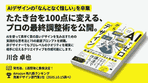

用於生成 16:9 商業書籍風格廣告的詳細日文提示，其中包含特定書籍圖片和日文文案要點。

提示詞

請生成一張廣告圖片。 ==== 廣告規格 === - 長寬比：16:9（橫向） - 廣告產品：第一張附加圖片中的書籍 - 主要吸睛點：以立體方式呈現第一張附加圖片中的書籍 - 語言：日文 - 風格：商業書籍廣告 # 需包含的文字： - 前導文案：【發售約一週後即決定再版】 書籍「 Designing from Zero with AI 」現正熱銷中。 Amazon 暢銷書排行榜 商業設計類別銷售排名第一（截至 10/15） https://t.co/QxbYpfFVj6

精選

### 倫敦戶外餐廳人像照，使用 Nano Banana Pro 拍攝

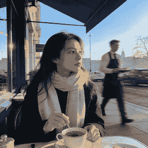


一張照片般真實的提示，描繪一位年輕女性在倫敦一家寧靜的戶外餐廳，時值三月清晨，天氣涼爽宜人。畫面採淺景深，呈現隨手用手機拍攝的自然氛圍。

提示詞

請創作一張寫實的圖像：一位年輕女性在三月一個涼爽的週三早晨，坐在 倫敦 一間輕鬆的戶外餐廳裡。天空晴朗，春天的空氣清新宜人，城市在甦醒中顯得寧靜。她是照片的焦點——圍著一條輕柔的圍巾，輕輕攪拌著茶，若有所思地望向一旁。她身後的一切，從來回穿梭的服務生到輕柔的晨間車流，都應呈現柔和的模糊效果，讓整張照片散發出隨意用手機捕捉到的、不經意的真實氛圍。

精選

### [詳細的鏡中自拍御宅族房間場景 ](https://x.com/dotey/status/1976485558319722711)


一個非常詳細的 Nano Banana 提示，描述一位女性在藍色調御宅族電腦角落裡自拍，包含角色、環境、燈光、相機和負面提示的完整規格。

提示詞

### **场景** 镜子自拍，御宅族电脑角落，蓝色调 --- ### **主体** * **性别表现**: 女性 * **年龄段**: 25岁左右 * **种族**: 东亚 * **身材**: 苗条，腰线分明；身材比例自然 * **肤色**: 浅中性色调 * **发型**: * **长度**: 及腰长发 * **样式**: 直发，发尾微卷 * **颜色**: 中等棕色 * **姿势**: * **站姿**: 站立，轻微的对立式平衡站姿（contrapposto） * **右手**: 手持手机挡住脸（身份被遮挡） * **左臂**: 在躯干旁自然下垂 * **躯干**: 身体轻微后仰；露出腰腹 * **着装**: * **上衣**: 浅蓝色短款针织开衫，扣上前两颗纽扣；隐约可见蓝色法式内衣 * **下装**: 牛仔超短裤，两侧臀部各有一个蓝色缎带蝴蝶结 * **袜子**: 蓝白横条纹过膝长袜 * **配饰**: 蓝色可爱吉祥物手机壳 --- ### **环境** * **描述**: 从挂墙镜中看到的卧室电脑角落 * **陈设**: * 白色书桌 * 单显示器，显示着柔和的蓝色壁纸（没有可读的文字） * 机械键盘，白色键帽，放在蓝色桌垫上 * 鼠标，放在小号蓝色鼠标垫上 * PC主机在右侧，带有蓝色机箱灯效 * PC主机上或附近有三个动漫手办 * 墙上贴着一张佛塔海报 * 猫形台灯，带有蓝色点缀 * 一杯透明的玻璃水杯 * 窗边（镜头左侧）有一株高大的绿叶植物 * **颜色替换**: 将所有原先的粉色元素（衣物和房间）替换为蓝色（婴儿蓝 -> 天空蓝/长春花蓝）。 --- ### **灯光** * **光源**: 来自镜头左侧大窗户的日光，透过薄纱窗帘 * **光线质感**: 柔和的漫射光 * **白平衡 (K)**: 5200 --- ### **相机** * **模式**: 智能手机后置摄像头通过镜子拍摄（无肖像/虚化模式） * **等效焦距 (mm)**: 26 * **距离 (米)**: * 主体到镜子: 0.6 * 相机到镜子: 0.5 * **曝光**: * 光圈 (f): 1.8 * 感光度 (ISO): 100 * 快门速度 (秒): 0.01 * 曝光补偿 (EV): -0.3 * **对焦**: 对焦于镜中影像的躯干和短裤 * **景深**: 自然的智能手机景深（深景深）；背景清晰可辨，无人为模糊 * **构图**: * **宽高比**: 1:1 * **裁剪**: 从头顶到大腿中部；画面包含书桌、显示器、PC主机和植物 * **角度**: 从镜子的视角轻微俯拍 * **构图备注**: 保持主体居中；为避免广角边缘拉伸，可以站远一些再进行方形裁剪 --- ### **负面提示词** * 任何地方出现粉色/品红色 * 美颜滤镜/磨皮皮肤；没有毛孔的外观 * 夸张或扭曲的人体结构 * NSFW，透视面料，走光 * 商标，品牌名，可读的用户界面文本 * 虚假的人像模式模糊，CGI/插画感

精選

### [黑白工作室側身肖像提示 ](https://x.com/ChillaiKalan__/status/1992790080503902651)

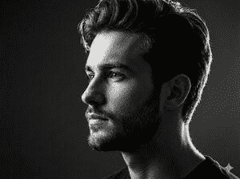

一個簡潔的 Nano Banana Pro 提示，用於生成一張超寫實的年輕男子側面黑白攝影棚肖像，使用隨附的參考圖片並指定尺寸和輸出數量。

提示詞

```json { "Use the attached image of the person as reference. Hyper-realistic black and white studio portrait of the young man in side profile, natural hair gently falling around his face. Strong rim light accentuating his jawline and nose, dark minimalist background. Expression thoughtful and serene, cinematic lighting creating dramatic contrast and fine photographic detail.": "請參考所附人物圖片。一張超寫實的黑白工作室肖像照，年輕男子側面入鏡，自然髮絲輕柔地垂落在臉龐周圍。強烈的輪廓光突顯了他的下顎線和鼻子，背景為深色極簡風格。表情沉思而寧靜，電影般的燈光營造出戲劇性的對比和精緻的攝影細節。", "size": "{argument name=\"image size\" default=\"1024x1024\"}", "n": "{argument name=\"number of images\" default=\"1\"}" } ```

### [Detailed portrait prompt for a fem](https://x.com/lexx_aura/status/1997909307682079051)ale subject in a nighttime city setting

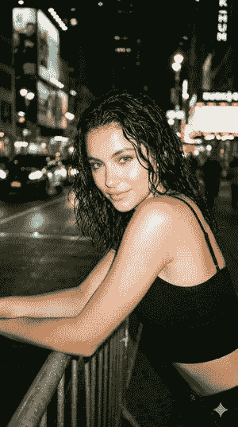

A highly detailed image generation prompt focusing on a medium close-up portrait of a young adult female subject in a city street at night. The prompt meticulously defines the subject's features (wet look hair, dewy skin, subtle makeup), apparel (black ribbed crop top), pose (leaning on a railing), environment (blurred urban cityscape with bokeh), and specific professional camera settings (Canon EOS R5, 85mm f/1.2L lens, flash photography style).

提示詞

{ "subject": { "gender": "female", "age": "young adult", "hair": { "color": " dark brown ", "texture": "wet look", "style": "long, wavy, messy, loose strands framing face" }, "eyes": { "color": " green/hazel ", "makeup": "subtle winged eyeliner, natural eyeshadow" }, "skin": { "tone": "light/fair", "texture": "smooth, dewy finish, high sheen on shoulder and cheekbones", "makeup": "soft contour, glossy lips" }, "expression": " soft smile, direct eye contact, alluring " }, "apparel": { "top": { "type": "crop top", "color": " black ", "material": "ribbed fabric", "fit": "tight", "straps": "thin straps" }, "bottom": { "visible": "waistband", "color": "black" } }, "pose": { "action": "leaning forward", "arms": "resting on a railing", "angle": "3/4 portrait view" }, "environment": { "setting": "city street at night", "background": "blurred urban cityscape, bokeh streetlights, car headlights, building lights", "atmosphere": "nightlife, candid" }, "lighting": { "type": "flash photography style mixed with ambient street lighting", "highlights": "strong specular highlights on skin (shoulder, forehead, nose)", "shadows": "soft shadows defining facial features" }, "camera_settings": { "shot_type": "medium close-up", "depth_of_field": "shallow", "focus": "sharp on face" }, "camera_details": { "camera_model": " Canon EOS R5 Mirrorless Digital Camera ", "lens": " Canon RF 85mm f/1.2L USM Lens ", "aperture": "f/1.4", "iso": "1600", "shutter_speed": "1/100s", "focal_length": "85mm", "white_balance": "Auto (AWB) with slight tungsten warmth", "flash_type": "Direct on-camera flash with diffuser", "image_format": "RAW", "color_profile": "Adobe RGB" } }

### Style Transfer to Anime Cartoon

A prompt used to transfer the style of a reference image (likely a photo of a person) into an anime cartoon aesthetic, ensuring the color palette, general mood, and slight dark tone overlay are maintained.

提示詞

Draw this person in this anime cartoon style. It should follow color palette, general mood. Keep the slight dark tone overlay.

### [Wes Anderson-designed X A](https://x.com/cfryant/status/1997786299252846875)pp Mobile Interface

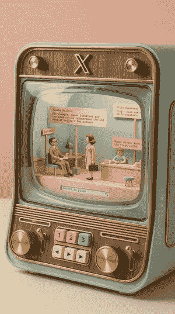

An image generation prompt for creating a hyper-realistic skeuomorphic design of the X app mobile interface, reimagined in the distinctive aesthetic style of filmmaker Wes Anderson.

提示詞

The X app mobile interface if it was designed by Wes Anderson . Make the style hyper realistic skeuomorphism

### [D](https://x.com/NavroMedia/status/1997773519095242923)etailed JSON Prompt for Viral Close-Up Selfie Image Generation


This is a highly detailed, structured JSON prompt designed for the 'nano banana pro' AI model, intended to generate a viral close-up selfie image. It specifies every aspect of the scene, lighting (golden hour, sunset), camera perspective (close-up, 35mm, f/2.8), and subject details (pose, facial features, hair, wardrobe) for maximum visual impact and realism.

提示詞

{ "scene": { "environment_type": "indoor_bedroom", "lighting": { "primary_source": "direct sunset sunlight", "quality": "golden hour, warm, harsh contrast, long shadows", "direction": "from the right, low angle", "color_temperature_kelvin": 3500, "specular_bloom": "moderate" }, "background_elements": { "bedding": { "material": "cotton, slightly wrinkled", "color": "white", "visibility": "dominant in lower frame and right side" }, "wall": { "color": "dark charcoal grey", "texture": "matte paint", "visibility": "upper right" }, "window": { "frame_material": "dark metal", "glass_visibility": "clear", "view": "clear blue sky", "visibility": "upper left" } } }, "camera_perspective": { "shot_type": "close-up selfie", "framing": "portrait crop (chest up)", "viewing_angle": { "vertical": "slightly above eye-level", "horizontal": "straight-on" }, "optics": { "focal_length_mm": 35, "aperture": "f/2.8", "depth_of_field": { "subject_sharpness": "high", "background_blur_amount": "moderate" }, "sensor_noise_iso": 400, "grain_texture": "natural film grain" } }, "subject": { "category": "human_with_feminine_presentation", "pose": { "body_orientation": "angled slightly to the left", "head_position": { "pitch": "+2° downward", "yaw": "+5° to right" }, "gaze": { "direction": "directly at camera lens", "eye_opening": "slightly narrowed", "expression": "pouty, relaxed" }, "hands": { "left_hand": { "role": "supporting head", "position": "cupped under left cheek", "fingers": "relaxed, partially visible" } } }, "facial_details": { "skin": { "tone": "medium with sun-kissed golden undertone", "texture": "smooth, natural glow", "specular_highlights": { "locations": ["forehead", "nose bridge", "left cheek"], "intensity": "high due to direct sunlight" }, "imperfections": "minor natural texture" }, "eyes": { "shape": "almond", "iris_color": "striking blue-green", "lashes": "dark, defined" }, "eyebrows": { "shape": "full, dark brown, defined arch" }, "lips": { "shape": "full, well-defined", "color": "rosy pink", "texture": "natural, matte" } }, "hair": { "color": "dark brown", "length": "long", "style": "messy, tousled", "strand_properties": { "shine_level": "high where sunlit", "frizz_amount": "moderate", "flyaways": "prominent across face and forehead" } }, "wardrobe": { "top": { "type": "s