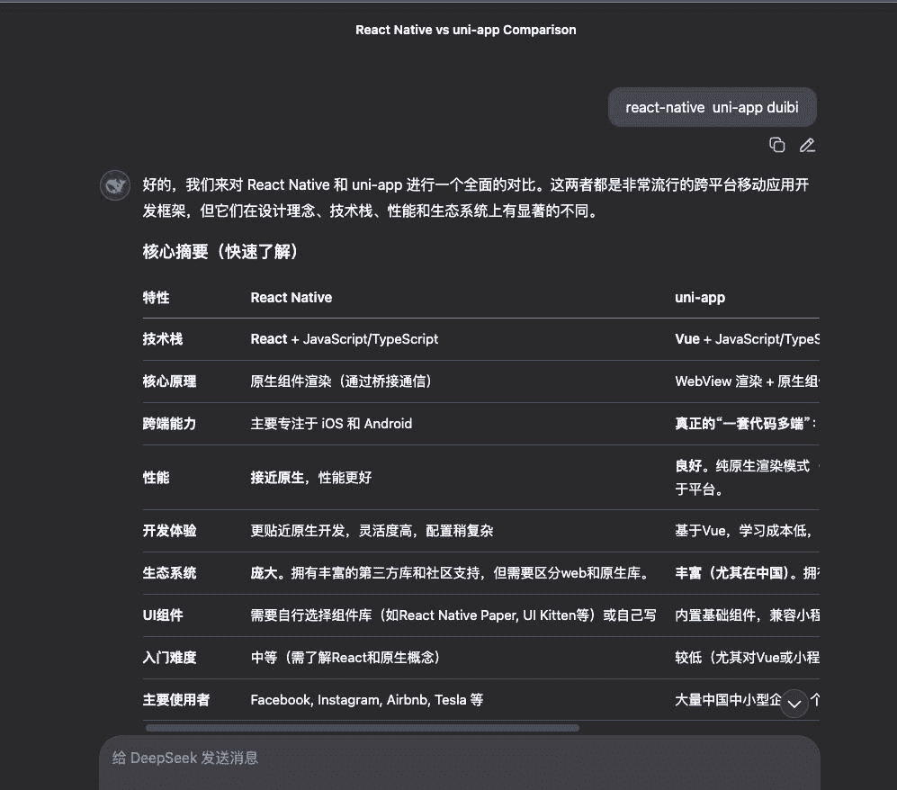
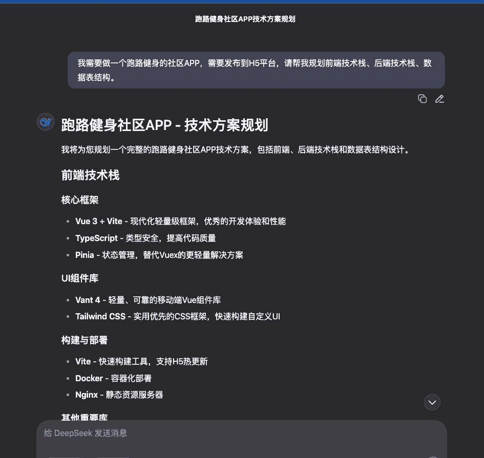

# 待学

> 来源：[https://xatc0v8uz5m.feishu.cn/docx/B2uPduYEhoXwXNxWuaHcgTh7n9f](https://xatc0v8uz5m.feishu.cn/docx/B2uPduYEhoXwXNxWuaHcgTh7n9f)

**1、选择简单流行技术栈**：如 react、express 等，大模型语言擅长解决成熟问题。

2、精通Git，严格的版本控制

自动生成n8n工作流！这个神级开源方案，绝了～

[自动生成n8n工作流！这个神级开源方案，绝了～](https://waytoagi.feishu.cn/wiki/L26swiiLIisLr7k5XpacBhtRnMh)

https://github.com/Zie619/n8n-workflows

编程语言

GO后端，Python

