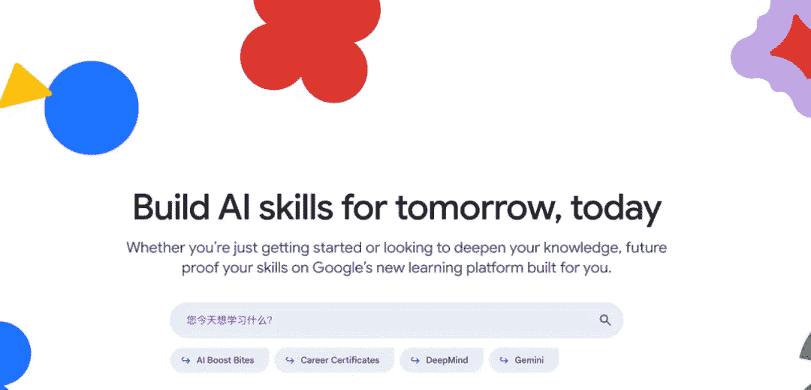
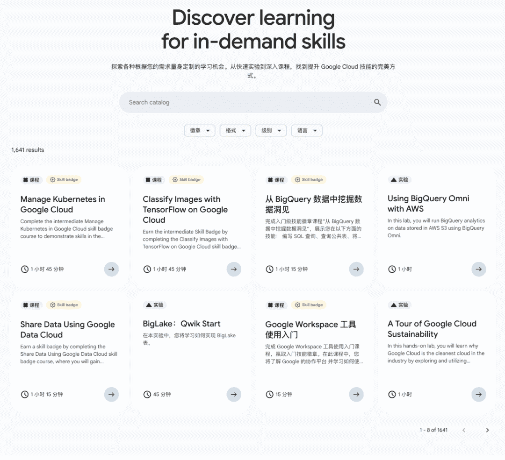
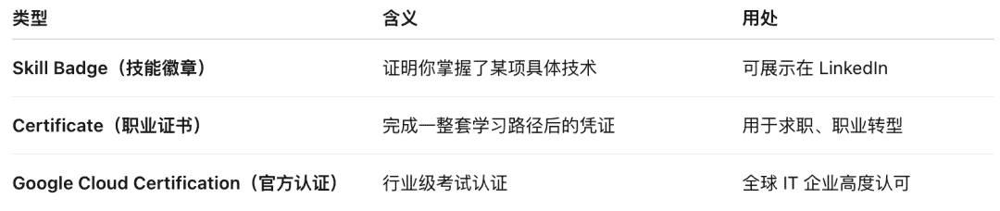
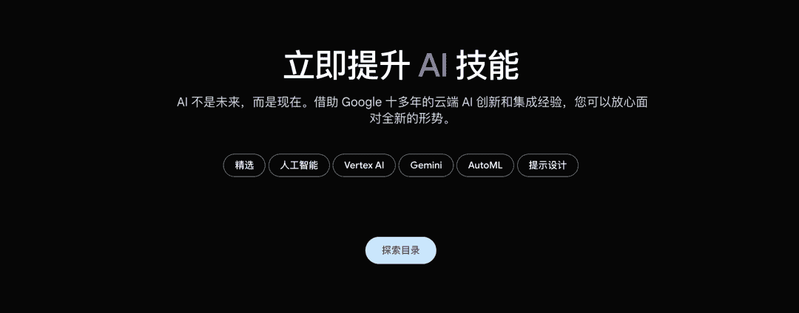
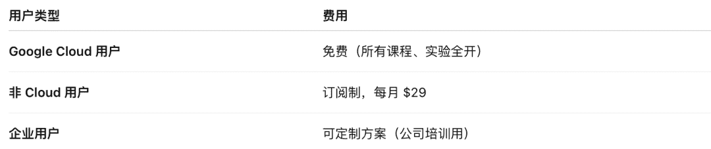

# 兄弟们 Google把公司“内部AI知识”直接开放给公众学习了...

> 来源：[https://xatc0v8uz5m.feishu.cn/docx/EoB6dBx5Go2NerxFltqcN9Hon3f](https://xatc0v8uz5m.feishu.cn/docx/EoB6dBx5Go2NerxFltqcN9Hon3f)

> 🔗 原文链接： h[ttps://mp.weixin.q](https://mp.weixin.qq.com/s/NzAzxTJzl8hvSMcYGgp8fQ)q.com/s/NzAzxTJz...

> ⏰ 剪存时间：2025-10-23 17:17:56 (UTC+8)

> ✂️ 本文档由 [飞书剪存 ](https://www.feishu.cn/hc/zh-CN/articles/606278856233?from=in_ccm_clip_doc)一键生成

原创 小互 小互AI2025年10月23日 14:09

兄弟们，牛P了

Google推出 Google Skills

整合了Google旗下几个最强团队的内部实训资源：

DeepMind AI 研究的团队

Google Cloud

Gemini AI 模型开发团队

Google Education

来教你学AI...

简单说：它是一个把“Google的内部AI知识”直接开放给公众学习的平台

而且学完还给你发证书...

企业还认可，可以直接推荐工作机会...

🎓 这些内容，大学要收你 6** 万美元 ：**

👉 Google对 对所有 Google Cloud 用户完全免费。

**包括：**

+   DeepMind 的真实 AI 研究训练课程

+   **超过 700 个真实**云环境中的 实操实验（动手练习）

+   内置 Gemini Code Assist （AI 编程助手）

+   完成课程后拿到 官方数字证书（Skill Badge / Certificate）

+   与 150 多家公司直接连接的就业通道

+   如果愿意深入，还能考取 Google Cloud 专业认证 （这是 IT 行业薪资最高的认证之一）。

这些证书可以直接放在 LinkedIn 或简历上，被全球很多公司认可。

简单说：

> 它是一个把“Google的内部AI知识”直接开放给公众学习的平台。

关闭

**观看更多**

更多

退出全屏

切换到横屏模式

[🎦 点击观看视频](https://mpvideo.qpic.cn/0bc3jyaoaaaaf4acgwxzovufatwd4bhabyaa.f10002.mp4?dis_k=bb37564521b5df87149ad2464a07ec9d&dis_t=1761211000&play_scene=10120&auth_info=c73ImK0GT1I206eehnBAUThCAkApKWtbNUVCNwYrbzxLEmJnHjd1WWNkfRI4EgNoP1gC&auth_key=fb304c796dfb6b61212917648349809c&vid=wxv_4221259525531336713&format_id=10002&support_redirect=0&mmversion=false)

视频详情

# 01

# —

#  课程与学习内容

涵盖主题：

+   人工智能与机器学习（AI / ML）

+   DeepMind AI 研究与伦理

+   Gemini AI 与代码辅助（Code Assist）

+   Google Cloud 技术（Vertex AI、AutoML、Prompt Design 等）

+   所有课程均来自 Google 内部研发团队与合作伙伴。

+   课程形式：

+   自主学习（Self-paced Learning）

+   指导式教学（Instructor-led）

+   动手实验（Hands-on Labs）

> ✅ 核心特点：内容真实、贴近生产环境、涵盖从入门到高级的路径。

# 02

# —

#  课程形式：不只是视频

Go**ogle **Skills 强调“ 动手学习（hands-on learning） ” 实操训练 。

除了视频和讲解，还提供：

+   **实操环境（Labs） **提供真实的 Google Cloud 环境实验室。

+   **练习任务（Tasks） **：让你自己写代码、建模型；

+   **实时反馈 **：AI 工具 Gemini 会在平台里帮你调试或补充提示。

+   所有注册用户每月可通过 Googl**e Cloud In**novators Program 
免费获得 35 美元学习额度 （可用于云实验）。

+   用户还可使用最高 **$500 免费云积分 **进行 AI 项目实践。

> 🔹 数据显示：

+   77% 学员更喜欢带导师的教学方式；

+   90% 的指导式课程完成率远高于自学模式；

+   企业投资实训可提高员工留任率 133%。

#

# 03

# —

#  学习成果与证书

完成课程后可以获得三种形式的成果：

👉 这些证书和徽章都是真实的、可验证的数字凭证，并被超过 82% 的招聘方认可为职业资质

**合作与就业机会**

**Google Skil**ls 不只是教学，还和 150 多家合作企业 建立了招聘渠道。

这意味着完成某些认证后，你可以：

+   被纳入这些公司的“候选人库”；

+   通过官方渠道获得面试或实习机会。

换句话说，它把“学技能 → 认证 → 求职”整合到一条路径上。

#

# 04

# —

#  费用与访问方式

Google Cloud 用户免费（所有课程、实验全开）

非 Cloud 用户，订阅制，每月＄29

企业用户，可定制方案（公司培训用）

💡 对比：大学同类课程动辄 5–6 万美元，Google Skills 几乎“零门槛”。

##

Google Skills 官方网站：www.skills.google

---

加入XiaoHu.ai 日报社群 每天获取最新的AI信息

____________

End.

# 感 谢 阅 读

点赞，转发，关注关注关注↓↓