# 2026年AI学习路线图：AI硬核玩家必看！附100多篇经典论文免费下载

> 来源：[https://xatc0v8uz5m.feishu.cn/docx/Gly5dNexTo0PEfxsQC2cceDGnAc](https://xatc0v8uz5m.feishu.cn/docx/Gly5dNexTo0PEfxsQC2cceDGnAc)

> 🔗 原文链接： h[ttps://mp.weixin.q](https://mp.weixin.qq.com/s/aM4Ma8NFobp8iBXNOSSv4g)q.com/s/aM4Ma8NF...

> ⏰ 剪存时间：2026-01-04 16:55:11 (UTC+8)

> ✂️ 本文档由 [飞书剪存 ](https://www.feishu.cn/hc/zh-CN/articles/606278856233?from=in_ccm_clip_doc)一键生成

原创 向阳乔木 向阳乔木推荐看2026年1月4日 16:25

今天读卡兹克解读 Deepseek 的最新论文。

我觉得真写的挺好的，但发现评论区很多人喷，AI科普真的难做啊。

不打比方像我们这样的小白能听懂吗，又说只有原作者才可以打比方，这是啥道理。

随后看到 AJ 发的截图，感觉卡兹克确实有点憋屈。


2026年开始，也想计划好好学论文。

不是为了完全搞懂，单纯就想了解AI圈里，那些顶级聪明的人在关注什么问题，如何用他们的奇思妙想解决这些难题的。

同时回顾AI发展史上的经典论文，更好了解AI技术的发展路径。

**巧了，瞌睡就有人递枕头。**

今天看到 Latent Space的2025年必读论文、资料合集，简直雪中送炭！

> Latent Space是目前AI工程领域最有影响力的播客和社区之一。

他们挑选推荐了 50 篇论文，也提到其他论文。

让 AI 全部下载后，发现一共123篇。

涵盖了 AI 领域方方面技术，从文本、生图、视频模型，到RAG、Prompt等技术，通通都有。

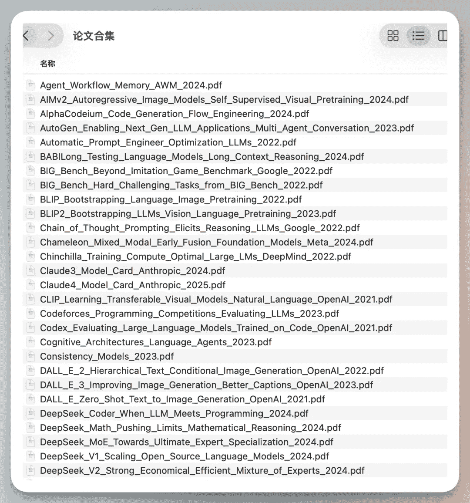

原文地址：

> https://www.latent.space/p/2025-papers

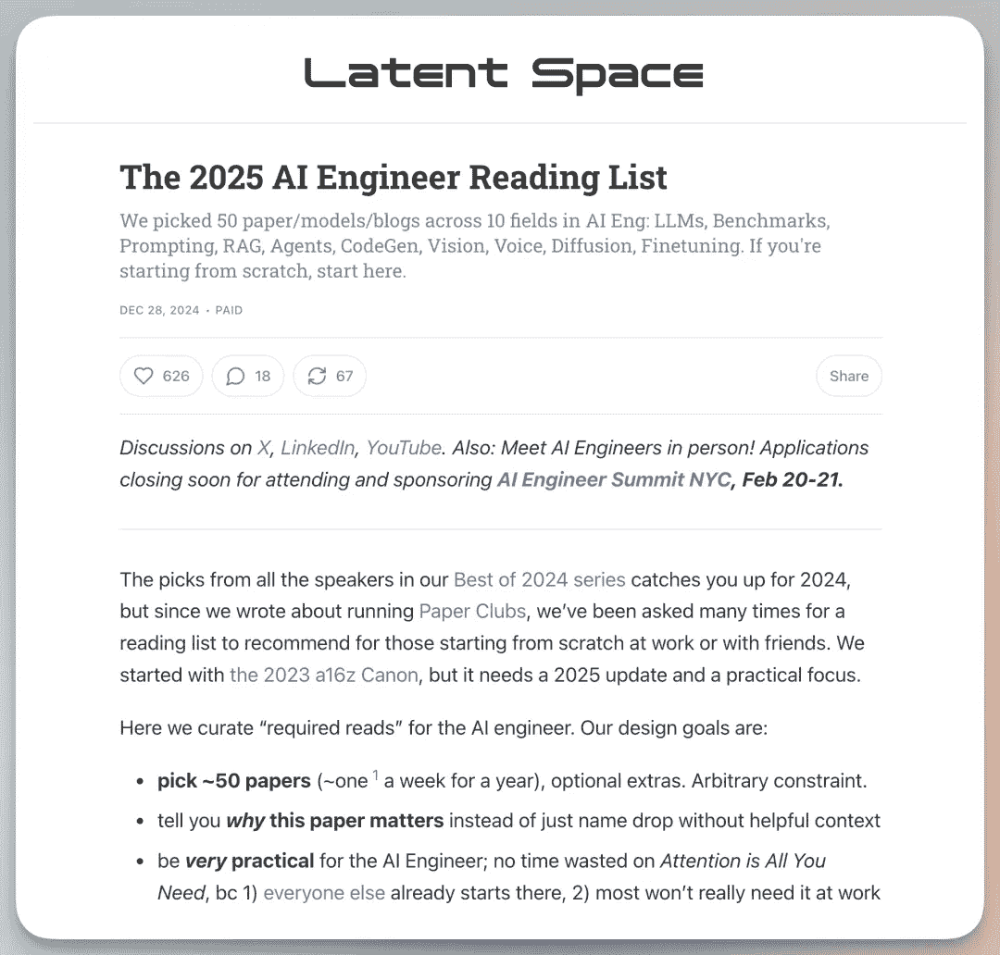

原文写的简略，大量术语，新手可能不好懂。

让AI分析重新扩写了一篇，竟然有一万五千字 （原文3千字🤣🤣 🤣 ）。

AI术语太多，讲明白真的很难，科普不易。

（提醒：AI生成可能有误，虽然已用Perplexity校验了许多，快崩溃了）

人工阅读排版补充，花了快3个小时，内容硬核，建议先收藏再看。

## 第一部分：大语言模型是什么

**大语言模型 **，简单说就是ChatGPT这类能聊天、能写作、能编程的AI。

它们通过阅读海量文本，学会了理解和生成人类语言。

### 1. OpenAI的GPT家族

**GPT **是"生成式预训练变换器"的缩写。

从GPT-1到GPT-4，每一代都比上一代更聪明。

GPT-1证明了一个想法，让AI先读大量文本（预训练），再教它做具体任务（微调），效果会很好。

GPT-2能写出像人类的文章，但OpenAI一开始不敢完全公开，怕被滥用。

GPT-3是个转折点，它有1750亿个参数（可以理解为大脑里的神经连接），能做翻译、写代码、回答问题，几乎不需要专门训练。

**Codex **是GPT-3的编程特化版本，GitHub Copilot就是基于它。

**InstructGPT **教会了模型听人话，按照指令做事。

**为什么重要 **：这些论文展示了AI如何从"会说话"进化到"能干活"。

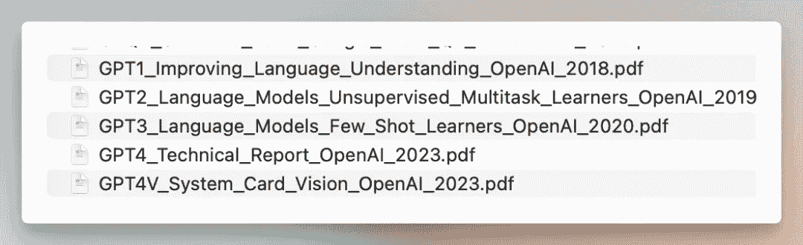

如果你想理解ChatGPT为什么这么厉害，这些是必读材料。

### 2. Claude和Gemini：OpenAI的竞争对手

**Claude **是Anthropic公司做的，创始人是OpenAI的前员工。

他们更注重AI的安全性，Claude在拒绝危险请求方面做得更好，编程方面超级强大，Claude Code口碑极好。

他们也是MCP、Skill等流行概念的提出者。（虽然CEO很SB，有严重的反华倾向）

Claude 每次发布一般有三个版本。

Haiku最快最便宜，Sonnet平衡性能和成本，Opus最强但也最贵。

他们的挑选了Claude3和4的技术报告，更早期的Constitutional AI、RLHF等论文不包含。

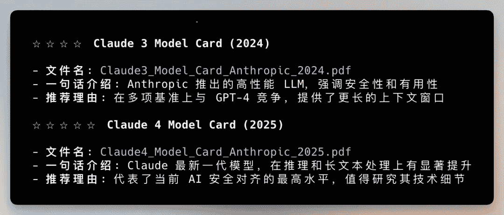

**Gemini **是Google的反击。

Gemini 1.0 能同时处理文字、图片、音频。

Gemini 2.5 在长文本理解上有突破，能一次性处理上百万字的文档。

去年 Gemini 3 发布更是吊炸天，前端审美一流，虽然超过200万上下文后幻觉严重，但依然是目前最优秀的顶级模型之一。

收录了谷歌团队前沿大模型（5篇）

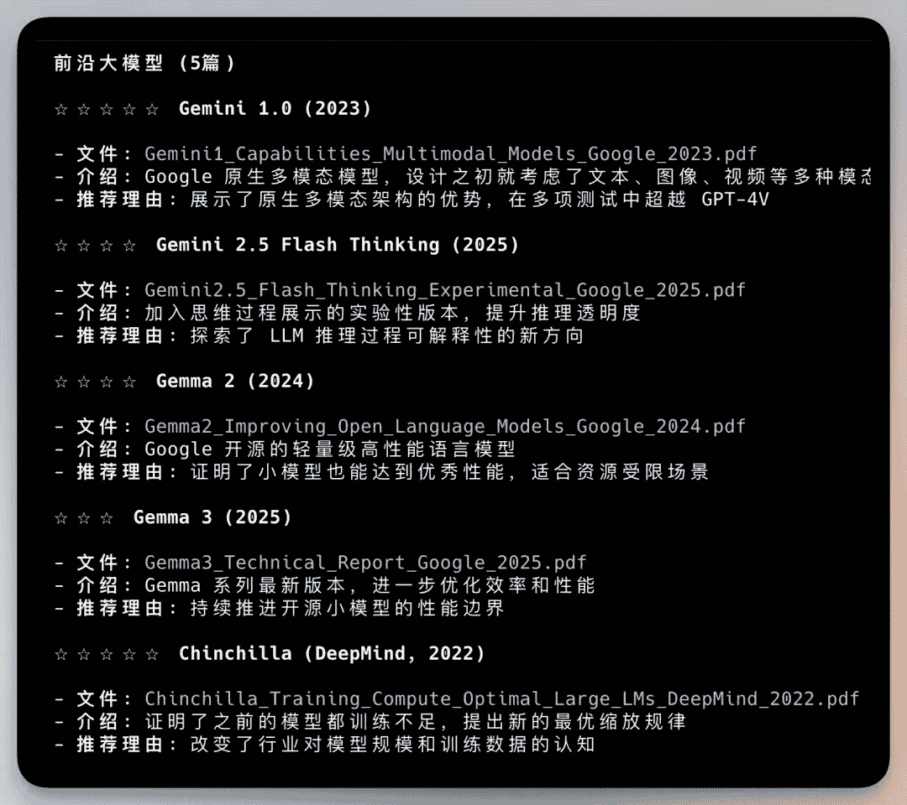

Benchmark 评测（3篇）

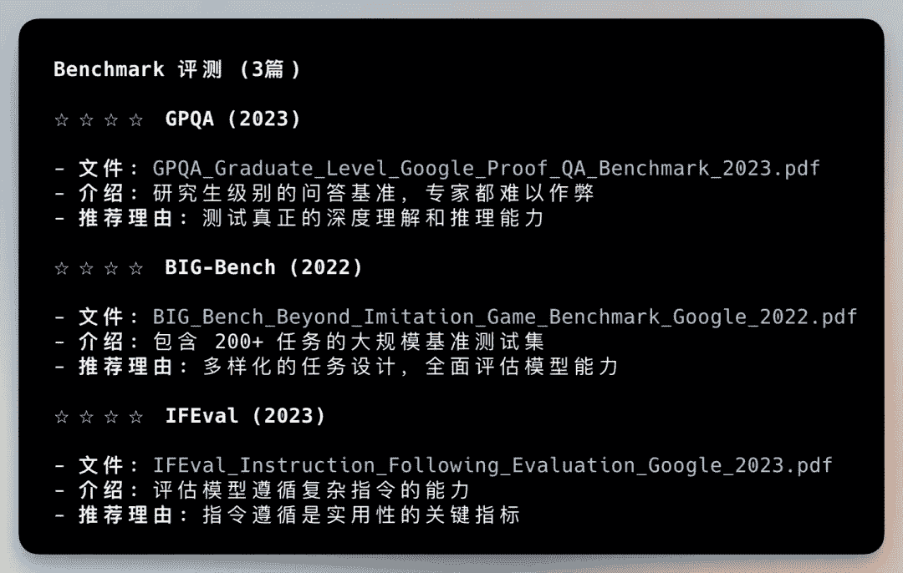

提示词工程（2篇）

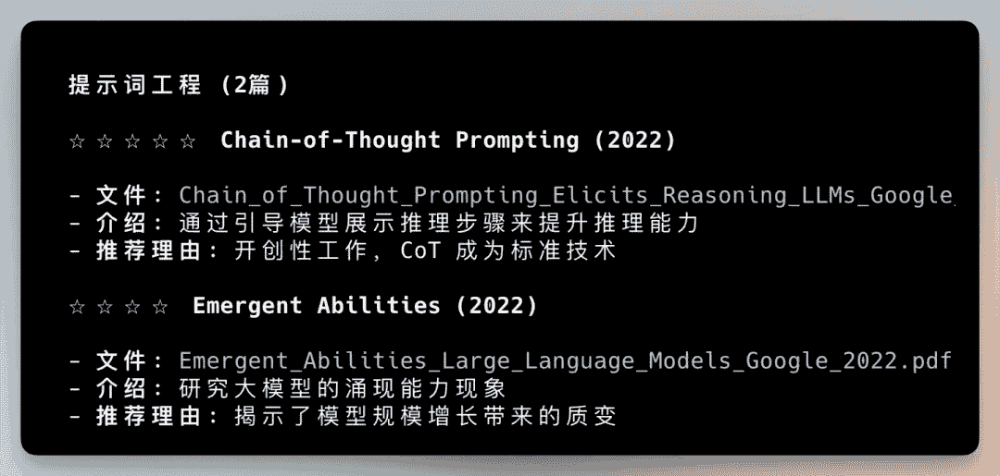

扩散模型（2篇）

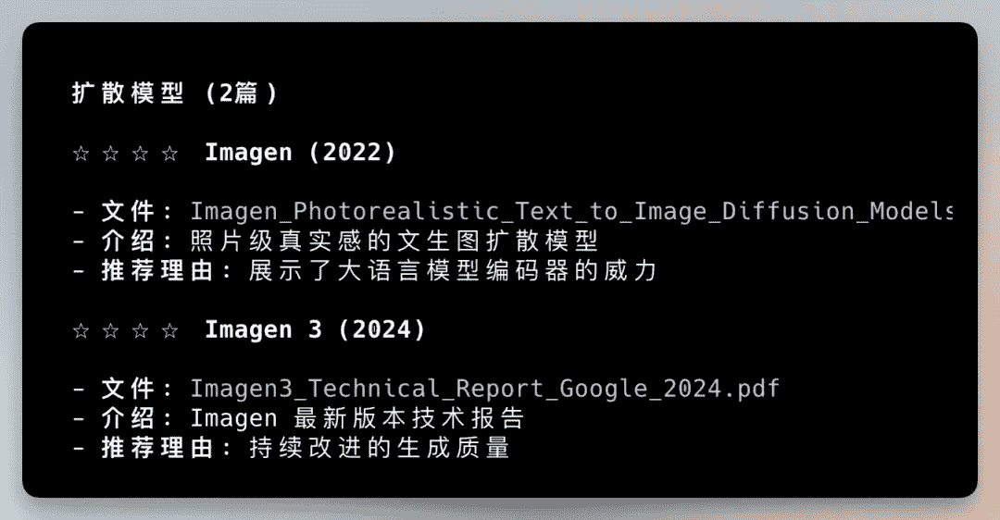

### 3. Llama：曾经开源世界的希望

**Llama **是Meta（Facebook母公司）开源的大语言模型。

开源意味着任何人都能免费使用、修改、部署。

Llama 1证明了开源模型也能接近商业模型的水平。

Llama 2加强了对话能力，很多创业公司用它做定制化应用。

Llama 3在数学、编程、推理上大幅进步，某些任务上甚至超过了GPT-4。

现在 Meta 大模型进展不乐观，开源王座基本都是中国模型轮番坐。

**Mistral **是法国创业公司，他们的7B模型（70亿参数）小而强，能在普通电脑上运行。

**Mixtral **用了"专家混合"技术，让模型在保持高性能的同时降低计算成本。

中国的模型最近进步很快。 **Kimi K-2 **能处理超长文本（200万字）。

**Qwen 3 **（通义千问）在多个基准测试上超过了GPT-4。

### 4. DeepSeek：用更少资源做更多事

**DeepSeek ****是中国的AI**实验室，他们的特点是" 穷人的智慧 "。

（这说的... 不过很真实）

用更少的计算资源训练出高性能模型。

+   • DeepSeek-Coder专注编程，在代码生成任务上能和GPT-4竞争。

+   • DeepSeek-Math专攻数学，解题能力接近人类数学竞赛选手。

+   • DeepSeek-V3用了创新的训练方法，成本只有同等水平模型的几分之一。

**GRPO **（群体相对策略优化）是他们提出的训练技术，让模型通过对比多个答案的好坏来学习，比传统方法更高效。

DeepSeek证明了不需要烧钱也能做出好模型。

他们的论文对资源有限的团队特别有参考价值。

### 5. 后训练：让模型更听话

**后训练 **指的是在基础模型训练完成后，通过额外的训练让它更符合人类需求。

比如让模型学会拒绝不当请求，让回答更准确，让语气更友好。

这个阶段通常用到人类反馈（RLHF），让真人给模型的回答打分，模型根据分数调整行为。

MBZUAI等机构的综述论文，梳理了后训练的各种技术，是快速了解全貌的好材料。

### 补充知识：推理模型的崛起

2025年， **推理模型 **成为主流。

传统模型是"快思考"，看到问题立刻回答。

推理模型是"慢思考"，会先在内部推演多个步骤，验证答案是否合理，再给出最终结果。

**o1 **是OpenAI的推理模型，在数学、编程、科学问题上表现惊人。

**R1 **是DeepSeek的推理模型，开源且性能接近o1。

**QwQ **是阿里的推理模型，特点是推理过程可见，你能看到它是怎么一步步思考的。

Sebastian Raschka的文献综述是目前最好的推理模型入门材料。

核心论文《Let's Verify Step By Step》提出了验证推理步骤的方法，Noam Brown（前Meta研究员，现在OpenAI）的演讲深入浅出地讲解了推理模型的原理。

## 第二部分：如何评价AI的能力

训练出一个模型后，怎么知道它到底有多强？

这就需要 **基准测试 **（Benchmark），相当于AI的考试。

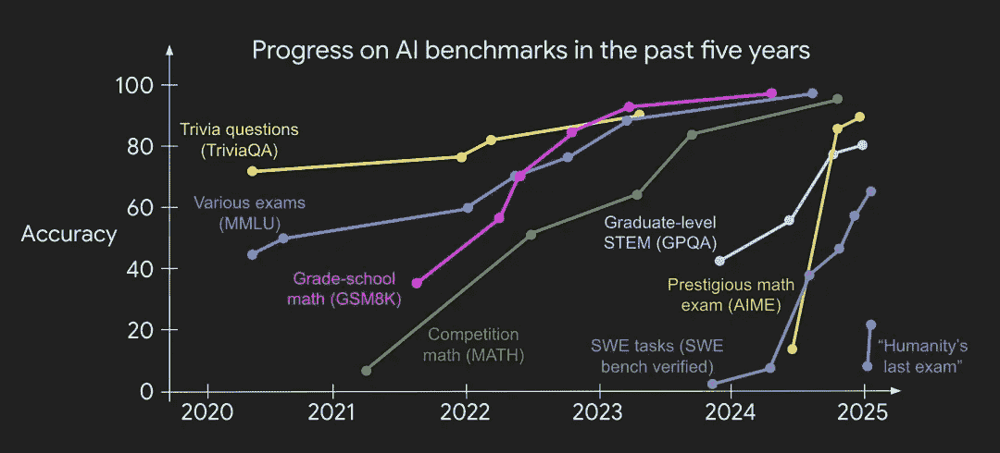

### 1. MMLU：知识广度测试

**MMLU **（大规模多任务语言理解）包含57个学科的15000多道选择题，从数学、历史到法律、医学都有。

它测试的是模型的 **知识储备 **，看它是否真的"博学"。

GPT-4在MMLU上能达到86%的准确率，接近人类专家水平。

**GPQA **（研究生水平问答）更难，题目来自物理、化学、生物的研究生考试。

**BIG-Bench **包含200多个任务，测试模型的多样化能力。

2025年，顶尖实验室用的是升级版：

**MMLU Pro **（题目更难，干扰项更多）

**GPQA Diamond **（最难的那部分题）

**BIG-Bench Hard **（最难的那部分任务）。

如果你要选一个模型做知识问答，MMLU分数是重要参考。

但要注意，高分不代表一切，有些模型可能"刷题"过度。

### 2. MRCR：长文本理解测试

**MRCR **（多跳推理与复杂检索）测试模型处理长文档的能力。

传统的"大海捞针"测试太简单，就是在长文本里藏一句话，看模型能不能找到。

MRCR更接近真实场景，需要在长文档里找到多个相关信息，综合起来回答问题。

OpenAI用MRCR测试他们的模型。

因为它更能反映实际工作中的需求，比如分析几百页的合同，或者总结一整天的会议记录。

如果你的工作需要处理大量文档，比如法律、金融、研究，模型的长文本能力至关重要。

MRCR分数高的模型，在这些场景下表现会更好。

### 3. MATH：数学能力测试

**MATH **是从数学竞赛里收集的12500道题，难度从初中到奥林匹克竞赛不等。

它测试的是 **逻辑推理 **和 **多步骤问题求解 **能力。

数学题有标准答案，容易判断对错，所以是评估推理能力的好工具。

顶尖实验室关注更难的子集：

**MATH level 5 ****（最难的那****20%）

AIME （**美国数学邀请赛）

AMC10/AMC12 （美国数学竞赛）

**FrontierMath **是2024年出的，包含前沿数学研究问题。

数学能力往往和通用推理能力相关。

数学好的模型，在编程、科学、工程问题上通常也表现更好。

### 4. IFEval：指令遵循测试

**IFEval **（指令遵循评估）测试模型能否准确理解和执行复杂指令。

比如"用五个句子总结这篇文章，每句话不超过20个字，第三句必须包含'创新'这个词"。

这种多重约束的指令，很考验模型的理解和控制能力。

Facebook的 **Multi-IF **、 **COLLIE **和Scale的 **MultiChallenge **是更新的版本，包含更复杂的多步骤指令。

实际工作中，我们经常需要给AI下复杂的指令。

IFEval分数高的模型，更能按你的要求做事，减少反复修改的次数。

### 5. ARC AGI：抽象推理测试

**ARC AGI **（抽象推理挑战）是一组视觉推理题，看起来像智力测验里的图形题。

给你几个输入输出的例子，你要找出规律，预测新输入的输出。

它测试的是 **抽象思维 **和 **举一反三 **的能力，不依赖记忆，纯靠推理。

ARC AGI很难，目前最好的AI正确率也只有50%左右，而人类能达到85%。

ARC‑AGI 极难，目前最好的自动化方案在 ARC‑AGI‑1 上大约 50%–55%。

而普通人平均大概 70% 左右，人类上限可能更高（ARC Prize 以 85% 为目标）

它是少数几个AI还远远落后于人类的基准。

ARC‑AGI 是目前最接近“通用智能核心能力”的测试之一。

用来衡量 AI 在抽象推理和类人泛化上的水平。

如果有一天 AI 在 ARC‑AGI 上整体表现接近甚至超过普通人。

那可以视为我们在迈向通用人工智能（AGI）的道路上跨过了一个非常关键的里程碑。

### 基准测试的局限

基准测试有个问题： **容易被"刷榜" **。

（前几天LeCun就承认Llama4刷榜了）

模型可能在训练时见过类似的题，或者针对特定基准过度优化，导致分数虚高。

而且基准测试往往滞后于实际应用。

真实场景的问题更开放、更模糊、更依赖常识，这些很难用标准化测试衡量。

所以现在有不少其他评估方法。

比如

**竞技场模式 **（让两个模型对战，用户投票选更好的）

（比如 https://lmarena.ai/ 但谁说这个就不能刷呢？）

**产品评估 **（直接测量用户满意度）

**生成式基准 **（让AI自己生成测试题）。

不要迷信基准分数，要结合实际场景测试。

一个在MMLU上得高分的模型，在你的具体任务上不一定好用。

## 第三部分：如何和AI对话

**提示工程 **（Prompt Engineering）听起来高大上。

其实就是学会怎么和AI说话，让它更好地理解你的需求。

### 1. 提示工程报告：系统性学习

《 The Prompt Report 》是提示工程领域的综述，总结了几百篇相关论文的核心发现。

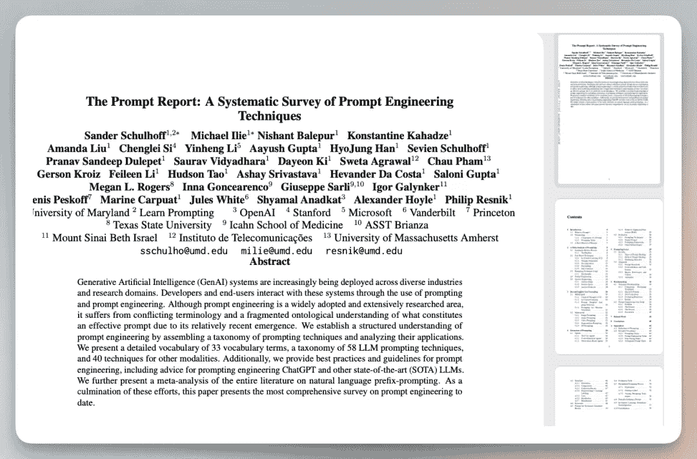

它告诉你什么样的提示词效果好，什么样的容易出错，以及背后的原理。

比如，给出几个例子（少样本学习）通常比只给指令效果好，让模型"一步步思考"能提高准确率。

与其到处找碎片化的提示词技巧，不如读这篇综述，建立系统性认知。

### 2. 思维链：让AI一步步思考

**思维链 **（Chain-of-Thought）是2022年的突破。

以前问AI"25×17等于多少"，它可能直接给出错误答案。现在加一句"让我们一步步思考"，它会写出：

+   • 25×17 = 25×(10+7)

+   • = 25×10 + 25×7

+   • = 250 + 175

+   • = 425

把推理过程显式写出来，准确率大幅提升。

这个技巧在数学、逻辑、编程问题上特别有效。

**Scratchpads **（草稿本）和 Let's Think Step By Step （让我们一步步思考）是类似的方法，都是让模型把"内心活动"写出来。

思维链曾经是最简单有效的提示技巧。

加一句话，就能让模型变聪明，几乎没有成本。

**（不过现在很多模型都是混合模式，推理模型中**内置了思考、推理，这些技巧重要性下降了）

### 3. 思维树：探索多条路径

**思维树 **（Tree of Thought）是思维链的升级版。

思维链是一条直线，思维树是一棵树。

模型会探索多条推理路径，每条路径走几步后评估一下，选最有希望的继续，走不通就回退。

就像下棋，不是只看一步，而是看几步后的局面，选最优的走法。

对于复杂问题，单一路径容易走进死胡同。

思维树让AI能"试错"，找到更好的解决方案。

### 4. 提示调优：不写提示词也能优化

**提示调优 **（Prompt Tuning）是另一种思路：不手写提示词，让模型自己学。

**前缀调优 **（Prefix-Tuning）在输入前加一段可学习的"前缀"，模型训练时调整这段前缀，找到最优的"提示"。

好处是不用改模型本身，只调前缀，成本很低。

还有通过调整 **解码参数 **（比如温度、熵）来优化输出。

或者用 **表示工程 **（Representation Engineering）直接修改模型内部的表示。

手写提示词很依赖经验，而且不同任务需要不同提示。

自动化的方法更稳定、更高效。

### 5. 自动提示工程：让AI写提示词

**自动提示工程 **的核心思想是：

人类其实不擅长写提示词，让AI来写反而更好。

给AI一些输入输出的例子，让它自己总结出最佳提示词。

**DSPy **是这个思路的实现框架，它把提示工程变成了可编程的过程。

### 实用建议

提示工程更多是实践技能，光看论文不够。

推荐几个实用资源：

+   • **Lilian Weng的博客 **：OpenAI研究员写的提示工程指南，深入浅出

> https://lilianweng.github.io/

+   • **Eugene Yan的博客 **：Uber工程师总结的实战技巧

+   https://eugeneyan.com/

+   • **Anthropic的教程 **：交互式教程，边学边练

+   https://platform.claude.com/docs/zh-CN/build-with-claude/prompt-engineering/overview

提示工程是AI工程师的基本功。

同样的模型，会写提示词和不会，效果天差地别。

## 第四部分：让AI访问外部知识

大语言模型的知识来自训练数据，但训练**数据有时效性，**而且不可能包含所有信息。 检索增强生成 （RAG）解决了这个问题。

### RAG的基本原理

RAG的流程是：

1.  1. 用户提问

1.  2. 系统从知识库里检索相关文档

1.  3. 把文档和问题一起喂给模型

1.  4. 模型基于文档生成答案

就像开卷考试，模型可以"查资料"，不用全靠记忆。

### 1. 信息检索基础

他们推荐了一本书, 说《 **信息检索导论 **》是这个领域的经典。

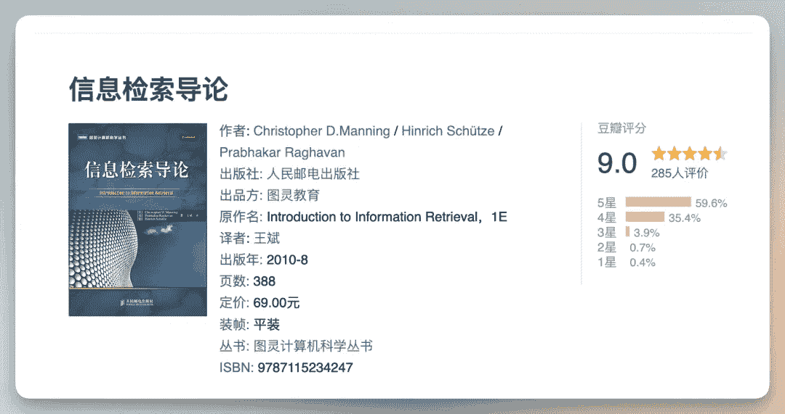

**信息检索 **（IR）有60年历史，远早于AI。

**TF-IDF ****（词频-逆****文档频率）衡**量词**的重要性 **

BM25 是搜索引擎常用的排序算法

FAISS 和 HNSW 是高效的向量检索工具。

这些"老技术"在RAG系统里依然重要，甚至比纯AI方法更可靠。

RAG不是纯AI问题，而是信息检索问题。

了解IR的基础知识，能帮你设计更好的RAG系统。

### 2. Meta的RAG论文：概念的起源

**2020年，**Meta的研究员发表了 RAG论文 ，正式提出这个概念。

他们证明了检索+生成的组合，比单纯的生成模型效果更好，尤其在需要事实性知识的任务上。

**原作者后来创办了**Contextual公司，提出了 RAG 2.0 的概念，加入了更智能的检索策略、多跳推理、动态知识更新等功能。

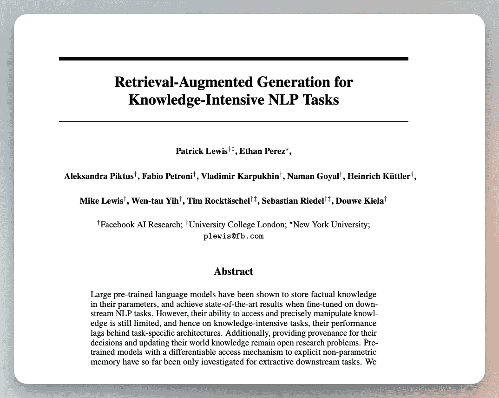

这篇论文奠定了RAG的理论基础。

虽然现在的RAG系统比2020年复杂得多，但核心思想没变。

### 3. 现代RAG的关键技术

现代RAG系统有很多"标准"：

**HyDE **（假设文档嵌入）：用户问"什么是量子计算"，系统先让模型生成一个假设的答案，然后用这个答案去检索，比直接用问题检索效果更好。

**分块 **（Chunking）：长文档要切成小块，块太大模型处理不了，块太小又丢失上下文。怎么切是门学问。

**重排序 **（Reranking）：检索出10个文档，用更精细的模型重新排序，把最相关的放前面。

**多模态数据 **：不只是文字，还能检索图片、表格、图表。

这些技术决定了RAG系统的实际效果。

掌握它们，你就能搭建出好用的知识问答系统。

### 4. MTEB：嵌入模型的基准

**嵌入模型 **把文本转换成向量（一串数字），向量之间的距离代表文本的相似度。

RAG系统用嵌入模型来检索相关文档。

**MTEB **（大规模文本嵌入基准）包含58个任务，测试嵌入模型在分类、聚类、检索、重排序等场景的表现。

虽然它的作者认为MTEB已经"死了"（因为过拟合严重），但目前还是事实上的标准。

主流的嵌入模型包括：

+   • OpenAI的text-embedding-3 ：闭源，效果好但要花钱

+   • **Nomic Embed **：开源，支持超长文本

+   • **Jina v3 **：多语言支持好

+   • **cde-small-v1 **：小而快，适合边缘设备（现在有v2）

**Matryoshka嵌入 **是新趋势，一个模型能输出不同维度的向量，灵活平衡精度和速度。

嵌入模型是RAG的核心组件。

选对嵌入模型，检索准确率能提升一大截。

### 5. GraphRAG：加入知识图谱

**GraphRAG **是微软提出的，把知识图谱加入RAG系统。

传统RAG是"平面"的，文档之间没有关联。

GraphRAG构建知识图谱，文档里的实体（人、地点、事件）和关系（谁做了什么）被显式表示。

查询时，系统不只是检索相关文档，还能沿着图谱的边探索，发现隐藏的关联。

比如问"张三和李四有什么共同点"，传统RAG可能找不到答案，但GraphRAG能发现他们都参与了同一个项目。

**ColBERT **、 **ColPali **、 **ColQwen **是另一类热门技术，用更精细的匹配方法提高检索准确率。

GraphRAG适合知识密集型任务，比如情报分析、科研文献综述、企业知识管理。

### 6. RAGAS：评估RAG系统

搭建了RAG系统，怎么知道它好不好？

**RAGAS **（RAG评估）提供了一套评估框架。

它从几个维度评估：

+   • **忠实度 **：答案是否基于检索到的文档，有没有胡编乱造

+   • **答案相关性 **：答案是否回答了问题

+   • **上下文相关性 **：检索到的文档是否相关

+   • **上下文召回率 **：所有相关文档是否都检索到了

OpenAI推荐用RAGAS评估RAG系统。

Nvidia的 **FACTS框架 **和Lilian Weng关于 **幻觉 **的综述也值得一读。

### RAG vs 长文本：永恒的争论

有人说，既然模型能处理100万字的上下文，还需要RAG吗？

直接把所有文档塞进去不就行了？

答案是：各有优劣。

**RAG的优势 **：

+   • 成本低，只检索相关部分，不用处理全部文档

+   • 可解释，能看到答案来自哪个文档

+   • 易更新，知识库变了，不用重新训练模型

**长文本的优势 **：

+   • 不会漏掉信息，检索可能遗漏关键内容

+   • 能理解全局，看到文档之间的关联

+   • 更简单，不用搭建复杂的检索系统

实践中，两者往往结合使用：先用RAG筛选出最相关的几十个文档，再用长文本模型处理。

理解两者的权衡，能帮你根据场景选择合适的方案。

## 第五部分：AI智能体

**智能体 **（Agent）是能自主完成任务的AI。

不只是回答问题，还能规划、执行、使用工具、从错误中学习。

### 1. SWE-Bench：软件工程基准

**SWE-Bench **（软件工程基准）包含2294个真实的GitHub问题，每个问题都有对应的代码仓库和测试用例。

任务是：给定问题描述，让AI修改代码，通过所有测试。

这需要理解代码、定位bug、写补丁、验证修复，是个完整的软件工程流程。

Anthropic的Claude、Cognition的Devin、OpenAI的模型都在SWE-Bench上测试。

2025 年，最强系统在 SWE‑Bench Verified 上已经能解决约 70%–75% 的问题，而很多主流模型也在 50%–70% 区间，还有明显提升空间。

**SWE-Lancer **是OpenAI新推出的，包含更真实的软件工程任务，比如重构代码、添加新功能、优化性能。

> 测试集使用 1400+ 个来自 Upwork 的真实自由职业软件工程任务，总金额约 100 万美元

SWE-Bench是评估AI编程能力的金标准。

### 2. ReAct：推理+行动

**ReAct **（推理与行动）是智能体的核心范式。

传统模型是"一次性"的，给输入，出输出，结束。ReAct让模型能"思考-行动-观察"循环：

1.  1. **思考 **：我需要什么信息？

1.  2. **行动 **：调用搜索工具查询

1.  3. **观察 **：看到搜索结果

1.  4. **思考 **：还需要更多信息吗？

1.  5. 重复，直到能回答问题

这个循环让模型能使用外部工具（搜索引擎、计算器、数据库），突破了纯语言模型的限制。

**Gorilla **和 **BFCL排行榜 **专注于工具使用和函数调用，测试模型能否正确调用API。

ReAct是智能体的基础架构。

### 3. MemGPT：长期记忆

**MemGPT **解决了智能体的记忆问题。

模型的上下文窗口有限，对话太长就会"忘记"前面说过的话。

MemGPT模拟操作系统的内存管理，把记忆分为：

+   • **工作记忆 **：当前对话的内容，存在上下文窗口里

+   • **短期记忆 **：最近几次对话，存在快速访问的数据库里

+   • **长期记忆 **：所有历史对话，存在慢速但大容量的存储里

智能体根据需要在不同层级的记忆间调度，既保证响应速度，又不丢失重要信息。

ChatGPT的"记忆"功能、LangGraph的记忆模块都采用了类似思路。

没有记忆的智能体，每次对话都像第一次见面。

有了记忆，智能体能建立长期关系，提供个性化服务。

### 4. Voyager：技能库与课程

**Voyager **是Nvidia在Minecraft游戏里训练的智能体。

它有三个核心组件：

+   • **课程 **：从简单任务开始（砍树、挖矿），逐步学习复杂任务（建房子、打怪）

+   • **技能库 **：学会的技能（比如"建一个工作台"）保存下来，可以复用

+   • **沙盒 **：在安全的环境里试错，失败了重来

这个架构让智能体能持续学习，积累经验，解决越来越难的问题。

Voyager展示了智能体如何从零开始学习。

这个思路可以推广到其他领域，比如让AI学习使用软件、操作机器人。

### 5. Anthropic的智能体最佳实践

Anthropic的《 **构建有效智能体 **》是2024年的优秀总结。

它强调几个关键点：

+   • **链接 **：把复杂任务分解成子任务，依次执行

+   • **路由 **：根据问题类型，选择合适的工具或模型

+   • **并行化 **：能同时做的事，不要串行

+   • **编排 **：协调多个智能体协作

+   • **评估 **：持续测量智能体的表现

+   • **优化 **：根据评估结果改进

这些原则来自Anthropic在Claude上的实践经验，非常实用。

**原文地址**

> https://www.anthropic.com/engineering/building-effective-agents

智能体开发不只是技术问题，更是工程问题。

这篇文章提供了经过验证的最佳实践。

### 更多资源

+   • Lilian Weng的智能体综述 ：前OpenAI研究员的深度文章

+   https://lilianweng.github.io/posts/2023-06-23-agent/

+   • **Shunyu Yao的演讲 **：ReAct作者，前OpenAI

+   https://arxiv.org/abs/2210.03629

+   • Chip Huyen的智能体文章 ：从工程角度讲智能体

+   https://www.youtube.com/watch?v=Z-0aOORTCz4

+   • UC Berkeley的LLM智能体课程 ：系统性学习材料

+   https://rdi.berkeley.edu/adv-llm-agents/sp25

智能体是AI的当下前沿。

从回答问题到完成任务，从被动响应到主动规划，这是质的飞跃。

## 第六部分：AI写代码

**代码生成 **是AI最成功的应用之一。

GitHub Copilot、Cursor、Claude Code、Antigravity这些工具已经成为程序员的标配。

### 1. The Stack：代码数据集

**The Stack **是专注于代码的开源数据集，包含30多种编程语言的60亿个文件。

它是The Pile（通用文本数据集）的代码版本，为开源代码模型提供了训练数据。

**The Stack v2 **更新了数据，增加了代码质量过滤。

**StarCoder **是基于The Stack训练的开源代码模型，性能接近商业模型。

The Stack让开源社区也能训练高质量的代码模型，不被大公司垄断。

### 2. 开源代码模型

**DeepSeek-Coder **：在代码生成、代码补全、代码翻译上表现优秀。

**Qwen2.5-Coder **：阿里的代码模型，支持92种编程语言，能处理长达128K的代码。

**CodeLlama **：Meta基于Llama训练的代码模型，有7B、13B、34B三个版本，适合不同场景。

### 3. HumanEval：代码能力测试

**HumanEval **包含164道编程题，每道题给出函数签名和文档字符串，要求模型写出函数实现。

比如：

```


1
2
3

def is_palindrome(s: str) -&gt; bool:
    &quot;&quot;&quot;检查字符串是否是回文&quot;&quot;&quot;
    # 模型要写出这里的代码


```

虽然HumanEval已经饱和（顶尖模型接近100%），但它依然是代码领域的必备知识。

现代替代品包括：

+   • **Aider **：真实的代码编辑任务

+   • **Codeforces **：算法竞赛题

+   • **BigCodeBench **：复杂的多步骤编程任务

+   • **LiveCodeBench **：持续更新的题库，防止过拟合

### 4. AlphaCodeium：流程工程

**AlphaCodeium **展示了"流程工程"（Flow Engineering）的威力。

不是训练更大的模型，而是设计更好的流程：

1.  1. 理解问题，生成测试用例

1.  2. 生成多个候选解法

1.  3. 对每个解法，生成解释和推理过程

1.  4. 用测试用例验证

1.  5. 如果失败，分析错误，修改代码

1.  6. 重复，直到通过所有测试

这个流程让普通模型在编程竞赛上接近顶尖选手的水平。

AlphaCodeium证明了"怎么用"比"用什么"更重要。

同样的模型，好的流程能带来10倍的性能提升。

### 5. CriticGPT：发现代码问题

**CriticGPT **是OpenAI训练的代码审查模型（基于GPT4微调）。

AI生成的代码可能有bug、安全漏洞、性能问题。

CriticGPT专门找这些问题，给出详细的解释和修改建议。

Anthropic则用 **稀疏自编码器 **（SAE）识别导致不安全代码的模型特征，从源头上减少问题。

### 实践建议

代码生成的前沿已经从研究转向工业界。

论文之外，更重要的是实践经验：

+   • 用Claude Code或Cursor ：体验AI辅助编程

+   • **看Devin的演示 **：了解AI智能体如何完成完整的软件工程任务

+   • **读工程博客 **：各大公司的工程博客有很多实战技巧

代码生成是AI最成熟的应用。

掌握它，能让你的编程效率翻倍。

## 第七部分：AI看图

**计算机视觉 **让AI能"看懂"图片和视频。

从识别物体、理解场景，到回答关于图片的问题，视觉能力正在快速进步。

### 1. YOLO：实时物体检测

**YOLO **（You Only Look Once，只看一次）

是物体检测的经典算法。

给它一张图片，它能实时标出所有物体的位置和类别，比如"这里有一只猫，那里有一辆车"。

YOLO的特点是 **快 **，能达到每秒处理几十帧视频，适合自动驾驶、监控、机器人等实时场景。

从2015年的YOLO v1到现在的v11，每一代都更快更准。

但要注意YOLO的"家族史"有点复杂，原作者离开后，社区出现了多个分支。

**DETR **（检测变换器）是基于Transformer的物体检测方法，在某些场景下已经超越YOLO。

物体检测是计算机视觉的基础任务。

无论是工业质检、零售分析还是安防监控，都需要这个能力。

### 2. CLIP：连接图像和文字

**CLIP **（对比语言-图像预训练）是OpenAI的突破性工作。

它同时训练图像编码器和文本编码器，让图片和文字在同一个向量空间里。

这意味着你可以用文字搜索图片，比如输入"日落时的海滩"，CLIP能找出最匹配的照片。

CLIP的训练数据是4亿对图文配对，从互联网上收集。

它学会了图像和语言之间的对应关系。

现在CLIP已经被 **BLIP **、 **BLIP2 **、 **SigLIP **、 **PaliGemma **等更新的模型超越，但它依然是必须了解的基础。

CLIP打通了视觉和语言，是多模态AI的基石。

现在的GPT-5V、Claude 4.5、Gemini3.0都建立在类似的思路上。

### 3. MMVP：测试视觉理解

**MMVP **（大规模多模态视觉理解）基准测试发现，CLIP在某些视觉推理任务上表现很差。

比如给两张图片，问"这两个物体哪个更大"，CLIP经常答错。

这说明它虽然能匹配图文，但不一定真正"理解"图像。

**MMMU **是MMLU的多模态版本，包含图表、示意图、照片等多种视觉内容。

SWE-Bench Multimodal 测试AI能否理解代码库里的截图和UI设计。

**MathVista **专注于数学图表， **CharXiv **测试对科研论文里图表的理解。

### 4. SAM：分割一切

**SAM **（分割一切模型）和 **SAM 2 **是Meta的图像和视频分割模型。

**分割 **是指把图像中的每个物体精确地"抠"出来。

SAM能分割任何物体，不需要提前训练，只要你点一下或者画个框，它就能把那个物体完整地分离出来。

SAM 2进一步支持视频分割，能追踪物体在视频中的运动。

配合 **GroundingDINO **（能根据文字描述定位物体），SAM可以实现"用文字抠图"，比如说"把照片里的狗抠出来"，AI自动完成。

分割是很多应用的基础，比如视频编辑、医学影像分析、自动驾驶。

SAM的零样本能力（不需要训练就能分割任何东西）特别实用。

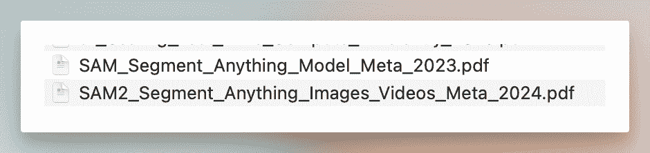

### 5. 早期融合：更深度的多模态

**早期融合 **和 **晚期融合 **是两种多模态架构。

**晚期融合 **（比如LLaVA）是先分别处理图像和文字，最后再合并。

就像两个人分别看图和读文字，然后讨论。

**早期融合 **（比如Flamingo、Chameleon）是从一开始就混合处理图像和文字。

就像一个人同时看图和读文字，理解更深入。

Meta的 **Chameleon **、Apple的 **AIMv2 **、Reka的 **Core **都采用早期融合。

实际上视觉语言模型至少有4种不同的架构流派。

架构决定了模型的能力上限。

早期融合模型通常在需要深度图文理解的任务上表现更好。

### 前沿视觉模型

前沿的视觉语言模型（VLM）工作现在很少发表论文。

GPT-4V只有系统卡和文档，没有完整论文。

建议实际体验这些模型的视觉能力：

**GPT-5 **：能同时理解图像、文字、音频，支持视觉微调，可以训练定制的物体检测模型。

Claude 4.5 Sonnet ：在图表理解、代码截图识别上表现出色，很多程序员用它来解释复杂的架构图。

Gemini 3.0 Flash ：处理速度极快，能实时分析视频流，适合需要低延迟的应用。

**o1 **：推理能力强，能解决需要多步推理的视觉问题，比如复杂的几何题。

其他值得关注的：

+   • **Pixtral **：Mistral的多模态模型

+   • **Llama 3.2 **：Meta的多模态版本，能在手机上运行

+   • **Moondream **：超小的视觉模型，只有2B参数，能在边缘设备运行

+   • **QVQ **：阿里的视觉推理模型

### OCR：文字识别

**OCR **（光学字符识别）是视觉的重要子领域，把图片里的文字提取出来。

传统OCR用专门的算法，现在的趋势是用通用视觉模型。

**Mistral OCR **和 **VLM Run **在文档识别、票据提取、手写识别上表现优秀。

很多业务场景需要处理扫描件、发票、合同。

好的OCR能大幅提高效率，减少人工录入。

## 第八部分：AI听说

**语音AI **让机器能听懂人话、能说话。

从语音助手、客服机器人到实时翻译，语音技术正在改变人机交互。

### 1. Whisper：语音识别

**Whisper **是OpenAI的 **自动语音识别 **（ASR）模型，能把语音转成文字。

它在68万小时的多语言语音数据上训练，支持99种语言，能处理各种口音、背景噪音、语速变化。

Whisper的识别准确率接近人类，在很多语言上甚至超过了专业的语音识别服务。

Whisper有v1、v2、v3、v3 Turbo多个版本，越新越好。

**distil-whisper **是蒸馏版本，速度更快，适合实时场景。

### 2. AudioPaLM：语音理解

**AudioPaLM **是Google在PaLM（后来变成Gemini）时代的语音研究。

它不只是把语音转成文字，而是直接理解语音的含义。

这意味着模型能捕捉语气、情绪、停顿等文字无法表达的信息。

Meta的 **Llama 3语音探索 **也在尝试类似的方向，让语言模型原生支持语音输入输出。

文字丢失了很多信息。

直接处理语音的模型，能提供更自然、更丰富的交互体验。

### 3. NaturalSpeech：语音合成

**NaturalSpeech **是微软的 **文字转语音 **（TTS）模型。

它能生成接近真人的语音，包括自然的韵律、情感、呼吸声。

NaturalSpeech 3进一步支持零样本语音克隆，只需要几秒钟的语音样本，就能模仿那个人的声音。

高质量的语音合成能用在有声书、语音助手、无障碍阅读等场景。

但也要警惕被用于诈骗和伪造。

### 4. Moshi：全双工对话

**Moshi **是法国Kyutai实验室的全双工语音模型。

**全双工 **意味着AI能像人类一样，边听边说，能打断、能插话、能实时反应。

传统的语音助手是"半双工"的，你说完它才能说，很不自然。

Moshi的演示非常惊艳，对话流畅度接近真人。

**Hume的OCTAVE **也有类似能力，还能识别和表达情绪。

全双工对话是语音交互的未来。

它让人机对话更自然，更像和真人聊天。

### 5. OpenAI实时API

OpenAI的 **实时API **让开发者能搭建类似ChatGPT语音模式的应用。

它支持低延迟的语音输入输出，能实时打断，能处理多轮对话。

虽然没有完整论文，但技术文档提供了很多实现细节。

实时API降低了语音应用的开发门槛。

以前需要组合多个服务（ASR、LLM、TTS），现在一个API搞定。

### 语音服务推荐

除了大模型公司，还有很多专注语音的创业公司：

**Daily **和 **Livekit **：提供实时音视频基础设施，适合搭建语音会议、在线教育应用。

**Vapi **：专注语音智能体，能搭建语音客服、语音助手。

**Assembly **和 **Deepgram **：专业的语音识别服务，支持实时转写、说话人识别。

**Fireworks **和 **Cartesia **：快速的语音合成服务，延迟低至几百毫秒。

**Elevenlabs **：高质量的语音克隆和多语言配音。

### NotebookLM的语音

虽然NotebookLM的语音模型不公开，但它的"播客模式"展示了语音AI的新可能。

两个AI主播能根据你上传的文档，生成一段自然的播客对话，包括讨论、提问、总结。

这种"AI生成播客"的形式，让知识传播更生动。

NotebookLM展示了语音AI不只是工具，还能是内容创作者。

这打开了很多新的应用场景。

### 语音和视觉的融合

Gemini 3.0原生支持语音和视觉，能同时处理"看到的"和"听到的"。

比如你拿着手机对着一道菜，问"这是什么菜，怎么做"，Gemini能看图、听问题、用语音回答。

这种多模态交互更接近人类的感知方式。

未来的AI会是全感官的。语音、视觉、文字不再是孤立的模态，而是融合在一起，提供更自然的交互体验。

## 第九部分：AI画画和做视频

**图像生成 **和 **视频生成 **是AI最直观、最有创造力的应用。

从艺术创作到广告设计，生成式AI正在改变视觉内容的生产方式。

### 1. 潜在扩散：Stable Diffusion的原理

**潜在扩散 **（Latent Diffusion）是Stable Diffusion背后的技术。

**扩散模型 **的原理是：先把图片加噪声，加到完全变成雪花，然后训练模型学习"去噪"，一步步恢复出清晰的图片。

生成时，从随机噪声开始，逐步去噪，就得到了新图片。

**潜在 **是指不直接在像素空间操作，而是在压缩后的"潜在空间"操作。

这大幅降低了计算成本，让普通电脑也能运行。

Stable Diffusion有SD1.5、SD2、SDXL、SD3多个版本。

**原团队离开**后，创办了Black Forest Labs，现在在做 Flux 系列（Flux Schnell快速版、Flux Dev开发版、Flux Pro专业版）。

Stable Diffusion是开源图像生成的基石。

理解它的原理，能帮你更好地调参数、写提示词、训练定制模型。

### 2. DALL-E：OpenAI的图像生成

**DALL-E **（名字来自达利和WALL-E）是OpenAI的图像生成模型。

DALL-E 1展示了文字生成图像的可能性，"牛油果形状的椅子"这种奇怪的组合也能画出来。

DALL-E 2大幅提升了图像质量和分辨率。

DALL-E 3更注重理解复杂的文字描述，能准确画出多个物体的关系。

DALL-E证明了AI能理解抽象概念，能创造训练数据里没有的东西。

### 3. Imagen：Google的图像生成

**Imagen **是Google的图像生成模型，和DALL-E是竞争关系。

Imagen 1在图文一致性上表现优秀，能准确画出提示词里的细节。

Imagen 2加强了风格控制，能模仿特定艺术家的画风。

Imagen 3进一步提升了图像质量，细节更丰富。

Nano Banana / Nano Banana Pro 是基于 Gemini 系列构建的图像生成与编辑模型家族，面向“对话式 + 编辑”的场景。

Nano Banana Pro（也叫 Gemini 3 Pro Image）是高端版本。

支持 2K–4K 级别高分辨率输出、更强的文字排版和视觉推理能力。

能在图片里渲染清晰文字、做复杂构图与高难度编辑。

去年底爆火了很久。

### 4. 一致性模型：快速生成

传统扩散模型需要几十步去噪，生成一张图要几秒钟。

**一致性模型 **（Consistency Models）把步骤压缩到1-4步，速度提升10倍以上。

**LCM **（潜在一致性模型）是一致性模型的实现，能实时生成图像。

2023年12月，tldraw的"快速绘图"演示病毒式传播，你画一笔，AI实时补全成完整的图画。

现在的版本包括 **sCM **（随机一致性模型）和 **DMD **（解耦多步蒸馏），速度更快，质量更好。

### 5. Sora：文字生成视频

**Sora **是OpenAI的文字生成视频模型，2024年2月发布。

并在 2025 年开始通过产品正式大规模向用户开放使用。

给一段文字描述，Sora能生成最长60秒的高清视频，包括复杂的场景、多个角色、流畅的运动。（Sora2效果很好）

它理解物理规律，知道物体怎么运动，光影怎么变化。

Sora基于 **DiT **（扩散变换器）架构，把视频看作时空序列，用Transformer处理。

虽然Sora没有完整论文，但它引发了视频生成的热潮。

**OpenSora **、 **Pika **、 **Runway **、 **Kling **等开源和商业模型快速跟进。

视频生成是AI的前沿领域。

从广告、教育到娱乐，视频生成会改变内容创作的方式。

### 6. 自回归图像生成：新范式

**自回归 **是语言模型的生成方式，一个词一个词地生成。

现在这个方法也用到了图像生成。

**Gemini、**GPT、Llama的 原生图像生成 都采用自回归方式。

好处是图像和文字用同一个模型，不需要单独的图像解码器，架构更简洁。

自回归图像生成可能是未来的主流方向。

它让多模态模型更统一，训练和部署更简单。

### 创业公司的创新

很多图像视频生成的创新现在来自创业公司：

**Ideogram **：擅长生成包含文字的图像，比如海报、Logo，文字不会乱码。

**Recraft **：专注矢量图和插画，生成的图像可以无损缩放。

**Reve Image **：新的图像模型（由前 Adobe / Stability 团队开发），在细节和风格控制上表现出色。

**Pika **、 **Playground **、 **Genmo **：各有特色的视频生成工具。

中国的 **Wan 2.x **和 **Kling **在视频生成上也很强，某些场景下不输Sora、veo3。

### ComfyUI：工作流工具

**ComfyUI **是基于节点的图像生成工作流工具。

你可以把不同的模型、处理步骤组合成工作流，比如"先生成草图，再上色，再加细节，再放大分辨率"。

每个步骤都可以调参数，可以替换模型，非常灵活。

ComfyUI在专业用户中很流行，很多复杂的图像生成任务都是用它完成的。

ComfyUI代表了"可编程的创意工具"。

它让图像生成从"黑盒"变成"白盒"，你能精确控制每一步。

### 其他生成领域

**文字扩散 **：生成包含清晰文字的图像，Mercury/Inception是目前最好的。

**音乐扩散 **：根据文字描述生成音乐，比如"轻快的钢琴曲，适合咖啡馆"。目前还是小众领域，但潜力很大。

生成式AI不只是图像和视频，任何能数字化的内容都可能被AI生成。

## 第十部分：训练自己的模型

**微调 **（Fine-tuning）是让通用模型适应特定任务的方法。

就像请一个通才当家教，再教他你家孩子的具体情况。

### 1. LoRA：低成本微调

**LoRA **（低秩适应）是最流行的微调方法。

传统微调要调整模型的所有参数，需要大量显存和计算。

LoRA只调整一小部分参数（通常是1%），其他参数冻结。

这大幅降低了成本，普通显卡也能微调大模型。

**QLoRA **进一步压缩，把模型量化到4位，显存需求再降一半。

一张24GB的显卡就能微调70B的模型。

LoRA让微调从"大公司的特权"变成"人人都能做的事"。

你可以用自己的数据训练定制模型，不用从头训练。

### 2. DPO：偏好优化

**DPO **（直接偏好优化）是训练模型"听人话"的方法。

传统的 **PPO **（近端策略优化）很复杂，需要多个模型配合，训练不稳定。

DPO简化了流程，直接用人类偏好数据训练。

给模型同一个问题的两个答案，一个好一个坏，让模型学习"好答案"和"坏答案"的区别。

这比PPO简单得多，虽然效果稍逊，但实用性更强。

OpenAI现在支持 **偏好微调 **（Preference Fine-tuning），就是基于DPO的思路。

DPO让你能调整模型的"性格"。

比如让它更简洁，或者更详细，或者更有创意，或者更保守。

### 3. ReFT：表示微调

**ReFT **（表示微调）是新的思路：不调整模型的权重，而是调整模型内部的"表示"（representation）。

模型处理输入时，会在内部生成一系列表示。

ReFT在关键位置插入可学习的"干预"，引导模型的思考方向。

这个方法参数更少，效果更好，特别适合需要精细控制的场景。

ReFT代表了微调的新方向。

它更接近"理解模型内部机制"，而不是"盲目调参数"。

### 4. AgentInstruct：合成数据

**AgentInstruct **是微软Orca团队提出的合成数据生成方法。

微调需要大量高质量的训练数据，但人工标注很贵。

AgentInstruct让AI自己生成训练数据：

1.  1. 定义任务类型（比如"总结文章"）

1.  2. 让AI生成多样化的例子

1.  3. 让另一个AI评估质量，筛选好的例子

1.  4. 用筛选后的数据微调模型

这个方法能快速生成大量训练数据，质量接近人工标注。

合成数据降低了微调的门槛。

没有大量标注数据，也能训练高质量的定制模型。

### 5. 推理微调：训练思考能力

OpenAI的o1用 **强化学习 **微调，让模型学会"慢思考"。

虽然具体方法没公开，但《 Let's Verify Step By Step 》论文提供了线索： 不只是评估最终答案，而是评估每一步推理是否正确。

Noam Brown（前Meta研究员，现OpenAI）在多次公开演讲中透露。

推理模型的训练类似AlphaGo，用搜索和自我对弈不断改进。

DeepSeek的R1也用了类似方法，而且开源了，可以研究它的训练过程。

推理微调是训练"会思考的AI"的关键。

### 实践资源

微调是个实践性很强的领域，光看论文不够。推荐几个资源：

Unsloth的notebooks ：手把手教你微调Llama、Mistral等开源模型，代码清晰，注释详细。

> https://github.com/unslothai/unsloth

**HuggingFace的教程 **：《如何在2025年微调开源LLM》系统讲解了数据准备、训练、评估、部署的全流程。

> https://www.philschmid.de/fine-tune-llms-in-2025

**各大模型的官方文档 **：OpenAI、Anthropic、Google都有微调文档，讲解API用法和最佳实践。

微调是AI工程师的进阶技能。

掌握它，你就能从"用别人的模型"升级到"训练自己的模型"。

## 总结：如何使用这份清单

这123篇论文覆盖了AI工程的核心领域，但不要被数量吓到。

不需要一次读完，也不需要每篇都精读。

这是 Latent Space 选的，更偏向AI工程师必读。

还有一些人人会推荐的经典论文如 《Attention Is All You Need》 没有收录。

但这个已经很棒了！

可以先看这些：

+   • 第一部分的GPT系列，理解大语言模型的进化

+   • 第三部分的思维链，学会基本的提示技巧

+   • 第四部分的RAG论文，了解如何让AI访问外部知识

然后根据感兴趣的方向，选1-2个领域深入学习。

另外，AI领域变化很快，半年前的"最新"可能已经过时。

还是要上 Twitter 和arXiv，了解最新信息和论文。

让我们在2026年，保持好奇心，持续干中学。

---

冲着字数，要个一键三连，不过分吧，哈哈哈！