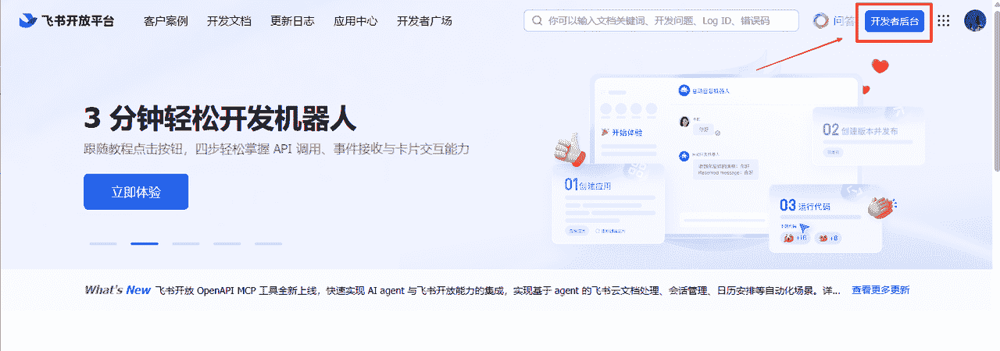
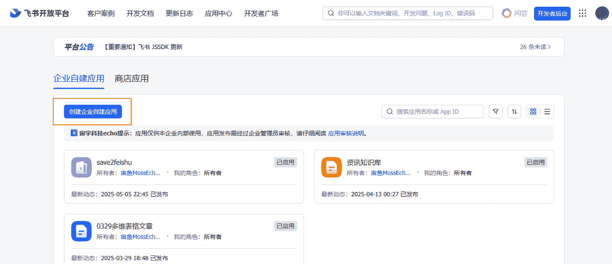
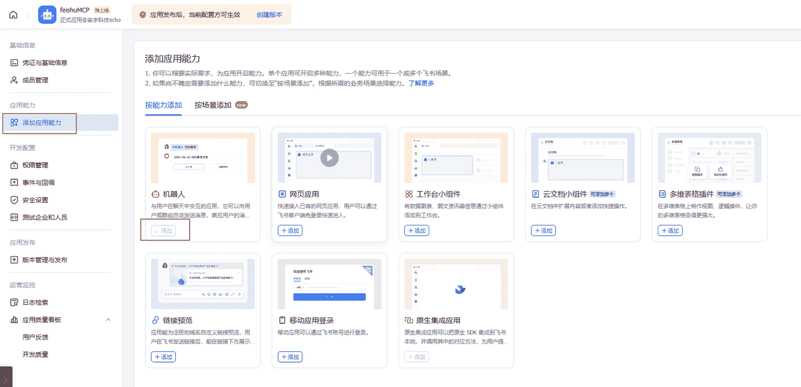

# 0623飞书MCP

> 来源：[https://xatc0v8uz5m.feishu.cn/docx/XCiAdmkM9okvY9xhmOPcY5yenqd](https://xatc0v8uz5m.feishu.cn/docx/XCiAdmkM9okvY9xhmOPcY5yenqd)

# MCP是什么、飞书是什么？

# 使用飞书有什么达到什么效果

# 怎么安装飞书mcp

## 提前的准备工作

### 准备一些专属你的接口信息

应用API等

1、打开你的飞书开放平台https://open.feishu.cn/?lang=zh-CN

进入你的开发者后台https://open.feishu.cn/app?lang=zh-CN

添加应用能力，把机器人添加进去。

开通应用权限把权限全部开通。

创建版本

### 安装trae

把飞书MCP信息填写好

一键复制安装

##