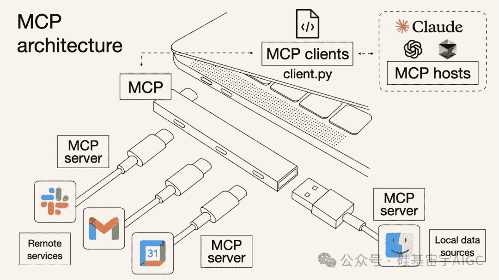

# AI界的"万能插座"诞生！碳基小白3分钟看懂MCP：拼个高达秒杀所有工具

> 来源：[https://xatc0v8uz5m.feishu.cn/docx/BR0UdrcSLoEYm4xi6ajcaD5xn9H](https://xatc0v8uz5m.feishu.cn/docx/BR0UdrcSLoEYm4xi6ajcaD5xn9H)

https://mp.weixin.qq.com/s/Qc8SHKB48r4JJGZLcZBUyg

# AI界的"万能插座"诞生！碳基小白3分钟看懂MCP：拼个高达秒杀所有工具

青争鱼Echo硅基宙宇AIGC2025-07-05 20:22:00

手机阅读

# "

> 💡 核心摘要

> MCP（模型上下文协议）是 AI 界的“万能插座”或“Type-C 接口”。它允许不同功能（如地图、天气、文档）像乐高积木一样轻松地“插”到 AI 大模型上，让 AI 能自动调用这些工具来完成复杂任务。本文将用最通俗易懂的方式，告诉你它是什么、有什么用，以及它如何像拼装高达一样，组合出强大的应用场景。

> 关键词: MCP, AI Agent, API,

## 📜 本文目录 (Table of Contents)

+   • 前言：AI 界的“万能插座”来了！

+   • 🧐 MCP 到底是什么？

+   • 🚀 MCP 的真正威力：1+1 > 2 的组合魔法

+   • 🌐 探索更多 MCP 资源

+   • 👋 写在最后：开启你的“高达”拼装之旅

+   • 📚 参考文献

---

## 前言：AI 界的“万能插座”来了！

哈喽，好久没见~（粤）

在这里呢，我们从普通吃瓜的碳基小白们都能听懂的方式来去介绍和说明前段时间很火的MCP。

### 为什么做这一期内容呢？

1.  为了让大家了解MCP是什么，以及MCP对AI的发展重要性

1.  AI+不同MCP的组合能达到什么效果？

其实在我们现阶段观点里，AI还是一个新能源、工具而已，不需要所有AI工具都去学。应用为导向，工具，够用就好了。毕竟作为碳基生物的我们是学不过来的，我们又不是AI😡

在这里不做深入的专业科普搭建，所以碳基小鱼们放心食用。

---

## 🧐 MCP 到底是什么？

🌟 Anthropic在2024年11月推出MCP，MCP是一种标准协议，类似于电子设备的Type C协议（可以充电和传输数据），使AI模型能够无缝地与不同的API和数据源交互。我们的网页使用http协议规范了Web网页开发。而MCP统一AI工具集成。

### 两个让你秒懂的比喻

#### ◆ 🔌 USB接口

我们可以想象，AI大模型是一个电脑，MCP是一个标准的USB接口，用来给电脑接入具备不同功能的接口，而不同功能的MCP就像是打印机、音箱麦克风、显示器等，给AI赋予了不同的专业功能。

#### ◆ 🤖 高达

再举个栗子，AI大模型是我们的高达大脑控制室，拼接上各种MCP服务结合之后，我们的高达就有了手脚、武器、剑。

针对不同敌人，我们通过MCP组装选择近战格斗型(RX-78-2 元祖高达)、远程攻击型（暴风高达）、防御辅助型（德天使高达），各各具备不同类型的特定功能的机器人😎

### 作用：让 AI 更可靠、更高效

🚀 MCP使AI大模型更加可靠和高效。通过建立通用标准，服务提供商可以基于该协议为其自身服务提供AI功能，使开发者能够更快地构建更强大的AI应用。开发者也不需要重新发明轮子——他们可以通过开源项目构建强大的AI Agent生态系统。

举一个熟了的栗子：高德地图开放了MCP的功能，我们在使用Deepseek的时候就能使用到高德精准定位的功能。

---

### 与 API 的关键区别：智能助理 vs. 手动操作

+   • MCP 是“自动”的：AI 自己判断当前任务需要什么，然后决定何时调用哪个工具。

+   • API 是“手动”的：你需要预先编写好代码，明确告诉程序在什么时候、用什么参数去调用哪个 API。

这就像 智能助理 vs 手动遥控器 的区别。

---

## 🚀 MCP 的真正威力：1+1 > 2 的组合魔法

单个 MCP 很有用，但它真正厉害之处在于，多个组合使用。我们可以针对专门的使用场景，组合出专属的“高达形态”。

下面是一些常见的 MCP 组合方案：

### 场景一：超级旅行规划师 ✈️

+   • 组合 MCP: 高德地图 + 墨迹天气 + 飞常准 + 12306

+   • 针对人群: 出差上班族、旅游达人、秘书助理

### 场景二：全能自媒体内容工厂 ✍️

+   • 组合 MCP: 飞书文档 + Flomo + Minimax + Bilibili + HotNews + 联网搜索

+   • 针对人群: 自媒体创作者、内容运营、新媒体团队

### 场景三：高效应用开发者工具箱 💻

+   • 组合 MCP: Context7 + Figma + Canva + GitHub

+   • 针对人群: 应用开发团队、独立开发者、产品经理

### 场景四：智能读书笔记助理 📚

+   • 组合 MCP: 微信读书 + Flomo

+   • 针对人群: 学生、读书爱好者、知识工作者、写作者

+   • 功能场景:

+   • 阅读与标注: 使用微信读书 MCP 阅读电子书，高亮、批注，记录心得。

+   • 灵感沉淀: 将阅读中产生的想法，用Flomo MCP 快速记录为碎片化笔记。

+   • 知识整理: 将微信读书的批注和 Flomo 的笔记相结合，整理成系统的知识体系，方便长期学习和复习。

---

后续会不定期分享好玩的 MCP 组合，解决不同的使用场景。

## 🌐 探索更多 MCP 资源

### 推荐网页

+   • 🔗 阿里百炼

+   • 🔗 MCP.so

+   • 🔗 MCP-CN

+   • 🔗 PulseMCP

+   • 🔗 Glama AI

---

## 👋 写在最后：开启你的“高达”拼装之旅

在这里我们先不去讲怎么使用。MCP 其实对于普通的小白来说是有一定的上手难度的。所以我们先展示一下使用出来的效果。

如果看完之后，对以上呈现的效果确实很想要，而且有动手意愿，请继续关注我们的频道。

下期预告：

+   • 【如何以最简单、低成本的方式搭建我们自己的 MCP 高达】

+   • 【更多好玩的 MCP 组合分享】

---

### 参考文献资料

+   • 📚 MCP: Build Rich Context AI Apps with Anthropic

+   • 📚 MCP（模型上下文协议）小白入门蓝皮书

+   • 📚 MCP X Agent 实用手册

---

THIS ALL，以上就是本期的所有内容

@ 作者 / 青争鱼Echo@ 投稿或爆料，请联系邮箱：Mossecho@aliyun.com

@ 全球最棒的AI社区的知识库 / https://waytoagi.feishu.cn/wiki/QPe5w5g7UisbEkkow8XcDmOpn8e

---

最后，感谢你看到这里👏如果喜欢这篇文章，不妨顺手给我们点赞👍｜在看👀｜转发📪｜评论📣

