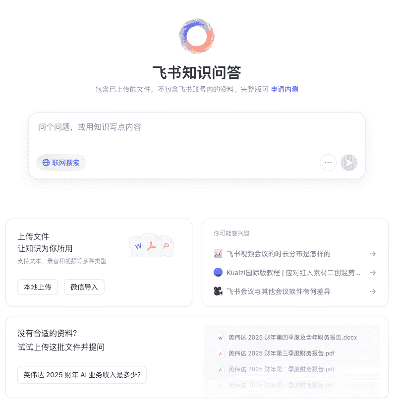
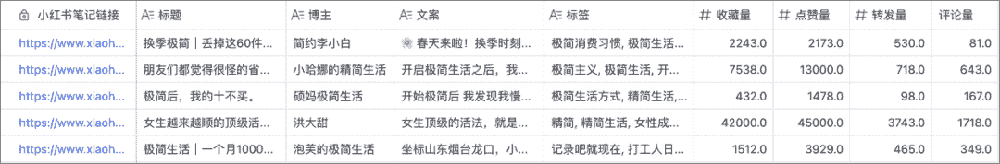
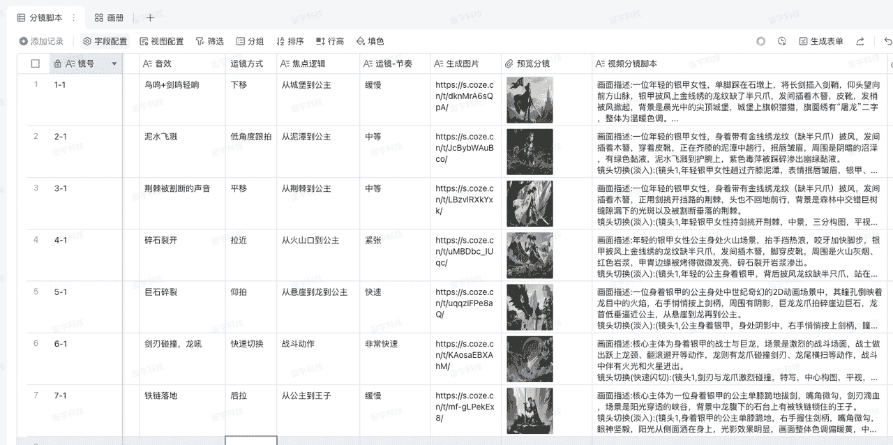
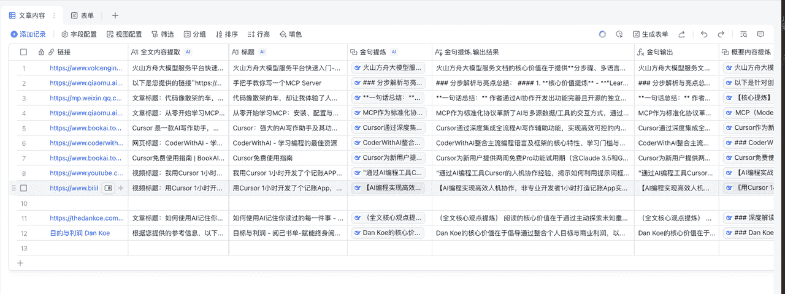

# 0710飞书未来无限大会

> 来源：[https://xatc0v8uz5m.feishu.cn/docx/EwS3dtWefo2fDFxaAlzcHZR5nig](https://xatc0v8uz5m.feishu.cn/docx/EwS3dtWefo2fDFxaAlzcHZR5nig)

# 简单介绍飞书和大会

哈喽，好久不见（粤）

昨天的飞书未来无限大会超级超级热闹。飞书作为一个软件软件真的进步得太快了，飞书+AI简直是企业打工牛马、学习进步记录的神器。

记得我第一次听说的飞书是在22年的时候，当时也在一个非常棒的【渐构】的社区，社区因为人员太多为了便于交流和学习以及管理知识库，内部发起了投票[钉钉or飞书]作为阵地。当时我因为不认识飞书，我选了钉钉，当时还在郁闷，为什么不用钉钉啊？飞书是个什么鬼？/😂

好在最后是飞书胜出了。在使用了飞书的云文档和同步编辑文稿和智能会议之后就喜欢使用飞书了。飞书一直是我这个离不开电脑的牛马，个人学习和公司运营中很好的帮手。

作为一个飞书的重度用户，看完大会上的产品发布非常地激动。快来一起看看吧

# 飞书知识问答

**飞书知识问答**是**最懂企业知识的专属** **AI 问答工具。**可以说飞书的这个知识问答跟现在的豆包AI、deepseek搜索我是完全不同的概念，因为它是基于我们飞书上所有的文档、知识库、消息、会议，这些内容来去出发的，也就是说它的信息来源更贴近于我们真实的情况。

而不是在互联网上所有的公开信息。它并不是一个通用型的智能问答。它是专属于我们个人知识库或者企业的图书馆智能总管。

举个栗子：我6月份参加过多少次视频会议？统计主要主题都哪些？6月份主要的会议的工作重点和工作总结是什么？

这个功能和谷歌的notebookLM很像，但飞书有着更大的优势，就是飞书是可以基于拥有一整个企业团队的知识库和办公沟通的信息。同时对企业来说，在海量的数据和信息在使用的过程中，是有着不同的权限的，在检索时能很好的区分和控制。

等不及上手体验朋友，直接拉到文末，附申请表

# 多维表格

首先，我先简单介绍一下多维表格，其实我们很多人容易被这个名字给误导。

我印象很深的是，4月份我去参加线下多维表格的AI切磋大会，当时就参加的人会比其他AI主题的活动来的人少一半，因为大家其实对多维表格的认识并不多，有着很大的误解。

**大家可能认**为他可能就是普通简单的一个excel表格，其实多维表格可有着通天的本领。换句话说，多维表格智能到把多种多样不同的AI功能植入到了表格中的每一个单元格当中。也就是在这个表格里，我们的每个单元格都可以具备AI的功能或总结提炼出我们想要的内容。

（以前的表格/现在的AI多维表格）

举一些实际的的案例

（自媒体小红书内容数据分析）

再举一个扣子老师的故事影片全流程生产的栗子

（一个故事短片，从剧本，到角色设定，到分镜拆分，在到分镜画面海报和视频，统统都一个在多维表格上全流程实现）

（个人知识库管理）

多维表格中通天的本领的关键就是【字段捷径】，每一个单元格都可以植入字段捷径中心的功能，让我们的表格数据不再只是静态的，而是能够根据我们业务和需求定制化专业的信息表。

**跨平台支持:**多维表格将不仅支持飞书，还将支持企业微信和钉钉

那么，我最看重多维表格还有哪些升级呢？

### 应用模式

面向企业的应用模式，是一种全新的、面向核心业务场景的专业系统构建方式;换句话说，企业可以自己根据业务板块搭建一个系统，比如

### **AI 侧边栏**

在这里，你可以直接完成，数据检索、知识问答、数据分析和工具调用等等智能任务，AI功能随时调取。

# 引发的深刻的AI思考

我们时常在思考AI时代下的产品应该长什么样子？这一次飞书，给了我们一种漂亮的答案。

AI会取代打工人牛马吗？

答案,并不会，非AI原生公司，AI不单只要给企业做赋能，还要和企业做融合。让AI长在企业身上，从生产到销售再到库存管理让AI融合到实际的场景中。

做到**“真能用、真落地”**

企业和个人的AI时代进化，从来不是一触即达，而是这样好用的AI工具融合到日常流程里。

其他更新详见此表和官方直播回放，按需领取

| 产品 | 发布情况 | 立即体验 |  | 预约演示/试用新品 |
| --- | --- | --- | --- | --- |
| **知识问答** | 已发布 | 访问 ask.feishu.cn 即可体验，有一定免费体验时间； |  | [点击预约](https://www.feishu.cn/landing/2025Feishu_Knowledge_AI_enterprise_AI) |
| **智能会议纪要** | 已发布 | 使用飞书开会即可体验，有一定免费额度； |  | [点击预约](https://www.feishu.cn/landing/feishu_ai_meeting?from=AIMeeting_banner) |
| 声纹识别 | 会后声纹识别已发布 |  |  | [点击预约](https://www.feishu.cn/solutions/feishu-rooms-overview) |
| 会议分析 | 已开放体验 | 访问[飞书会议分析](https://recipes.feishu.cn/meeting)即可体验 |  |  |
| **多维表格** | Q3 陆续上线 | 下载飞书即可体验多维表格已有能力，新能力陆续上线； |  | 报名优先体验全新功能，请 [点击这里填写问卷 🚀。](https://bytedance.larkoffice.com/share/base/form/shrcnUR6eEnNCNuFHVnxys4BsUh) |
| **飞书开发套件** | 飞书 aPaaS、aily 已发布 | 点击 [体验飞书 aily](https://aily.feishu.cn/ai/ailyplay)，有一定免费额度；更多功能请预约咨询 |  | [点击预约](https://www.feishu.cn/landing/feishu_future_caio_2025?tracking_code=701TL00000o9Kp8YAE) |
| **飞书项目** | 部分功能已上线，部分功能 QA 陆续上线 | [飞书项目官网](https://project.feishu.cn/home) |  | [购买咨询](https://project.feishu.cn/home/service) |

关注公众号私信飞书未来无限大会获取

和申请入口

官方未来无限大会直播内容分享

[2025 飞书未来无限大会 演讲全文及回放](https://larkcommunity.feishu.cn/wiki/UbiYwRt1piU7j0kpPKccTbJ4nDe)

[2025 飞书发布会精华总结（公开版）](https://bytedance.larkoffice.com/wiki/SIErwrlM7ig6a6k9RxhcvnD1njb)