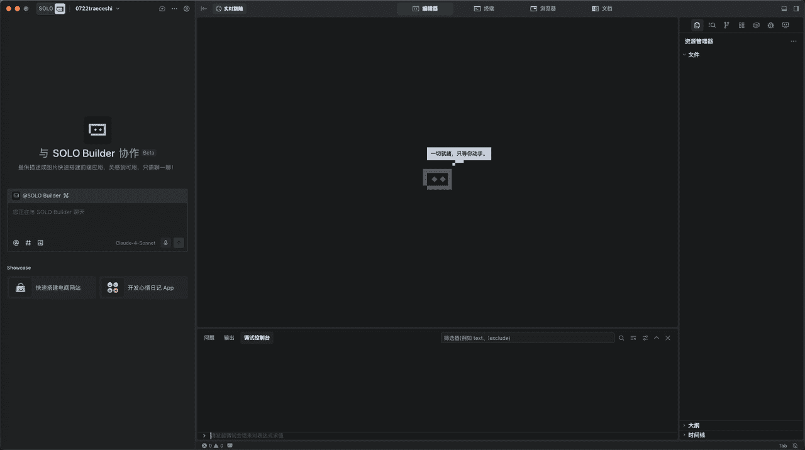
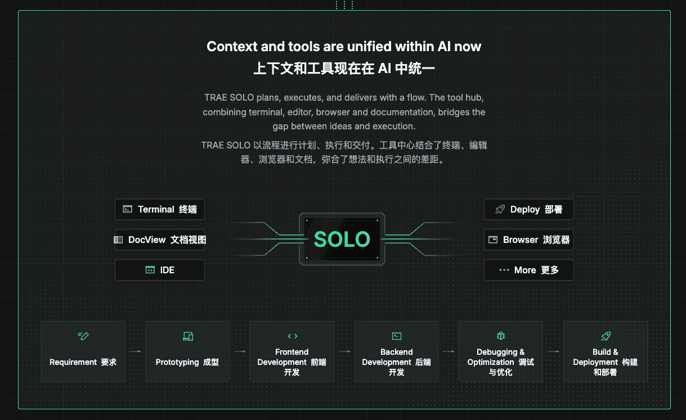
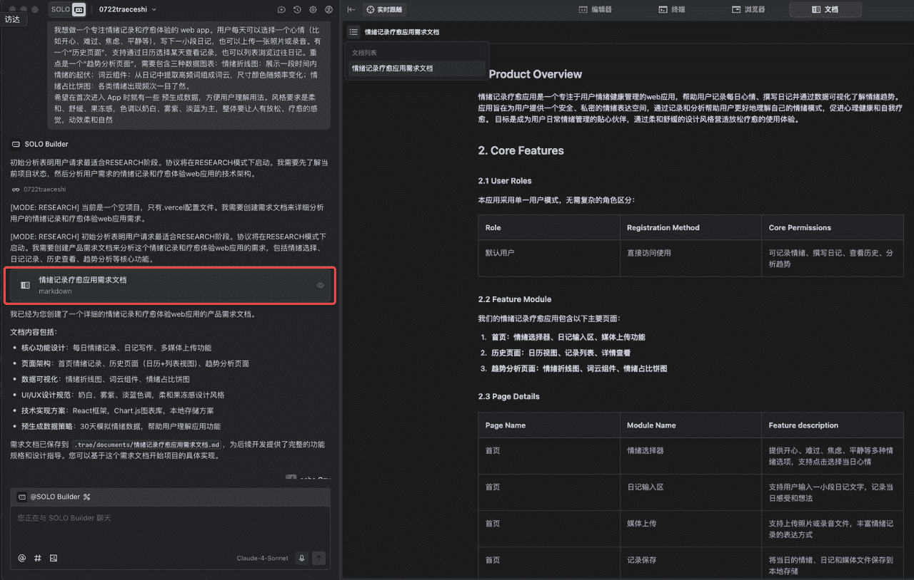
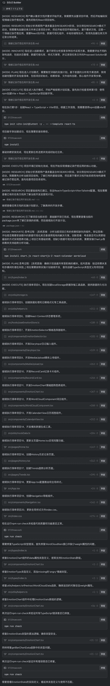
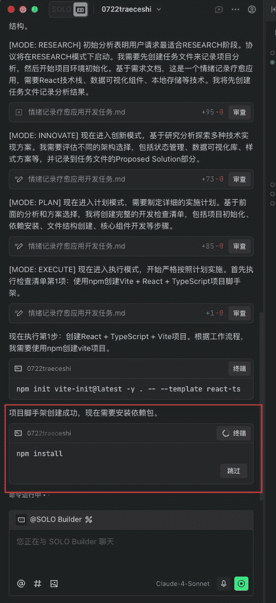
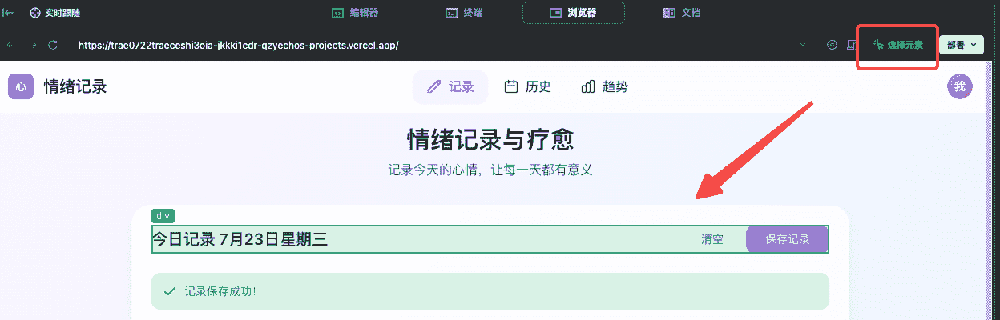
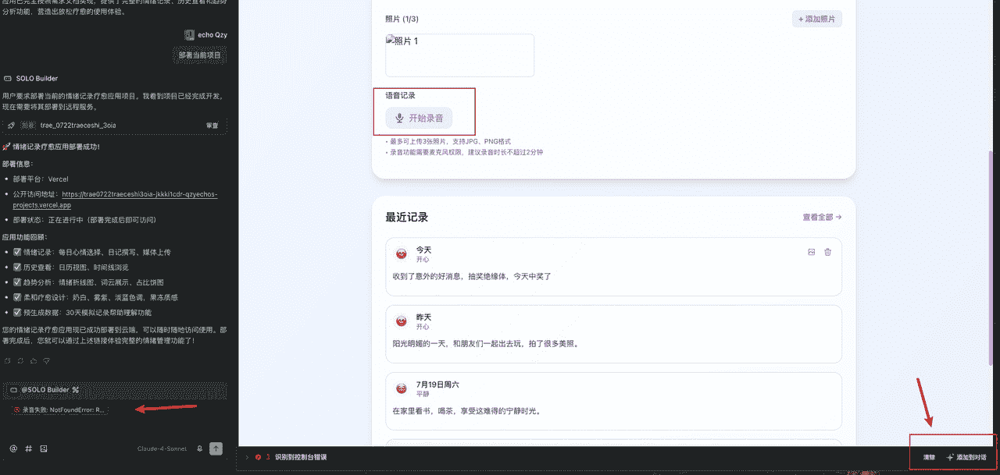
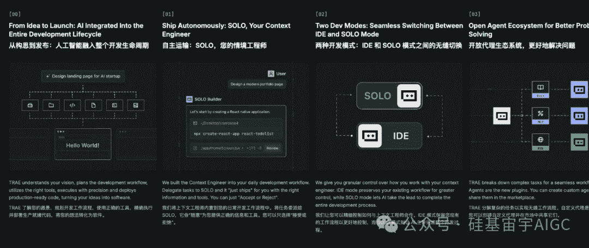
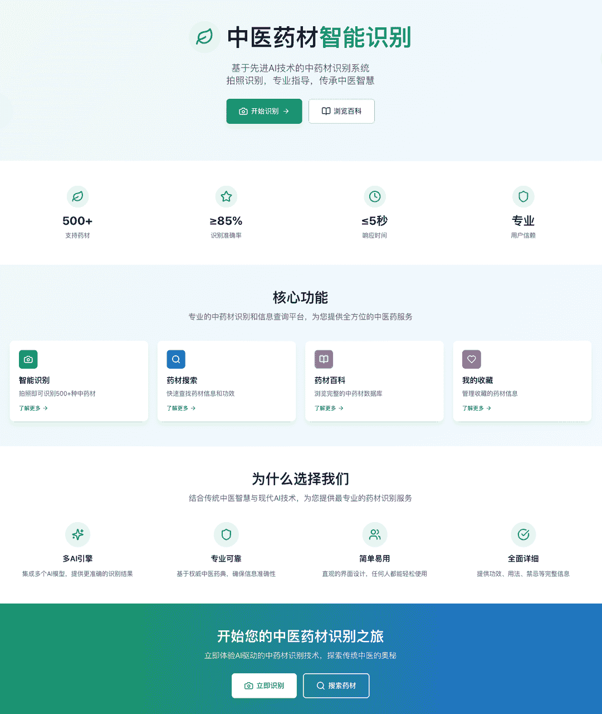
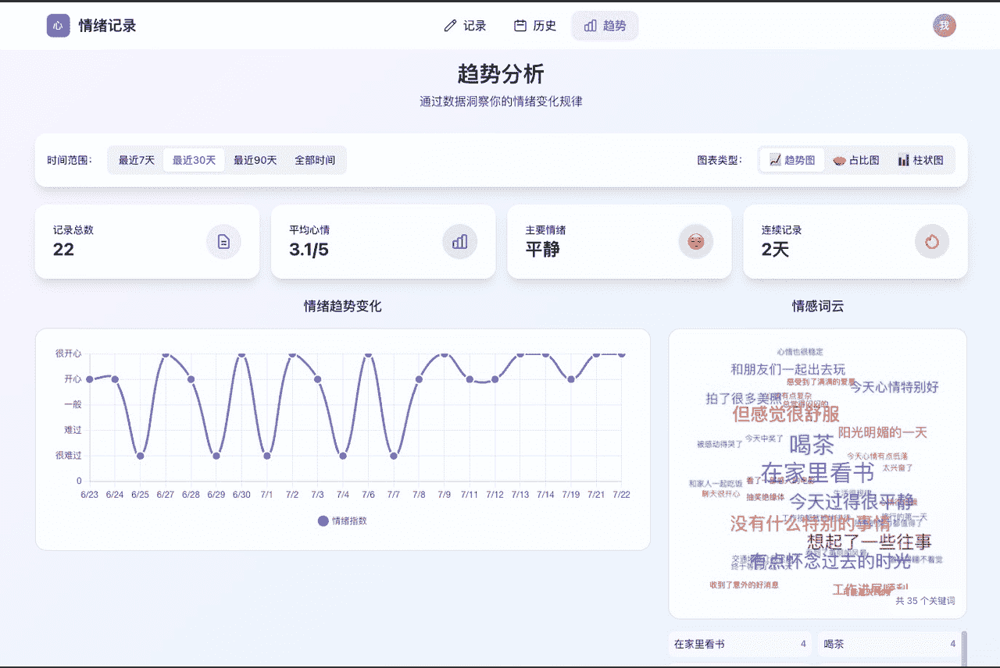

# TRAE2.0 Solo|AI团队上线，告别“shi山”代码，内附邀请码

> 来源：[https://xatc0v8uz5m.feishu.cn/docx/GPbZd9Qnio1GFsxcNsOcxI9wn5g](https://xatc0v8uz5m.feishu.cn/docx/GPbZd9Qnio1GFsxcNsOcxI9wn5g)

# 🚀 TRAE 2.0 Solo模式深度体验

# "

> 💡 核心摘要

> 字节跳动TRAE推出重磅Solo模式更新，我第一时间体验后分享真实感受。从界面升级到30+任务自动化工作流，Solo模式带来前所未有的AI编程体验，让项目成功率大幅提升。

> 🏷️ 关键词：TRAE 2.0Solo模式AI编程自动化开发字节跳动

---

## 📋 目录

+   • 🤖 TRAE是什么

+   • ⚡ 更新哪些功能

+   • 🎯 体验感受

+   • 🤔 思考

+   • 💼 case展示

+   • 🎫 文末附邀请码

哈喽，好久不见~（粤）

昨天国内Ai又推出来了非常重磅的产品，就是我们的老朋友啦。字节的TRAE,推出了新的AI coding功能模式，也就是Solo。

我也很幸运的作为中奖绝缘体的我，第一时间也抽到了邀请码，狠狠的上手体验了一番。\撒花

[MAIN-1920+BGM_1.52dfa3bc.mp4](https://internal-api-drive-stream.feishu.cn/space/api/box/stream/download/all/YIg6bdnp9oAYCnxD6Dyc5Ro5nMe)

TRAE 2.0 整个logo焕然一新，功能界面也换新了。从这样的动作我们就能看出来，这次的更新非同小可，肯定是一次重大的更新啦。全新的Solo模式，确实给到了前所未有的体验，让我的整个项目成功率真的高了好多。

废话不多说，一起看看都有哪些更新吧

# TRAE是什么

先给新朋友介绍一下，AI IDE是一个颠覆性的编程工具，以往程序员去开发一个产品应用的话都是用VS code等等一些软件手动编写前端和后端代码。但是呢？AI的到来呢，让整个编程的过程。完全不一样了。

比如说我们通过把这个项目的功能需求以及展示出来的效果等等都描述给到AI**之后呢？TR**AE在大语言模型的加持下呢，能够让整个编写代码的过程变成自动化，也是自动编写代码。（换句话说就是工程师开发了一个ai代码的一种东西，然后呢？把自己的工作抢走了\笑哭）

前段时间,一直都是海外的Cursor在AI Coding领域里面，是最强的。

目前cursor的市值就估值高达100亿美金。TRAE作为国产后来者，也一直在不断进步。我们可以看到的是国内的产品真的有不断地变好，而且性价比高。这一次Solo的推出，更让我感觉有点恍惚。

这一次新的更新，整的和我前面在三月份的时候使用TRAE的体感完全不同。让我们来看看都有哪些不同吧。

# 更新哪些功能

## 操作界面

左上角有个模式的切换，IDE/SOLO**的切换按钮，**而且是可以在做项目的过程中，随时无缝切换。也就是当我们在做项目的过程中，可以随时切换会自己手动介入的这种模式。

同时把这个AI沟通的交互窗口切换到了左边。这次AI的角色是Solo builder。

## SOLO模式

Solo模式是这次更新的最重要最重要的一个功能。而且他给我的使用体验就是它相当于是一个整个AI的编程团队。它似乎划分出了在做项目时所需要的多个角色，会根据我们在做项目细分多个模块，细化完成工作。

通过Trae自带的简单的展示案例（开发心情日记APP）提示词，它第一步会清楚的划分PRD需求文档，给每个步骤做出指示。例如：

一般我们在AI coding最后出来的效果好坏，很大程度上就决定于PRD的需求文档的编写。这也是项目开发时，产品经理的核心工作之一。

**最让人震惊的来了**，在我们简简单单的给了一个提示词之后，一旦它确认开始工作之后，Solo模式它就给了我们长的工作流。

我数了数足足**有30任务项**。如下图，solo模式就给持续工作，不需要动手，完全给了一整套完整的工作流，然后5-10分钟项目基本完成了，90%。

这只是刚刚开始确认完第二步！

也就是说，我们刚泡一壶茶准备开始啃代码的时候，啪，完成了？？？

以前我们用TRAE 做coding的时候，体验是怎么样的呢？可以说，写一个项目，第一个拦路虎PRD，我们需要去构思，需要去找AI去帮我们理清整个项目的框架，然后呢给到一份比较完整的需求文档。生成项目的过程中BUG不断，项目最后完成度不定性的因素非常高，最后很容易就变成了一堆代码屎山。

所以这次solo的效果确实让我非常惊艳。

## 自动安装所需要的环境依赖包

这一点真的对于新手小白来说，太太太友好了！

我记得当时三月份做线下的AI切磋大会的时候，我们组队都开始上手去做一些有意思的项目时，就被这个环境这个东西卡了半个多小时，大部分刚开始接触编程的人来说甚至都不知道环境是什么？什么node.js、Python、Java等等我们当时完全是没有概念的。

现在SOLO直接帮我们检查，帮我们安装。太酷啦！

## 小细节

网页界面展出出来之后，我们可以**选择元素**，做到指哪改哪。

在本地测试时，所出现的**报错记录**下来，然后添加到SOLO窗口中更改。改bug更加精准。

**生成项目需要**用到图片和数据时，能够自动调用生图模型给项目内置图片和数据。

这个效果是完全不一样的，举个栗子，电商网页的图片自动生出，而不是图片缺失待上传，数据为空。这样的演示效果真的天差地。

试想一下，如果上面这张衣服模特的图片全都是灰色的格子、带上传，金额数据全都是0。那我们看起来整个页面的效果其实都是不完整的。但是solo他做到了。在项目创建的过程中就把图片数据得到我们那呈现出来的效果就很丝滑。

## 小吐槽

这次邀请码确实太难搞了呀。好在幸运的第二天我居然抽奖中了。当然第二天晚上在大家的吐槽下，发放了不少邀请码。下次请不要再让邀请码这么难get到。

第二，在和SOLO交互的过程中，似乎我提出的问题，SOLO都是没有回答的，它不是在和我们交流这个项目，而像是直接接收和分析我们的目标指令，直接分工合作。这个点有好有坏。

# 体验感受

这次用SOLO给人的感觉非常的丝滑。

小项目来来回回让它改了几次bug，就能用了。当然复杂的项目也会有很多的BUG，都不是一蹴而就的。是这一次次更新让我们比之前节约了很多时间，减少了很多bug，减少了很多步骤。这让好的想法有了更多的可能，可以肯定的是AI功能还会再去进步。AI也会越来越得心应手，在面对人类复杂的工程问题。

在这里也请大家放掉标题党们关于AI万能论想法，其实接触了AI coding了之后，你会发现也会有它的局限性，一点都不懂代码，或者说对他没有一点概念的话，其实是很难完整做出一个好的项目的。每一个好的项目都需要我们持续不断的迭代、更新。当然，这相比于我们以前要掌握一门计算机语言已经提快了很多很多，不是吗？

完全就感觉像在6月份以前的AI coding就像是一个人劝着它说去帮我们完成编程任务。坐在了汽车的主驾驶上。但是现在Solo的模式来了之后，AI coding就变成了一群机器人在做这个事情，变成了我坐在副驾驶上。主驾驶就交给了它，他们，AIs。

同时在使用了SOLO 之后感觉，AI coding的角色边界也开始模糊了。在昨天之前我都还会认为哪怕现在AI时代的到来，有产品开发经验或者编程程序员。都会有很大的优势，但是现在solo出来了之后，我动摇了。

我发现未来可能更多的是如何有好的想法，然后通过各种好玩的方式或者是营销的植入日常生活让更多人去上手体验，形成一个商业性的一个闭环。这些技能更是一个未来的更重要的核心优势。

文末附**邀请码**

THIS ALL，以上就是本期的所有内容

@ 作者 / 青争鱼Echo@ 投稿或爆料，请联系邮箱：Mossecho@aliyun.com

[通往AGI之路](https://waytoagi.feishu.cn/wiki/QPe5w5g7UisbEkkow8XcDmOpn8e) 全球最棒的AI社区的知识库 /

---

最后，感谢你看到这里👏如果喜欢这篇文章，不妨顺手给我们点赞👍｜在看👀｜转发📪｜评论📣

### case展示

下一期将分享如何使用Trae2.0solo实战做一个网站【神农AI识别百草】

https://trae0722zhongyaoxiangmuru0k-1td53wqnp-qzyechos-projects.vercel.app/recognition

开发心情日记APPhttps://trae0722traeceshi3oia-jkkki1cdr-qzyechos-projects.vercel.app/

电商网站https://trae072203dianshangceshi1rzd-epnmuj19c-qzyechos-projects.vercel.app/

官网https://www.trae.ai/solo?showJoin=1

听说22日晚官网发出了1000个邀请码，没抢到的在下面的渠道蹲吧（需要订阅Pro用户才能用邀请码，首月3美金，）

x渠道：[h](https://x.com/search?q=solo%20code&src=typed_query&f=live)ttps:/[/x.com/search?q=](https://www.reddit.com/user/Trae_AI/)solo%20co[d](https://traesolocodedcln-5o418fy5b-ambershens-projects.vercel.app/)e&src=typ[e](https://www.xiaohongshu.com/user/profile/661f6cf4000000000d027e6c)d_query&f=live

red渠道：https://www.reddit.com/user/Trae_AI/

官方自动发放渠道：https://traesolocodedcln-5o418fy5b-ambershens-projects.vercel.app/

小红书渠道评论区：https://www.xiaohongshu.com/user/profile/661f6cf4000000000d027e6c

b站渠道评论区：https://www.bilibili.com/opus/1092296696955666452?

抖音渠道：我们又申请了一些 SOLO Code.各位关注 TRAE 的 - 抖音

discord渠道：https://discord.gg/FTndW3KK

试试下面的

mO1AmwX9nQj4mwX7cAjAmAeUbdKbmAj5ZsOQi9aBbdmjf6aiWPD7fj

mO1AmwX9nQj4mAnBcAj4ngSUWuSEhPuliR8eesyLYuWUYeynld4kjj

mO1AmwX9nQj4lgT5cAb5mwyUngeHafiKfsONgt0bnOWqasejVgijjj

mO1AmwX9nQfDnQj9cAf5mgWUeNGseQuJZ9GGZeOnhuaMYwipYwyRWD

mO1AmwX9nQfDmgzDcAbBmgaUdwiniNaBYNSig6yDodWrdfWSmN43jj