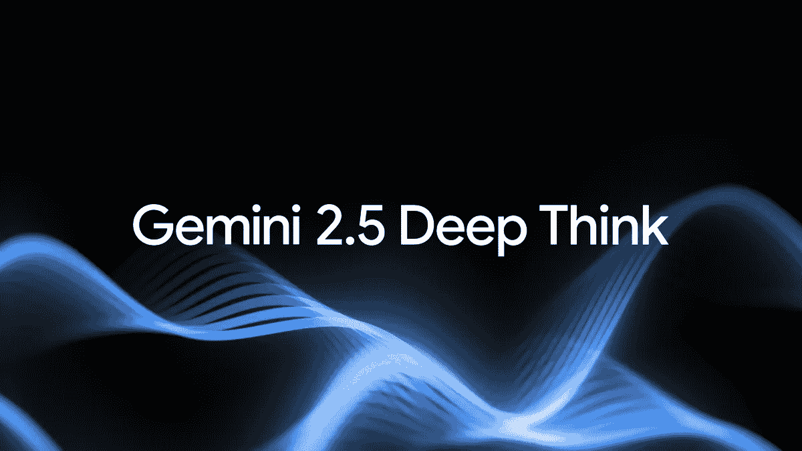
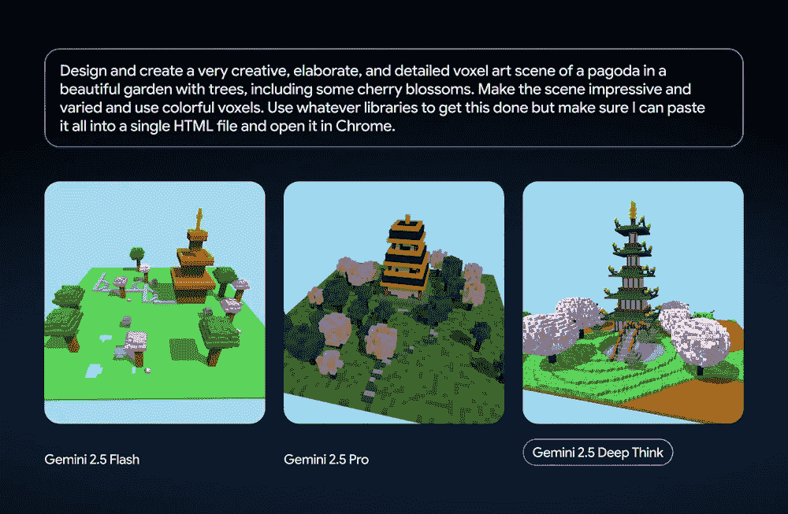
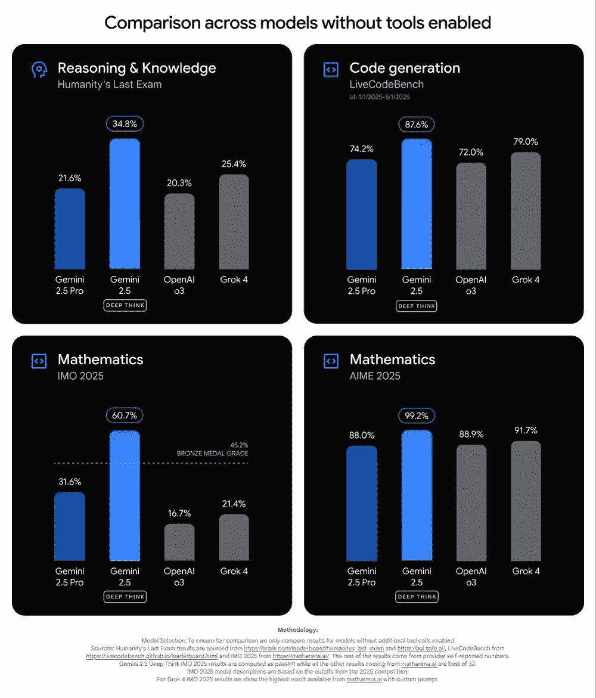

# gemini2.5deepthink

> 来源：[https://xatc0v8uz5m.feishu.cn/docx/SMf4dFt0GoLeB1xTmjfcWpKin9e](https://xatc0v8uz5m.feishu.cn/docx/SMf4dFt0GoLeB1xTmjfcWpKin9e)

Google AI Ultra 订阅用户推出 Gemini 应用中的 Deep Think

仅限Ultra 订阅用户，尊贵用户哈哈哈哈

[它是](https://blog.google/technology/google-deepmind/google-gemini-updates-io-2025/#deep-think)最近在今年国际数学奥林匹克 (IMO) 比赛中获得金牌标准的模型的一个变体。

我们将 Gemini 应用程序中的 Deep Think 提供给米歇尔·范·加雷尔 (Michel van Garrel) 等数学家来测试数学猜想。

## Deep Think 的表现如何：最先进的性能

**迭代开发和设计：**

提升 Web 开发任务的美观度和功能性。

+   **科学和数学发现：**由于深度思考能够推理高度复杂的问题，它可以成为研究人员的强大工具。它可以帮助构建和探索数学猜想，或推理复杂的科学文献，从而有可能加速发现的进程。

+   **算法开发和代码：**[ Deep Th](https://x.com/GoogleDeepMind/status/1925676461651791992)ink 特别擅长解决棘手的编码问题，其中问题的制定和对权衡和时间复杂性的仔细考虑至关重要。

+

