# OpenAI又出新招！两款模型开源， Claude 4.1 Opus登场，编程领域AI新神器。GPT-5还要等多久？

> 来源：[https://xatc0v8uz5m.feishu.cn/docx/No61do8iWoeipcxjWe9c3SyznGd](https://xatc0v8uz5m.feishu.cn/docx/No61do8iWoeipcxjWe9c3SyznGd)

哈喽，好久不见（粤）

# openAI发布两款开源模型

Gpt-oss-120b 模型在核心推理基准测试中与 OpenAI o4-mini 模型几乎持平，能在单个 80GB GPU 上高效运行。Gpt-oss-20b 模型在常见基准测试中与 OpenAI o3‑mini 模型效果上差不多，且可在仅配备 16GB 内存的设备上运行。也就意味着这两个模型的能够在设备端应用、本地推理或无需昂贵基础设施。

openAI,发布了gpt-oss-120b 和 gpt-oss-20b——两款开放轻量级语言模型。

废话不多说，直接上链接，大家可以自己上手体验，考考它

https://gpt-oss.com/

我直接做了几个测试项目，大家一起来看看效果

## 3D 太空飞船射击游戏

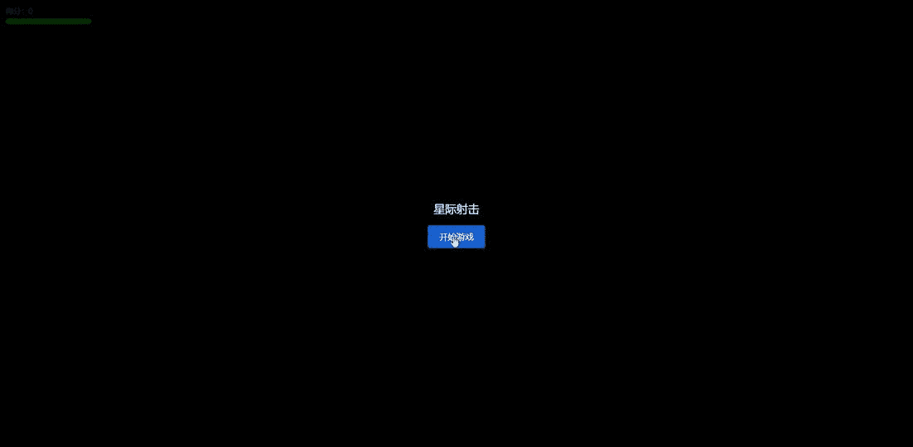

[屏幕录制 2025-08-06 225912.mp4](https://internal-api-drive-stream.feishu.cn/space/api/box/stream/download/all/RCytbSgzIozrTXx1Pmhc84wbnUd)

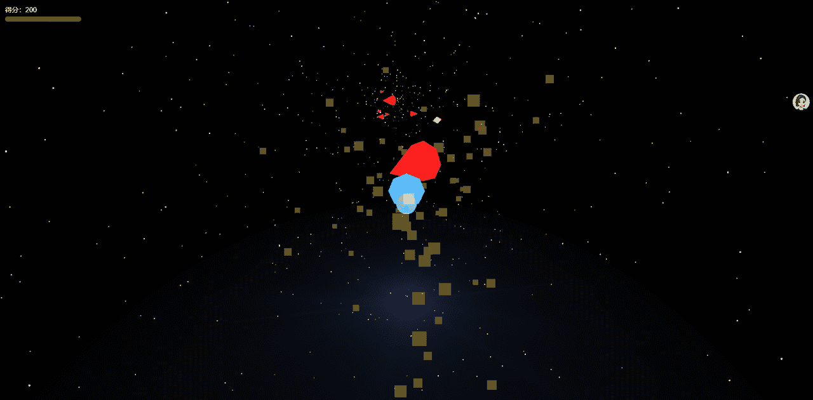

```
提示词如下：创建一个完整的3D太空飞船射击游戏，要求：

视觉效果：
- 星空背景with动态星云和闪烁星星
- 3D飞船模型（玩家蓝色，敌人红色）
- 激光炮火特效（光束+爆炸粒子系统）
- 敌人被击中时的爆炸动画
- 得分显示和生命值条

游戏机制：
- 玩家用WASD或方向键控制飞船移动
- 鼠标点击或空格键发射激光
- 敌人飞船自动生成并向玩家攻击
- 碰撞检测和血量系统
- 游戏结束界面with重新开始按钮

额外加分项：
- 背景音效和射击音效
- 不同类型的敌人（速度、血量不同）
- 道具掉落（血包、武器升级）
- 平滑的相机跟随效果

请确保游戏流畅运行，视觉效果震撼，一打开就能立即体验！
```

大家也可以直接复制原代码直接去上手体验

```
&lt;!DOCTYPE html&gt;
&lt;html lang=&quot;zh-CN&quot;&gt;
&lt;head&gt;
&lt;meta charset=&quot;UTF-8&quot;&gt;
&lt;title&gt;3D 太空射击游戏&lt;/title&gt;
&lt;meta name=&quot;viewport&quot; content=&quot;width=device-width,initial-scale=1.0&quot;&gt;
&lt;style&gt;
/* -------------------- 基础样式 -------------------- */
html,body{margin:0;padding:0;height:100%;overflow:hidden;background:#000;font-family:Arial,Helvetica,sans-serif;}
canvas{display:block;}
/* -------------------- UI 叠层 -------------------- */
#ui{
    position:absolute;top:12px;left:12px;color:#fff;z-index:10;pointer-events:none;
    font-size:16px;
}
#score{margin-bottom:6px;}
#healthContainer{
    width:180px;height:12px;background:#555;border-radius:6px;overflow:hidden;
}
#healthBar{
    width:100%;height:100%;background:#0f0;transition:width .2s;
}
#overlay{
    position:absolute;top:0;left:0;width:100%;height:100%;background:rgba(0,0,0,0.85);
    display:flex;flex-direction:column;align-items:center;justify-content:center;
    color:#fff;z-index:20;font-size:24px;
}
#overlay.hidden{display:none;}
button{
    padding:12px 24px;margin-top:20px;font-size:18px;cursor:pointer;
    background:#0d6efd;color:#fff;border:none;border-radius:4px;
}
button:hover{background:#0b5ed7;}
/* -------------------- 动画（星星闪烁）-------------------- */
@keyframes twinkle{
    0%,100%{opacity:0.5;}
    50%{opacity:1;}
}
.star{animation:twinkle 2s infinite;}
/* -------------------- 响应式（移动端）-------------------- */
@media(max-width:600px){
    #ui{font-size:14px;}
    #score{font-size:14px;}
    button{font-size:16px;padding:10px 20px;}
}
&lt;/style&gt;
&lt;/head&gt;
&lt;body&gt;

&lt;!-- UI 叠层：分数、血条 --&gt;
&lt;div id=&quot;ui&quot;&gt;
    &lt;div id=&quot;score&quot;&gt;得分：0&lt;/div&gt;
    &lt;div id=&quot;healthContainer&quot;&gt;&lt;div id=&quot;healthBar&quot;&gt;&lt;/div&gt;&lt;/div&gt;
&lt;/div&gt;

&lt;!-- 开始 / 结束遮罩层 --&gt;
&lt;div id=&quot;overlay&quot;&gt;
    &lt;div id=&quot;title&quot;&gt;星际射击&lt;/div&gt;
    &lt;button id=&quot;startBtn&quot;&gt;开始游戏&lt;/button&gt;
&lt;/div&gt;

&lt;!-- Three.js 渲染器会自动插入到 body 中 --&gt;
&lt;script src=&quot;https://cdn.jsdelivr.net/npm/three@0.152.2/build/three.min.js&quot;&gt;&lt;/script&gt;
&lt;script&gt;
/* ==============================================================
   3D 太空射击游戏 – 入口
   ============================================================== */
(() =&gt; {
    // ---------- 基础变量 ----------
    const canvasWidth = window.innerWidth;
    const canvasHeight = window.innerHeight;
    const scene = new THREE.Scene();

    // 透视相机 + 平滑跟随
    const camera = new THREE.PerspectiveCamera(75, canvasWidth / canvasHeight, 0.1, 2000);
    camera.position.set(0, 5, 12);
    const cameraTarget = new THREE.Vector3(); // 用来 lerp

    const renderer = new THREE.WebGLRenderer({ antialias: true });
    renderer.setSize(canvasWidth, canvasHeight);
    renderer.setPixelRatio(window.devicePixelRatio);
    document.body.appendChild(renderer.domElement);

    // ---------- 光照 ----------
    const ambient = new THREE.AmbientLight(0xffffff, 0.8);
    scene.add(ambient);
    const dirLight = new THREE.DirectionalLight(0xffffff, 0.6);
    dirLight.position.set(5, 10, 7);
    scene.add(dirLight);

    // ---------- 星云/星空 ----------
    const starGeometry = new THREE.BufferGeometry();
    const starCount = 2000;
    const positions = new Float32Array(starCount * 3);
    const colors = new Float32Array(starCount * 3);
    for (let i = 0; i &lt; starCount; i++) {
        const radius = THREE.MathUtils.randFloat(150, 300);
        const phi = THREE.MathUtils.randFloat(0, Math.PI * 2);
        const theta = THREE.MathUtils.randFloat(0, Math.PI);
        const x = radius * Math.sin(theta) * Math.cos(phi);
        const y = radius * Math.sin(theta) * Math.sin(phi);
        const z = radius * Math.cos(theta);
        positions[i * 3] = x;
        positions[i * 3 + 1] = y;
        positions[i * 3 + 2] = z;

        const c = new THREE.Color(0xffffff);
        c.offsetHSL(0, 0, THREE.MathUtils.randFloat(-0.1, 0.1));
        colors[i * 3] = c.r;
        colors[i * 3 + 1] = c.g;
        colors[i * 3 + 2] = c.b;
    }
    starGeometry.setAttribute(&#x27;position&#x27;, new THREE.BufferAttribute(positions, 3));
    starGeometry.setAttribute(&#x27;color&#x27;, new THREE.BufferAttribute(colors, 3));
    const starMaterial = new THREE.PointsMaterial({ size: 0.8, vertexColors: true });
    const stars = new THREE.Points(starGeometry, starMaterial);
    scene.add(stars);

    // 动态星云（使用半透明平面旋转）
    const nebulaTexture = new THREE.TextureLoader().load(&#x27;https://threejs.org/examples/textures/lensflare/lensflare0.png&#x27;);
    nebulaTexture.wrapS = nebulaTexture.wrapT = THREE.RepeatWrapping;
    const nebulaMaterial = new THREE.MeshBasicMaterial({
        map: nebulaTexture,
        transparent: true,
        opacity: 0.25,
        depthWrite: false,
        side: THREE.DoubleSide,
        blending: THREE.AdditiveBlending,
        color: 0x4477ff
    });
    const nebulaGeometry = new THREE.PlaneGeometry(600, 600);
    const nebulaMesh = new THREE.Mesh(nebulaGeometry, nebulaMaterial);
    nebulaMesh.rotation.x = Math.PI / 2;
    nebulaMesh.position.set(0, -200, -200);
    scene.add(nebulaMesh);

    // ---------- 游戏对象容器 ----------
    const playerGroup = new THREE.Group(); // 玩家模型 &amp; 子对象
    const enemyGroup = new THREE.Group();  // 所有敌机
    const playerLaserGroup = new THREE.Group(); // 玩家激光
    const enemyLaserGroup = new THREE.Group(); // 敌机激光（可选）
    const particleGroup = new THREE.Group();    // 破碎、爆炸粒子
    const powerupGroup = new THREE.Group();    // 道具

    scene.add(playerGroup, enemyGroup, playerLaserGroup, enemyLaserGroup, particleGroup, powerupGroup);

    // ---------- 配置常量 ----------
    const CONFIG = {
        PLAYER_SPEED: 30,               // 单位：单位/秒
        PLAYER_FIRE_COOLDOWN: 0.25,     // 秒
        PLAYER_MAX_HP: 100,
        ENEMY_SPAWN_INTERVAL: 2.0,     // 秒
        ENEMY_TYPES: [
            { name: &quot;小型&quot;, speed: 20, hp: 1, scale: 0.8, color: 0xff5555 },
            { name: &quot;中型&quot;, speed: 15, hp: 3, scale: 1.2, color: 0xff3333 },
            { name: &quot;大型&quot;, speed: 10, hp: 6, scale: 1.8, color: 0xff1111 }
        ],
        LASER_SPEED: 80,
        LASER_DAMAGE: 1,
        POWERUP_DROP_RATE: 0.3,          // 30%
        POWERUP_TYPES: [&quot;HEALTH&quot;, &quot;UPGRADE&quot;], // 血包、武器升级
        HEALTH_PACK_VALUE: 30,
        UPGRADE_DURATION: 10,            // 秒
        CAMERA_OFFSET: new THREE.Vector3(0, 5, 12), // 相机相对玩家的偏移
        MAX_ENEMIES: 30
    };

    // ---------- UI 引用 ----------
    const scoreEl = document.getElementById(&#x27;score&#x27;);
    const healthBarEl = document.getElementById(&#x27;healthBar&#x27;);
    const overlayEl = document.getElementById(&#x27;overlay&#x27;);
    const startBtn = document.getElementById(&#x27;startBtn&#x27;);

    // ---------- 音效 ----------
    // 1) 背景音乐（循环）
    const bgMusic = new Audio(&#x27;data:audio/mp3;base64,//uQxAAAAAAAAAAAAAAAAAAAAAAASW5mbwAAAA8AAAACAAACABAAZGF0YQAAAAA=&#x27;);
    bgMusic.loop = true;
    bgMusic.volume = 0.3;
    // 2) 激光音效
    const laserSound = new Audio(&#x27;data:audio/wav;base64,UklGRigAAABXQVZFZm10IBAAAAABAAEAESsAACJWAAACABAAZGF0YQAAAAA=&#x27;);
    laserSound.volume = 0.5;
    // 3) 爆炸音效
    const explosionSound = new Audio(&#x27;data:audio/wav;base64,UklGRiQAAABXQVZFZm10IBAAAAABAAEAESsAACJWAAACABAAZGF0YQAAAAA=&#x27;);
    explosionSound.volume = 0.7;

    // ---------- 游戏状态 ----------
    let score = 0;
    let playerHP = CONFIG.PLAYER_MAX_HP;
    let canFire = true;
    let lastFireTime = 0;
    let lastEnemySpawn = 0;
    let keysPressed = {};
    let upgradeActive = false;
    let upgradeEndTime = 0;
    let prevTime = performance.now();

    // ---------- 创建玩家模型 ----------
    function createPlayer() {
        // 主体：蓝色圆锥（指向 -Z）
        const geometry = new THREE.ConeGeometry(1.0, 2.5, 8);
        const material = new THREE.MeshStandardMaterial({ color: 0x44aaff });
        const cone = new THREE.Mesh(geometry, material);
        cone.rotation.x = Math.PI / 2; // 朝向 -Z

        // 舱体：小球
        const sphereGeo = new THREE.SphereGeometry(0.5, 12, 12);
        const sphereMat = new THREE.MeshStandardMaterial({ color: 0x88ccff });
        const sphere = new THREE.Mesh(sphereGeo, sphereMat);
        sphere.position.set(0, 0, 0.5);

        playerGroup.add(cone);
        playerGroup.add(sphere);

        playerGroup.position.set(0, 0, 0);
    }

    // ---------- 敌人模型 ----------
    function createEnemy(typeIdx) {
        const type = CONFIG.ENEMY_TYPES[typeIdx];
        const geometry = new THREE.ConeGeometry(1.0 * type.scale, 2.5 * type.scale, 8);
        const material = new THREE.MeshStandardMaterial({ color: type.color });
        const mesh = new THREE.Mesh(geometry, material);
        mesh.rotation.x = Math.PI / 2;

        const enemy = {
            mesh,
            hp: type.hp,
            maxHp: type.hp,
            speed: type.speed,
            radius: 1.0 * type.scale,
            type: type.name
        };
        // 随机出生位置（X/Y 在 -20~20 / -12~12）
        const spawnX = THREE.MathUtils.randFloatSpread(40);
        const spawnY = THREE.MathUtils.randFloatSpread(24);
        const spawnZ = -200 - THREE.MathUtils.randFloat(0, 100);
        mesh.position.set(spawnX, spawnY, spawnZ);
        enemyGroup.add(mesh);
        return enemy;
    }

    // ---------- 激光 ----------
    function createLaser(owner, origin, direction) {
        const geometry = new THREE.CylinderGeometry(0.08, 0.08, 3, 6);
        const material = new THREE.MeshBasicMaterial({ color: owner === &#x27;player&#x27; ? 0x00ffdd : 0xff2200 });
        const laser = new THREE.Mesh(geometry, material);
        // 默认模型是沿 Y 轴，这里旋转到 Z 轴并对齐方向
        laser.quaternion.setFromUnitVectors(new THREE.Vector3(0, 1, 0), direction.clone().normalize());
        laser.position.copy(origin);
        const laserObj = {
            mesh: laser,
            direction: direction.clone().normalize(),
            speed: CONFIG.LASER_SPEED,
            owner,
        };
        // 根据所属放入相应组
        if (owner === &#x27;player&#x27;) playerLaserGroup.add(laser);
        else enemyLaserGroup.add(laser);
        return laserObj;
    }

    // ---------- 粒子爆炸 ----------
    function createExplosion(position) {
        const particleCount = 30;
        const geometry = new THREE.BufferGeometry();
        const positions = new Float32Array(particleCount * 3);
        const velocities = new Float32Array(particleCount * 3);
        for (let i = 0; i &lt; particleCount; i++) {
            positions[i * 3] = position.x;
            positions[i * 3 + 1] = position.y;
            positions[i * 3 + 2] = position.z;
            // 随机方向 &amp; 初速度
            const theta = Math.random() * Math.PI * 2;
            const phi = Math.random() * Math.PI;
            const speed = THREE.MathUtils.randFloat(5, 20);
            velocities[i * 3] = Math.sin(phi) * Math.cos(theta) * speed;
            velocities[i * 3 + 1] = Math.sin(phi) * Math.sin(theta) * speed;
            velocities[i * 3 + 2] = Math.cos(phi) * speed;
        }
        geometry.setAttribute(&#x27;position&#x27;, new THREE.BufferAttribute(positions, 3));
        geometry.setAttribute(&#x27;velocity&#x27;, new THREE.BufferAttribute(velocities, 3));
        const material = new THREE.PointsMaterial({ size: 0.5, color: 0xffaa33, transparent: true, opacity: 0.9 });
        const particles = new THREE.Points(geometry, material);
        particles.userData = { age: 0, maxAge: 0.8 };
        particleGroup.add(particles);
        // 播放爆炸音效
        explosionSound.currentTime = 0;
        explosionSound.play();
    }

    // ---------- 道具 ----------
    function createPowerup(type, position) {
        let geometry, material, radius = 0.8;
        if (type === &#x27;HEALTH&#x27;) {
            geometry = new THREE.SphereGeometry(radius, 12, 12);
            material = new THREE.MeshStandardMaterial({ color: 0x00ff00 });
        } else if (type === &#x27;UPGRADE&#x27;) {
            geometry = new THREE.OctahedronGeometry(radius);
            material = new THREE.MeshStandardMaterial({ color: 0xffff00 });
        }
        const mesh = new THREE.Mesh(geometry, material);
        mesh.position.copy(position);
        const powerup = { mesh, type };
        powerupGroup.add(mesh);
        return powerup;
    }

    // ---------- UI 更新 ----------
    function updateUI() {
        scoreEl.textContent = `得分：${score}`;
        const hpPercent = Math.max(0, playerHP / CONFIG.PLAYER_MAX_HP);
        healthBarEl.style.width = `${hpPercent * 100}%`;
        healthBarEl.style.background = hpPercent &gt; 0.5 ? &#x27;#0f0&#x27; : (hpPercent &gt; 0.2 ? &#x27;#ff0&#x27; : &#x27;#f00&#x27;);
    }

    // ---------- 输入 ----------
    window.addEventListener(&#x27;keydown&#x27;, e =&gt; {
        keysPressed[e.code] = true;
        // 触发射击（空格）
        if (e.code === &#x27;Space&#x27;) fireLaser();
    });
    window.addEventListener(&#x27;keyup&#x27;, e =&gt; keysPressed[e.code] = false);
    window.addEventListener(&#x27;mousedown&#x27;, e =&gt; {
        if (e.button === 0) fireLaser(); // 左键
    });
    // 防止页面滚动
    window.addEventListener(&#x27;keydown&#x27;, (e) =&gt; { if ([&#x27;ArrowUp&#x27;,&#x27;ArrowDown&#x27;,&#x27;ArrowLeft&#x27;,&#x27;ArrowRight&#x27;,&#x27;Space&#x27;].includes(e.code)) e.preventDefault(); });

    // ---------- 射击 ----------
    function fireLaser() {
        const now = performance.now() / 1000;
        const cd = upgradeActive ? CONFIG.PLAYER_FIRE_COOLDOWN / 2 : CONFIG.PLAYER_FIRE_COOLDOWN;
        if (now - lastFireTime &lt; cd) return;
        lastFireTime = now;
        // 前端位置（略微前移）
        const origin = playerGroup.position.clone();
        origin.z -= 1.2;
        const dir = new THREE.Vector3(0, 0, -1);
        createLaser(&#x27;player&#x27;, origin, dir);
        // 声音
        laserSound.currentTime = 0;
        laserSound.play();
    }

    // ---------- 游戏循环 ----------
    function animate(now) {
        requestAnimationFrame(animate);
        const delta = (now - prevTime) / 1000; // 秒
        prevTime = now;
        // 更新星云旋转
        nebulaMesh.rotation.z += delta * 0.03;
        // 更新玩家
        updatePlayer(delta);
        // 更新相机（平滑跟随）
        const desiredCamPos = playerGroup.position.clone().add(CONFIG.CAMERA_OFFSET);
        camera.position.lerp(desiredCamPos, 0.1);
        camera.lookAt(playerGroup.position);
        // 更新激光
        updateLasers(delta);
        // 更新敌机
        updateEnemies(delta);
        // 更新粒子
        updateParticles(delta);
        // 更新道具
        updatePowerups(delta);
        // 敌机生成
        spawnEnemies(delta);
        // UI
        updateUI();
        renderer.render(scene, camera);
        // 检查游戏结束
        if (playerHP &lt;= 0) gameOver();
    }

    // ---------- 玩家移动 ----------
    function updatePlayer(delta) {
        const move = new THREE.Vector3();
        if (keysPressed[&#x27;KeyW&#x27;] || keysPressed[&#x27;ArrowUp&#x27;]) move.y += 1;
        if (keysPressed[&#x27;KeyS&#x27;] || keysPressed[&#x27;ArrowDown&#x27;]) move.y -= 1;
        if (keysPressed[&#x27;KeyA&#x27;] || keysPressed[&#x27;ArrowLeft&#x27;]) move.x -= 1;
        if (keysPressed[&#x27;KeyD&#x27;] || keysPressed[&#x27;ArrowRight&#x27;]) move.x += 1;
        if (move.lengthSq() &gt; 0) move.normalize().multiplyScalar(CONFIG.PLAYER_SPEED * delta);
        playerGroup.position.add(move);
        // 限制移动范围
        playerGroup.position.x = THREE.MathUtils.clamp(playerGroup.position.x, -25, 25);
        playerGroup.position.y = THREE.MathUtils.clamp(playerGroup.position.y, -16, 16);
    }

    // ---------- 激光更新 ----------
    function updateLasers(delta) {
        const toRemove = [];
        // 玩家激光
        playerLaserGroup.children.forEach(laser =&gt; {
            laser.position.addScaledVector(new THREE.Vector3(0, 0, -1), CONFIG.LASER_SPEED * delta);
            if (laser.position.z &lt; -300) toRemove.push(laser);
            // 与敌机碰撞检测
            enemyGroup.children.forEach(enemyMesh =&gt; {
                const distSq = laser.position.distanceToSquared(enemyMesh.position);
                if (distSq &lt; 1.5 * 1.5) {
                    // 找到对应的敌人对象
                    const enemy = enemyMesh.userData?.ref;
                    if (enemy) {
                        enemy.hp -= CONFIG.LASER_DAMAGE;
                        // 先把激光标记删除（稍后统一处理）
                        if (!toRemove.includes(laser)) toRemove.push(laser);
                        // 击中产生小爆炸
                        createExplosion(laser.position.clone());
                        if (enemy.hp &lt;= 0) {
                            // 敌机死亡
                            enemyGroup.remove(enemy.mesh);
                            createExplosion(enemy.mesh.position.clone());
                            score += 100;
                            // 随机掉落道具
                            if (Math.random() &lt; CONFIG.POWERUP_DROP_RATE) {
                                const puType = Math.random() &lt; 0.5 ? &#x27;HEALTH&#x27; : &#x27;UPGRADE&#x27;;
                                createPowerup(puType, enemy.mesh.position.clone());
                            }
                        }
                    }
                }
            });
        });
        // 删除标记的激光
        toRemove.forEach(l =&gt; {
            if (l.parent) l.parent.remove(l);
        });

        // TODO：如果想让敌人也能射击，只需要类似方式在 enemyLaserGroup 中处理
    }

    // ---------- 敌机更新 ----------
    const enemyList = []; // 保存 {mesh, hp, speed, radius, ...}
    function spawnEnemies(delta) {
        // 计时
        lastEnemySpawn += delta;
        if (lastEnemySpawn &gt;= CONFIG.ENEMY_SPAWN_INTERVAL &amp;&amp; enemyGroup.children.length &lt; CONFIG.MAX_ENEMIES) {
            lastEnemySpawn = 0;
            // 随机选取一种敌人类型
            const typeIdx = Math.floor(Math.random() * CONFIG.ENEMY_TYPES.length);
            const enemyObj = createEnemy(typeIdx);
            // 把引用保存到 mesh 上，方便后续查询
            enemyObj.mesh.userData = { ref: enemyObj };
            enemyList.push(enemyObj);
        }
    }
    function updateEnemies(delta) {
        const toRemove = [];
        enemyList.forEach(enemy =&gt; {
            const dir = playerGroup.position.clone().sub(enemy.mesh.position).normalize();
            enemy.mesh.position.addScaledVector(dir, enemy.speed * delta);
            // 简单的自旋效果，让敌机看起来更加活泼
            enemy.mesh.rotation.z += delta * 1.5;
            // 检测与玩家碰撞
            const distSq = enemy.mesh.position.distanceToSquared(playerGroup.position);
            if (distSq &lt; 2.0 * 2.0) {
                // 玩家受伤
                playerHP -= 15;
                // 敌机消失
                toRemove.push(enemy);
                createExplosion(enemy.mesh.position.clone());
                // 产生小碎片
                createExplosion(enemy.mesh.position.clone());
            }
            // 超出视野（太靠后）自动删除
            if (enemy.mesh.position.z &gt; 10) {
                toRemove.push(enemy);
            }
        });
        // 删除死亡/超出范围的敌机
        toRemove.forEach(e =&gt; {
            const idx = enemyList.indexOf(e);
            if (idx &gt; -1) enemyList.splice(idx, 1);
            if (e.mesh.parent) e.mesh.parent.remove(e.mesh);
        });
    }

    // ---------- 粒子更新 ----------
    function updateParticles(delta) {
        const toRemove = [];
        particleGroup.children.forEach(particle =&gt; {
            const positions = particle.geometry.attributes.position.array;
            const velocities = particle.geometry.attributes.velocity.array;
            const count = positions.length / 3;
            for (let i = 0; i &lt; count; i++) {
                positions[i * 3] += velocities[i * 3] * delta;
                positions[i * 3 + 1] += velocities[i * 3 + 1] * delta;
                positions[i * 3 + 2] += velocities[i * 3 + 2] * delta;
                // 简单的重力效果
                velocities[i * 3 + 1] -= 9.8 * delta * 0.5;
            }
            particle.geometry.attributes.position.needsUpdate = true;

            particle.userData.age += delta;
            const t = particle.userData.age / particle.userData.maxAge;
            particle.material.opacity = THREE.MathUtils.lerp(0.9, 0, t);
            if (t &gt;= 1) toRemove.push(particle);
        });
        toRemove.forEach(p =&gt; {
            particleGroup.remove(p);
            if (p.geometry) p.geometry.dispose();
            if (p.material) p.material.dispose();
        });
    }

    // ---------- 道具更新 ----------
    function updatePowerups(delta) {
        const now = performance.now() / 1000;
        // 检测玩家收集
        powerupGroup.children.forEach(pu =&gt; {
            const distSq = pu.position.distanceToSquared(playerGroup.position);
            if (distSq &lt; 2.0 * 2.0) {
                // 读取类型
                const type = pu.userData?.type || (pu.geometry.type === &#x27;SphereGeometry&#x27; ? &#x27;HEALTH&#x27; : &#x27;UPGRADE&#x27;);
                if (type === &#x27;HEALTH&#x27;) {
                    playerHP = Math.min(CONFIG.PLAYER_MAX_HP, playerHP + CONFIG.HEALTH_PACK_VALUE);
                } else if (type === &#x27;UPGRADE&#x27;) {
                    upgradeActive = true;
                    upgradeEndTime = now + CONFIG.UPGRADE_DURATION;
                }
                // 播放获取道具的音效（这里直接 reuse laser sound 作示例）
                laserSound.currentTime = 0;
                laserSound.play();
                powerupGroup.remove(pu);
            } else {
                // 道具自转，提升可视度
                pu.rotation.y += delta * 1.2;
                pu.rotation.x += delta * 0.8;
            }
        });
        // 升级计时结束恢复
        if (upgradeActive &amp;&amp; now &gt;= upgradeEndTime) upgradeActive = false;
    }

    // ---------- 游戏结束 ----------
    function gameOver() {
        // 停止所有动画
        cancelAnimationFrame(animate);
        // 显示游戏结束 UI
        overlayEl.innerHTML = `&lt;div&gt;游戏结束&lt;/div&gt;&lt;div style=&quot;margin-top:12px;&quot;&gt;最终得分：${score}&lt;/div&gt;&lt;button id=&quot;restartBtn&quot;&gt;重新开始&lt;/button&gt;`;
        overlayEl.classList.remove(&#x27;hidden&#x27;);
        document.getElementById(&#x27;restartBtn&#x27;).addEventListener(&#x27;click&#x27;, restartGame);
    }

    // ---------- 重新开始 ----------
    function restartGame() {
        // 清空场景中动态图层
        enemyGroup.clear();
        playerLaserGroup.clear();
        enemyLaserGroup.clear();
        particleGroup.clear();
        powerupGroup.clear();
        enemyList.length = 0;
        // 重置状态
        score = 0;
        playerHP = CONFIG.PLAYER_MAX_HP;
        playerGroup.position.set(0, 0, 0);
        lastFireTime = 0;
        lastEnemySpawn = 0;
        upgradeActive = false;
        upgradeEndTime = 0;
        // 隐藏 UI
        overlayEl.classList.add(&#x27;hidden&#x27;);
        // 重置背景音乐（若已暂停）
        bgMusic.currentTime = 0;
        bgMusic.play();
        // 重新启动主循环
        prevTime = performance.now();
        requestAnimationFrame(animate);
    }

    // ---------- 游戏启动 ----------
    function startGame() {
        overlayEl.classList.add(&#x27;hidden&#x27;);
        // 初始化玩家
        if (playerGroup.children.length === 0) createPlayer();
        // 开启背景音乐（需要用户交互）
        bgMusic.play();
        // 开始渲染循环
        prevTime = performance.now();
        requestAnimationFrame(animate);
    }

    // ---------- 监听开始按钮 ----------
    startBtn.addEventListener(&#x27;click&#x27;, startGame);

    // ---------- 窗口尺寸变化 ----------
    window.addEventListener(&#x27;resize&#x27;, () =&gt; {
        const w = window.innerWidth, h = window.innerHeight;
        renderer.setSize(w, h);
        camera.aspect = w / h;
        camera.updateProjectionMatrix();
    });
})();
&lt;/script&gt;
&lt;/body&gt;
&lt;/html&gt;
```

小白同学看这里，复制代码到新建的TXT文档里面，然后保存更改txt后缀名为html，运行即可

第二个和第三个塞车游戏、AI艺术创作工具 - 交互式绘画板就生成失败了

打开后是黑屏，当然我没有深入的优化它，这是它第一次生成的结果

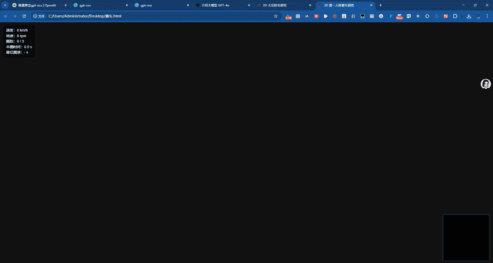

## 能力测试指标

编程能力

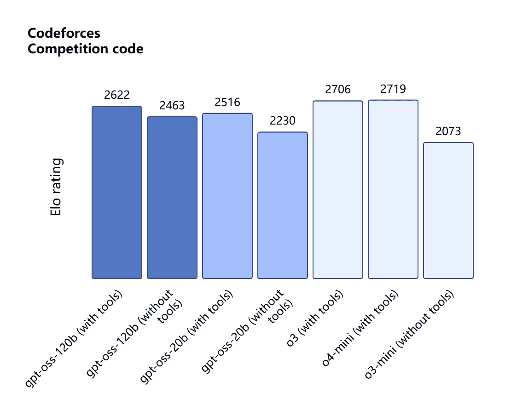

数学能力

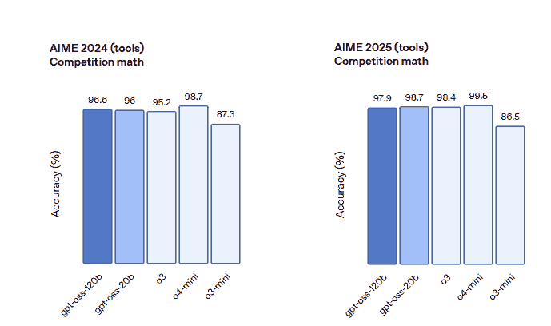

最后总的来说，这两个模型水平和o4-mini 、o3-mini 差不多，还有一点就是openAI，居然开源了，确实比较意外。可能来自与国内的大模型不少开源动作的压力吧。AI卷起来卷起来！

不过，奥特曼虚晃一枪没有把传说中的GTP5发布出来。希望他说的GPT5在他的这个月的计划之内。来看看他的原话

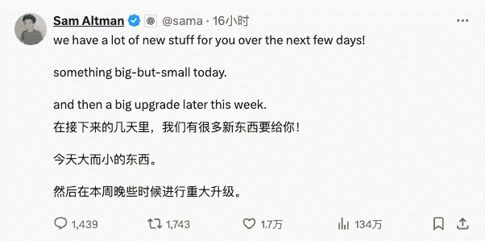

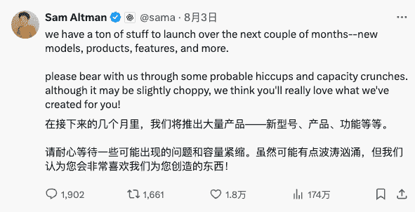

这两个开源现在均可以在 Hugging Face 上免费下载

https://huggingface.co/openai/gpt-oss-120b

# Claude 4.1 Opus发布

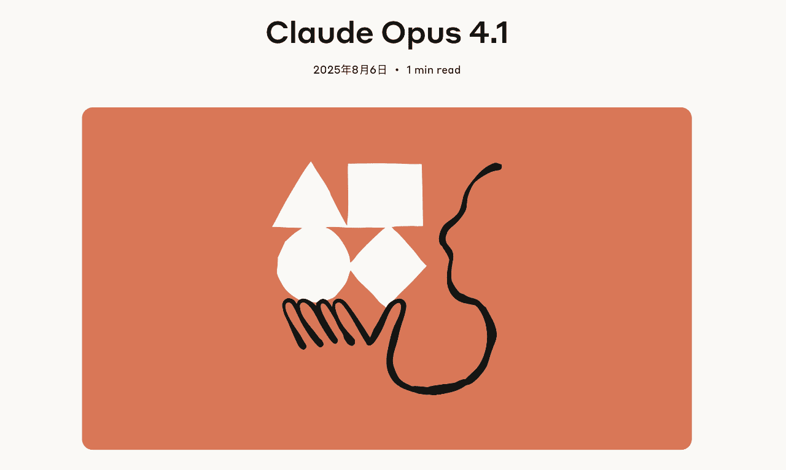

Claude，编程领域的真神。

## 编程能力再上一个台阶

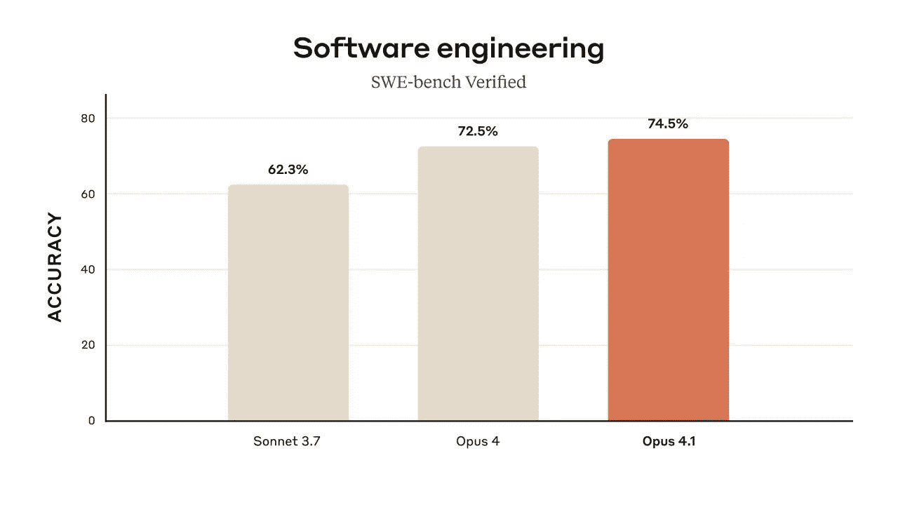

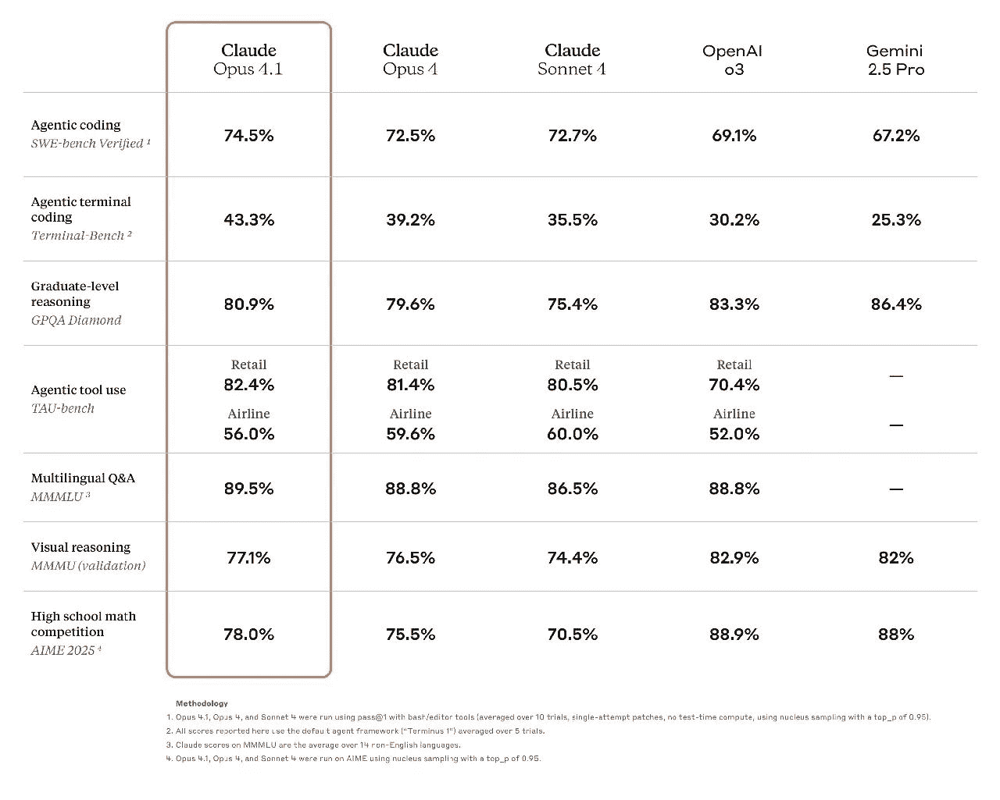

收费方面和原来一样

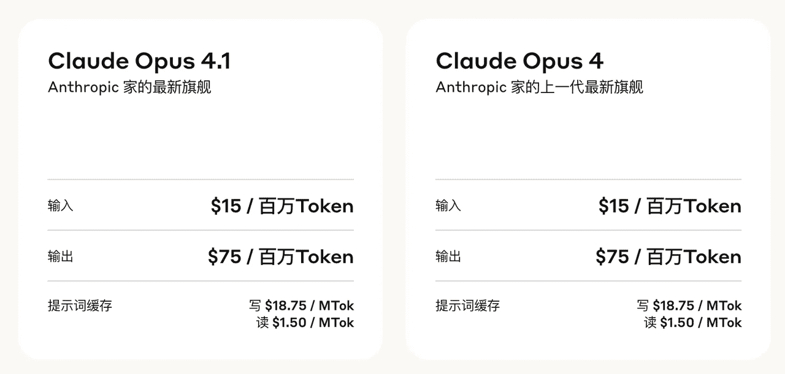

现在推出的新版本已经在官网发布了，感兴趣的小伙伴可以去体验一下.开发者只需通过 API 使用 claude-opus-4-1-20250805 即可

8月初真的是热闹，这两天的发布的三款模型，你最为哪个大模型心动，留在评论区

THIS ALL，以上就是本期的所有内容

@ 作者 / 青争鱼Echo@ 投稿或爆料，请联系邮箱：Mossecho@aliyun.com

[通往AGI之路](https://waytoagi.feishu.cn/wiki/QPe5w5g7UisbEkkow8XcDmOpn8e) 全球最棒的AI社区的知识库 /

---

最后，感谢你看到这里👏如果喜欢这篇文章，不妨顺手给我们点赞👍｜在看👀｜转发📪｜评论📣

