# Apple intelligent

> 来源：[https://xatc0v8uz5m.feishu.cn/docx/CYstdefGkopEVWxyUYhc8R6inkd](https://xatc0v8uz5m.feishu.cn/docx/CYstdefGkopEVWxyUYhc8R6inkd)

支持版本，新机版本18.2

支持Apple intelligence的机型如下

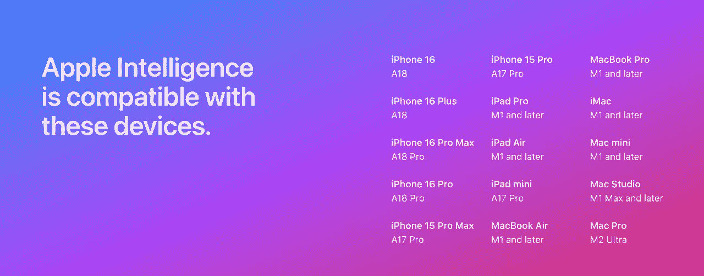

想要使用Apple，先抛开国行情况咱们不说（因为国行会更晚一些），需要15Pro以上才能使用Appleintelligent

好消息是，平板iPad和笔记本电脑MacBook、电脑Mac mini基本上都是能支持。

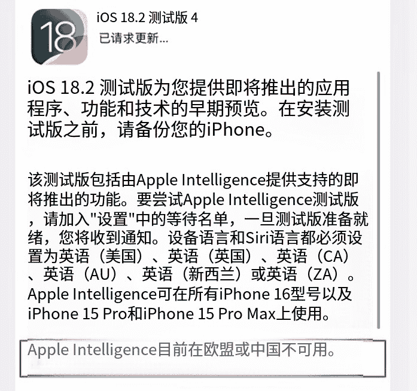

而iOS18.1只支持文字版本的Apple intelligent

iOS18.2可以通过申请支持图像功能

全新的Siri唤醒动画，全屏的彩虹环

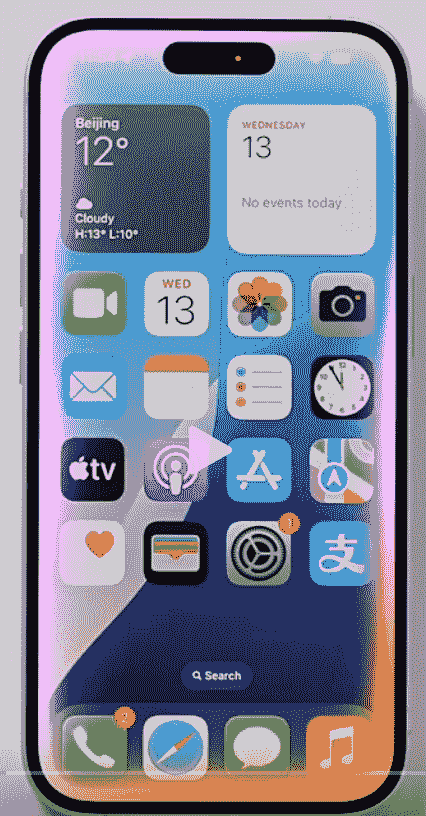

除了我们知道的常规的唤醒Siri的方式以外，新增了一个方式，就是双击屏幕底部横条能够实现唤起文字输入I唤醒

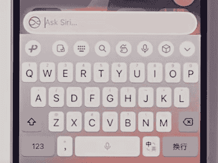

一个比较重要的是，就是apple intelligent他的这个功能它是内置在手机里面的一个本地的模型。不需要你去联网，我是在你的手机上没有打开网络，也能够实现一些简单的按摩型的功能，还有能通过手机来去实现一些智智能化的交互。嗯，当然就是它这个的话就决定了它的实现的功能啊，就没有这么多。那我们来看一下它实际的大小

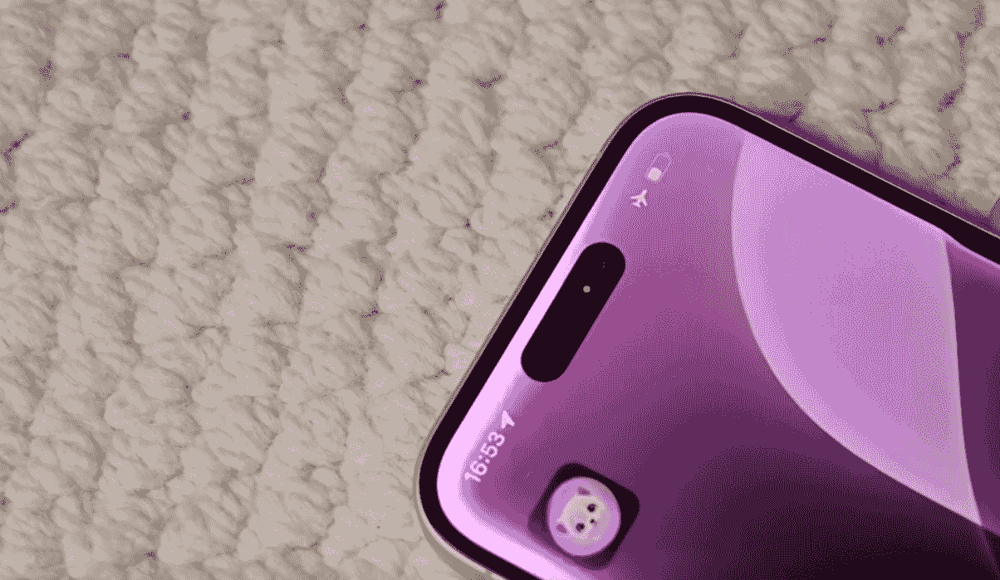

支持本地，大部分功能是可本地运行，大模型占用空间3.13G。这一点主要也是他呃注重隐私嘛，然后的话他对女生这么大模式功能的话，呃，一方面要保证能够实现。智能化的交互啊，一方面的话又要保证不用占用太多的内存。还有了一个保护用户的隐私被上传。呃，这个点的话其实是呃能够能够考虑到的。

不然大家怎么都说Apple这么安全和注重隐私呢

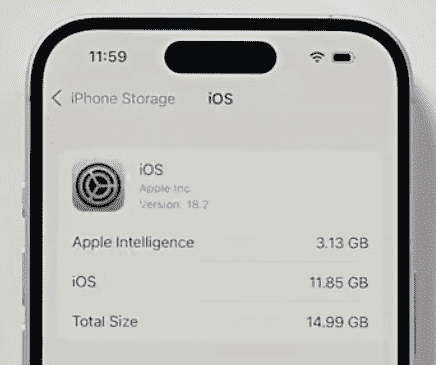

本地的这么小的模型当然是有使用限制的，所以引入了直接的CHAT GPT，以此来达到更多的这样AI功能方面的实现。

绑定自己的账号之后，使用到更多的AI功能

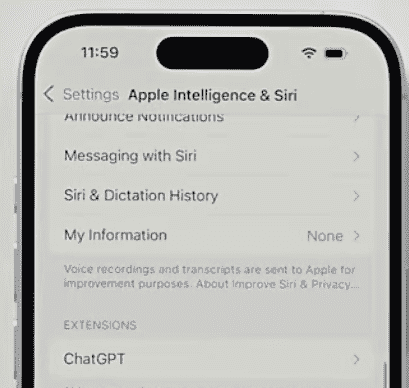

当然就是我们在绑定完这个GDP之后呢，它也不完全是一个呃gbt的全功能，呃，也就是说我们登录完这个try gb的这个账号，它也是分这个账号。的这个会员啊或者是非会员的一个一个能力吧，就是gt，如果说你想你有这个会员的这个功能的话，它也能够在在在在在这个上面去体现，然后呢世界更强大的更低延迟的一个功能。A

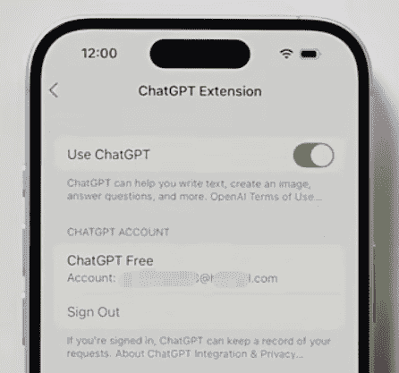

根据我们用户的提出的任务的难度来判断使用谁

比如做简单自带功能，Siri会调用自己的模型，

如果问题比较复杂则使用GPT，比如你问它

我想要做一个去西雅图的3天之旅，请你给我规划一下3天的形成？

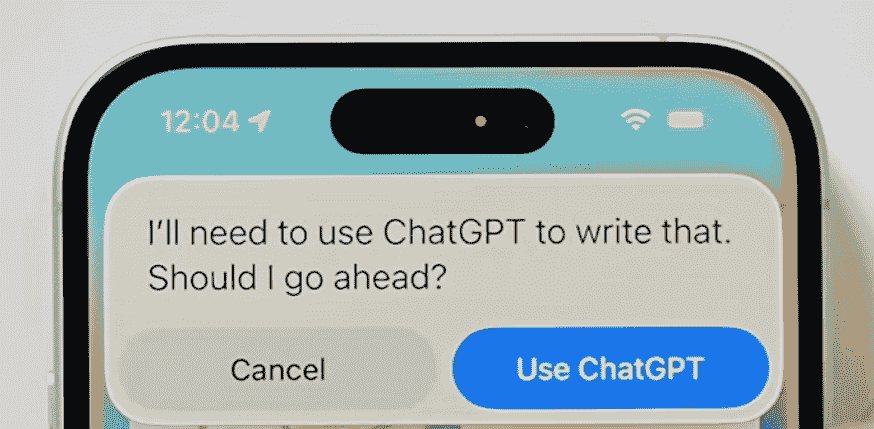

呃，有意思的是他每次去调用gp t的模型的他都会询问一下，然后呢确认一下啊要不要调用它。就当我们直接问到一个比较复杂的问题肯定我是没有办法解决的时候，它就会弹出来这个窗口。

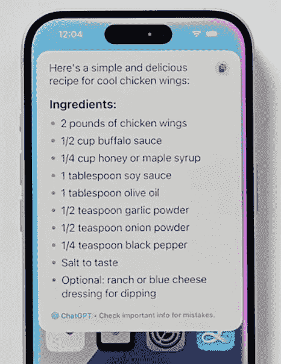

其实我们再来说一下关于这个呃apple的intelligent呢它的图像功能这个是去申请的，至少目前是

图像功能呢目前一共有三个，第一个是image playground。

就是图片中的一个小猫功能的应用

第二个是Genmoji

第三个是Image wand

能先来说一下第一个。他这个的话其实就是一个呃深图的呃东西，然后的话他是完全本地的，他不需要去联网也能实现啊，当然的话就是它的生存效果啊，跟我们接触到最新的这些nano_banana、即梦 Seedream 4.0

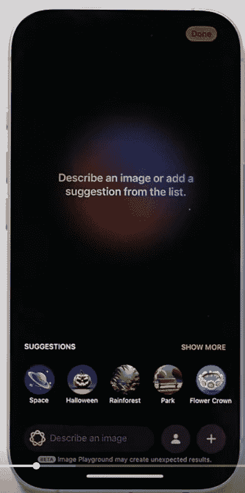

呃，一方面呢他就可以通过底下的一些提示词还有你的描述。来去生成一个全新的图片，呃，第二种方式就是我们也可以上传一张照片，让他去根据我们的图片去改风格。添加一些好玩的元素。比较有意思的是他能够做到比较精细化的一些微淘，比如说衣服的颜色，还有就是这个添加一些。嗯，各种各样的元素，但是他的这个整体的使用效果来看的话，估计也就能够做一个简单的头像，但是而且他生图的这个质量

这个第二个应用就是一个生成自定义的。Emoji怎么样？是不是很惊喜？是不是很意外？没错，我们的小苹果好吧在AI生图的使用场景融入的就是这么细

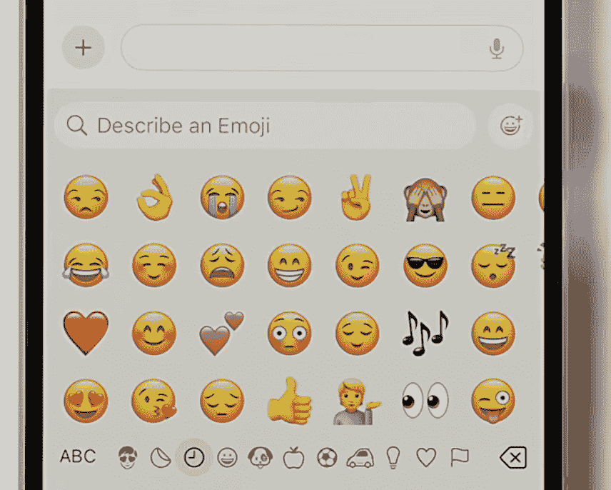

哎

呃，国内的手机，国行的新iPhone手机啊，到时候接入模型不是gb，也不是那个谷歌的gemini，然后的话大概率可能是阿里跟百度的这个模型，所以的话呃到时候可能会有这方面的体验，然后的话

总的来说的话，其实呃苹果它这次更新的手机啊，外观啊，性能啊其实都很好，很棒。也非常的漂亮，然后金宝啊，电池啊，内存啊，对吧？但是呢关于在AI领域这一块的这个深深入啊，还有就是说他的一个给我们带来的惊喜其实对于我来说是远远不够的，我觉得他没有。非常的惊艳，而且它实用的这种功能呃并没有比现在市场上这些大模型，大模型公司之间的拿手进来说做的强啊。至少在apple intelligence里面呢，它这个产品出来并没有达到一个一个iPhone时刻，对，然后呢嗯。所以的话在神图领域啊，还有这些小的点上的话，其实也就是手机上更好的。啊，融合了这些大模型，而不是说他自己的在AI功能上的实现达到了多高的标准？就是可能这段时间AI这个在苹果上面的这个发展跟这个方向上，他们还憋了大招，这个也说不定。嗯。未来的手机会是什么样子呢？让我们拭目以待吧。

以上就是呃所有关于苹果最新发布会AI领域。Apple intelligent方面的这个内容了，你觉得他能打几分，然后手机能拿几分，可以在评论区留下你的感受。