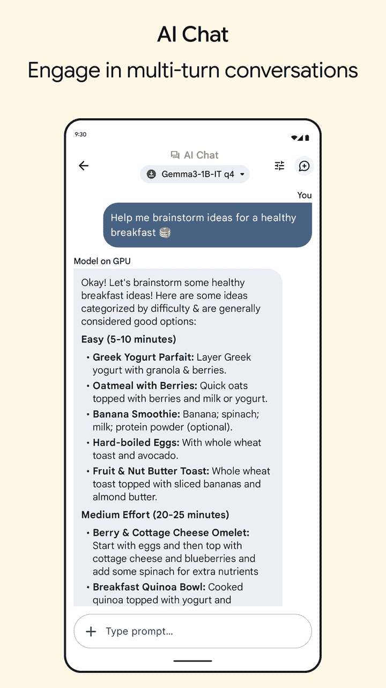
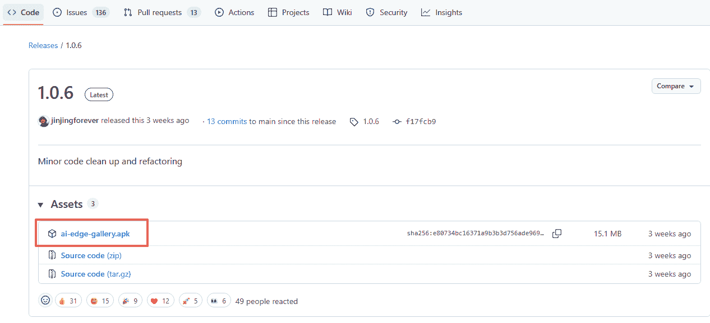
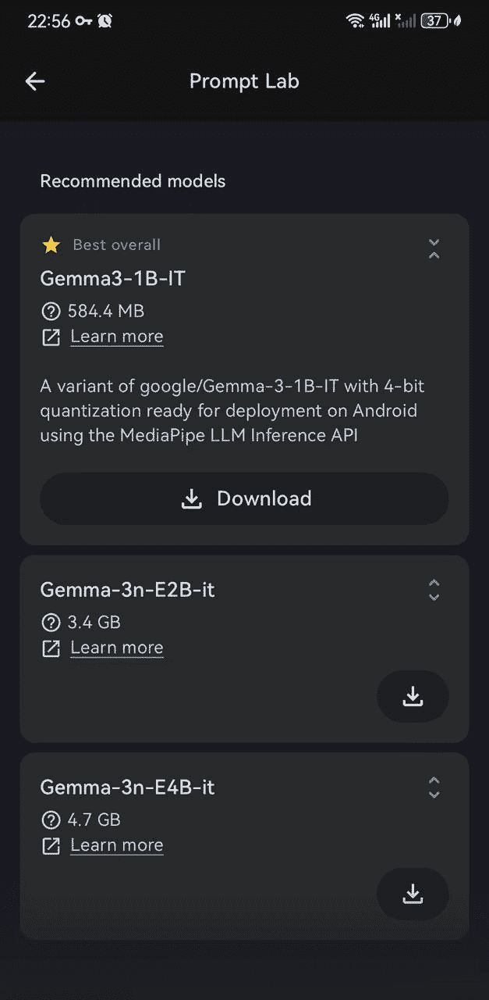

# 苹果17都做不到，谷歌Gemma 3n安卓手机做到了？？？

> 来源：[https://xatc0v8uz5m.feishu.cn/docx/DvoTdcUqjoa1MQxZdUxcgGXonUh](https://xatc0v8uz5m.feishu.cn/docx/DvoTdcUqjoa1MQxZdUxcgGXonUh)

## 前言

哈喽，好久不见（粤）~

苹果17的发布会都看了么？最新的苹果手机抢到了吗？苹果去年的AI Apple intelligent 都用上了么？/狗头

2024年10月28日，随着iOS 18.1的推出，Apple Intelligence进入公开阶段，说好了支持文本写作辅助、通知摘要、清理照片等基础功能。

BUT，国内用户还不能使用，一年了...

库克你糊涂呀！

让我们登场今天的主角，Google AI Edge Gallery 、Gemma 3n

**今天谷歌**再次更新自家的Gemma 3n，支持把大模型放入本地，安卓手机里面运行。

简单来说，把AI装进手机里，**手机飞行模式断网状态下**也能使用大模型功能。附安装教程（仅支持安卓手机）

主要几个优点，1、能本地化，数据更安全；2、无需联网使用大模型，可以理解为手机就是一个小模型；3、小模型，速度快

## 什么是Gemma 3n？

首先，我们先来认识一下，Google AI Edge Gallery 这次的Gemma 3n

Google AI Edge Gallery 是谷歌官方维护的一个开源项目集合。

Gemma 3n 是谷歌专为移动和边缘设备设计的高效多模态生成式AI模型，咱们理解为谷歌版本的手机大模型就好，不用太在意名字；

Gemma 3n 是谷歌在今年谷歌发布会上就推出的一个生成式AI模型，专为移动设备本地**（手机、笔记本、平板）优化**设计。它支持多模态输入（文字、图像、音频、视频），能够离线运行，完全保障数据隐私。Gemma 3n 采用了创新的“每层嵌入（PLE）”和“MatFormer”模型架构，极大降低了内存和算力需求，可在最低2GB内存的设备上运行，适合移动端快速响应和流畅交互

这个时候好奇的宝宝就会问了，我的手机都安装了Deepseek、豆包、kimi这些AI应用了，也能实现这些功能。我为什么还要在自己的手机上安装一个本地的模型呢？而且它的能力可能还没有这些商业应用级别的模型得出的结果准确？

这个问题问的太好了~

## AI内嵌手机本地的意义是什么？

没错，我们从模型的内存上就能看得出来。我们能看到手机里的模型也就3-4GB，这里也意味着说毕竟手机本地永远不会是一个非常大的一个模型。然后的话所以他的这个能力不能够跟我们现在在市场上看到的最前端的这些大模型，比如说GPT、Gemini2.5pro、Deepseek、豆包、千文等等。这些模型的量级不是这么比较的。

我们日常用户的手机内容也就128-512G。我相信1T的手机大家日常需求肯定不多。我们未来也不可能人手扛着一个1T、2T的手机安装一个内存的更大的模型在路上。

### 手机本地端的大模型能力永远比不过商业级大模型的能力

手机端的大模型永远没有办法跟企业级机房这些模型相比因为物理内存那里限制着，所以本质上手机搭载模型的意义不在于此。

### AI手机时代的下的隐私

我是这么看待这个问题的。

首先手机本地的模型是能够保证我们自己隐私方面的问题，满足一些日常处理隐私信息，不想被拿去做大数据训练。大家可能会觉得没有所谓，隐私信息早已可能被各大平台获取了。但是，但是

我想到一个很好玩的场景，很像【无敌破坏王3】里面的场景。/偷笑

就是未来可能我们在手机上面对的销售不是各大购物平台某宝，某音、某多“偷听”我的喜好和需求，然后大数据算法推荐商品链接。

未来的途径可能是一个人工智能机器人，或者是一个大模型，它经过我们的AI搜索。

比如说我问AI能做关于珍珠粉能够做什么，那这个时候呢，这个AI机器人就用死命的竭尽全力给我推销各种关于珍珠粉的产品。

这个时候我们如果用的是自己的手机上本地的模型，那么它就不会应用到各大平台的这些推荐算法跟AI数据里面去做营销。我觉得这点很有必要。

### 手机的本地模型定位是私人管家

第二点呢，就是未来它的走向是一个服务于我们个人的，一个管家。现在智能手机是我们的延伸，未来AI会在这个基础上更懂我的喜好，懂我的偏好，习惯。手机上的AI是我们属于我们自己的，它是我们日常自己在使用习惯一点一点训练出来的。

**我觉得这个**是AI的未来手机的一个发展趋势。它只要能够满足记录下来我们这一个用户的喜好，日常的问题就够了，它不用解决世界上所有的问题，每天喂无止境的知识、难题和信息。它只需要解决我的问题即可。

举个栗子

我们自己手机上的大模型,

不需要知道东风快递怎么能覆盖全球最牛的物理学原理/偷笑；

不需要知道最新的懂王又新增了谁的关税信息和无止境的全球各地新闻信息流；

我们需要手机里的大模型，知道我的身体状态，监控各个健康指标；

需要它知道，我们的日常行程安排是怎么样的，按照我们行程提醒和优化；

需要它知道，我们的家里的空调几点自动开启，洗衣机什么时候运行，窗帘什么时候打开；

等等

就够了。就够了。

我们的手机不需要哪家又最新的，哪家又这家最强的，哪家又投喂了最新的数据和世界性原理的AI模型。

So,这是我认为手机本地内嵌AI应该要做的事情，它不需要很大，不需要最强和最新。

所遇到专业的任务，还是需要最尖端的AI商业级应用来解决。

当然，现在内嵌在手机的AI远达不到我们前面的设想，还需要时间。

### 手机和现在AI的结合现状

说个题外话，就是现在手机的AI发展状况。

手机作为一个用户最多而且是说我们移动端最方便，最智能的一个设备之一。其实AI在手机上的一个体现呢，相比于AI的进展，各大厂商上的AI并没有展现得淋漓尽致。

各大手机厂商他们的发布会上面对于AI方面的能力展示，或者说一些创新的功能。我觉得其实是远远不能够满足现在AI的进度和发展，我不知道他们是在憋大招，还是说等其他同行先做出某个爆火的效果了出来之后去效仿还是怎么回事？

让我们静待吧，我们相信手机。未来肯定会在AI的加持下如虎添翼。

虽然可能我们未来的AI实体形态不一定是手机这个样子，可能是眼镜，可能是GPT做的一个全新的产物。

都说不定，让我们静待吧

## Gemma 3n能实现的功能

📱本地运行，完全脱机：体验GenAI的魔力没有互联网连接。所有的处理都直接在你的设备上进行。

•🤖选择你的模型：从拥抱脸轻松切换不同的模型，并比较他们的性能。

•️问图：上传图片并提出问题。获取描述、解决问题或识别对象。

•️音频抄写员：将上传或录制的音频剪辑转录成文本或翻译成另一种语言。

•✍️提示实验室：总结，重写，生成代码，或使用自由格式提示来探索单轮LLM用例。

💬AI Chat：参与多回合对话。

•📊性能洞察：实时基准（TTFT，解码速度，延迟）。

•🧩带上你自己的模型：测试你当地的文字。litermlm模型。

•🔗开发人员资源：快速链接到模型卡和源代码。

## 怎么用Gemma 3n？

谷歌官方已发布了支持Gemma 3n的开源应用，

第一种：可以直接从Play Store下载。

第二种：通过GitHub获取Google AI Edge Gallery APK。选择1.0.6版本apk。

安装后可在手机上本地运行模型，无需联网。用户可以通过该应用完成文字聊天、图像识别、声音识别等多模态交互。它支持本地离线运行，保护个人数据隐私，也对外开放代码，方便开发者根据需求定制和扩展.

安装好之后，就会进入下面这个界面

然后，我们进入Prompt Lab

选择一个对应的模型，毕竟他这个是内嵌在手机里面的，所以他的大小没有特别大。包括iPhone的这个苹果手机它的Apple intelligent其实大小也是在3gb左右。

### 手机配置要求

+   最低设备要求：大约2GB内存运行低版本模型，3GB内存运行高版本模型。

+   推荐配置：手机或设备CPU性能越强，性能越好，支持多模态实时推理。

+   应用版本对手机的存储和硬件要求极低，强调移动端本地计算效率。