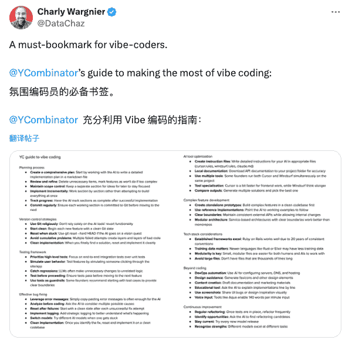
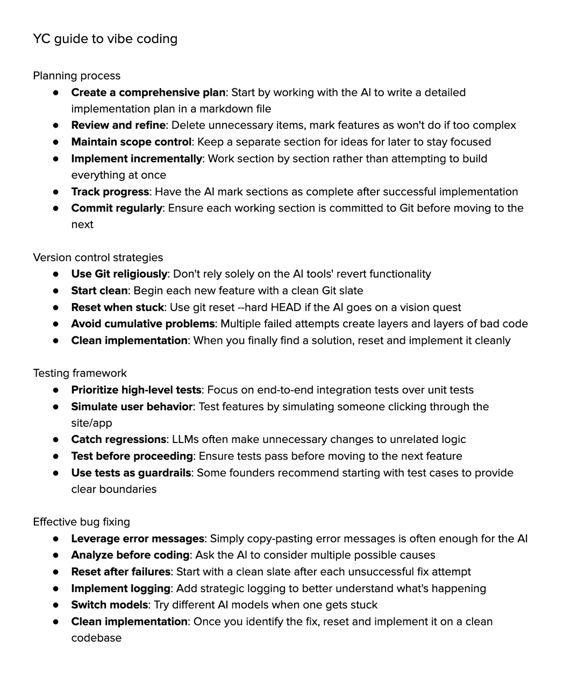
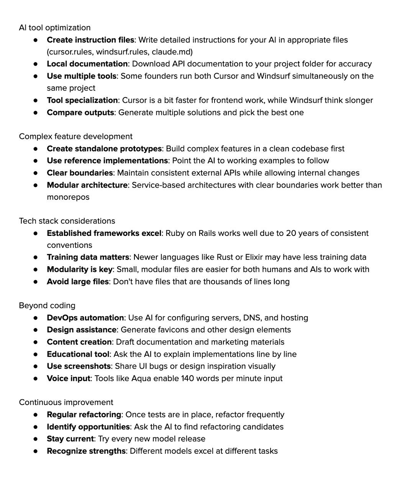

# 爆火的YC编写的Vibe Coding指南秘籍，告别vibe 代码屎山，效率提升10倍的秘密就在这里

> 来源：[https://xatc0v8uz5m.feishu.cn/docx/RGxhdJmD2olKXAxZMYRcQTkInfb](https://xatc0v8uz5m.feishu.cn/docx/RGxhdJmD2olKXAxZMYRcQTkInfb)

哈喽，好久不见（粤）

今天来分享一篇YC机构的Vibe coding使用指南，相信一定能够帮助到你，让你的应用项目跑的更加顺利。

让我一起来看看吧

## YC是谁？

首先，Y Combinator（简称YC）是一家创办于2005年3月的美国创业孵化器和创投公司，YC专注于投资种子阶段的初创企业，除了提供资金支持外，还通过举办为期三个月的创业训练营，为创业团队提供创业建议和执行能力提升。YC以独特的孵化和投资模式闻名，被称为“创业公司的新兵训练营”，也曾培养出多家知名独角兽公司如Dropbox、Airbnb和Reddit等。

简单的介绍完，请开始我们的正餐

## VIBE coding实用技巧

Planning process

规划流程

— Create a comprehensive plan: Start by working with the AI to write a detailed implementation plan in a markdown file

— Review and refine: Delete unnecessary items, mark features as won’t do if too complex

— Maintain scope control: Keep a separate section for ideas for later to stay focused

— Implement incrementally: Work section by section rather than attempting to build everything at once

— Track progress: Have the AI mark sections as complete after successful implementation

— Commit regularly: Ensure each working section is committed to Git before moving to the next

— 制定综合计划：首先与人工智能合作，在 Markdown 文件中编写详细的实施计划

— 审查和完善：删除不必要的项目，将功能标记为太复杂则无法执行

— 保持范围控制：保留一个单独的部分来存放想法，以供以后保持专注

— 增量实施：逐个部分工作，而不是尝试一次构建所有内容

— 跟踪进度：成功实施后，让 AI 将部分标记为完整

— 定期提交：确保每个工作部分在进入下一个工作部分之前都提交给 Git

Version control strategies

版本控制策略

— Use Git religiously: Don’t rely solely on the AI tools’ revert functionality

— Start clean: Begin each new feature with a clean Git slate

— Reset when stuck: Use git reset –hard HEAD if the AI goes on a vision quest

— Avoid cumulative problems: Multiple failed attempts create layers and layers of bad code

— Clean implementation: When you finally find a solution, reset and implement it cleanly

— 虔诚地使用 Git：不要仅仅依赖人工智能工具的恢复功能

— 从干净开始：从干净的 Git 石板开始每个新功能

— 卡住时重置：如果 AI 继续进行视觉任务，请使用 git reset –hard HEAD

— 避免累积问题：多次失败的尝试会产生一层又一层的坏代码

— 干净的实现：当你最终找到解决方案时，干净地重置并实施它

Testing framework

测试框架

— Prioritize high-level tests: Focus on end-to-end integration tests over unit tests

— Simulate user behavior: Test features by simulating someone clicking through the site/app

— Catch regressions: LLMs often make unnecessary changes to unrelated logic

— Test before proceeding: Ensure tests pass before moving to the next feature

— Use tests as guardrails: Some founders recommend starting with test cases to provide clear boundaries

— 优先考虑高级测试：专注于端到端集成测试而不是单元测试

— 模拟用户行为：通过模拟某人点击网站/应用程序来测试功能

— 捕获回归：LLM 经常对不相关的逻辑进行不必要的更改

— 继续前测试：确保测试通过，然后再转到下一个功能

— 使用测试作为护栏：一些创始人建议从测试用例开始，以提供明确的界限

Effective bug fixing

有效的错误修复

— Leverage error messages: Simply copy-pasting error messages is often enough for the AI

— Analyze before coding: Ask the AI to consider multiple possible causes

— Reset after failures: Start with a clean slate after each unsuccessful fix attempt

— Implement logging: Add strategic logging to better understand what’s happening

— Switch models: Try different AI models when one gets stuck

— Clean implementation: Once you identify the fix, reset and implement it on a clean codebase

— 利用错误消息：对于人工智能来说，简单地复制粘贴错误消息通常就足够了

— 编码前分析：要求 AI 考虑多种可能的原因

— 失败后重置：每次修复尝试失败后从头开始

— 实施日志记录：添加战略日志记录以更好地了解正在发生的事情

— 切换模型：当一个模型遇到困难时尝试不同的 AI 模型

— 干净的实现：确定修复后，重置并在干净的代码库上实施它

AI tool optimization

AI 工具优化

— Create instruction files: Write detailed instructions in appropriate files (cursor.rules, windsurf.rules, http://claude.md)

— Local documentation: Download API docs to your project folder for accuracy

— Use multiple tools: Some founders run Cursor + Windsurf on the same project

— Tool specialization: Cursor is faster for frontend, Windsurf better for longer tasks

— Compare outputs: Generate multiple solutions and pick the best one

— 创建指令文件：在适当的文件（cursor.rules、windsurf.rules http:// claude.md）中编写详细指令

— 本地文档：将 API 文档下载到您的项目文件夹以确保准确性

— 使用多种工具：一些创始人在同一个项目上运行 Cursor + Windsurf

— 工具专业化：光标对于前端来说更快，Windsurf 对于更长的任务更好

— 比较输出：生成多个解决方案并选择最佳解决方案

Complex feature development

复杂功能开发

— Create standalone prototypes: Build complex features in a clean codebase first

— Use reference implementations: Point the AI to working examples to follow

— Clear boundaries: Keep consistent external APIs, allow internal changes

— Modular architecture: Service-based architectures with clear boundaries > monorepos

— 创建独立原型：首先在干净的代码库中构建复杂的功能

— 使用参考实现：向 AI 指出要遵循的工作示例

— 明确边界：保持一致的外部 API，允许内部更改

— 模块化架构：基于服务的架构，边界明确>单存储库

Tech stack considerations

技术堆栈注意事项

— Established frameworks excel: Ruby on Rails thrives with 20 years of conventions

— Training data matters: Newer languages (Rust, Elixir) may have less training data

— Modularity is key: Small files are easier for humans + AI to work with

— Avoid large files: Don’t let files grow into thousands of lines

— 成熟的框架表现出色：Ruby on Rails 凭借 20 年的惯例蓬勃发展

— 训练数据很重要：较新的语言（Rust、Elixir）的训练数据可能较少

— 模块化是关键：小文件更容易被人类 + AI 处理

— 避免大文件：不要让文件增长成数千行

Beyond coding

超越编码

— DevOps automation: Use AI for configuring servers, DNS, and hosting

— Design assistance: Generate favicons and design elements

— Content creation: Draft documentation and marketing materials

— Educational tool: Ask the AI to explain implementations line by line

— Use screenshots: Share UI bugs or design inspiration visually

— Voice input: Tools like Aqua enable 140 words/minute input

— DevOps 自动化：使用 AI 配置服务器、DNS 和托管

— 设计协助：生成网站图标和设计元素

— 内容创建：起草文档和营销材料

— 教育工具：要求 AI 逐行解释实现

— 使用屏幕截图：直观地分享 UI 错误或设计灵感

— 语音输入：Aqua 等工具可实现 140 字/分钟输入

Continuous improvement

持续改进

— Regular refactoring: Once tests are in place, refactor frequently

— Identify opportunities: Ask AI to suggest refactoring candidates

— Stay current: Try every new model release

— Recognize strengths: Different models excel at different tasks

— 定期重构：测试到位后，经常重构

— 识别机会：要求 AI 建议重构候选人

— 保持最新状态：尝试每一个新型号版本

— 认识优势：不同的模型擅长不同的任务

以上，就是本次的coding技巧的全部指南啦

AI时代下的coding不可怕，更多要多操作多上手

