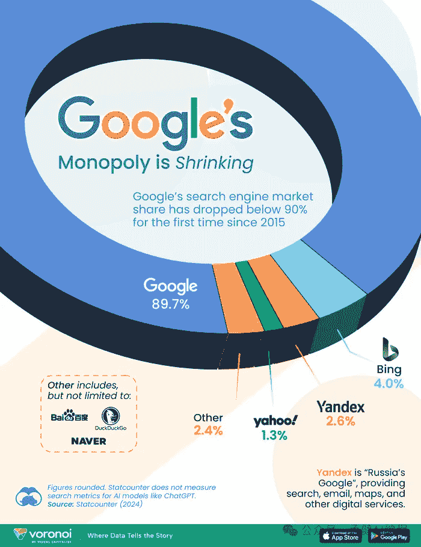
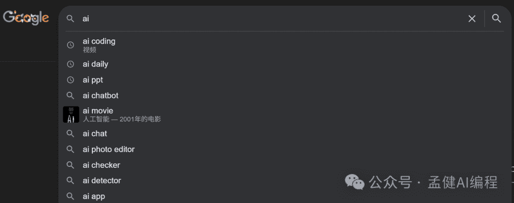
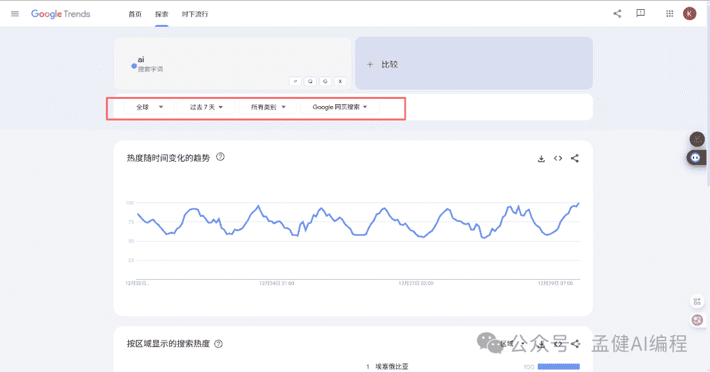
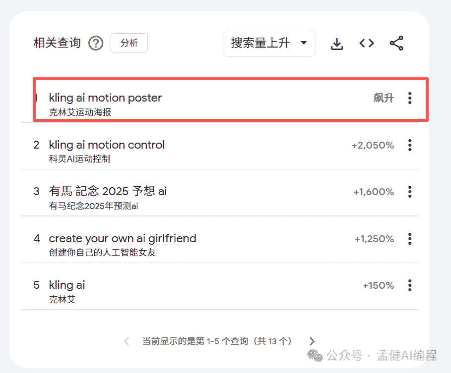
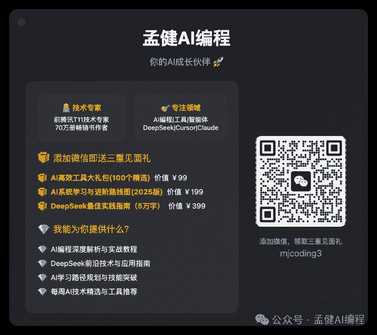

# 出海需求怎么挖？我用 Google “新词”找到 0-1 的机会（附 122 个词根）

> 来源：[https://xatc0v8uz5m.feishu.cn/docx/MMfkdD7nooQPFCxyElgc5Yqjngc](https://xatc0v8uz5m.feishu.cn/docx/MMfkdD7nooQPFCxyElgc5Yqjngc)

> 🔗 原文链接： h[ttps://mp.weixin.q](https://mp.weixin.qq.com/s/sBhDHvb15oI3TGTB5qhCTw)q.com/s/sBhDHvb1...

> ⏰ 剪存时间：2025-12-29 21:48:03 (UTC+8)

> ✂️ 本文档由 [飞书剪存 ](https://www.feishu.cn/hc/zh-CN/articles/606278856233?from=in_ccm_clip_doc)一键生成

原创 孟健的AI编程认知 孟健AI编程2025年12月29日 20:59

大家好，我是孟健。

刚刚参加完破局线下的 AI 大会。

在我的夜话会上，大家问得最多的一个问题是：

**怎样挖掘需求？**

看起来这件事，确实难住了很多人。

今天我就把我们团队现阶段最常用、也最“科学”的找需求方法，整理成一篇可复用的 SOP。

先讲一个底层认知： 海外搜索市场，基本就是 Google 的主场。



所以，对“出海做产品/做站”的人来说，找需求最稳的一条路，其实是：

**去挖关键词。**

这里的关键词，指的是用户每天真实输入到 Google 搜索框里的那些词、短语、句子。

因为： **搜索的背后，就是需求。**

一、先把关键词分清楚：新词 vs 老词

关键词挖掘听起来简单，但如果你不做分类，很容易陷入“什么都能做，但不知道先做什么”的状态。

我们通常把关键词分成两类：

+   **新词 **：最近 3 个月出现的词（这是主观划分，你也可以用 6 个月 / 12 个月）

+   **老词 **：更早就存在、已经被大量站点覆盖过的词

因为 Google 曾披露： 每天大约有 15% 的搜索，是全新的查询。

换句话说：每天都有一批“刚出现”的需求，还没被足够多的页面满足。

这对我们意味着什么？

+   如果你做老词，常见情况是：竞争大、索引慢、起量慢

+   但如果你抓到新词窗口期，并快速做出能满足需求的页面/工具，往往更容易更快被收录，甚至更快拿到更靠前的排名

这就是红利。

逻辑跟“AI 热点事件写文章”很像： 越早满足，越容易吃到第一波流量 ——甚至有时候红利还更大。

所以，我们现阶段的重点是： **以新词挖掘为主 **。

**二、新词怎么挖？两件工具就够了**

很多人以为挖词要用一堆付费工具。

但对 0-1 的新手来说，真的没必要。

我们最常用的就两个：

+   Google 搜索（下拉联想）

+   Google Trends（趋势）

1）用 Google 下拉联想挖词（Autocomplete）

你在 Google 搜索框里输入一个词时，它会自动给出一堆“大家常搜的相关词”。

这就是最直接的需求线索。

实操时，你可以用“空格”组合出更多变体：

+   **词后空格 **： ai␣ → 看它往后接什么（ ␣ 表示空格）

+   **词前空格 **： ␣ai → 看它前面常出现什么

+   **词中空格 **：把词拆开 → 看中间会被补成什么

搭配使用，你能很快扩出一堆候选词。



2）用 Google Trends 找“飙升”的新词

Google Trends 是找新词的神器。

方法也很简单：

**1. **

打开 https://trends.google.com/trends/

**2. **

把时间范围缩短到 **7 天**

**3. **

重点看 **飙升（Rising） **的关键词

https://trends.google.com/trends/





举个例子：上面这个 kling ai motion poster ，就是我从 ai 这个词一路顺藤摸瓜挖出来的新词。

它大概率对应“可灵（Kling）模型”的某类具体需求。

**至于值不值得做，是下一步的事—**— 今天我们只讲：怎么找到这些词。

基本上，靠 Google 下拉 + Trends 7 天飙升，你已经能抓到绝大部分新词了。

我们一直在用的也是这套方法。

**三、关键难点：你得先有“词根”**

你可能已经发现了一个问题：

无论是下拉联想，还是 Trends，你都得先输入一个词，才会给你更多相关词。

那问题来了： **我应该先输入什么？**

答案是：你需要一套“词根库”（seed list）。

这里要感谢哥飞大佬提供的 51 个词根。

我们在这个基础上扩展到了 **122 个词根 **，今天直接分享给大家（可直接复制）：

```
action,advisor,agent,ai,analyzer
anime,answer,art,assistant,audio
avatar,best,builder,calculator,cartoon
cataloger,character,chart,chat,cheat
checker,clue,code,coloring page,comparator
compiler,composer,connector,constructor,convert
converter,crawler,creator,dashboard,designer
detector,diagram,directory,downloader,editor
emoji,enhancer,evaluator,example,explorer
extractor,face,faq,figure,filter
finder,font,format,generator,graph
guide,helper,hint,how to,humanizer
icon,ideas,illustration,image,interior design
interpreter,layout,list,logo,maker
manager,meme,model,modifier,monitor
music,navigator,notifier,online,optimizer
paraphraser,pattern,photo,picture,planner
portal,portrait,processor,product photo,receiver
recommend,recorder,resources,responder,restorer
review,sample,scheduler,scraper,sender
simulator,solver,song,sound,speech
starter,studio,style,summarizer,summary
syncer,tattoo,template
tester,text
```

一个很简单但非常有效的建议：

**每天把这份词根过一遍，随便挑 5 个丢进 Google** / Trends，去看联想词和飙升词。

只要你坚持一段时间，你一定会开始“看到”需求。

四、再进阶一点：监控大站 sitemap（游戏方向很好用）

除了上面这套“通用挖词”方法，我们还会做一件事：

监控一些游戏大站的 sitemap 更新 （比如 CrazyGames 等），从它们新增的页面里反推新词和新需求。

这一步需要一点技术手段。

如果你是程序员，可以尝试自己写脚本去监控 sitemap 的更新频率、新增 URL、页面标题变化等。

你会发现：很多“刚冒头”的小游戏关键词，就是这样被挖出来的。

五、写在最后：别小看“简单的方法”

以上就是我们现阶段挖掘需求（尤其是新词需求）的一整套方法。

它不花哨，但足够实用。

新手用这套方法跑通 0-1 完全没问题。

至于老词挖掘，玩法确实更多，但对 0-1 的新手不友好。

等我们把老词打法跑出更稳定的结果，我再把那一套也完整拆开分享给大家。

如果这篇文章对你有帮助，欢迎点个赞、在看、转发三连。

我们下期再见！

🚀 想要与更多AI爱好者交流，共同成长吗？

和一群志同道合的人，持续精进 AI 的每一天



**精选文章**

[一次闭门分享后的认知刷新](https://mp.weixin.qq.com/s?__biz=Mzk0ODM5NTEyNA==&mid=2247503355&idx=1&sn=c4c3f103958c0ec67e1f1d260e9f01a4&scene=21#wechat_redirect)

这两天在现场，我对AI 出海这件事更笃定了

慢，才是最快的路（给正在焦虑的人）

AI 能写 90% 代码之后：程序员到底还剩什么价值？

出海别再 1:1 抄站了:《毛选》给我的 6 条底层思考

pixelcut：22 年起步的黑马，又是一个千万 ARR 的产品！

小需求做到千万美元 ARR：remove.bg 全案拆解

三小时上线，七天破千刀：AI 出海订阅站的 0-1 全流程复盘

为什么你的 AI 产品总是做不起来？90%的人忽略了这两个底层模型

[AI 浏览器大战打响：手把手白嫖一个月 Perplex](https://mp.weixin.qq.com/s?__biz=Mzk0ODM5NTEyNA==&mid=2247503114&idx=1&sn=3ca5801921683fe07c1a315a924ca4bb&scene=21#wechat_redirect)ity 会员（Comet 实操 5 步）