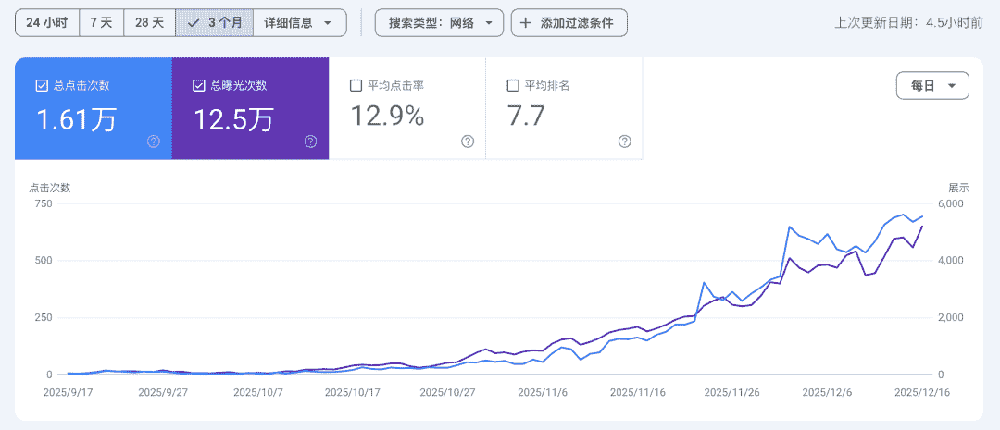
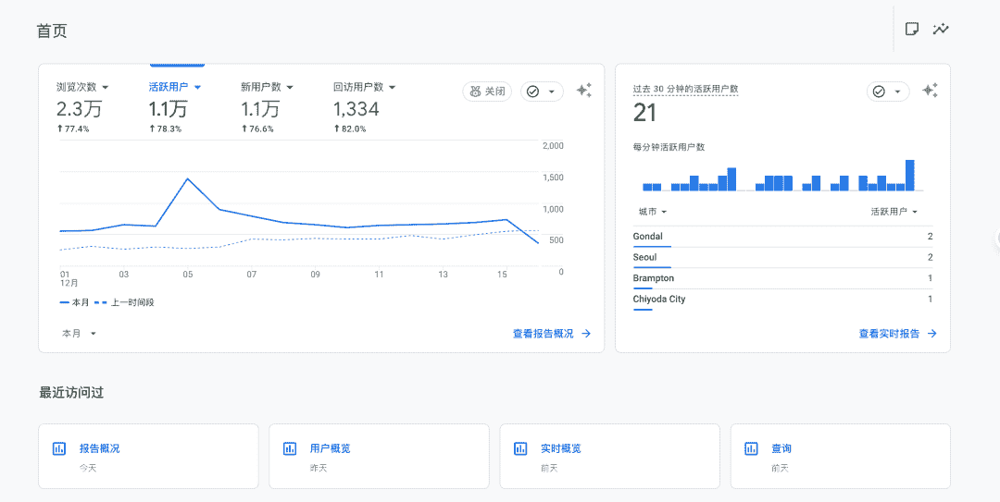
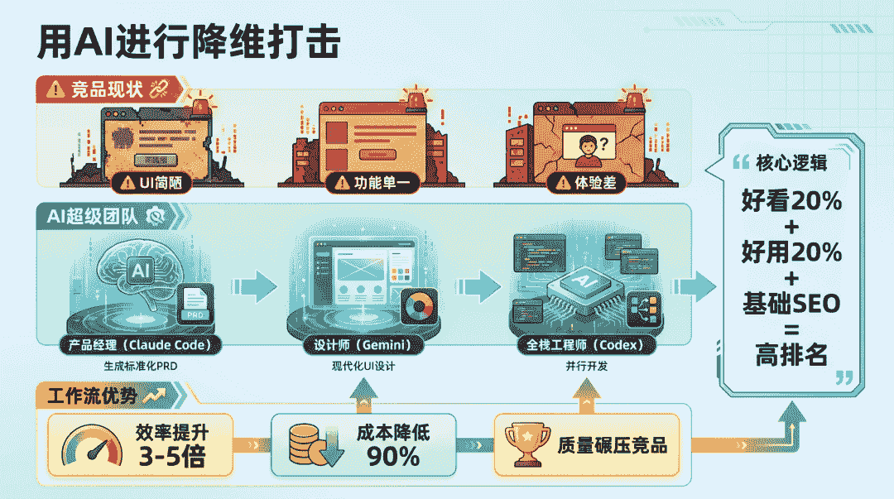
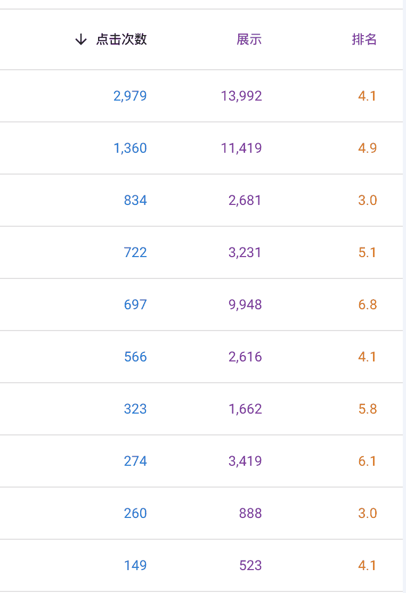
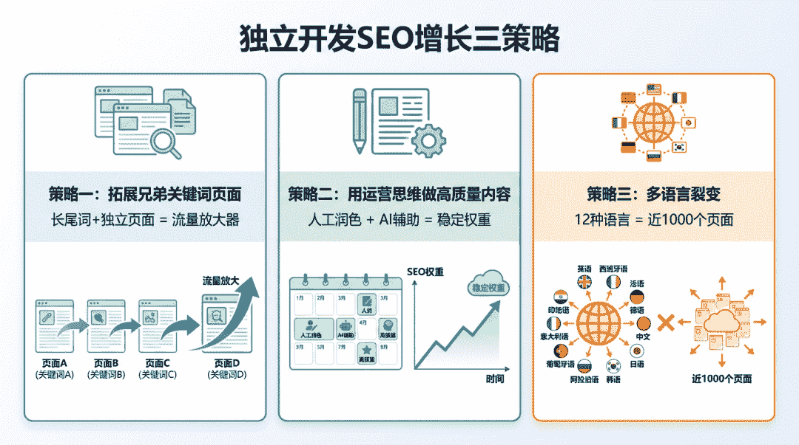
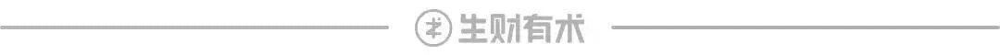

# 靠 AI 一人做产品出海，我把网站日活做到700+的三步笨办法

> 来源：[https://xatc0v8uz5m.feishu.cn/docx/AH2Rd9lM0oqwWXxG4Wfcrwp9nvg](https://xatc0v8uz5m.feishu.cn/docx/AH2Rd9lM0oqwWXxG4Wfcrwp9nvg)

> 🔗 原文链接： h[ttps://mp.weixin.q](https://mp.weixin.qq.com/s/0eOB__z9NZsEexzZXlr7Mw)q.com/s/0eOB__z9...

> ⏰ 剪存时间：2026-01-01 15:39:06 (UTC+8)

> ✂️ 本文档由 [飞书剪存 ](https://www.feishu.cn/hc/zh-CN/articles/606278856233?from=in_ccm_clip_doc)一键生成

田威 龙哥盟2025年12月31日 20:00  浙江

👆点击 生**财有术 >**点击右上角“···”>设为星标🌟

**赚钱圈友 @田威 **，运营出身，5 月份还是一行代码都不会。最近他反复琢磨一个问题： AI 时代，非技术的人能不能用更低成本做出一个能稳定进人的网站？

他说：AI 把技术门槛压平了，但流量不会自动来。决定你能不能活下去的，是选词、外链、内页这些“笨功夫”。

今天他会把自己 9 月上线的工具站怎么做到日活稳定 700+讲清楚： 怎么选老词切口、怎么堆外链、怎么用内页做出量变。

---

下周二 晚19:00的直播，坤汀将与3位老师对谈： 2026 开年，普通人有哪些机会值得认真看一眼？ 点击“预约”，蹲住直播间~

大家好，我是田威，离职后，我一头扎进了 web 出海和独立开发这个陌生领域，过程说实话非常狼狈。

起步阶段几乎天天被报错教育，一度怀疑自己是不是选错了路。直到AI能力真正落地，我才第一次发现： 原来非技术背景，也能靠AI跑通一个完整的网站闭环。

9月我上线了第二个工具站，最近回看数据，这个小破站的日活已经稳定在700+。虽然只是个AdSense广告站，一个月也就几十美金，但它对我的意义很简单：

不懂技术，也能用笨办法+AI，把 「开发一流量一变现」 完整跑通。

作为 AdSense 广告站（工具类）新手，目前我的工具站月入仅几十美元，远不及月入万刀的大佬。

但对于5月份还是一行代码都不会写、对建站一窍不通的我来说，这几十美元却有着特殊的意义——它证明了我作为一个非技术人员，靠着笨办法和 AI 工具，真真切切地跑通了从开发、上线、推广到变现的完整闭环。

千里之行，始于足下。

把时间拨回到今年5月，那时的我还是一张白纸。因为参加了课，才硬着头皮开始接触独立开发。

在建站之初，我的策略很简单： 循序渐进，先练手，不贪大。

所以我选择了一个逻辑最简单的 AdSense 广告站来跑通全流程。

在这里，我想聊一聊 为什么大多数独立开发者做不好流量？

我之前也焦虑过，觉得流量就是要做爆款，要在推特上刷屏。但后来我发现， 这种烟花式流量虽然好看，但不可复现，且生命周期极短。

对于普通人来说，我们需要的是 「稳定流量」。

稳定流量 = 刚需搜索 (SEO) + 长期沉淀 (资产)。

这里说的资产，不仅是那些只要服务器不挂就能一直被搜到的网页，还包括我们辛苦发出去的每一条外链。它们就像是我们在互联网上撒下的种子，只要种下去了，就会源源不断地把养分（流量）输送回来。

它不像追热点，今天写了明天就过气；它更像存钱，你做的每一个页面、发的每一条外链，都是在给未来存利息。这也是我选择这条笨路的根本原因。

简单分享一下我是如何跑通整个流量逻辑的：

选产品（找准刚需切口）

发外链（笨功夫也是真功夫）

加内页（量变引起质变）

如果你对工具站和AdSense感兴趣的话，建议你 点击下方卡片购买 3 天体验会员 ，赚钱星球内有更多实操帖子分享。 购买后查收短信，及时添加老师 ，还将获得老师的1v1项目推荐，帮助你找到最适合的方向。

接下来，我想和大家详细聊聊这三点实操经验。

# Part 1

# 选产品： 与其追新，不如翻新

选品是出海建站的老生常谈，也是最容易让新人迷茫的第一步。作为一个纯小白，我有自知之明： 去竞争激烈的新词、热词，我肯定卷不过那些经验丰富的大佬。

所以，我的策略反其道而行之： 不做新词，只做老词 。这样也更容易拿到反馈。

01

为什么选老词？

与其在红海里做炮灰，不如在蓝海里做地头蛇。老词虽然听起来不性感，但需求极其稳定。

我在选品调研时意识到， 真正的低竞争不等于低流量 。一个值得做的优质老词，其实需要满足四个维度的平衡：

流量适中（Volume）

通常建议月搜索量在 100-5000 之间（太低没意义，太高卷不动）

有钱途（CPC > $1）

点击成本最好在 1 美元以上。这代表有人愿意为这个流量花钱，商业价值高，我们做广告变现才容易。

难度低（KD < 30）

Keyword Difficulty（关键词难度）最好在 30 以下，这样新站才有可能在 3-6 个月内冲上首页。我选的这个词 KD 只有 20 多，属于绿色简单模式。

意图明确（User Intent ）

进行朋友圈营销、添加同行来换位提问、浏览规则速递

客户转化成交方法（关键点）

选的词必须包含具体的场景或痛点。

这种 低难度、高价值、意图清晰 的词，往往因为太具体或者太普通而被大玩家忽略，但这恰恰是我们新手捡漏的最佳机会。

03

用AI进行降维打击

确定了关键词后，我调研了排名前几的竞品网站。结果让我很惊讶： 排名第一第二的网站，体验做得非常稀巴烂。

❖

UI简陋

很多是几年前的老站，界面风格还停留在上个世纪。

❖

功能单一

受限于当年的技术或代码能力，功能做得非常简单，甚至有些还不太好用。

这就是 AI 时代给我们的红利。

以前大家代码能力有限，做出来的工具丑一点、简单一点也能忍。但现在，有了 AI 工具，我作为一个小白，完全可以组建一支 超级AI开发团队 ，用更高标准的代码质量、更现代的 UI 设计，去降维打击这些老旧的竞品。

我的三位一体AI工作流是这样的：

产品经理 (Claude Code)

我不再自己瞎想功能，而是把需求丢给 Claude Code。这里有个进阶技巧：利用 Claude Code 的 `Skills` 系统。比如我定义了一个 `product-requirements` 的 skill，只要我说“帮我写个 PRD”，它就会自动激活，按我预设的模板生成标准化的产品文档。这比每次从头写 prompt 效率高太多了。

设计师 (Gemini)

我也不会设计，但我会用 Gemini。告诉它“生成一个现代化、极简风格的 UI 原型”，它能结合多模态能力，帮我把页面布局、配色方案安排得明明白白，直接输出高颜值的设计思路。

客户引流实测方案

免费的方法：抖音视频矩阵、商家主动添加拓客、🛰️视频号/朋友圈营销。

付费的方法：百度竞价投放、顺企网付费合作、软件拓客。

全栈工程师 (Codex)

最后，把 Claude 的需求和 Gemini 的设计给到 Codex。最爽的是它的并行执行能力（`/dev` 命令配合 `--parallel` 参数）我可以让它同时跑前端组件开发和后端 API 编写，就像真的有两个程序员在同时帮我干活，效率比我一个人手搓快了 3-5 倍。

有了这套 AI 组合拳，我就能以极低的成本，快速构建出一个在体验上碾压竞品的新站。

我的核心逻辑非常简单粗暴：

在同一个关键词战场里，只要我能把产品做得比他们好看 20%，好用 20%，再配合基础的 SEO 和内页策略，我就有很大机会在这个简单模式的战场里拿到高排名。

事实证明，这套打法是完全跑得通的。现在市面上还有很多类似的工具站，依旧停留在丑且简陋的阶段， 这都是我们可以用 AI 去重做一遍、抢占流量的巨大红利。

#

# Part 2

# 发外链： 运营思维战神程序员思维

在和很多独立开发者交流时，我发现一个有趣的现象： 大家都不爱发外链 。

很多技术出身的朋友觉得酒香不怕巷子深，只要产品好，流量自然来。

说实话，刚开始我也很抗拒发外链，觉得这事儿太 low，像个发传单的。但我强迫自己换了个视角： 这不是发广告，这是在给搜索引擎投票 。 谷歌需要通过这些票数来判断你的网站是否值得被推荐。

我的策略非常朴实，就是用 笨功夫去堆量 。前前后后，我大概为这个网站发了 100-200 个外链。

01

坚持白嫖原则

因为这个站本身是练手性质，前期没赚钱，所以我给自己定了个规矩： 只发免费的，绝不花钱买。

我的外链来源主要分三批：

第一批（冷启动）

找一些专门针对新产品发布的平台（Launch platforms）提交。

第二批（老站权重）

挖掘一些老的黄页网站（Directories），虽然看起来旧，但域名权重高。

第三批（垂直导航）

寻找垂直领域的导航站提交收录。

前前后后，我也因此积累了一份属于自己的优质外链资源表。我觉得这应该是每一个独立开发者都必须准备的资产。

02

只要发了，就一定有效果

发外链的过程很枯燥，但回报是肉眼可见的。

上个月： 我的核心关键词排名还只是勉强挤进前 10。

这个月： 随着外链效应的累积，好几个大流量词已经稳居前 5，甚至个别词在很多语言环境下已经做到了 Top 2。

所以，我想对大家说： 一定要发外链！ 哪怕每天只发几个，慢慢积累，网站的权重就会一点点做上去，排名自然也就水涨船高。

03

Chrome插件引流法

这里我要分享一个非常高性价比的骚操作： 开发 Chrome 插件来获取高权重外链。

很多朋友不知道，Google Chrome 应用商店本身的域名权重极高（DR 90+）。只要你在上面发布插件，并填入你的官网地址，你就自动获得了一条极其优质的外链。

具体操作路径如下：

(1) 注册开发者账号

去 Chrome Web Store注册一个开发者账号，只需一次性支付 5 美（约 35 元人民币），终身有效。

(2) 用 AI 生成插件

不需要你会写代码。直接把你的核心功能丢给 Claude 或 codex，让它生成一个简单的 Chrome 插件版本。

可以是网站功能的简化版（比如一键换算）

也可以是功能的补充（比如快速查询）

(3) 上架发布

在发布页面的官网一栏，填入你的网站链接。

为什么推荐这个方法？

❖

成本极低

5 美元一次性投入，后续发布不花钱。

❖

效率极高

用 AI 写一个简单插件，熟练的话 1 小时 就能搞定从开发到上架的全流程。

❖

权重极高

这是 Google 自家的平台，外链质量没得说，对新站排名的拉动效果非常明显。

#

# **Part 3 **

# 加内页：量变引起质变

最后一个关键点是 加内页。

我观察到，很多做工具站的朋友容易陷入一个误区：只做一个单纯的功能页。导致整个网站极其单薄，只有 1-2 个页面。

从 SEO 的角度看，这是很吃亏的。

打个比方，谷歌就像个书店老板。如果你的店里只有两三本书，他肯定不愿意把你放在显眼的橱窗位置。反之，你的书（页面）越多、内容越丰富，他就会觉得你这家店“很有料”，权重自然也会随之提升。

怎么把页面变多？

为了解决这个问题，我采用了一套组合拳，把我的网站从单薄做到了丰满，目前全站大概有 1000 个页面左右。

我的竞品大多只有 1-2 个页面，在页面体量上，我直接形成了碾压优势。

具体做法如下：

策略一： 拓展兄弟关键词页面

主关键词做起来后，我会去挖掘很多长尾的兄弟关键词。

针对每一个兄弟词，我都会专门生成一个新的产品页面。这些页面的功能其实大同小异，只要能用就行，核心目的是承接搜索流量。目前我大概做了十几个这样的产品内页。

策略二：用运营思维做高质量内容

除了功能页，我还专门写了相关的博客文章。这里我要特别强调一点：千万不要用 AI 生成垃圾水文。

因为我是运营出身，对内容质量有执念。我发现很多竞品虽然也有博客，但全是AI，一眼假的废话。所以我选择了发挥我的长板—— 人工润色 + AI 辅助。

我大概撰写了 60-70 篇高质量文章，每一篇都经过我的人工校验，确保逻辑通顺、干货满满。虽然这比纯 AI 生成要慢，但这种精品内容带来的 SEO 权重极其稳定。

这里也想多说一句关于扬长避短：

其实做流量的方法很多，比如现在很火的短视频引流（社媒传播）。但我有自知之明，我在镜头前不自在，做视频效率低，所以我果断放弃了 TikTok/Youtube 这条路，专心死磕我最擅长的文字内容。

我觉得独立开发最重要的是找到自己的舒适区 ： 如果你擅长视频，就去做视频；如果你像我一样擅长写字，那就把文章写到极致。没必要跟风，适合自己的才是最高效的。

策略三：多语言裂变

之前读大佬的文章时提到他说的通过 32 种语言本地化让网站流量大增。这让我很受启发，但我没有盲目照搬。

对于像我这样不懂代码的，完全依靠 Vibe Coding 的个人站长来说， 语言做得太多，反而可能是个负担 。 维护成本高不说，如果内容质量跟不上，很容易被搜索引擎判定为低质量站点。

经过权衡，我认为10-15 个高质量语言版本 才是性价比最高的选择。

所以我最终锁定了最核心的 12 种语言：包括英语、中文、西语等覆盖全球绝大部分高价值用户的核心层，以及竞争没那么极端、适合吃长尾流量的日语、韩语等潜力层。

这样做的好处是： 既吃到了多语言的 SEO 红利，又避免了因为语 言过多导致的内容质量失控。

这是最能快速放大页面数量的一招。

我给网站上了 12 种语言的版本。

算一算账：(十几个产品页 + 几十篇文章) × 12 种语言 ≈ 近 1000 个页面。

#

# END

# 赢在孤独执行力

从5月份的一个编程小白，到今天拥有一个日活 700+ 的网站，这段经历让我明白： AI 时代，技术不再是壁垒，耐得住寂寞的执行力才是。

说实话，独立开发是一场极其消耗心力的修行。

在这条路上，你会遇到无数个想放弃的瞬间：代码报错修不好时、发了外链没人点时、看着后台 0 访问发呆时……这种孤独感是吞噬性的。

但请相信，每一个穿越过黑暗隧道的人，靠的都不是聪明，而是死磕。

在这个喧嚣的时代，能沉下心来做一件属于自己的小事，本身就是一种胜利。

给自己多一点耐心，给时间多一点信心。

路虽远，行则将至。希望我的分享能给你一点启发，也以此文勉励正在路上的我和你。

作者 | 田威 | 排版 | 朱朱

主编 | 七天 | 编辑 | 小武 高月亮

想看更多 关于赚钱的机会[和项目实操，链接同路人 ，欢迎 点击下方卡片购](https://mp.weixin.qq.com/s?__biz=Mzg5MTkwNjUxNQ==&mid=2247646537&idx=2&sn=2e467444058cf3c1bd943b1ae57ec9e3&scene=21#wechat_redirect)买龙哥盟三天体验会员 ， 购买后请注意短信，及时添加老师 ， 会有老师提供 1v1 的内容推荐服务：根据你的阶段与需求，给你匹配合适的内容和方向。 了解赚钱3天体验营，欢迎戳链接： 赚钱3天免费体验营第135期即将开营：真实项目案例+社群陪伴+直播大课帮你突破赚钱认知