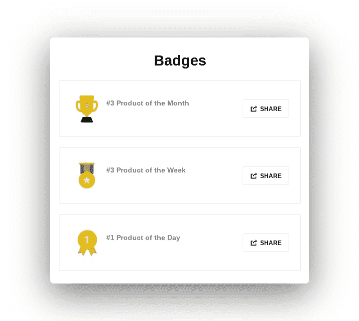
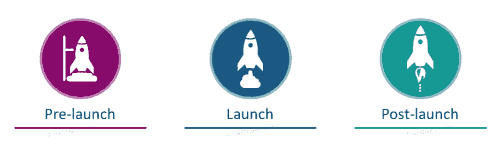
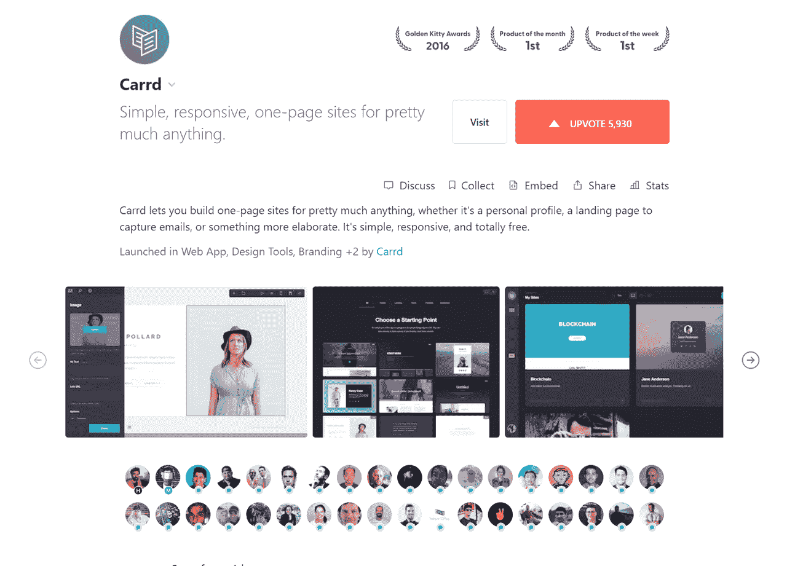
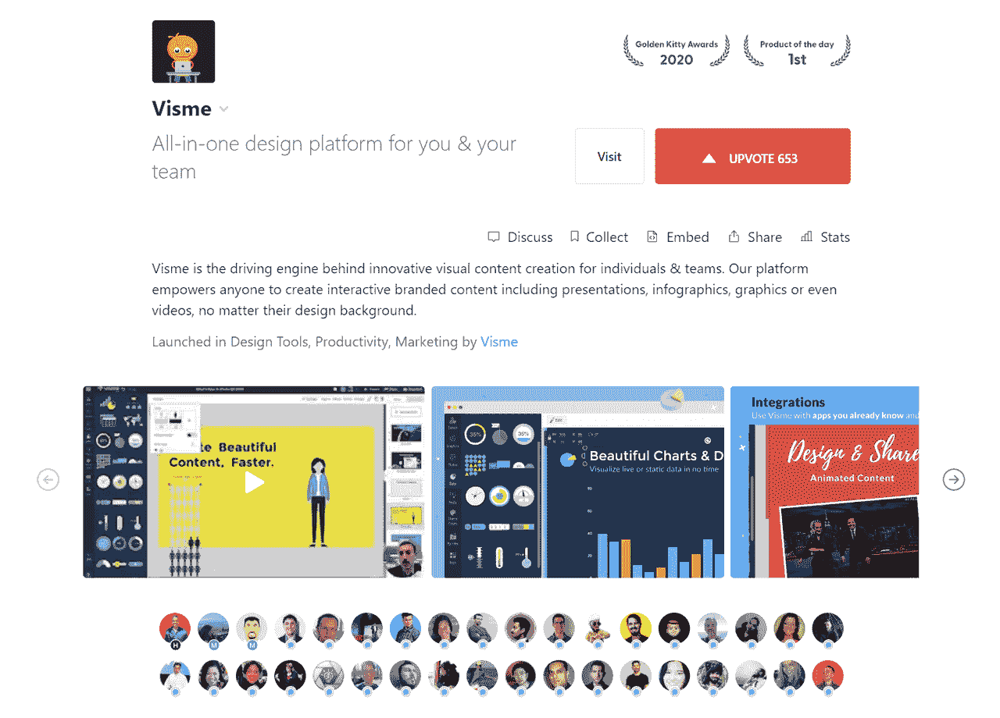
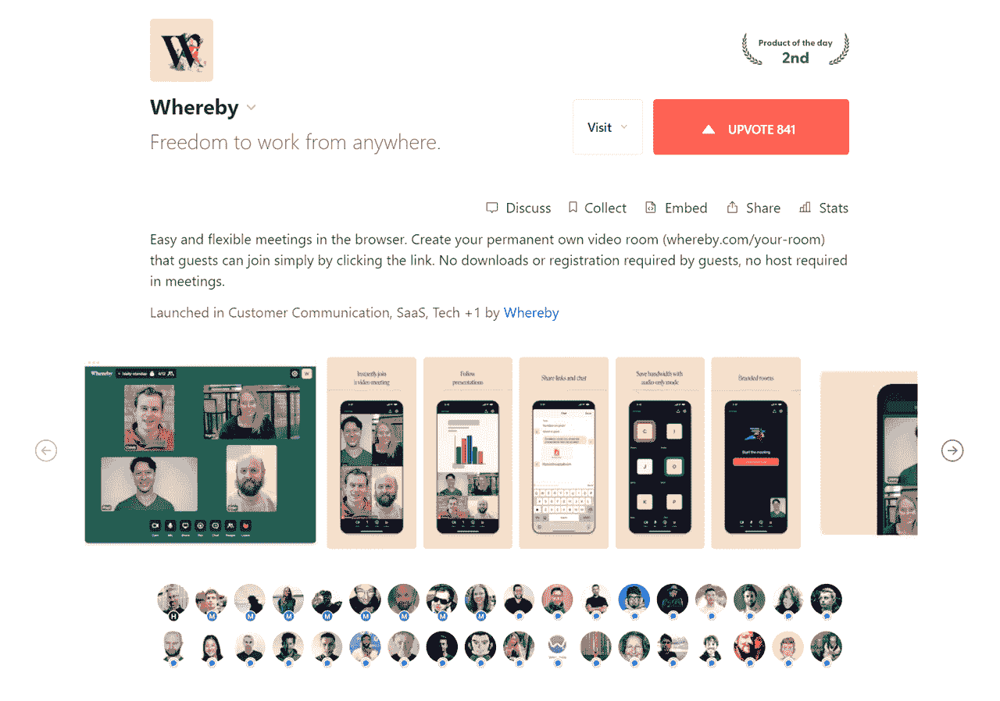
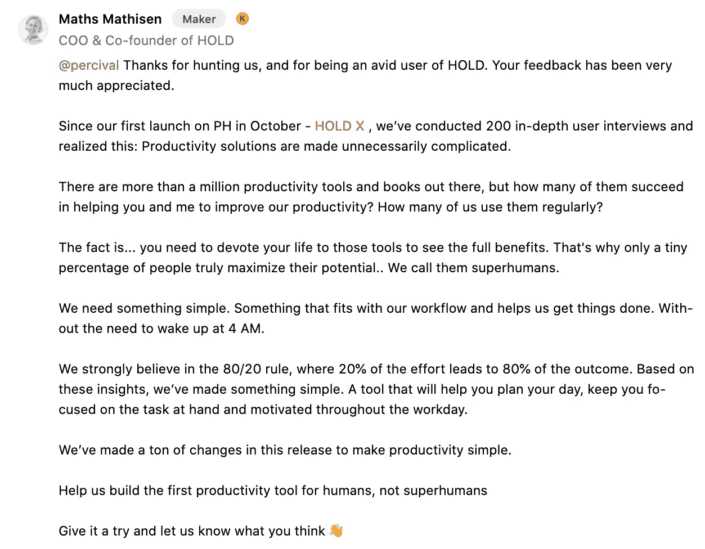
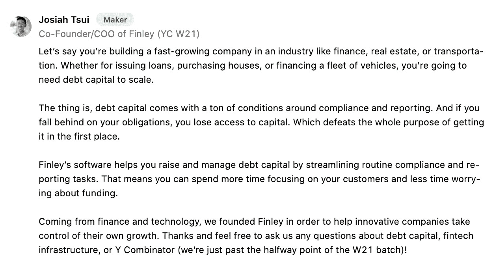
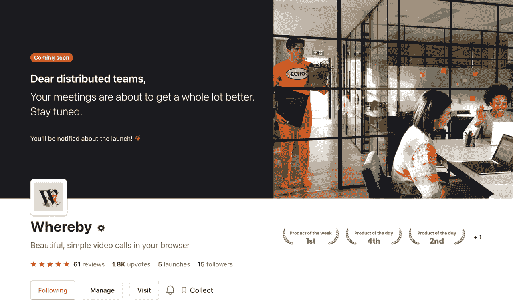

# 最终的指导如何排名第1月的产品打猎Ultimate guide on how to rank #1 on Product Hunt

> 来源：[https://xatc0v8uz5m.feishu.cn/docx/VwAqdrrFcop1JOxUo40c1DcHnOb](https://xatc0v8uz5m.feishu.cn/docx/VwAqdrrFcop1JOxUo40c1DcHnOb)

> 🔗 原文链接： h[ttps://tibo-maker.](https://tibo-maker.notion.site/Ultimate-guide-on-how-to-rank-1-on-Product-Hunt-589c000cd56f4baf9c64988a52eb4b4e)notion.site/Ulti...

> ⏰ 剪存时间：2026-01-05 17:28:37 (UTC+8)

> ✂️ 本文档由 [飞书剪存 ](https://www.feishu.cn/hc/zh-CN/articles/606278856233?from=in_ccm_clip_doc)一键生成

By [Tibo ](https://tibo-maker.notion.site/53fdef364d29428aafe3df43324ff388?pvs=25)- Maker of the year 2022 , Maker of multiple #1 products & several top 10 spots!

Product Hunt is a gold mine for getting new customers. If you rank high, you can even generate about 10,000 unique visits and 1000-3000 genuine leads for your business.

Let’s discover how you can achieve #1 product and make the most out of this!

At the end of this article, there’s a resource hub and checklist which you can follow to rank #1 on Product Hunt. Go check it out!

Know NOTHING about Product Hunt? You may want to read this section first.

But if you already know what PH is, you can skip it.

Understanding Product Hunt

Who exactly uses product hunt and how can you capitalize it?

Product Hunt's user base primarily consists of tech enthusiasts, early adopters, investors, journalists, and fellow entrepreneurs . This can help you get reach, test your product easily and get feedback quickly.

Product Hunt can provide you with these incredible benefits:

By ranking high on Product Hunt, your product will be exposed to a large audience of tech enthusiasts, early adopters, and potential customers. This exposure can lead to an increase in signups, downloads, and sales.

Product Hunt ranking can indirectly boost SEO by increasing visibility and traffic, generating high-quality backlinks, enhancing social signals, encouraging user-generated content, and building brand authority and trust. These factors can lead to improved search engine performance for your website.

A successful Product Hunt launch can catch the attention of angel investors, venture capitalists, and other funding sources . A high rank serves as social proof that your product is innovative and has market potential.

The buzz also demonstrates that your product resonates with users and industry experts, providing validation of your product's value proposition and market fit.

Social Proof on your website to build trust of potential prospects:

You get to add a Product Hunt widget on your website about your rank which makes your potential users trust it more.

Ranking high on Product Hunt will generate traction towards your product and brand, leading to increased media coverage, mentions on social media, and word-of-mouth referrals.

Product Hunt's active community can provide invaluable feedback on your product, helping you identify strengths, weaknesses, and areas for improvement

Ranking high on Product Hunt can unlock additional opportunities such as being featured in the Product Hunt newsletter, winning a Golden Kitty Award, and more.

Product Hunt ranks products based on user upvotes and engagement. Products that hit the #1 spot can also gain over 10,000 unique visits.

Though these numbers may not appear extraordinary, keep in mind the conversion rates are strong due to the fact that Product Hunt’s audience are early adopters of innovations.

If you rank high, expect around 1,000-3,000 genuine leads for your business from ten thousand website visits.

The platform awards the following rankings:

Product of the Day: The highest-ranked product of a specific day.

Product of the Week: The highest-ranked product of a specific week, based on the total number of upvotes and engagement throughout the week.

Product of the Month: The highest-ranked product of a specific month, based on the total number of upvotes and engagement throughout the month. (4 million people interested in new products visit the website every month)

Each ranking tier brings increased visibility, recognition, and opportunities for collaboration with other entrepreneurs, influencers, and investors.

Depending upon your product, set up goals for your launch and then start working on your strategy. Determine specific goals for your Product Hunt launch, such as a target number of upvotes, comments, or new users. Setting goals will help you measure the success of your launch and inform future strategies.

Let’s keep a goal of finding 500 people that can help you succeed on PH. This is a good average number of leads that’ll get your product in top 5 of the day.

We’ll break down how we’ll reach this goal in section #8. Before that, let’s understand how can you make your strategy from scratch.

Plan and execute your Product Hunt launch strategy according to the following timeline:

Focus on building momentum, preparing promotional materials, and building a community of people interested in your product. They will be your first supporters.

Submit your product early in the day (ideally at 12:01 AM PST), promote it across various channels, and actively engage with users on Product Hunt by replying to comments and addressing feedback.

Analyze the results of your launch, thank your supporters, work on their feedback, and continue to engage with your new users to foster long-term relationships.

Let’s take 3 examples to study:

1) Carrd: A launch driven by strong community

2) Visme: A launch driven by strong marketing

3) Whereby: A launch driven by an awesome product

Carrd was founded in 2016 by AJ, a solo developer with a vision to create a straightforward and affordable platform for building responsive one-page sites. Carrd aimed to cater to individuals, freelancers, and small businesses looking for a user-friendly way to establish an online presence.

Before launching on Product Hunt, AJ focused on developing a product that met users' needs while ensuring that the tool was intuitive and efficient. The pre-launch strategy included:

Releasing a beta version of Carrd and inviting early users to test the platform, mainly through word of mouth and social media.

Soliciting user feedback and making iterative improvements based on their suggestions.

Engaging with potential users in online forums, social media, and communities related to web design and development.

Sharing Carrd's development progress and updates on Twitter, creating a sense of anticipation among followers.

When Carrd was ready for its Product Hunt debut, AJ had already built a strong community of supporters and potential users. Key strategies during the launch included:

Announcing the launch on Twitter and other social media platforms, urging followers to upvote and share Carrd on Product Hunt.

Actively participating in the Product Hunt discussion section, addressing questions, and providing support to users.

Offering a limited-time discount on Carrd Pro, the premium version, to incentivize new users and early adopters.

Garnering support from friends and colleagues in the tech and design communities, encouraging them to share Carrd with their networks.

Carrd's launch on Product Hunt was a major success. The key outcomes were:

Ranking as one of the top products on the day of the launch, with over 1,000 upvotes.

Experiencing a significant increase in user sign-ups and conversions to the Carrd Pro plan.

Gaining media coverage from several tech publications and blogs, increasing Carrd's visibility in the market.

Attracting a dedicated user base that continued to provide feedback, leading to ongoing product improvements.

Visme was founded in 2013 by Payman Taei, who recognized the need for an easy-to-use design tool that would empower users to create visually appealing content without requiring professional design skills. Visme aimed to cater to businesses, educators, and individuals seeking an effective way to communicate their ideas visually.

Before launching on Product Hunt, Visme focused on refining its product and building awareness through strategic marketing initiatives. The pre-launch strategy included:

Developing a polished, feature-rich version of Visme that addressed users' design needs.

Creating an extensive library of templates, icons, and visuals to facilitate users' content creation.

Building brand awareness through content marketing, including blog posts, guest articles, and social media posts.

Establishing partnerships with influencers, bloggers, and thought leaders in the design and marketing industries to expand Visme's reach.

With a solid product and marketing foundation in place, Visme was well-prepared for its Product Hunt launch. Key strategies employed during the launch included:

Announcing the launch via email campaigns targeting existing users and newsletter subscribers, encouraging them to upvote and share Visme on Product Hunt.

Leveraging influencer partnerships to amplify the launch, asking them to share Visme with their audiences on social media and other platforms.

Running a limited-time promotion offering a discount on Visme's premium plans, incentivizing new users to sign up.

Actively engaging with users on Product Hunt, answering questions, and providing support to address any concerns.

Visme's launch on Product Hunt was a resounding success. The key outcomes included:

Ranking among the top products of the day, with over 1,500 upvotes.

Experiencing a surge in new user sign-ups and conversions to premium plans.

Gaining coverage from various tech publications and blogs, further boosting Visme's visibility and credibility.

Attracting interest from potential investors, paving the way for future funding rounds.

Whereby was founded in 2013 by Ingrid Ødegaard, originally under the name "appear.in". The platform aimed to simplify video conferencing by offering a browser-based solution without the need to install software or create user accounts. Whereby was designed to serve small businesses, remote teams, and individuals looking for a hassle-free video conferencing tool.

Before launching on Product Hunt, the Whereby team concentrated on developing a reliable and easy-to-use product that would meet the needs of their target audience. The pre-launch strategy included:

Building a browser-based, no-download video conferencing solution that allows users to create and join meetings with just a few clicks.

Ensuring compatibility with multiple devices and browsers to provide a seamless user experience.

Beta testing the platform with a select group of users, gathering feedback, and making necessary improvements.

Promoting Whereby on social media, relevant online forums, and industry-related communities.

With a solid product offering in place, Whereby was ready for its Product Hunt debut. Key strategies employed during the launch included:

Announcing the launch on social media channels and newsletters, urging followers to upvote and share Whereby on Product Hunt.

Actively engaging with users on Product Hunt, answering questions, and providing support to address any concerns.

Offering a limited-time discount on Whereby's premium plans to incentivize new users to sign up and try the service.

Encouraging satisfied beta users to share their positive experiences on Product Hunt and social media.

Whereby's launch on Product Hunt was a significant success. The key outcomes were:

Ranking among the top products of the day, with several hundred upvotes.

Experiencing a surge in new user sign-ups and conversions to premium plans.

Gaining exposure and credibility through positive user reviews and recommendations.

Attracting the attention of potential investors and partners, leading to further growth opportunities.

To launch on Product Hunt with a hunter, consider the following steps:

A hunter is a trusted user who will submit your product to Product Hunt. Collaborating with a well-known hunter can increase your chances of getting featured.

But do you really need a hunter?

It's important to note that anyone, including product makers, can submit a product on Product Hunt. In fact,

79% of featured posts were by makers who self-hunted

60% of #1 Product of the Day winners were self-hunted

On top, while launching, multiple tasks are at hand and not having a hunter frees you from managing the collaborative tasks. Don’t underestimate this advantage as you will already have 100 things to think about.

While you don't necessarily need a hunter for your Product Hunt launch, collaborating with one can provide a few benefits.

Advantages of working with a hunter includes:

Experienced hunters are familiar with Product Hunt's dynamics and know what works best on the platform. They can provide valuable insights and guidance to optimize your launch strategy.

Hunters might have connections with influencers, journalists, or other prominent figures in your industry. These connections can be leveraged to promote your product and generate buzz around your launch. Make sure the hunter is comfortable with helping you out here.

Hunters can help facilitate engagement within the Product Hunt community by sharing your product with their followers, participating in discussions, and generating interest.

Although collaborating with a hunter can provide these benefits, it's not a requirement for launching on Product Hunt. If you decide to submit your product without a hunter, ensure that you familiarize yourself with the platform, engage with the community, and carefully plan your launch strategy to maximize your chances of success.

If I get a chance to start over, I wouldn’t go with a hunter .

Select a strategic date & time to maximize engagement and visibility. Numerous variables affect your launch, many of which are uncontrollable, so there's no guaranteed formula for success.

Although, weekends usually have less competition which makes it easier to rank #1 but it also gets less traffic.

Weekdays (especially Tuesday & Thursday) on the other hand has highest competition which gives you high traffic with 15% more "Visit" button clicks.

Leverage traction on platforms like Twitter to boost your Product Hunt launch.

As a rule of thumb, schedule your launch for 12:01 am PST to maximize visibility for a full 24 hours.

Make sure to activate a few promotion tactics early in the day to increase your chances to grab the 1st spot early on. This will then increase organic votes on your project as the 1st product of the day is the one you see the most.

Product Hunt has recently started hiding the voted and showing all products for the first 4 hours. This gives all the products, equal opportunity to get the traction who can test out the product. If your product is really good, the organic traffic itself will drive the upvotes and your chances of being first will be increased.

Adapt your launch timing based on your target audience, press coverage, team availability, or other factors.

Choose a launch time that aligns with your goals and maximizes your product's visibility and engagement.

ONE THING TO TAKE CARE OF: Don't Overthink It! While it's essential to be prepared for your Product Hunt launch, avoid overthinking every detail. Instead, focus on the key aspects that matter most. It’s okay if you didn’t get it right in the first go. You can launch multiple times!

At the end of the document, I’ve shared a library of really cool taglines, thumbnails & images for you. Check it out!

Firstly to start off, sign up for a personal account—no branded or business account.

While creating your assets, make sure you are keeping PH audience in mind who are makers, indiehackers, entrepreneurs etc. Create your assets in such a way that it addresses this audience directly.

Now let’s breakdown how you can create eye-catching visuals, descriptions, and a compelling tagline for your product listing.

Just use the name of your product without using emojis or descriptions in the title.

Bon[us tip: after](https://www.producthunt.com/products/maker-swipe-file#tweet-hunter-for-twitter) the launch, change the tittle to optimize it for what people could search on Product Hunt. For an example, “ Tweet Hunter ” was changed to “Tweet Hunter for Twitter” as people could be looking for Twitter tools.

Add a very short description of the product. Write an attention grabbing tagline that also explains your product’s value prop.

> One workspace. Every team.

> One platform for your team and your work

> The collaborative interface design tool

This space is perfect for elaborating on your product's purpose and functionality. Make sure to keep it brief while still highlighting your unique selling points and features.

> Notion is an all-in-one workspace where you can write, plan, collaborate and get organized - it allows you to take notes, add tasks, manage projects & more. Imagine a lego structure. Notion provides the building blocks and you can create your own layouts and toolkit to get work done.

> Make work life simpler, more pleasant and more productive. Slack is the collaboration hub that brings the right people, information, and tools together to get work done. From Fortune 100 companies to corner markets, millions of people around the world use Slack to connect their teams, unify their systems, and drive their business forward.

> Figma is a collaborative design tool for creating user interfaces, mobile apps, and websites. It offers a wide range of features, including vector editing tools, prototyping, and version control, all in a cloud-based platform.

Consider using a captivating 240x240 image that catches the eye. Animated GIFs can make for engaging visuals, but be wary of making them too busy. Alternatively, you can never go wrong with showcasing your standard logo, as it is a simple yet effective way to grab viewers' attention.

Images/GIFs can be incredibly powerful. They catch the eye of potential users and present an opportunity to showcase what your product can offer them. Sometimes, a single image can tell the whole story.

Product Hunt’s recommended size for images in the gallery is 1270x760. You can upload multiple images to the gallery at once.

Keep in mind, your first image is the most important: It will automatically appear as a preview card on Social Networks, so make sure it's extra crisp!

Use clear, concise visuals that quickly convey your product's value proposition. Avoid cluttered designs and opt for a simple, clean look that is easy to understand at a glance.

Make sure you show benefits not features.

Keep in mind that many users will view your visuals on mobile devices. Ensure that your images and GIFs are legible and look good on smaller screens.

Two types of assets work best:

Video demonstrations showing a product's capabilities

A product walk-through by the maker

While it’s more authentic when you present the product as a founder, it can also prevent people from actually going to your website since they have seen it all in the video. Find a good balance between both which can maximize conversions to your website.

Be sure to kick off the conversation with a comment about the product. Ask for feedback, thoughts about it or simply just questions they might have. This is a very important part of your launch — 70% of products who achieved Product of the Day, Week, or Month had a first comment by the maker.

You can secure early exposure by featuring your product on the 'Coming Soon' section.

The 'Coming Soon' page is a dedicated section on Product Hunt that features upcoming product launches. Schedule your launch up to 1 month in advance to tease it, drive traffic, and collect followers well before the launch.

To get featured on this page, submit a teaser of your product, including a brief description, launch date, and an email subscription form.

This early exposure can help generate interest, gather feedback, and build a subscriber list before your official launch.

N[ow, if you al](https://tweethunter.io/)re[ady hav](https://taplio.com/)e an audience built, this’ll become way easier. Tweet Hunter & Taplio are great tools to help you out here. It helps you build an audience, gather a list of people who were interested in previous Product Hunt launches and reaching out to them on launch day.

A lot of makers hang-out on twitter. Building an audience there can really help having a successful launch. If you already have an audience, make sure you leverage it.

You can generate momentum through your network and Implement pre-launch marketing strategy by making the most out of your connects.

Focus on upvotes from hunters and active Product Hunt members, as they carry more weight and influence. Engage with them to gain credibility and traction for your product. (Twitter can be a great leverage here)

Warm accounts vs cold accounts:

Focus on warming up leads by engaging with them before launch. Warm accounts carry more weight in upvotes and are more likely to be considered by Product Hunt.

Let’s start with the most important thing!

Create an excel sheet and add all the people who will potentially support on the day of the launch so that you don’t have to think about it on the big day & highlight the people who have a network or a social distribution that can get you more traction.

Friends and family (Ask them to start using their product hunt account regularly to warm up their accounts if needed)

People who upvoted similar products

Check who upvoted similar products on PH → Make [a list of their](http://tweethunter.io/) twitter accounts → Interact with them using tweethunter.io or similar tools

Influencers you might know

Whatsapp, Slack, discord, Facebook groups (& more)

Accounts from the ‘coming soon’ page

[You can chec](https://upvote-bell.com/)k out upvote-bell . It allows you to download the list of people who upvoted a project and retrieve their Twitter usernames. Use case: find a project in the same space as yours that was successful. Download the upvoters. DM them on your launch day.

Participate in Slack groups, WhatsApp groups, and Facebook groups related to your product niche or industry to build relationships and gain insights from fellow makers and entrepreneurs.

Here are a few groups you can start off with

Add these leads in another sheet in your doc

Prepare the assets you want to send

You don’t want to spend any time on the day of the launch on anything you could have prepared beforehand!

Prepare the following (You probably won’t get enough time to do it on the day of launch)

Content and images (Images should have the Product Hunt and your logo on them.)

Messages & emails to send

Remember: You should not ask for upvotes directly. Not publicly and from people you barely or don’t know. Ask for support and feedback and if people like your project, you can be sure they will upvote.

Write your maker comment and keep it ready

Write a detailed and thoughtful message to provide context, express gratitude, and answer potential questions from users and tell your story.

Now, Drink some coffee, get ready in the war room and start following this list step by step:

Send individual DMs to your Tweet Hunter Contact list.

Start with the highest potential conversions with warm accounts

Then send it to cold accounts

(Make sure you send DMs little by little and not all at once to avoid spamming)

Send a message in the Slack, Whatsapp, Facebook groups you joined initially

Add a Product Hunt widget on your website to encourage visitors to upvote and engage with your product.

Engage with users by replying to comments and addressing feedback.

Post on all your social media accounts

Reach out to influencers you know

Send emails to your user base

And then start responding to the comments and feedback and hype up the social media buzz by interacting more.

People are interested about your struggles and wins. Post/tweet 10 times during the day to share every step of your journey.

You can keep an eye on your stats page:

There are certain practices that can harm your Product Hunt ranking and overall launch success:

Spamming or artificially inflating upvotes: Product Hunt has measures in place to detect and penalize vote manipulation. Focus on providing genuine value and engaging with your audience to earn upvotes.

Don’t ask for upvotes blatantly

Analyze results, thank supporters, and address any outstanding feedback after the launch.

If you manage to do all of the things mentioned above, you’ll probably hit the top five products of the day. This’ll give you a feature in the next day's Product Hunt digest email.

Use feedback from users to iterate and improve your product.

Add Product Hunt badges and embeds to your website and marketing materials to showcase your success and credibility.

A lot of people will reach out to you on social media and other channels, make sure you either convert them to users or followers.

While achieving the #1 spot on Product Hunt can provide significant benefits, it's essential not to lose sight of your long-term goals.

Don't get disheartened if you don't rank as high as you'd like; instead, use the experience to learn, iterate, and improve for future launches.

Till then, keep building!

Hey, liking this? Find out about all my other projects and free resources

Here’s the checklist: Your ultimate guide to launching on Product Hunt

Explore product hunt’s platform

Participate in discussions

Upvote and comment on products you like

Closely follow and understand the everyday rankings

Finalize a hunter (or don’t)

Start creating your assets

Create a teaser page and be in the coming soon page

Implement pre-launch marketing strategy

Friends and family (Ask them to start using their product hunt account regularly to warm up their accounts if needed)

People who upvoted similar products

Influencers you might know

Whatsapp, Slack, discord, Facebook groups (& more)

Accounts from the ‘coming soon’ page

Join communities and groups, and engage

Prepare messages and images you’ll need to reach out on the day of launch

Send individual DMs to your google sheet leads

Start with the highest potential conversions with warm accounts

Then send it to cold accounts

Send a message in the Slack, Whatsapp, Facebook groups you joined initially

Add a Product Hunt widget on your website to encourage visitors to upvote and engage with your product.

Engage with users by replying to comments and addressing feedback.

Post on all your social media accounts

Reach out to influencers you know

Send emails to your user base

Start responding to comments

Use feedback to improve the product

Add product hunt badges and embeds to your website