# 40+老登的出海复盘，纯靠广告自然流几天破百刀

> 来源：[https://xatc0v8uz5m.feishu.cn/docx/Q3bldOOw6oXI9Zx8zs8clg1Vnkn](https://xatc0v8uz5m.feishu.cn/docx/Q3bldOOw6oXI9Zx8zs8clg1Vnkn)

> 🔗 原文链接： h[ttps://mp.weixin.q](https://mp.weixin.qq.com/s/CBflACuYrSNMCiLTZ94Pog)q.com/s/CBflACuY...

> ⏰ 剪存时间：2026-01-09 22:57:26 (UTC+8)

> ✂️ 本文档由 [飞书剪存 ](https://www.feishu.cn/hc/zh-CN/articles/606278856233?from=in_ccm_clip_doc)一键生成

孟健AI编程2026年1月9日 21:40

编者荐语：

转自俊哥的出海复盘，俊哥跟我线下一起搞了3个月，中年不易，AI出海目前来说还是一条超级红利赛道，大家一起加油！

以下文章来源于俊哥AI出海 ，作者俊哥AI副业

**俊哥AI出海 **.

俊哥，前字节跳动工程师，万人社群AI编程教练，专注AI编程出海，争取早日月入万刀 AI编程出海变现+V: jungevipvip

> “现在大环境这么差，工作很难找了...”

> “中年人基本没可能...”

> “你这岁数有个工作就不错了，国内啥情况你不了解吗...”

> ......

大家好, 我是俊哥，一个80后，40+老登，万人社群多次AI编程教练，星火师，目前和孟健一起深耕AI编程出海，感谢洋哥、孟健给我的机会和赋能。这篇文章应该深圳大会之前就写的，不过现在写也不算晚，此文不算纯技术，献给所有在破局进行中年转型的圈友们！

圣诞那周，也是我在总部线下创业2个月，第一个百刀纪念，当然现在收入仍在增加，每天稳定躺赚谷歌广告收益

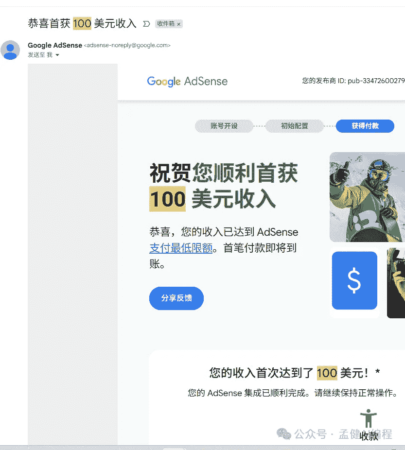

**每天广告日结，躺赚收益**

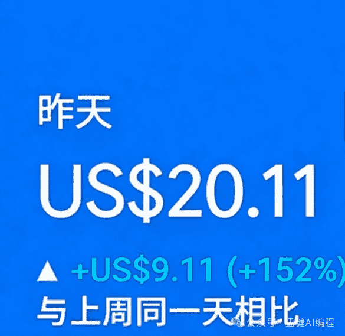

目前已走出“新手村”，梳理下我的来时路，请大家耐心往下看，后面会复盘广告变现心路历程！

# **一、 意气风发**

曾经的我，意气风发，985计算机毕业，前大厂打工人

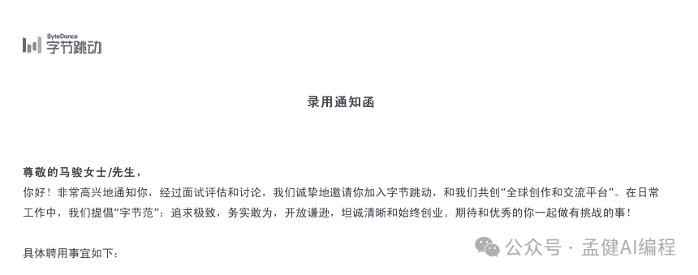

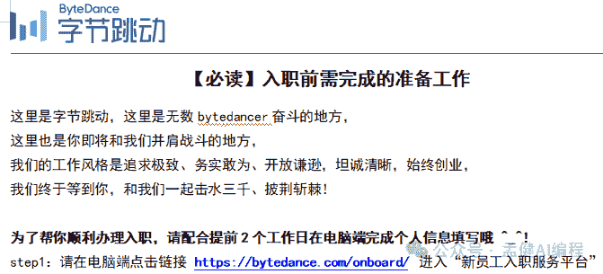

总觉得自己会拥有无限美好的未来，对其他都不屑，后来发现我自己对社会了解甚少。

**曾经的我**

# **二、中年危机**

然后随着年龄增长，经历了大厂裁人，再加上之前工作繁忙长期996，北漂无法兼顾家庭，分别遭遇了职场危机、婚姻危机，基本上中年危机有关的事，我都遇到了。然后前年我父亲又突发脑梗，导致下身瘫痪，无法自理

接连遭受一系列打击后，我有段时间基本无法进行正常工作、生活，长期失眠抑**郁，好在加入了破局俱乐部，因**为之**前一直技术出身，**关注洋哥公众号很早很早了，所以 23年洋哥搞破局时就加入了 ， 第一批破局圈友 ，但那时还在职场，所以关注度不是很高，再加上当时的AI还没有现在这么落地。

# **三、深入破局**

加入破局头2年，因为之前在职状态再加上不重视，错过了很多机会，然后自己摸索副业，非常不专注，后来又遇到很多不靠谱的人和事，搞了很多不靠谱项目损失了很多钱，才让我这个之前单纯的大厂职场人对世界有了深刻的认知。

**和洋哥**

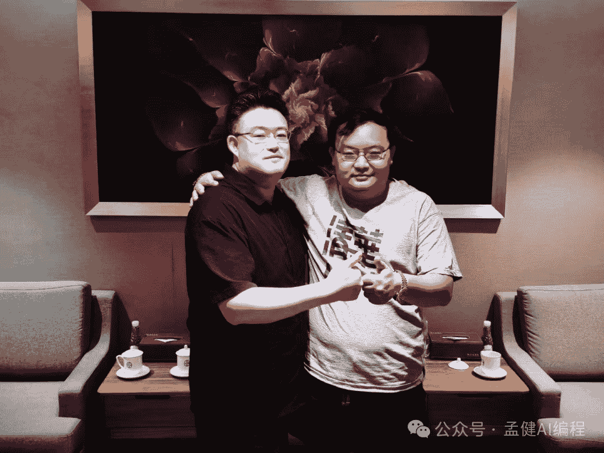

之前搞过很多赛道，都不了了之了，去年6月份加入了破局行动家，才开始深入了解破局和AI各个赛道的玩法，线下也多次见过洋哥，但定位一直不清晰，技术万金油，商业白痴，直到洋哥第一次线下私塾闭门会，遇到了孟健，然后和洋哥、孟健进行了深度沟通，找准了自己的定位，根据自己曾经的经历，如果我继续之前不专注的状态，干什么都不会有啥结果，和年轻人拼不了体力，然后小钱又看不上，这种状态持续下去，年龄又是大龄，基本人生就废了。

和八爪鱼联创 半仙及 SEO/GEO 大佬海鹏

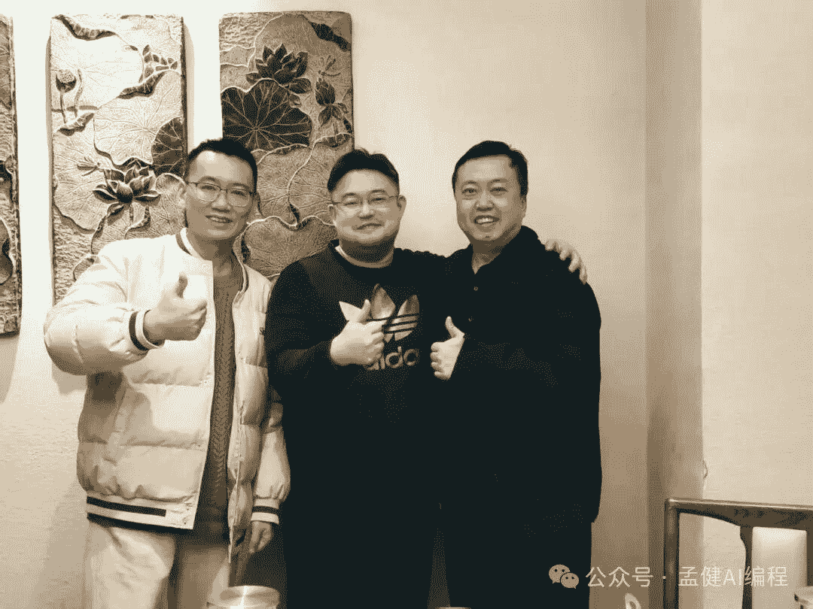

从积极发帖开始转变，加入AI编程教练，参与2次圈友及1次行动家的AI编程教学，从一开始紧张，到现在的游刃有余！

**破局精华排行榜**

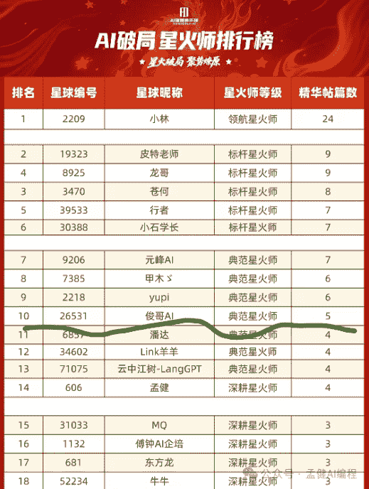

**AI编程行动营**

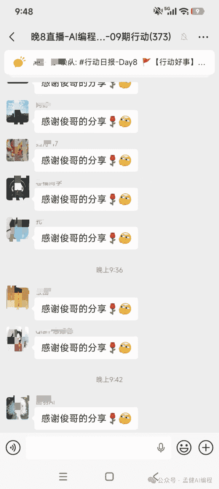

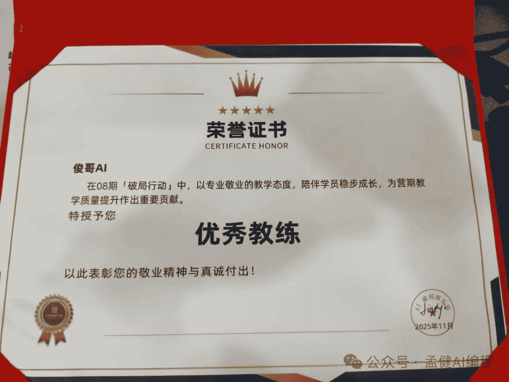

# **四、线下创业**

10月中旬，我来到破局总部，和孟健一起深耕AI编程出海，感谢洋哥和总部大力支持，让我们能专心跑通项目。

我每天和孟健一起开会讨论复盘，基本上孟健就是按照大厂的节奏来推进我们团队的各项工作，好在他不嫌我年龄大，哈哈再次感谢。没来之前，我不专注，焦虑，定位不清晰，执行力更谈不上，每天患得患失，再他的影响下

我变得专注了，执行力比之前强太多了，慢慢的有了向上的感觉，之前总觉得不靠接单进行技术变现很难，尤其还是在海外，更是不可能，直到我们通过洋哥科学创业的方法论 ，还有孟健SOP以及每天的数据复盘下，我慢慢也出了成绩，而且据我所知这个成绩，在其他出海社群都能排上前10，终于感觉我的中年危机可能提前结束了。

在洋哥、孟健的推力下，科学创业方法论，AI出海落地SOP加持下，我的出海saas靠谷歌广告也能躺赚收益了，在经过几周谷歌审核后，终于到了摘果子的时候了

当然我们团队是因为做了30个站点后才有了这点小成绩，所以大家要科学看待，不要好高骛远！

目前2个月访问量接近10万了，纯谷歌seo自然流，未进行其他投放等骚操作

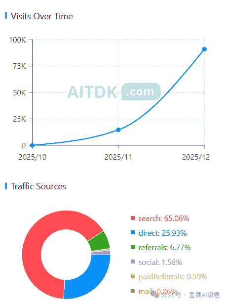

全是发达国家

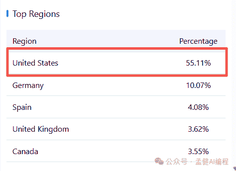

总用户数 4.5万

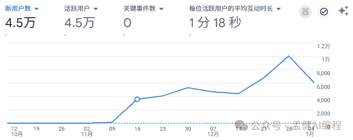

日UV 保持在 2000左右，也就是每天都有大约2000多个独立用户访问我的网站

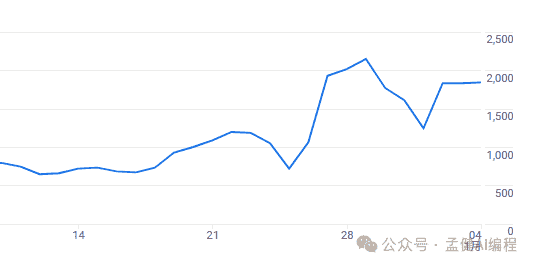

Clarity 显示几千访客

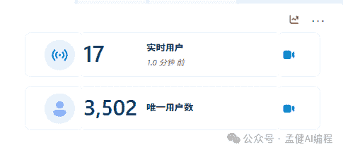

当然除了订阅和广告，我们也探索了其他出海变现

联盟拉新

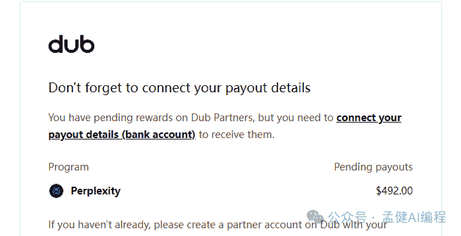

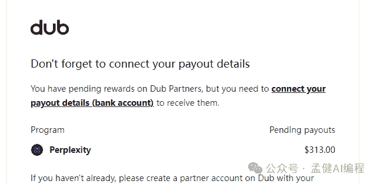

0-1闭环打通后 ，洋哥宴请我们

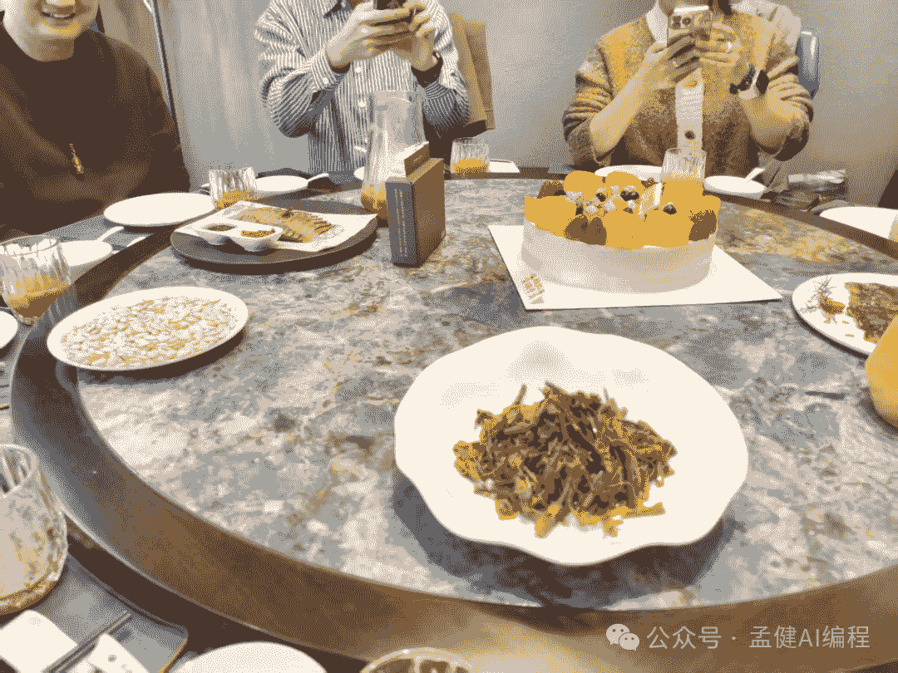

# **五、 出海变现复盘**

**底层逻辑**

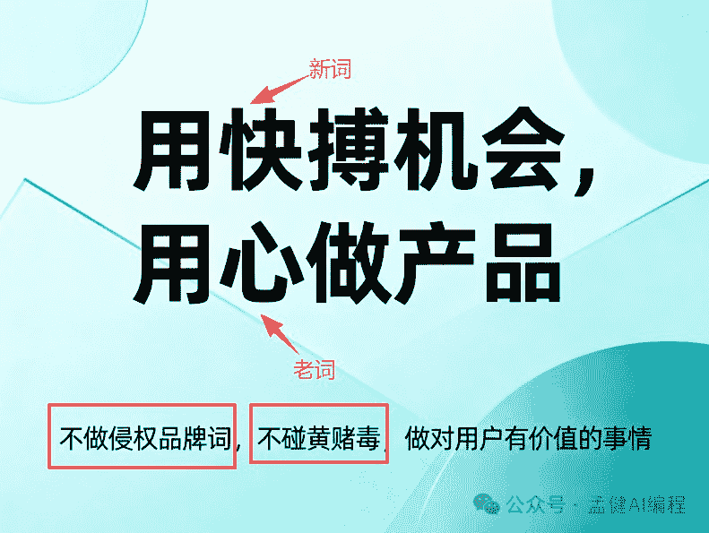

我为什么通过广告，而不是订阅变现

新手上来最好的练手就是做新需求，老的需求已经有很多优秀并且比较完善的网站来满足了，新手很难突破

然后0-1期间 我的主要诉求是跑通变现闭环，那我是没有挑选余地的，当天我像往常一样，通过谷歌trends挖掘需求，发现这个新词，然后经过快速调研，去 Reddit、Twitter、YouTube 追溯来龙去脉，发现这个需求可以做，但是并不适宜开通订阅，但对于我们这种新手个体来说，找到需求死磕，是唯一的选择。

**每日复盘SOP**

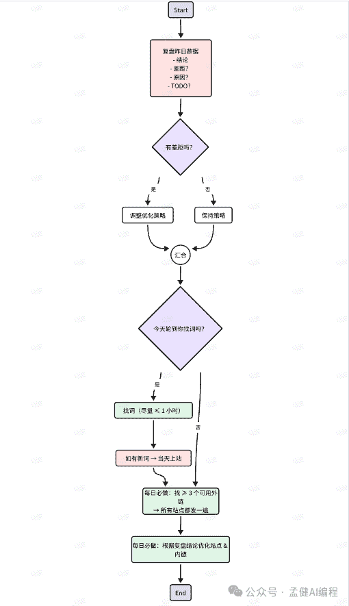

那我就通过广告来变现呗，毕竟创业来说，市场不会等人，速度就是优势。于是我当天晚上就把网站上线了，

**当天发现需求，当天上线，**这是孟健给团队定的规矩，除此之外我们每天必须复盘，雷打不动，以至于每次洋哥走到我们那块，都不好打扰我们

**大力出奇迹**

我2个月时间上了15个站点，所以你们知道俊哥时间都花在哪了

这个站是我做的多少个站，我也记不清了。其实一开始我对这种要求不适应，总觉得已经不在打工了，每天搞得压力这么大，但现在看来量变才有的质变，这也是我最后能拿到结果的原因。

**出海工具链**

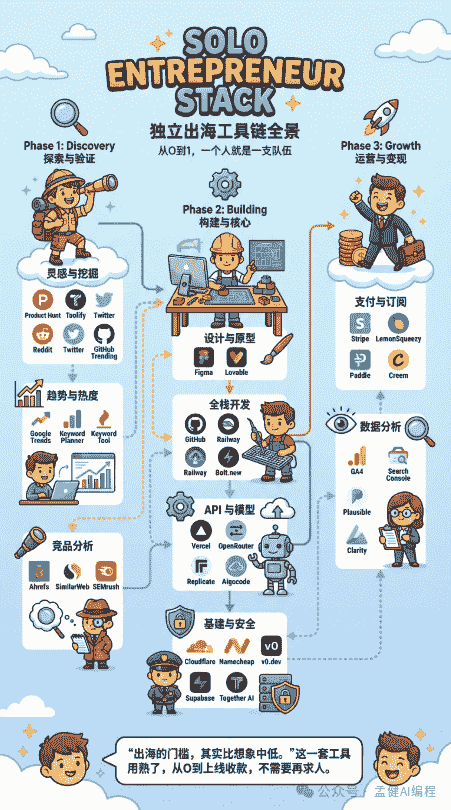

借助AI编程的杠杆，我们团队一个月里做了近30个小产品，已经练就了「3小时上站」的节奏，而且质量不算差。

竞品拆解:需求强、对手弱点清晰

结论:需求足够强烈，竞品登上了Google SERP第一页，但存在明显短板:

单一页面，SEO一般，样式AI味明显，而这就是我能够打败对手的地方。

MVP 策略：多个页面+优化样式+reddit冷启动

不过当时只有 3 个小时，所以我也决定先不对标那种大而全的游戏资讯站，时间不够，第二是遵循 MVP 思想，先验证市场需求，再完善产品。

于是，我快速做了一个非单页样式优化站点，而且对接了真实游戏道具装备数据表，我巧用reddit论坛，去里面找真实游戏数据，并通过优美设计UI后，呈现在我的网站上

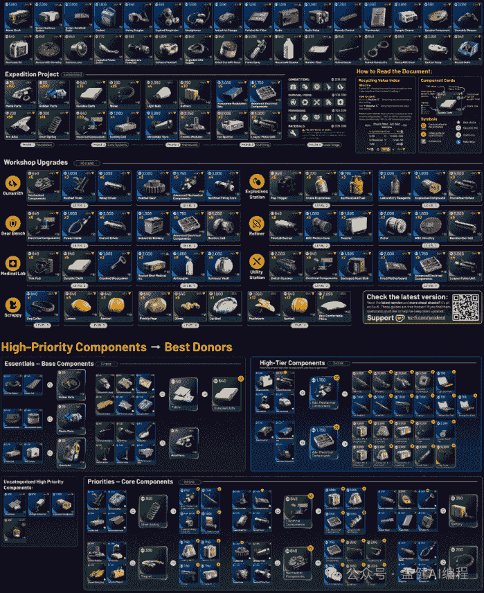

这是我认为和竞品拉开差距的地方，对面数据不是最新的，而且网站AI味明显。

我虽然并非官方咨询站，但是加了真实的 数据及优化界面，这样我就能看到有多少个用户对这个游戏资讯站真感兴趣了。

神奇的reddit，我的karma是7，在新号里权重算比较高的了

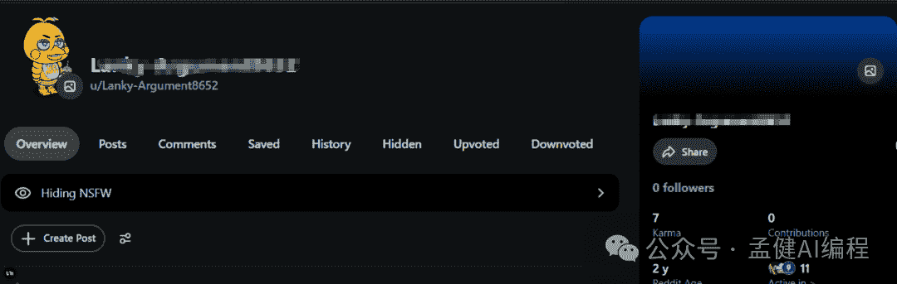

**AI优化UI**

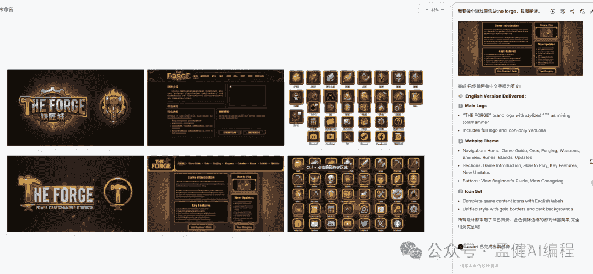

**真实用户**

这是一个真实欧洲用户给我发来的邮件

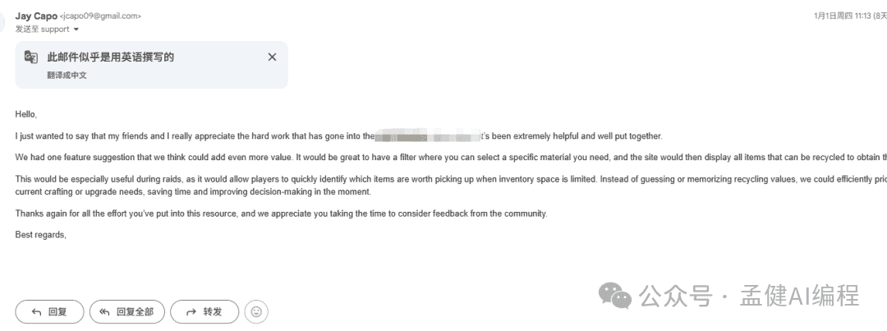

**不断迭代**

因为我这是个资讯站，所以为了保持持续流量，要和官方游戏资讯能达到信息同步，所以我只要有时间就每天迭代，这也是我能够稳定获取免费谷歌流量的原因

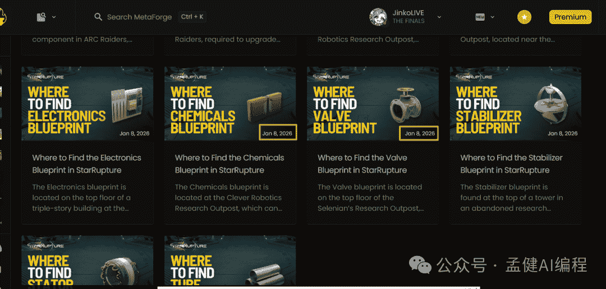

每天都及时上新，保持和官方论坛一致，现在AI编程加持，除了费算力，压根不需要我

# **六、未来规划**

孟健从深圳线下大会回来，给团队规划下步计划和工作重点，还是那句话，我们团队一直按照头部大厂管理自己，加上洋哥科学创业方法论，出海上站SOP.

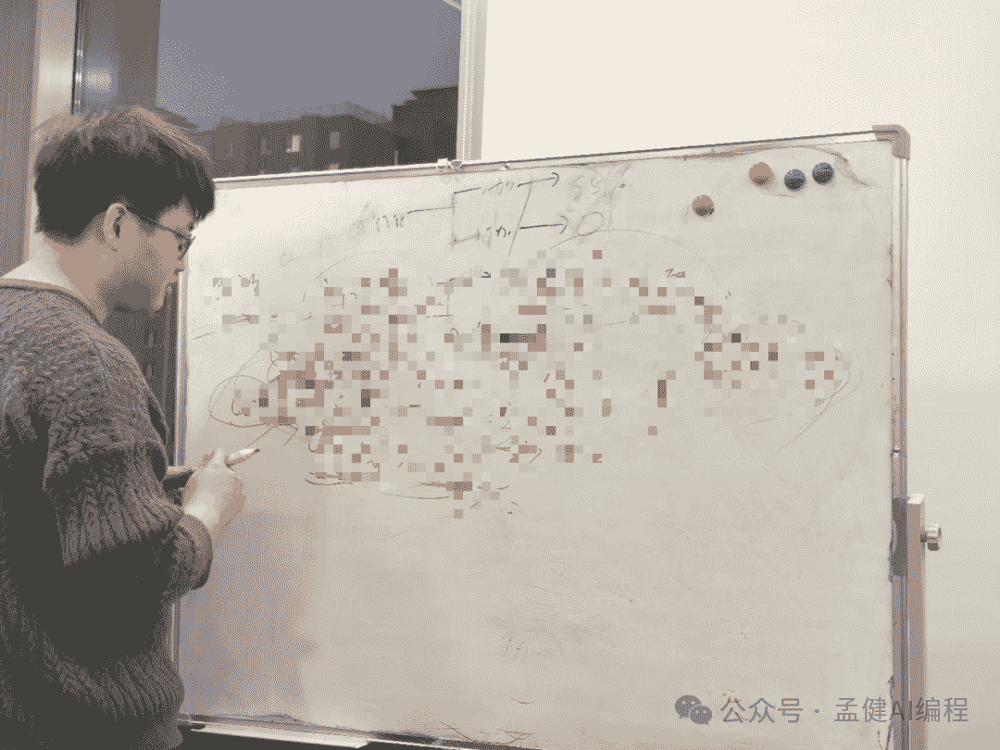

后面我们团队 ，会继续深耕AI编程出海赛道，争取工具化产品化自动化深入，并在后面带领破局圈友都能出海赚美刀，请大家耐心等待。

# **七、 AI编程现状及展望**

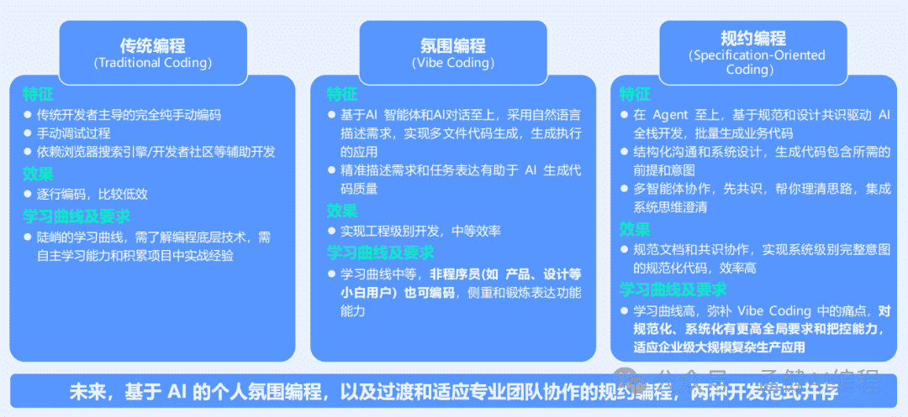

过去搞个网站是真麻烦。

你得先租办公室，养一堆程序员和产品经理，还得天天管人。这些场地、人力，说白了就是“生产资料”。这门槛，不知道卡死了多少牛逼的点子。

但现在不一样了。AI 来了，AI 编程来了，一个人、一台电脑、一个想法，就能干。你不用有钱，也不用带团队，坐家里就能把产品搞出来。

可问题是，有些人有商业头脑，但不会用 AI 编程，还是会被拦在门外。

而会 AI 编程的人呢，分两种：

+   要是自己也有好点子，直接动手，想法秒变产品；

+   要是自己没想法，那就去找有想法的人合作，帮人落地，一起搞钱。

AI 把这套生产资料，真正交到了普通人手里。

**腾讯预测**

AI编程正在引发一场深刻的效率革命。腾讯2025年的报告显示，其超过90%的工程师已在使用AI编程助手CodeBuddy，公司 50%的新增代码由AI辅助生成 ，这使得平均编码时间缩短了40%，整体研发效能提升超20% 。AI在代码评审环节的参与度也高达94%，能直接发现28%的代码缺陷，为产品质量加固防线 。具体到业务，腾讯云65%的新增代码来自AI助手，人均千行代码BUG率降低了31.5%；腾讯游戏的美术制作自动化率甚至达到了95% 。阿里云推出的“AI程序员”已能实现分钟级完成应用开发，哈啰集团接入后AI代码采纳率超过20% 。一些企业的实践表明，AI编程工具能将开发成本降低超过90%，效率提升显著 。

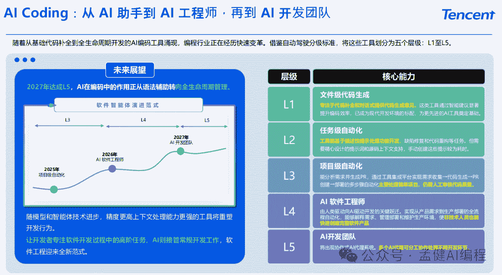

然而，我们必须清醒： **实现产品成功，编程只是第一步 **。AI目前仍难以精准“领会”复杂的、非标准化的业务需求，在架构设计、产品创新思维以及跨部门团队协作方面的作用依然有限 。工具易得，而 深刻的需求洞察、巧妙的产品规划与持久的运营能力 才是真正的壁垒。这恰恰需要“人”的深度思考、对业务的理解以及创造性的战略眼光 。

**最**后感谢洋哥，孟健的赋能，使我这个中年危机可能人生要废的老登，能够及时逆转，在25年末26年初，走通了闭环，后面继续和团队做大做强！