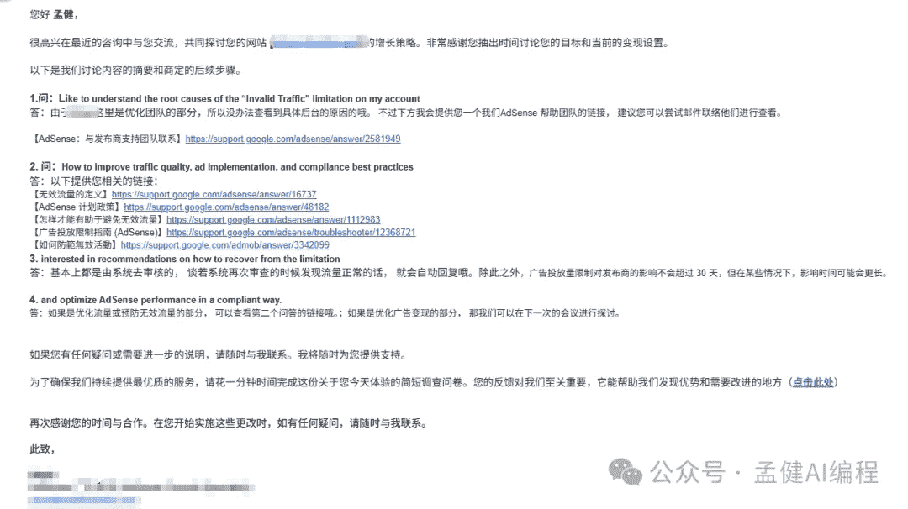
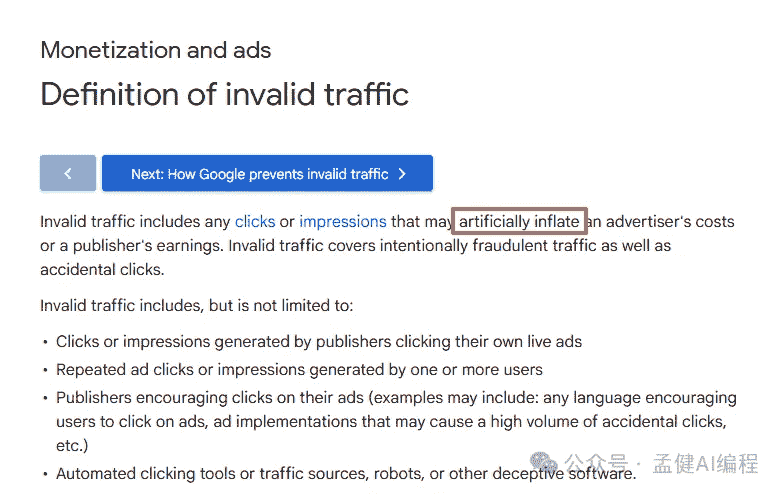
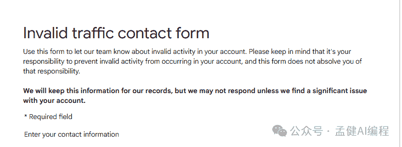
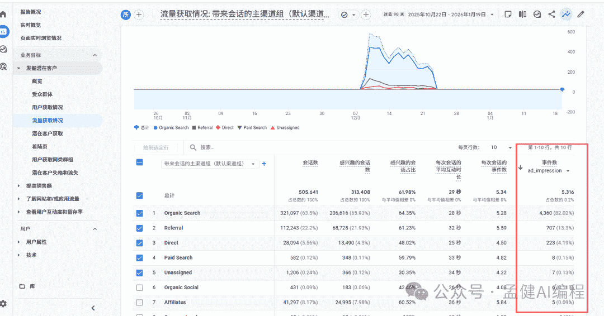
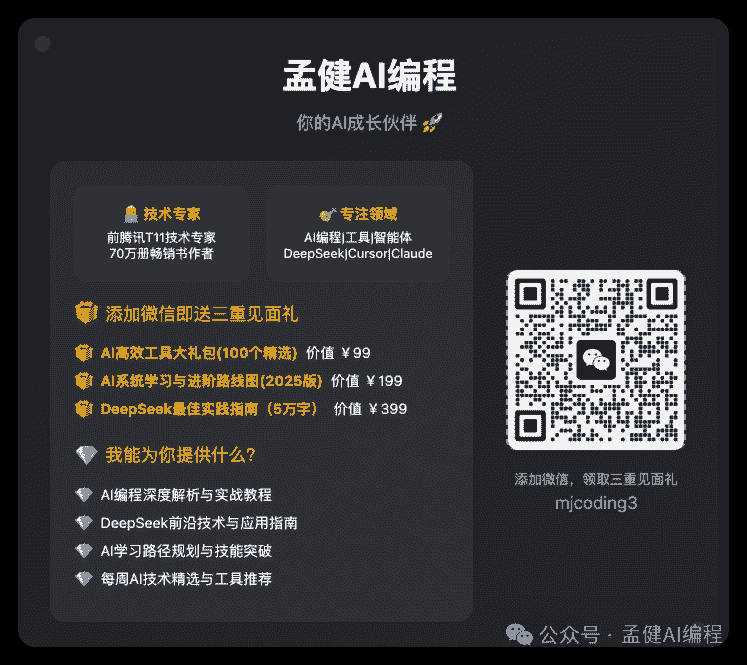

# AdSense 被判无效流量？官方聊完后我总结了 8 条避坑

> 来源：[https://xatc0v8uz5m.feishu.cn/docx/K0ZLdmTMtoGqeNxdPbOcHvIbnYb](https://xatc0v8uz5m.feishu.cn/docx/K0ZLdmTMtoGqeNxdPbOcHvIbnYb)

> 🔗 原文链接： h[ttps://mp.weixin.q](https://mp.weixin.qq.com/s/6_ylfk8_FBhrt0PDlOlpug)q.com/s/6_ylfk8_...

> ⏰ 剪存时间：2026-01-20 23:55:16 (UTC+8)

> ✂️ 本文档由 [飞书剪存 ](https://www.feishu.cn/hc/zh-CN/articles/606278856233?from=in_ccm_clip_doc)一键生成

原创 孟健的AI编程认知 孟健的AI编程认知 孟健AI编程2026年1月20日 21:18

大家好，我是孟健。

最近不少小伙伴应该都遇到过一种很“窒息”的情况：AdSense 突然提示 “无效流量（Invalid traffic）” ，然后广告展示被限制，收入也跟着断崖。

我今天专门和 AdSense 官方团队成员做了一次咨询交流，把他们的核心观点 + 我自己工具站的踩坑点，分享给大家。

# 1）先把概念说清：什么叫“无效流量”？

在 Google 的语境里， 无效流量更像是“结果导向”的**异常判断 ：只要广**告展示/点击出现了 不自然、不该发生 的增长，就可能被系统标记。

官方文档里有明确解释（建议你自己再读一遍原文）：

https://support.google.com/adsense/answer/16737

其中一个关键词是 artificially inflate ——本质就是：

任何 不符合“真实用户自然意图”的行为 ，只要可能让展示/点击/成本被人为放大，都可能被算作无效流量。

# 2）无效流量的两类来源：故意的 + 非故意的

A. 明确禁止：故意制造点击/展示

这类大家都比较熟，也是最典型的“作弊”。比如：

+   自己点击广告

+   请朋友/群友点击广告

+   机器人 / 脚本点击

+   买流量、刷量

+   点击农场

+   诱导用户点击（误导性的文案/按钮/提示）

咨询里也提到一点： **正规渠道的推广本身并不违规 **（例如 Google Ads 投流、社媒分享、合作推广）。

问题不在“你有没有花钱买流量”，而在于 流量是否真实、是否合法、是否会带来不自然的点击行为 。

我也提到了“工具导航站收录”这类来源。对方的态度比较谨慎：

+   不好一刀切判断；

+   但总体建议是： **流量尽量自然 **，越干净越稳。

B. 更容易踩坑：非故意的无效流量

更现实、也更常见的是：你本意并没想作弊，但你的页面结构、交互设计、流量结构，依然可能制造“误触/误点/异常”。

典型例子：

+   广告贴着「关闭」「下一步」这类按钮，用户误触

+   页面刚加载就弹插屏，用户还没看清就点到

+   手机端广告太靠近内容区域，手滑点到

+   用户频繁刷新页面（哪怕无意）

+   UI 设计让广告“看起来像内容”，用户以为是正文/功能入口

只要“有可能”导致成本或收入被人为放大，就属于无效流量。

谷歌对此的态度是：“结果”比“动机”更重要。

因为 Google 要保护的是 广告主的钱， 用户体验，整个广告生态。

如果只惩罚“故意作弊”，那 糟糕的设计、误触型产品、灰色增长 都会钻空子。

# 3）我自己的真实踩坑：自动广告对工具站并不友好

我也把我自己的工具站情况拿出来问了：

我开启了 AdSense 自动广告（Auto ads）后，一开**始发现自动插入的位置**会影响用户体验—— 主功能区被塞进广告 ，对用户来说很容易误触。

对方给的建议很直接：

+   对工具型站点来说， **用户体验优先**

+   广告位建议 **手动控制 **，不要让系统随意插

+   移动端 + PC 端都要分别检查 （很多问题只在移动端出现）

# 4）还有一种你控制不了的：被恶意刷（第三方/竞争对手）

不少人会担心：是不是被竞争对手恶意点了？

Google 确实有专门的系统来监测这种情况，官方说明在这里：

https://support.google.com/adsense/answer/1348752

他们除了自动检测，也有专门团队用技术手段追踪和分析行为模式，提升检测准确性，并持续更新防护机制。

如果你确实发现 **异常点击/异常来源 **，可以提交无效点击表单：

https://support.google.com/adsense/contact/invalid\_clicks\_contact

但这里也要把预期摆正：

+   表单开头明确写的： **责任依然在你身上**

+   提交并不等于“免责”，也不代表 Google 会回复

+   通常只有在他们认为账号确实存在重大问题时，才可能联系你

# 5）怎么预防：一套能落地的监控与排查方式

Google 给的建议核心就一句： 监控你的流量与广告数据，找出异常来源。

你可以重点看这些维度：

+   哪些国家/地区的流量突然异常

+   哪些页面/广告位的 CTR 异常偏高

+   展示/点击是否出现剧烈波动（短时间猛涨）

我个人建议再补一条： **把流量按渠道细分 **。

做法很简单：给不同渠道的链接加上 utm_* 参数，让 GA 能自动识别来源。

然后在 GA 里看「流量获取」相关报表：

如果 AdSense 和 GA 已经关联，你还可以在事件里重点看：

+   ad_click

+   ad_impression

这样你能对比出：到底是哪个渠道/哪波推广，把你的广告数据拉“异常”了。

发现异常后，你可以：

+   提交前面提到的无效点击表单，留下你的解释与证据

+   视情况处理合作渠道（联系渠道方排查/暂停投放/更换落地页）

# 6）关于“买量”：可以做，但别买垃圾流量

咨询里明确提到：Google 认可你通过各种方式推广网站、带来流量，包括付费流量，比如：

+   Google Ads

+   付费社交推广

+   合作推广

+   第三方流量服务

但前提永远是同一句话： **合法、真实、遵守政策。**

如果你用 Google Ads 投放，建议你重点关注质量分（Quality Score）。它会影响竞价排名，也间接反映流量质量。

一般核心是三块：

+   预计 CTR（广告是否足够吸引点击）

+   广告相关性（关键词/文案是否匹配）

+   落地页体验（承接需求、速度、可用性、内容一致性）

如果你买的是“低价、批量、来路不明”的流量，哪怕你**没亲自刷，系统也很可能判**定为无效流量， 责任最终仍会归到你身上 。

所以我自己的建议是：

**尽量不要买便宜外链、便宜流量。**

# 7）别用不恰当 SEO：骗一时，伤很久

一些“看起来能快速起量”的 SEO 手段，也可能让流量结构变得异常，从而放大无效流量风险，比如：

+   欺骗搜索引擎（Cloaking）

+   隐藏文本

+   关键词堆砌

+   AI 批量生成低质内容

Google 的反垃圾政策在这里（建议看官方中文版）：

https://developers.google.com/search/docs/essentials/spam-policies?hl=zh-cn、

面向用户和面向搜索引擎，应该呈现一致的内容；长期只靠真正解决用户需求。

# **8）最后的几条忠告**

这几条看起来很基础，但真的很多人会忽略：

+   **永远不要点击自己的广告 **（任何情况下都不要）

+   不要让朋友/同事帮你“点一点支持”

+   检查广告相关 SDK/代码逻辑，避免重复请求、异常渲染

+   定期检查广告位在移动端的可点击区域，避免误触

另外，对方还提到一个现实情况：

一旦被标记为无效流量，审核周期可能至少需要 1 个月。

并且通常是 **账号级 **的影响：也就是说，你账号下的站点可能都会被限制一段时间。

# 9）我的补充建议：什么时候上 AdSense 更稳？

如果你的网站还在冷启动，流量波动非常大，其实更容易触发系统的“异常”。

所以我更推荐的节奏是：

+   先把站点内容/产品打磨好

+   先做外链与运营，让 SEO 排名和自然流量相对稳定

+   再提交/开启 AdSense 变现

这样风险更可控。

以上就是这次咨询交流的主要内容，希望能帮你更快定位问题、少走弯路。

👉 推荐一个我一直关注的👸号：哥飞

如果你也在做 AI / 技术出海 / 个人项目，哥飞的很多思路都很实战，值得一看。

🚀 想要与更多AI爱好者交流，共同成长吗？

和一群志同道合的人，持续精进 AI 的每一天

**精选文章**

字流 2.0 发布：我把 14 个平台的发布流程压到 10 分钟

[出海收款门槛又低了：PayPal ](https://mp.weixin.qq.com/s?__biz=Mzk0ODM5NTEyNA==&mid=2247503579&idx=1&sn=9a27c0d31457c0ed4b633fa825f630ee&scene=21#wechat_redirect)支持个人卖家账户（亲测 30 分钟通过）

创业之后，一天只工作 8 小时，真的够吗

[出海圈都说好用的 Claude Skills，我用 C](https://mp.weixin.qq.com/s?__biz=Mzk0ODM5NTEyNA==&mid=2247503503&idx=1&sn=a7db40f9f58f13c0310b93608a9a1eb4&scene=21#wechat_redirect)odex 试了一遍：UI/UX 直接起飞

🌱 创业后，我的一天是这样度过的

AI 时代，程序员的“衡量标准”彻底变了

40+老登的出海复盘，纯靠广告自然流几天破百刀

[我终于把 AdSense 提现到国内银行卡](https://mp.weixin.qq.com/s?__biz=Mzk0ODM5NTEyNA==&mid=2247503458&idx=1&sn=2dccf13279698529f06f7b2dc95c12f4&scene=21#wechat_redirect)了（PIN 信/税务/电汇/结汇全流程）

[AI 出海市场洞察#3｜Gramm](https://mp.weixin.qq.com/s?__biz=Mzk0ODM5NTEyNA==&mid=2247503442&idx=1&sn=0530ba074fde0a454cca443c2181596c&scene=21#wechat_redirect)arly：老牌巨头的流量与变现全链路拆解

我被 Resend 封号了：踩了个大坑