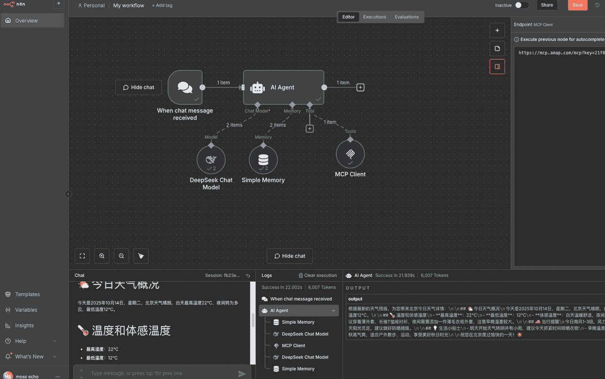
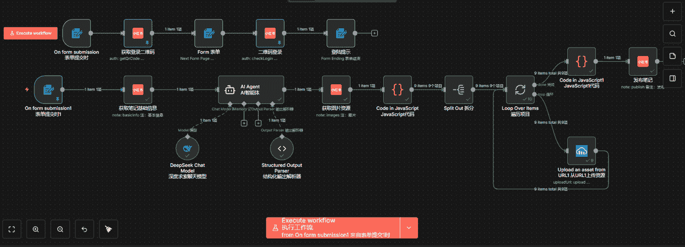

# 写作创作工作流

> 来源：[https://xatc0v8uz5m.feishu.cn/docx/Xy1EdlusjoBAQ1xee9Vco80GnCc](https://xatc0v8uz5m.feishu.cn/docx/Xy1EdlusjoBAQ1xee9Vco80GnCc)

让cursor、Trae来帮你写dify、扣子工作流

# 【AI编程神器Cursor】不止写代码，5种玩法让你全面提效，小白宝藏！

https://www.bilibili.com/video/BV1rRCVYREFm/?spm_id_from=333.1387.upload.video_card.click&vd_source=438ba78d5bb5b959271252c42c24ec66

提示词：中文-ai-味去除-5c

https://promptup.net/prompt/%E4%B8%AD%E6%96%87-ai-%E5%91%B3%E5%8E%BB%E9%99%A4-5c

# 我摊牌了，我的文案都是拿AI这样写的...【NotebookLM完整攻略】

https://www.bilibili.com/video/BV1vzw5e8EgF/?spm_id_from=333.1387.upload.video_card.click&vd_source=438ba78d5bb5b959271252c42c24ec66

乔木老师写作提示词

```
{## 乔木写作风格参考  v1

### 语言特质
- 口语化、对话感强，像和读者面对面聊天
- 善用生活化类比解释复杂概念
- 在专业性和可读性之间自然平衡

### 表达习惯
- 短段落，多留白，视觉舒适
- 重要观点用**加粗**突出
- 频繁用设问和&quot;你&quot;来制造互动感
- 要用中文逗号（，）不要加dash破折号
- **绝对不要用“不是”，“而是”，“想象一下”,&quot;你有没有想过&quot; 这种AI感表达**
- **绝对不要用破折号**

### 内容层次
- 不满足于表面解释，会延伸到更深的思考
- 善于在不同领域间建立联系（技术→生活→认知）
- 既讲&quot;是什么&quot;，也讲&quot;为什么重要&quot;

### 风格调性
- 真诚、不装、承认自己的困惑
- 专业但不掉书袋，数据和案例支撑观点
- 有洞察力，能给读者&quot;原来如此&quot;的感觉

### 待处理内容
{输入你的内容}

----

可以试试上面的提示词，新公众号，100关注时，写出过7000阅读量的文章。

但核心还是提供内容的好坏，人工review优化。

----
另外一个技巧，确实可以提供几篇你觉得好的文章，提炼语言风格为提示词来仿写。

----
关于去AI味和过朱雀检测，这个我研究不多，重点是用更新的模型，标点符号和表达措辞的微调。}
```

n8n



小红书图文仿写

