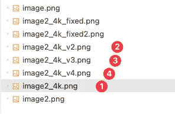
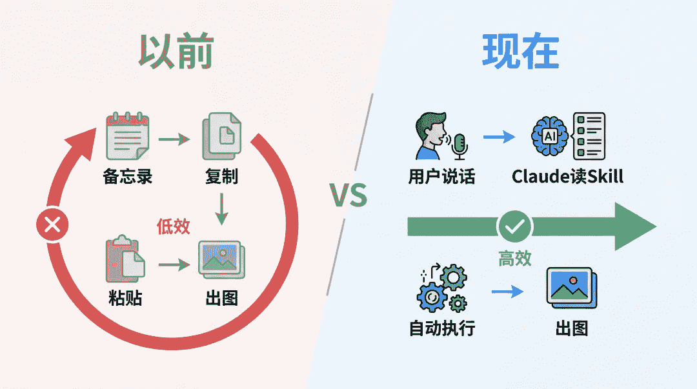
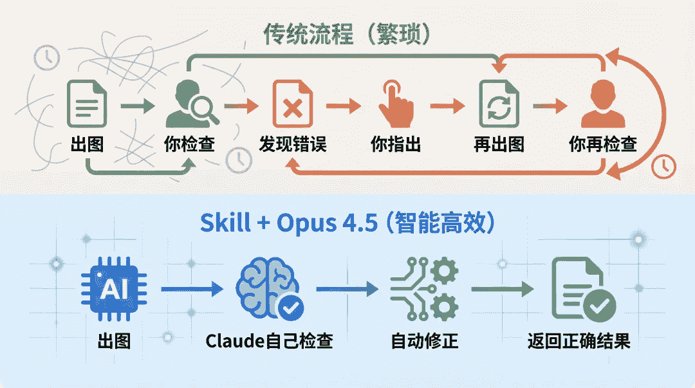
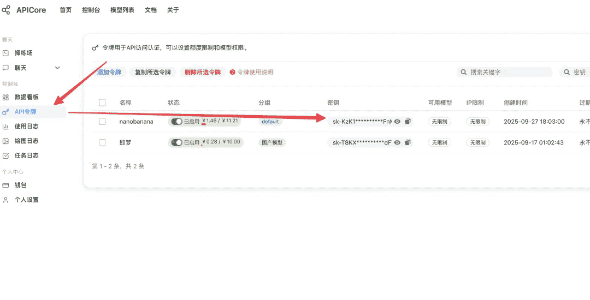
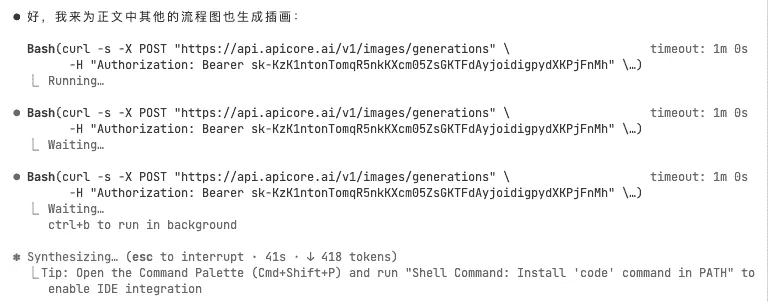

# Claude Code + Nano Banana Pro = 懂你的设计Agent，一句话就出图

> 来源：[https://xatc0v8uz5m.feishu.cn/docx/NECJdq8wQoCXOZxdShpcm390nhd](https://xatc0v8uz5m.feishu.cn/docx/NECJdq8wQoCXOZxdShpcm390nhd)

> 🔗 原文链接： h[ttps://mp.weixin.q](https://mp.weixin.qq.com/s/EdrXwc1_uE5nc5JWlkJE0Q?scene=1&click_id=13)q.com/s/EdrXwc1_...

> ⏰ 剪存时间：2025-12-12 18:49:28 (UTC+8)

> ✂️ 本文档由 [飞书剪存 ](https://www.feishu.cn/hc/zh-CN/articles/606278856233?from=in_ccm_clip_doc)一键生成

原创 我是成峰 AI产品自由2025年12月12日 07:05

试了一晚上各种作图工具，我突然想明白了：

最好的作图工具，是不用你动手的那种。

---

# **昨晚正愁死我了**

用 Nano Banana Pro 做了张封面，结果"爬楼"写成了"肥楼"。


肥楼封面


让AI改，整张图风格变了。

再改，文字成乱码。

又改，还是没改对。

改了4次，它才给我写对。


改图过程



后来我把摸出的方法写进Skill，再改这张图，一次就成功了。


成功


[不知道 Claude Code 是什么？看这篇](https://mp.weixin.qq.com/s?__biz=MzU3MjU5Mzc2Nw==&mid=2247486065&idx=1&sn=3a83f3aea0cb1093a696ced261501228&scene=21#wechat_redirect)： 没想到!Claude Code这样装,小白5分钟就能上手AI编程 ｜ CC保姆级教程

不知道 Skills 是什么？看这篇： Claude Skills 写作指南：从0到1看完就会，不会来找我

# **所以我做了个Skill**

我把 Nano Banana Pro 的 API 和我的作图方法论，封装成了一个 Skill。

你说一句话，剩下的它全干了：


流程图


为什么好用？

1.方法论有地方存了，还能自己优化

以前提示词存备忘录，踩过的坑下次还得踩一遍。

现在写进Skill，经验就沉淀下来了。

出图不对？你说一句，它就把方法论更新进去，下次不会再犯。

Lovart出图也强，但你的方法论没地方存啊。


对比图



2.它自己会检查

Claude Opus 4.5 真的很强！

会自己看图，对不对它自己知道。

发现问题，自己改。


智能执行



另外我会持续更新这个Skill到GitHub，你同步一下就能拿到最新方法。

# **怎么用？2步搞定**

## 1.先搞个API Key

Nano Banana Pro 模型，4K图才1毛8一张。

https://ismaque.org/register?aff=npk7

注册一下，充5块钱，把Key复制出来。重新优化一下这个风格


注册页面



## 2.让Claude帮你装

把这段话丢给Claude：

```
帮我安装生图Skill：
- 地址：https://github.com/Ceeon/gemini-image-skill
- 路径：~/.claude/skills/gemini-image
- API Key：[你的Key]
```

记得把Key填进去。

重启Claude Code，说"画一张xxx"，就能用了。

# **还能这么玩**

一次出多张图 ：要好几张图？它会同时调API，并行生成，不用一张张等。


并行出图



Skill组合 ：写作Skill + 出图Skill，说一句"写篇文章配个封面"，全给你整好。


多Skill组合


提示词不用存备忘录了。

踩过的坑不用再踩。

说一句话，整套流程它自己就跑完了。

这就是Skill——让你的经验有个家。

我这个文章里的所有流程图，就是"一键完成"的。

