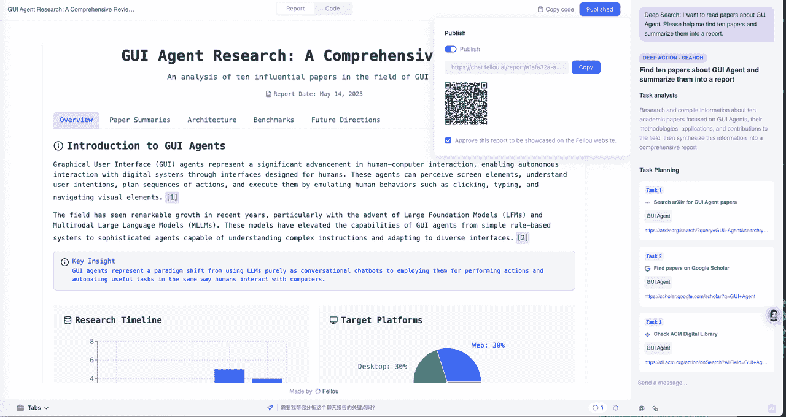
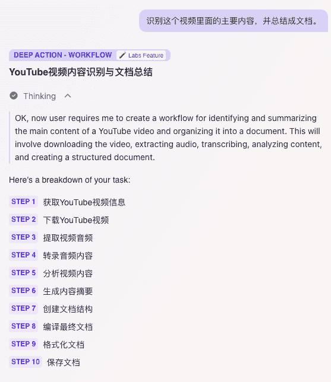
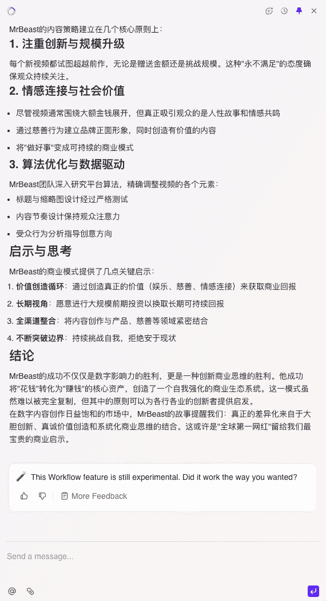
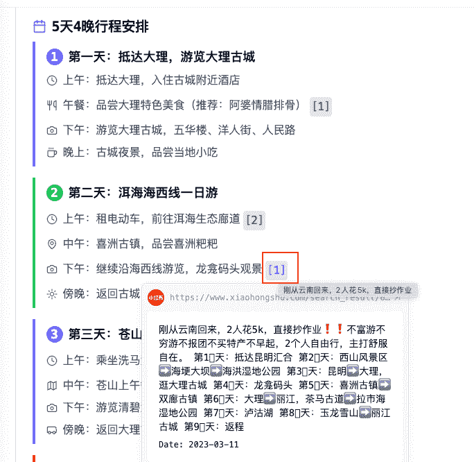

# 最强AI浏览器Fellou来啦

> 来源：[https://xatc0v8uz5m.feishu.cn/docx/UAS8dxSkUozyE8xnln7cms85nlg](https://xatc0v8uz5m.feishu.cn/docx/UAS8dxSkUozyE8xnln7cms85nlg)

## 标题

精致打工人，用精致AI 浏览器Fellou

## fellou介绍

什么是fellou ai 浏览器

https://fellou.ai/

和传统浏览器有什么区别

## 主要功能

摘要网页内容

深度搜索

执行工作流程

## 能力测试

## 测试项目

如何在5000预算内计划一次大理旅行？

### 总结视频内容

视频内容识别，执行步骤的时候

会卡在某个节点当中，并且一直循环，没有办法得很好理解，

在我以为它会失败的时候，它最后完成了这个任务。

## 总结

优点

作报告的界面效果很漂亮

多界面并行，运行速度较快

可以分开多个窗口多线并行使用浏览器

有界面视觉分区识别

做的报告中有引用源，能快速查到对应的来源

缺点

数据不准确，例如粉丝数量等数据细节不精确

登录账号查询相应账号讯息还不会准确，例如查找社交账号上的最新内容

测试展示

https://chat.fellou.ai/report/cd119f0b-2056-4818-917f-46169aa8c109