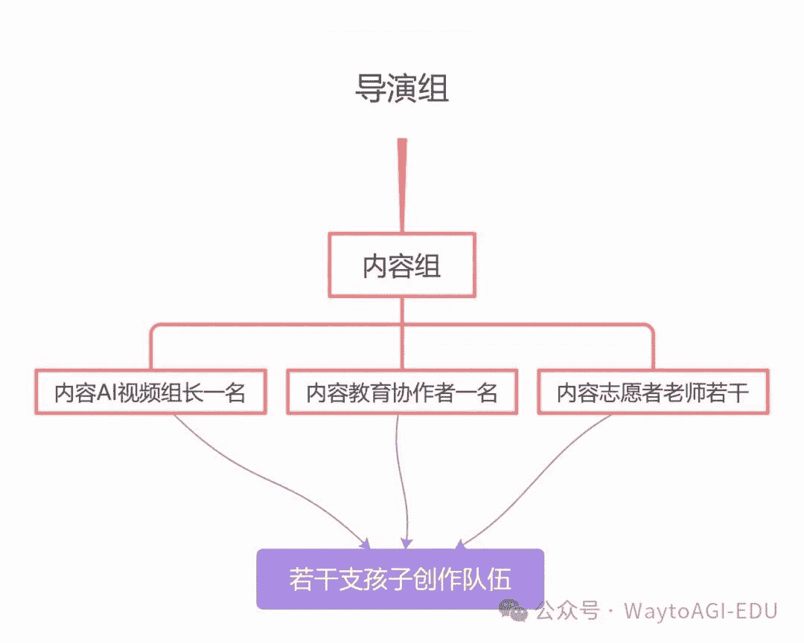
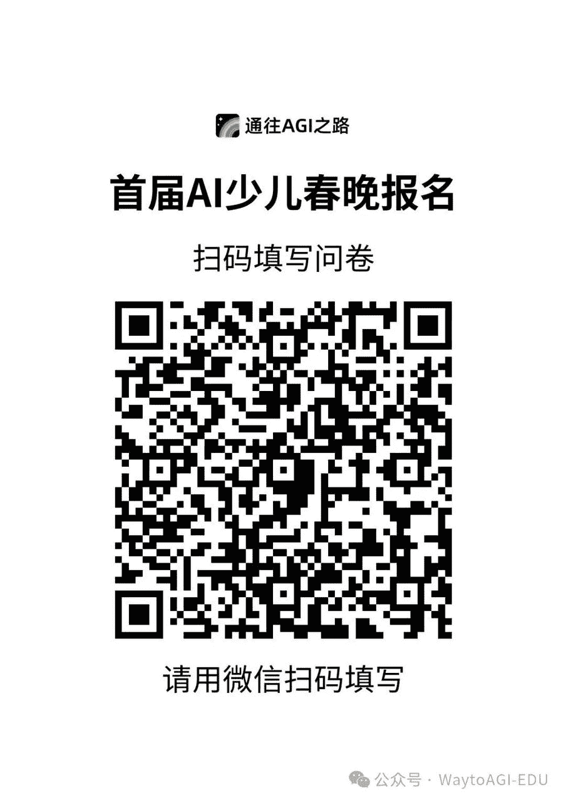

# WaytoAGI首届 「儿童AI春晚」：共创团队持续招募中

> 来源：[https://xatc0v8uz5m.feishu.cn/docx/RFjkdoa9JomZM9xN2ldcN29Nn0c](https://xatc0v8uz5m.feishu.cn/docx/RFjkdoa9JomZM9xN2ldcN29Nn0c)

> 🔗 原文链接： h[ttps://mp.weixin.q](https://mp.weixin.qq.com/s/3zlGEKr9XpdAI5vGIrwsPg?scene=1&click_id=12)q.com/s/3zlGEKr9...

> ⏰ 剪存时间：2025-11-06 00:18:14 (UTC+8)

> ✂️ 本文档由 [飞书剪存 ](https://www.feishu.cn/hc/zh-CN/articles/606278856233?from=in_ccm_clip_doc)一键生成

原创 WaytoAGI教育版 WaytoAGI-EDU2025年11月5日 20:33

**🌈WaytoAGI**教育板块正在筹备首届 「儿童AI春晚」 ：

我们计划将用120分钟 ， **以小孩子创意和作品为中心 **——呈现一场科技与童心的交响。

70个由孩子主导的AI视频作品，

我们想让孩子们的 AI 创意 ，被世界看见。

这绝不仅是一场晚会，而是一个大型AIGC内容共创项目。

这件事很难，但很酷。

###  **节目内容怎么构成？ **

1.  **【锦绣山河】 **｜AI+文旅：孩子眼中的祖国山河

1.  **【文脉新传】 **｜AI+非遗：用AI续写神话、传统

1.  **【星光“童”行】 **｜AI+“星”孩：关注特殊儿童的AI表达

1.  **【温暖日常】 **｜AI+生活：藏在小事里的爱与奇思

1.  **【“智”造未来】 **｜AI+硬件：孩子设计的机器人、智能体

1.  **【逐梦星海】 **｜AI+航天/科学：向宇宙提问的小小科学家

1.  **【自由创想区】 **｜ 无论是ip二创，还是天马行空，主题不限，创意无限

1.

> 📌 所有作品必须有儿童参与，主要来自四大渠道：

+   纯孩子创作

+   亲子共创

+   师生共创

+   学校/机构推荐

##  **共创团队持续招募邀请中 **

1️⃣ **内容制作组｜故事导演**

+   一共分9组，每组招募 1位AI视频组长 + 1位教育协作者+若干名志愿者老师

+   每组负责10分钟时长节目（含7个孩子作品）

+   从六大主题篇章中选题 + 自由创想，引导孩子明确创作方向

+   提供技术指导、初审内容、把控导向、确保孩子主导

2️⃣ **美工设计组｜视觉灵魂**

+   设计主视觉、海报、直播封面、收录证书、邀请函、片头片尾等

✅ 要求：熟练使用设计工具，风格温暖有童趣。

3️⃣ **宣传推广组｜社区桥梁**

+   运营春晚📕/视频号/👸号

+   撰写媒体通稿、制作预热素材、组织社区扩散

✅ 要求：熟悉新媒体传播，会讲故事

4️⃣ **技术支持组｜幕后基石**

+   直播间搭建、推流、导播、视频剪辑、作品归档

✅ 要求：有直播或视频技术经验，责任心强，能应对突发状况

5️⃣ **外联与公益组｜资源纽带**

+   对接学校、教育机构、科技企业、公益基金会

+   协调实物奖励、赞助支持、合作授权（如动画IP）

✅ 要求：沟通能力强，有项目合作经验

###  **🎁 你将获得： **

我们知道，这是一次巨大的挑战。 我们也相信，这是一份无上的荣耀，所有参与共创的工作人员，都将获得：

+   WaytoAGI 官方 **共创证书**

+   录入 **社区教育板块【鹿友人才库】**

+   春晚片尾 **署名致谢**

+   深度参与 **儿童AI教育实验 **的一线经验

+   与跨领域教育创新者共建社区，共同进步

---

在AI时代，最**好的教育不是**教孩子使用工具，

而是守护他们用工具说出自己的故事。

而是利用工具 如何成为自己

这一次，我们邀请所有关心AI教育的大家

和WaytoAGI教育板块一起，做那个守护者。

和我们一起，做一件“很难，但很酷”的事。

我们，在等你。